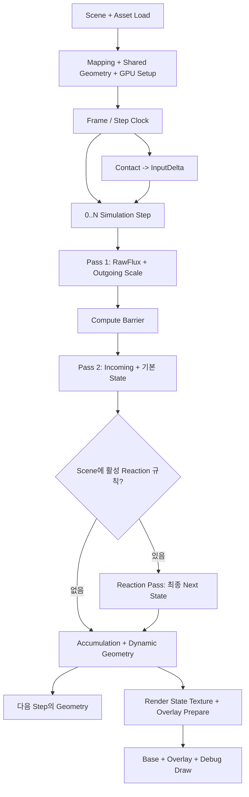

# Flows — 실행 흐름 지도

이 폴더는 **실제 실행 순서와 데이터 이동**을 다룬다. State 의미·수식·GPU ABI의 정본은 [[02_Architecture/01_Contracts/01_State-and-Profile|Contracts]]에 있고, 구현 파일 위치는 [[02_Architecture/02_Source/00_Source-Map|Source]]에서 찾는다.

> **C++ 상위 경로:** `FApplication::MainLoop` → `FRenderer::RenderFrame` → `FRenderer::RecordCommandBuffer`. GPU 패스 실행 순서는 아래 흐름과 [[02_Architecture/03_System-Map|System Map]]을 참고한다.

## 전체 실행 경로

## 문서 목록

| 구간 | 작은 단위 문서 | 핵심 경계 |
|---|---|---|
| 01 Initialization | [[02_Architecture/00_Flows/00_Initialization/00_Scene-Load|Scene Load]] · [[02_Architecture/00_Flows/00_Initialization/01_Surface-Build-and-GPU-Setup|Surface Build]] | 정적 전처리와 instance GPU 준비 |
| 02 Frame | [[02_Architecture/00_Flows/01_Frame/00_Frame-and-Step-Scheduling|Step Scheduling]] · [[02_Architecture/00_Flows/01_Frame/01_Contact-to-InputDelta|Contact]] | 프레임 시간과 실제 step·입력 소비 시점 |
| 03 Simulation | [[02_Architecture/00_Flows/02_Simulation/00_Step-Overview|Overview]] · [[02_Architecture/00_Flows/02_Simulation/01_PreStep-and-Sparse-Scheduling|Pre-Step]] · [[02_Architecture/00_Flows/02_Simulation/02_Flux-Pass1|Pass 1]] · [[02_Architecture/00_Flows/02_Simulation/03_Gather-Pass2|Pass 2]] · [[02_Architecture/00_Flows/02_Simulation/04_Accumulation-and-Geometry-Feedback|Geometry Feedback]] | GPU pass와 barrier, State A/B |
| 04 Rendering | [[02_Architecture/00_Flows/03_Rendering/00_Render-Overview|Overview]] · [[02_Architecture/00_Flows/03_Rendering/01_Render-State-Texture|State Texture]] · [[02_Architecture/00_Flows/03_Rendering/02_Texel-Overlay-Preparation|Overlay]] · [[02_Architecture/00_Flows/03_Rendering/03_Draw-and-Debug|Draw & Debug]] | 렌더 전용 파생값은 Solver로 되돌아가지 않음 |

## 조사 순서

1. 문제가 발생한 **단계**를 고른다.
2. 해당 단계에서 **읽기/쓰기 resource**와 다음 소비자를 확인한다.
3. Source 문서에서 owner와 entry point를 찾아 코드를 읽는다.
4. 값의 정합성은 Contracts, 검증 방법은 [[05_Experiments/01_Validation-and-Tests|Validation]]에서 확인한다.

> 주요 구성 관계는 [[02_Architecture/03_System-Map|System Map]]을 참고한다.
