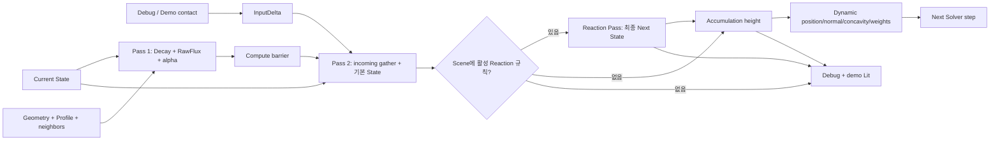
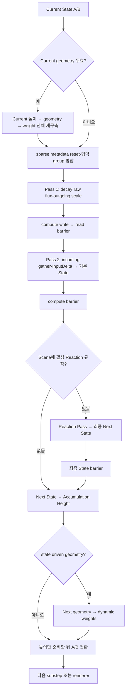

# Simulation Step Overview

각 실행 step의 전체 순서만 정의한다. 수식·저장 ABI는 계약 문서에서, 셰이더 파일과 C++ 소유자는 Source에서 확인한다.

**연결 문서**
- [[02_Architecture/00_Flows/02_Simulation/01_PreStep-and-Sparse-Scheduling|Pre-Step]]
- [[02_Architecture/00_Flows/02_Simulation/02_Flux-Pass1|Pass 1]]
- [[02_Architecture/00_Flows/02_Simulation/03_Gather-Pass2|Pass 2]]
- [[02_Architecture/00_Flows/02_Simulation/04_Accumulation-and-Geometry-Feedback|Geometry]]

## 한 Solver Step과 Geometry Feedback

`InputDelta`는 첫 Pass 2에서 한 번 소비한다. Pass 1은 가용량 이상을 보내지 않도록 outgoing을 제한하고 Pass 2가 초과 Capacity까지 포함한 기본 State를 계산한다. Scene에 활성 Reaction 규칙이 하나라도 있으면 별도 pass가 Profile별 규칙을 적용해 최종 Next State를 기록한다. State-driven geometry가 ON이면 파생 형상은 **다음** step의 수송·Decay에 들어간다. OFF이면 정적 형상과 CPU 가중치를 쓴다. Raw Flux cache와 sparse 실행은 결과식이 아닌 실행 경로의 선택이다. [[02_Architecture/01_Contracts/04_Solver|Solver]]

## 실제 명령 순서

[`FSurfaceStateSystem::RecordStep`](../../../../../Source/SurfaceState/Solver/SurfaceStepRecording.cpp)는 active instance마다 현재 A/B, texel/channel 수, 모델 행렬, gravity, 입력 활성화 및 Solver flags를 `FSurfaceSolverInstanceStep`에 담는다. Transform·설정 변경으로 transfer weight cache가 무효화되면 CPU에서 다시 계산해 업로드한다. [`FSurfaceStateSolver::RecordSteps`](../../../../../Source/SurfaceState/Solver/SurfaceStateSolver.cpp)는 instance들을 단계별로 묶어 dispatch하며, 출력 버퍼가 다음 shader·indirect command에서 읽히기 전에 barrier를 기록한다.

## Pass별 입출력과 조건

| 단계 | shader와 주요 읽기 → 쓰기 | 조건 |
|---|---|---|
| 선행 재구축 | `SurfaceAccumulationHeight` → `SurfaceDynamicGeometryUpdate` → `SurfaceDynamicWeightsUpdate`: Current State → 현재 geometry·weight | reset, profile/transform 변경 등으로 현재 geometry가 무효화되었을 때 full dispatch |
| schedule reset | `SurfaceSparseScheduleReset`: persistent activity·CPU 입력 group → 현재/다음 schedule | sparse solver·active mask·geometry scheduling 사용 시 |
| Pass 1 | `SurfaceSolverPass1`: Current State·Profile·Geometry·Weight → RawOutgoing·OutgoingFluxScale·선택적 flux cache | source의 decay와 전송 가능량 계산 |
| Pass 2 | `SurfaceSolverPass2`: Current State·이웃 출력·InputDelta → 기본 State 또는 Next State | target에서 incoming을 gather하고 입력을 한 번 반영. Scene에 활성 Reaction 규칙이 있으면 기본 결과를 scratch에 기록 |
| Reaction Pass | `SurfaceReaction`: 기본 State·positive Input·Incoming → 최종 Next State·다음 activity | Scene에 활성 규칙이 하나라도 있으면 실행. texel의 Profile에 규칙이 0개면 기본 State를 복사 |
| 후행 파생값 | `SurfaceAccumulationHeight`, 필요한 경우 두 Dynamic shader: Next State → 높이·다음 geometry·weight | 다음 step 및 renderer가 새 결과를 읽도록 준비 |

## Step 종료, 다음 소비자

연구용 opt-in flag bit 26은 동적 geometry 갱신을 멈추고 flux의 target 위치도 저장된 DynamicGeometry에서 읽는다. bit 27은 높이 dirty tolerance를 생략하고 매 step 전체 파생 geometry 재계산을 요청한다. 둘은 연구 도구가 명시적으로 선택하며 제품 기본값에는 포함하지 않는다. bit 28의 반응량 장부는 Local Reactions 계약을 따른다.

`SetInitialInputReadbackObserver`는 CPU contact rasterization 뒤 첫 Solver dispatch 전에 한 번 호출하는 읽기용 observer다. benchmark의 `authoring_checkpoint_steps`는 양수·오름차순·중복 없는 Solver serial 목록이며 `capture_image=true`와 Scene 참조가 필요하다. 지정 step의 같은 command buffer에서 캡처한 이미지와 GPU idle 후 State/geometry를 함께 저장한다. 초기 snapshot은 rasterized InputDelta와 Current State를 포함하고 초기 렌더 이미지는 포함하지 않는다. `authoring_instance_id` 기본값은 `b_heated`다. benchmark `geometry_feedback`은 기본 true이며 명시적 false도 반영한다.

`RecordSteps` 이후 `FSurfaceGPUResourceManager::AdvanceCurrentState`가 A/B 방향을 뒤집고 입력 활성화 플래그를 정리한다. geometry OFF에서는 Solver용 동적 geometry 갱신을 생략하지만 마지막 substep에서 표시용 높이를 만들 수 있다. sparse dispatch는 metadata의 indirect command를 소비하고, full 경로는 texel 수에 따른 workgroup을 dispatch한다. 둘의 수식 의미와 buffer ABI는 [[02_Architecture/01_Contracts/04_Solver|Solver]]와 [[02_Architecture/01_Contracts/05_GPU-Layout|GPU Layout]]이 기준이다.

## 변경 시 함께 추적할 위치

| 변경 | 생산자 | 소비자 |
|---|---|---|
| 시간·substep | `FrameCoordinator.cpp`, `SimulationClock.h` | `SurfaceStepRecording.cpp` |
| Contact 범위·적용 | `SurfaceContactApplication.cpp` | `SurfaceSolverPass2.comp`, sparse 입력 group |
| Flux·Decay | `SurfaceSolverPass1.comp`, `SurfaceSolverPass2.comp` | scratch layout, `SurfaceStateSolver.cpp` barrier |
| Reaction | `SurfaceReaction.comp`, `ProfilePacking.cpp` | 반응 table·scratch, 최종 State와 sparse schedule |
| State 기반 형상 | `SurfaceAccumulationHeight.comp`, 두 Dynamic shader | 다음 step과 렌더 overlay |
