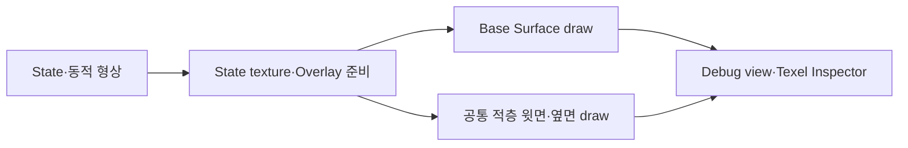
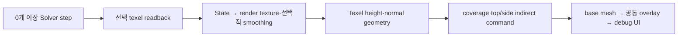

# Rendering Flow Overview

> 렌더링은 Solver 결과를 관찰하는 경로다. 표시용 smoothing·색상·높이 배율은 다음 Solver step의 State나 Geometry에 피드백하지 않는다.

**연결 문서**
- [[02_Architecture/00_Flows/03_Rendering/01_Render-State-Texture|State Texture]]
- [[02_Architecture/00_Flows/03_Rendering/02_Texel-Overlay-Preparation|Overlay]]
- [[02_Architecture/00_Flows/03_Rendering/03_Draw-and-Debug|Draw / Debug]]

## 전체 실행 흐름

## Solver 형상과 화면 형상

State-driven geometry는 지원되는 모든 적층 State의 Capacity 제한 기여를 합산해 실제 Solver용 `AccumulationHeight`를 만든다. 이 값에서 instance별 동적 위치·normal·오목도·TransferWeight를 갱신한다. `Lit height display scale`은 화면의 형상 높이만 조절한다. 계산식은 [[02_Architecture/01_Contracts/03_Geometry#Accumulation Height|Geometry]], step 순서는 [[02_Architecture/01_Contracts/04_Solver|Solver]]가 기준이다.

렌더러는 원본 Mesh를 Base Surface로 유지하고, 같은 정적 texel topology 위에 공통 `H_total` 윗면과 경계 옆면을 만든다. 별도의 물리적 다중 layer stack은 없다. Meso·Accumulation·Final Geometry debug view는 texel 연결면을 보여준다. Accumulation 미리보기는 선택 State만 보지만 Solver 형상은 모든 지원 State의 합이다.

## 현재 데모 외관

데모 adapter는 Registry에서 `heat`, `mud`, `waterfilm`, `lava`, `ice` channel을 조회한다. Heat는 base albedo를 붉은색으로 보간한다. Mud·WaterFilm·Lava는 공통 윗면에서 합성하며 물이 Mud 위에 있으면 shader가 한 RGBA 결과로 결합한다. Mud 절차적 범프, WaterFilm opacity, color ramp와 smoothing은 렌더링 전용이다. 원본 Normal Map을 Overlay에 중복 적용하지 않는다.

State Heatmap은 `State / Capacity`를 표시하며 100% 초과를 구분한다. 렌더링의 `[0,1]` 제한은 저장량이나 전달용 Saturation에 적용하지 않는다. 실제 State·Capacity·world area·적층량은 Texel Inspector에서 확인한다. [[02_Architecture/01_Contracts/01_State-and-Profile|State 계약]]

범용 State ID→외관 규칙, 물리적 다중 layer와 환경 조명은 현재 구현되지 않았다. 따라서 데모 효과를 모든 Profile에 적용되는 일반적인 물성 모델로 해석하지 않는다.

셰이더 진입점과 include는 [[02_Architecture/02_Source/01_Shaders/02_Surface-Rendering|Surface Rendering]]과 [[02_Architecture/02_Source/01_Shaders/01_Overlay/00_Index|Overlay]], C++의 기록·소유 경계는 [[02_Architecture/02_Source/00_CPP/06_Rendering|Rendering C++ 지도]]를 따른다.

## Command Buffer 전체 순서

[`FRenderer::RecordCommandBuffer`](../../../../../Source/Rendering/Core/RendererCommands.cpp)는 command buffer를 연 뒤 `FrameCoordinator.RecordSimulation`을 먼저 호출한다. 여러 substep이 있다면 마지막까지 기록하고 A/B 방향을 바꾼 뒤, 현재 State에 대해 Inspector·State texture·overlay compute·graphics draw를 차례로 기록한다. CPU 측 `RenderFrame`은 image acquire, 제출과 present를 담당한다.

## C++ RecordCommandBuffer 검증된 조건

`RendererCommands.cpp`는 `FrameCoordinator.RecordSimulation` 다음 Inspector→ViewMode 검사→Lit state-texture(선택)→texel preview/overlay compute(선택)→graphics pass를 순서대로 기록한다. Lit view가 없거나 demo effect가 꺼져 있을 때 전체 display compute를 항상 실행한다고 설명하지 않는다. overlay는 `CanRenderLitOverlays()` 및 instance의 공유 texel mesh/index/descriptor 유무도 검사한다.

Ice는 별도 다섯 번째 재질로 서리 noise·푸른 산란색·유전체 반사를 사용한다. 기존 RGBA texture는 그대로 두고 `ExtraDemoBindings.z`의 Ice ID로 State buffer를 sample한다. Mud/WaterFilm/Lava/Ice의 네 적층 채널이 occupancy·coverage·smoothing에 참여하며, 최종 공통 윗면에서 물을 합성한다. 자세한 예제는 [[02_Architecture/01_Contracts/06_Reactions|Local Reactions]]를 따른다.

상위 C++ 기록 함수의 책임 분리(2026-11-09)는 [Rendering Source](../../02_Source/00_CPP/06_Rendering.md)의 Command recording 경계를 따른다. 위 pass 순서와 GPU 계약은 유지하며 별도 리팩터링 함수 경계로 탐색한다.
