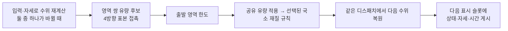

# Surface Simulation 상태·형상·GPU 계약

## 접촉·퇴적·수송 세분화

접촉 모델은 수송을 확정한 직후 물 질량에서 수위를 복원한다. 여기에 잠긴 형상 샘플의 차트 투영 면적을 합산한다. 기울어진 샘플의 중심 수심이 $d$, 표본 반쪽의 중력축 높이 차이가 $a$이면 잠긴 비율은 $\operatorname{clamp}((d+a)/(2a),0,1)$이다. 수평 표본은 양의 수심에서 전 면적을 기여한다. 혼합은 같은 영역에 혼합 대상인 흙이나 진흙이 있을 때만 계산한다. 바닥 흡수의 기존 1차 계수는 젖은 면적 비율을 곱하고, 강철의 접촉 냉각은 같은 접촉 면적에서 국소 수심에 비례해 열전달을 완화한다. 0.25 mm 이상인 곳에는 설정된 접촉 계수를 전부 적용한다. 새로 녹은 물은 다음 스텝의 접촉 면적에 포함된다.

다층 저장 영역에는 총질량 [kg], 수위 [m], 혼합수 질량 [kg]을 저장한다. 고형분은 총질량에서 혼합수를 뺀 값이다. 같은 면을 통해 두 성분이 공여 영역의 조성비대로 이동한다. 진흙의 건조는 남은 혼합수에 대한 1차 감소이며, 감소분을 기화와 같은 질량 장부에 기록한다. 자유수와 다시 접촉하면 흙 질량당 혼합수 한도까지 재습윤한다. 물성은 건조·습윤 상태 사이에서 점도와 항복응력을 보간한다. 두께와 체적은 재질의 고정 벌크 밀도를 사용하는 축약 모델이다.

각 형상 표본에서 기준 바닥과 질량이 있는 아래층의 복원된 윗면 중 높은 쪽을 수송용 바닥으로 쓴다. 기존 영역 연결마다 양쪽 유효 바닥의 최댓값이 통과 턱이다. 유효 높이는 시간이 지나며 바뀌고 초기 물 저장 영역과 연결은 고정한다. 하나의 기존 영역 안에 새로 생긴 둑이 홈을 둘로 가르는 경우는 이 저장 구조의 적용 범위를 벗어난다.

씬의 선택 속성 `transportSubsteps`는 1, 2, 4, 8을 허용하며 기본은 1이다. 고정 스텝 1/240초 내부에서 수송과 수위 복원을 반복한다. 외부 급수와 국소 반응은 각 고정 스텝에서 한 번 처리하고 열린 경계 유출은 각 수송 구간에 반영한다. 다회 단일 액체 수송은 전체 디스패치로 실행한다. 표시 스냅샷은 최종 수위, 실제 체결된 월류의 누적 질량과 마지막 통과 시각, 반응 직전 접촉 영역, 렌더용 피복 수위 및 수송용 바닥을 제한하는 아래층의 수위를 읽는다.

`substrateStorage`는 바닥 상태 ID별로 설정한다. 흡수수 필드에는 저장 상한 `capacityKgM2`를 둔다. 온도 필드에는 유효 두께 `effectiveThicknessM`를 둘 수 있고 재질의 `thermal.densityKgM3`와 `thermal.specificHeatJkgK`를 곱해 면적당 열용량을 얻는다. 온도는 K로 계속 저장한다. `SubstrateQuench` 상호작용의 접촉 계수와 바닥의 열 여유가 열 교환을 제한한다. 가열 수로의 기존 인라인 면적당 열용량과 접촉 계수도 읽는다.

[설계 결정](../../03_Decisions/00_Records/ADR-0002-Surface-Contact-and-Coupling.md) · [검증과 캡처](../../05_Experiments/05_Surface-Physics-Comparison.md)

## 다층 박막 프로파일

객체로 선언한 `states.layer`를 아래에서 위로 읽는다. 층은 물리 재질의 상과 색을 참조하고 저장 영역별 kg를 갖는다. 초기 피복은 `initialFilm` 직사각형과 겹치는 표본 면적으로 배분한다. 한 프로파일은 최대 여덟 층을 지원하며, 최상단 액체는 기존 수면 렌더와 급수 경로에 연결한다.

다층 프로파일의 `states.layer`는 수송과 `Layer States` 및 `Layer Thickness` 등록에 함께 쓰인다. `id`, `displayName`, `color`, `displayMax`, `thicknessDisplayMaxMm`를 같은 층 정의에서 읽는다. `color`는 실제 피복 렌더링에 쓰인다. 상태 진단은 일반·다층 프로파일 모두 씬에서 상태를 등록하는 순서로 sRGB 색을 자동 생성한다. 두 항목씩 보색을 부여하고, 새 쌍은 기존 색 사이에 배치한다. 범례와 상태 뷰는 이 색을 공유한다. 개별 두께 뷰는 선택한 수치 팔레트를 사용한다. 맨 위 액체는 자기 ID와 표시 속성으로 수심 진단에 연결한다. 구버전 다층 씬에 남은 `.Scene.states.layer`는 무시한다.

각 수송 층은 저장 영역별 질량과 밀도로 부피를 정하고, 아래에서 위로 수위를 복원한다. 위치 $x$에서 월드 바닥 높이 $B(x)$와 질량이 있는 아래층 중 가장 높은 수위 $F$를 비교해 유효 바닥을 $\max(B(x),F)$로 정한다. 기준 바닥의 수위별 용량이 $V(H)$일 때, $H>F$인 위층의 부피는 $V(H)-V(F)$다. $H\leq F$이면 부피는 0이다. 아래층이 홈에만 차면 윗부분의 마른 돌 높이는 기준 형상과 같다. 수위, 접촉 면적, 공유 면의 턱과 수용·잔류 부피가 같은 유효 바닥을 사용한다. 각 서브스텝의 수송은 시작 시점의 복원값을 읽고, 확정한 질량으로 다음 수송의 수위를 아래에서 위로 갱신한다. 면 유량에는 수송 중인 층의 밀도·점도·안식각 마찰·항복응력을 적용한다. 층마다 같은 제한 이동량을 두 끝에 반대 부호로 더한다. 저장 영역 분할은 초기 지형에서 고정한다.

단일 액체층 경로도 공유 재질의 `angleOfReposeDeg`와 `yieldStressPa`를 읽어 같은 이동성 규칙을 적용한다. 생략했을 때의 값은 각각 0°와 0 Pa다. 단일층과 다층의 Local Update와 상태 저장 배치는 각 프로파일 경로의 계약을 따른다.

표시 스냅샷은 층별 질량·수위도 복사한다. 다층 씬의 물 두께 진단은 픽셀 위치의 형상 샘플과 물이 속한 저장 영역에서 읽는다. 연결 보간을 켜면 각 샘플에서 수송용 유효 바닥을 빼서 깊이를 구한 뒤 연결된 깊이를 보간한다. 마른 샘플은 0으로 유지한다. 화면의 피복이 수면보다 높은 곳에는 깊이를 표시하지 않으며, 표시 바닥을 내려 수송 깊이를 늘리는 계산은 하지 않는다. 아래층의 표본별 두께는 그 층의 복원 수위와 해당 위치의 유효 바닥 사이의 양의 높이 차로 표시한다. 가장 위에 놓인 얼음 마개의 외관은 기존 얼음 피복 셰이더와 같은 투과·반사·균열 계산을 사용한다.

국소 상호작용은 수송이 확정된 뒤 홈별로 실행한다. 지정 온도 용융과 응고는 재질의 동일한 평형 온도를 각각 넘거나 밑도는 온도 차에 비례해 기존 층의 질량을 다른 상으로 옮긴다. 반응의 GPU 레코드는 32비트 워드 10개이고 마지막 워드는 구동 온도 차의 부호다. 흙 혼합은 같은 홈에 있는 흙과 자유수를 정해진 질량비로 소비하고 합계만큼 진흙을 만든다. 층 워드는 총질량 [kg], 중력축 수위 [m], 혼합수 [kg] 순이다. CPU와 GPU의 데이터 배치는 각각 보존하며, 배리어 뒤의 다음 스텝과 렌더러가 같은 질량 결과를 읽는다.

## 상호작용 에셋과 프로파일 연결

`Materials/*.PhysicalMaterial`, `Interactions/*.Interaction`, `Profiles/*.SurfaceProfile`은 `Assets/Simulation/` 아래의 YAML 저작 에셋이다. 파일 확장자로 종류를 구분한다. 각 에셋은 한 개의 YAML 매핑을 가지며 `version: 1`과 파일명과 일치하는 `id`를 선언한다. 단위처럼 숫자로 읽힐 수 있는 문자열은 `'1'`처럼 인용한다. `.Scene`은 JSON으로 차트, 초기 상태와 외부 입력을 선언하고 `surfaceProfile`에 프로파일 ID를 지정한다.

`.PhysicalMaterial`은 재질의 밀도·점도·열물성·외관을 정의한다. 상태의 ID, 수량과 단위는 `.SurfaceProfile`의 `states.layer` 또는 `states.substrate`에 직접 선언한다. `SurfaceWater`와 `AbsorbedWater`는 서로 다른 저장 칸이며 둘 다 `Water`의 `liquid` 상을 참조할 수 있다.

모든 수송 프로파일은 공통 ThinFilm 솔버를 사용하며 `transport.state`만 선언한다. 이 값은 급수와 기본 수심 표시가 사용하는 최상단 Region 저장 액체다. 아래층의 질량과 밀도로 구한 두께를 스텝 시작 스냅샷에서 읽어 위층 유효 바닥에 더한다. 눈처럼 `storage: cell`을 선언한 맨 위의 얼음은 셀에 한 질량으로 저장하고, 같은 Local Update에서 액체로 옮긴다. 수송 항목을 생략한 절차형 씬은 씬에서 제공한 대표 액체를 한 층으로 같은 솔버에 넘긴다.

하나의 Local Update가 각 Storage Region의 상변화·혼합을 먼저 수행한다. 이어서 같은 Simulation Cell 아래의 영역을 합산해 Substrate 온도, 흡수수, 탄화 등 셀이 공유하는 상태와 연결한다. 흡수 용량과 건조는 셀마다 한 번 적용한다. 외투의 흡수 면적은 눈이 녹기 전에 존재했던 표면 물에서 계산한다.

`.Interaction`은 `model`과 모델 계수를 정의한다. `.SurfaceProfile.interactions`의 `use`에 이 ID를 지정하고 해당 표면의 상태와 입력 필드를 연결한다. [SnowyCoat 프로파일](../../../../Assets/Simulation/Profiles/SnowyCoat.SurfaceProfile)은 `SnowMelt`, `FabricAbsorption`, `FabricDrying`을 이 형식으로 연결한다. 여러 시편 프로파일은 [SurfaceAbsorption](../../../../Assets/Simulation/Interactions/SurfaceAbsorption.Interaction)을 공유한다.

`Local Update`는 솔버의 셀별 갱신 단계 이름이다. 프로파일의 규칙 연결 키는 `interactions[].use`다.

## 바닥 저장 용량과 재질 비교

`.SurfaceProfile.substrateStorage.<stateId>.capacityKgM2`는 결합된 바닥 흡수수 상태의 면적당 저장 상한이다. 셀의 저장 한도 [kg]는 이 값과 셀의 투영 면적 [m²]의 곱이다. `states.substrate`의 상태 정의는 저장량의 의미와 단위를 정한다. `.Interaction`의 흡수 규칙은 스텝의 속도를 정한다. 프로파일에 상한이 있는 경우 그 값을 먼저 읽으며, 기존 에셋은 규칙의 `capacityKgM2`도 읽는다.

`MaterialSpecimens` 씬은 `surfaceProfile`에 왼쪽 시편을, `comparisonSurfaceProfiles` 배열에 그 오른쪽 시편을 순서대로 지정한다. 모든 프로파일은 같은 액체, 상태, 흡수 규칙과 속도를 공유하고 서로 다른 바닥 재질·용량을 사용한다. 강철 대조의 흡수 용량은 0이다. 이전 두 시편 에셋의 `PairedFlatSamples`와 단일 `comparisonSurfaceProfile`도 읽을 수 있다.

형상 격자와 계산 격자 모두 가로 열을 시편 수로 균등 분할한다. 각 시편 사이와 바깥에는 수송 면을 연결하지 않는다. `surfaceRelief`의 높이는 각 시편에 반복되며 수위 복원과 수송에 쓰인다. 초기 액체를 같은 면밀도로 배치하고, 진단 팔레트는 공통 절대 범위를 쓴다.

`comparisonGapM`은 이웃 시편을 화면에서 벌리는 거리다. 렌더 메시, 선택 메시와 주입 윤곽에 함께 적용하고 잘린 곳에 옆면을 만든다. `bodyThicknessM`은 표시용 몸체의 두께다. 두 값은 계산 셀의 면적과 흡수 용량에 영향을 주지 않는다. 물가와 흡수수의 표시 보간은 각 시편 경계에서 멈춘다.

시편의 색·거칠기 및 노멀 맵은 해당 `.PhysicalMaterial`에서 읽고, 시편별 텍스처 구역을 생성한다. `appearance.metallic`으로 금속 반사를 선택할 수 있다. 표시 필드의 오프셋 472와 476에 각각 시편 수와 금속 시편 비트 마스크를 저장한다.

## 눈금이 있는 투명 단면

씬의 선택 속성 `sectionWindow`에 앞쪽 단면 위치 `frontV` [0, 1), 기준 바닥부터의 창 높이 `heightM` [m], 눈금 간격 `graduationM` [m]를 지정한다. 한 장의 높이 차트에서 사용한다. 뷰는 원래 벽의 앞쪽을 가린 뒤 표시 스냅샷을 읽는 하나의 투명 사각형을 그린다. 단면을 지나는 형상 표본의 바닥과 고체층 상단을 표시하며, 액체의 밝은 윗선은 같은 영역의 중력축 수위에서 구한다. 바닥 이하 단면도 반투명하게 합성한다. 바닥 높이는 얇은 수평 경계선으로 표시한다. 눈금은 차트의 최저 바닥을 기준으로 한다. 이 단면은 솔버의 형상, 경계와 저장 부피에 영향을 주지 않는다. 수심·격자 등 진단 뷰에는 원래 차트를 표시한다.

`glassVessel`은 `interiorUV: [uMin, vMin, uMax, vMax]`와 `thicknessM`으로 직사각형 관측 용기를 그린다. 유리 벽 네 면, 윗테두리와 받침은 표시용 메시다. 달라지는 고체층과 수위는 같은 영역 스냅샷에서 읽고 정면 유리의 눈금은 기존과 같은 기준을 쓴다. 뒤쪽 유리를 먼저 그린 뒤 물질 표면과 앞쪽 유리를 합성한다. 원래 높이장을 쓰는 진단 뷰는 유리 메시를 건너뛴다.

일반 앞쪽 단면은 선택적인 `solidBedRangeU: [uMin, uMax]`에서 기준 바닥보다 높은 부분을 불투명한 받침으로 표시할 수 있다. 재질은 씬이 쓰는 바닥 텍스처를 공유한다. 실제 높이는 솔버의 형상 표본을 읽는다. 두 옵션은 같은 단면에서 동시에 설정할 수 없다.

`startPaused: true`를 선언한 씬은 에디터에서 열거나 다시 시작하면 초기 상태에서 멈춘다. Play 또는 Step으로 첫 물리 스텝을 볼 수 있다. 오프라인 캡처와 검증은 요청한 스텝까지 계속 진행한다.

## 00. 경계와 단위

Surface Simulation에서 한 표면은 XY에서 높이가 하나인 직사각형 차트다. 기울기는 Y축 회전으로 준다. 형상 격자의 상한은 축당 256이고 계산 격자의 상한은 축당 128이다. 계산 격자의 실제 해상도는 해당 축의 형상 표본 수 이하다. 각 축에서 정수 인덱스로 샘플을 분할한다. 셀마다 하나 이상의 샘플이 필요하다. 격자를 바꾸면 실험 상태를 다시 초기화한다.

`SurfaceScene`의 `simulationCells`는 계산 격자의 [너비, 높이]다. `geometrySamplesPerCell`에 1, 2, 4, 8 중 하나를 지정하면 각 축의 계산 셀 수에 그 값을 곱해 전체 형상 격자를 얻는다. 예를 들어 `simulationCells: [14, 10]`과 `geometrySamplesPerCell: 4`는 56×40 형상 표본이다. `geometrySamples: [56, 40]`은 전체 형상 격자를 고정하는 직접 입력 방식이다. 형상 키는 둘 중 하나만 쓰며, 형상 축당 2–256 표본과 계산 축당 1–128 셀 범위를 검사한다.

`Simulation → Solver → Resolution`에는 시뮬레이션 셀과 형상 샘플을 이 순서로 표시한다. 각 줄의 프리셋 드롭다운 오른쪽에서 가로·세로 값을 직접 입력할 수 있다. `Scene Default`를 고르면 씬을 열 때 읽은 해당 격자 설정을 복원한다. 현재 격자와 호환되지 않으면 씬의 두 격자 설정을 함께 복원한다. 형상의 셀당 프리셋은 계산 격자가 바뀌어도 비율을 유지한다. 형상 값의 직접 입력과 고정 격자 프리셋은 전체 형상 격자를 설정한다. 격자 총개수와 물리 크기는 아래 설명에 표시한다. 편집값은 `Apply & Restart`로 현재 세션에 적용한다.

| 범위 | 저장하는 값 | 단위 |
|---|---|---|
| 표면층 | 액체 질량·수위, 고체 물(눈·얼음) 질량 | kg·m/저장 영역, kg/계산 셀 |
| 바닥 | 흡수수 질량, 탄화 진행도, 바닥 온도 | kg/셀, 0–1, K/셀 |
| 물량 장부 | 열린 경계 유출, 증발·건조 누적 | kg/셀 |
| 표시 입력 | 액체 수위, 액체·고체 합산 높이, 온도, 표면 증발률, 탄화 활동도 | m, m, K, kg/s, 0–1 |

온도 [K]는 셀에 저장한다. 시나리오에 따라 매 스텝 지정값으로 평가하거나 이전 스텝의 온도를 이어받아 갱신한다. 각 Storage Region은 등록한 층의 질량을 따로 보관한다. 각 층이 자기 물성을 공유한다. [Water.PhysicalMaterial](../../../../Assets/Simulation/Materials/Water.PhysicalMaterial)은 액상 밀도 1000 kg/m³, 동적 점도 0.001 Pa·s, 얼음 밀도 917 kg/m³를 정의한다. CPU와 GPU 모두 액체 질량을 밀도로 나눠 부피를 구하고, 샘플의 높이와 투영 면적으로 수위를 복원한다. 화면의 고체 물 두께도 같은 얼음 밀도를 사용한다.

수위 복원은 각 직사각형 높이 표본에서 실제로 잠긴 부분을 적분한다. Y축 회전 후 표본의 가장 낮은 높이를 $z_{\min}$, 두 끝의 높이 차이를 $d$, 수평 투영 면적을 $A$라고 하자. $z_{\min}<H<z_{\min}+d$에서 수위 $H$ 아래의 부피는 $A(H-z_{\min})^2/(2d)$이다. 마른 표본은 0을, 전체가 잠긴 표본은 $A(H-z_{\mathrm{center}})$를 더한다. 중심 높이가 같은 표본들로 이루어진 영역은 역함수를 직접 계산한다. 기울어진 일반 영역은 단조인 부피 합을 이분 탐색한다. 수송에서 출발 영역에 남길 양과 도착 영역이 받을 수 있는 양에도 같은 부피식을 사용한다.

배포 데모는 `Assets/Scenes/`의 `SurfaceScene` v1 파일이다. `geometry`로 차트 생성기를 선택하고, 파일에서 크기·격자·경계·주입과 기울기·초기 액체 질량을 읽는다. Cavity 장면은 비교용 형상 세트와 입력 방식도 지정한다. 배포 씬은 모두 상태 정의가 들어 있는 `SurfaceProfile`을 참조한다. Snow on Fabric는 지정 바닥 온도를 반응에 제공하고, 건조율 배수는 씬 필드에서 읽는다. 그 외 장면의 공간별 초기 얼음·열원, 국소 갱신과 카메라 연출은 `SurfaceSceneBuilder`의 절차에 따라 계산한다. 에디터 `Scene Setup → Assets`에서 적용한 액체 물성과 국소 갱신 계수는 현재 세션의 계산에 사용한다. 절차로 정해진 열원 위치, 활성 영역과 온도 스케줄은 씬 정의를 따른다.

### 씬 조건과 비교 재생

`SurfaceComparison` v1의 `cases`는 두 개에서 네 개까지 허용한다. 각각 상대 `.Scene` 경로와 서로 다른 이름을 지정한다. 같은 형상 계열의 독립 실행이어야 하고, 하나의 씬 내부에 이미 시편을 여러 개 둔 에셋은 비교 조건으로 중첩하지 않는다. 내장 카탈로그는 `DebugUIWorkspace.cpp`에서 표시 순서와 하위 분류를 정한다. 비교 조건은 `Assets/Scenes/Features` 또는 `Comparisons`에 저장한 에셋에서 읽는다.

`Simulation → Solver → Storage Regions → Automatic basin splitting`은 시뮬레이션 셀 내부의 물 저장 단위를 정한다. 켜면 초기 바닥 높이에서 찾은 홈마다 물 질량과 수위를 따로 저장하고, 물이 두 홈의 접촉부 턱을 넘으면 같은 셀 안에서도 수송한다. 끄면 시뮬레이션 셀당 질량과 수위를 하나씩 저장하므로, 턱 아래에서도 분리된 저점이 같이 찰 수 있다. 두 모드에서 시뮬레이션 격자와 바닥 형상 표본은 같다. `Apply & Restart`가 저장 영역을 재구성하고 시간을 0으로 되돌린다.

`SurfaceScene`의 선택 속성 `splitSubgridBasins`는 생략하면 `true`다. `Automatic Basin Splitting`에는 각진 바닥과 완만한 높이장 두 종류가 있다. 같은 바닥의 ON/OFF는 이 속성만 바꾼다. 단일 조건에서 토글을 바꿀 수 있고 비교 화면은 각 조건의 값과 저장 영역 수를 표시한다. [턱 전후 비교](../../05_Experiments/04_Surface-Simulation-Validation.md#홈-자동-분할-onoff)

씬 목록에서 비교 항목을 고르면 `Compare All`로 연다. `Condition`에서 하나를 고르면 해당 원본 씬을 연다. 비교할 때는 조건마다 하나의 솔버와 렌더 타깃을 두고, 상단 외관 및 하단의 Layer States와 Substrate States를 같은 표시 상태에서 그린다. 두 조건은 좌우로, 세 조건과 네 조건은 2×2 영역에 배치한다. 고정 스텝, 재생·일시정지·재시작과 카메라는 공유하며 각 뷰의 진단 모드는 독립이다. 공통 해상도 변경은 모든 조건에 적용되며, `Use Original Resolutions`로 조건별 초기 격자를 복원할 수 있다. 비교 PNG는 조건별로 `-A`에서 `-D`까지 구분하며, Active View PNG는 선택한 뷰만 잘라낸다.

Flat & Ruffled Fabric의 두 조건은 140×100 mm 차트 중앙의 60×60 mm 정사각형에 물 1.44 g을 투영 면적에 비례해 배분한다. 입력 면적 기준 물 두께는 0.4 mm다. 에디터에서 정지 상태, 재생 배속 0.1×로 연다. 주름 위 수심과 실제 접촉 면적은 복원한 수위와 표본 높이로 결정된다. 비교 프로파일의 젖음 표시 기준은 흡수수 0.35 kg/m²다.

스펀지와 강철의 독립 조건은 각각 10×10 cm이고 마른 상태에서 시작한다. 2.0–2.25초에 물 20 g씩을 `scheduledInlet`으로 차트 전체에 균일하게 배분한다. 스펀지의 깊이별 젖음에서 대비 감쇠를 시작하는 시연 시각도 급수 종료에 맞춰 10.25초로 옮겼다. 같은 스펀지 Normal Map을 `geometryInput`으로 지정해 세 시편 모두 배율 0.4로 재구성한 높이장을 수송에 사용한다. Absorption Storage Depth는 25 mm 스펀지(2.5 kg/m²)와 5 mm 스펀지(0.5 kg/m²)를 비교한다. 면적당 저장량과 젖음 표시 기준은 같은 유효 저장 분율을 가정해 깊이에 비례한다. 표시 두께가 양수인 몸체는 밑면을 닫는다. 흡수 외관을 지정한 재질의 윗면·옆면·밑면은 같은 위치의 흡수수를 읽는다. 스펀지는 물리 재질의 `appearance.wetnessDepth`와 씬의 `wetnessRedistributionStartSeconds`로 깊이별 외관을 활성화한다. 평균 포화도 $S$는 흡수수 면밀도를 셀 용량으로 나눈 값이다. 윗면에서 아래로 잰 깊이 비율 $f$에서 $S+(1-2f)\Delta$를 선형 색과 거칠기의 보간 비율로 쓴다. 대비 $\Delta$는 $\min(S,1-S)$ 이하로 제한한다. 시작 시각 이후에는 두께 $H$와 재질의 유효 확산계수 $D$로 정한 $\tau=H^2/(\pi^2D)$에 따라 지수 감쇠한다. 수분의 저장량과 솔버는 표시 모델 때문에 바뀌지 않는다.

### 씬의 형상 입력

씬 파일의 `heightMap.texture`는 씬 상대 경로인 PNG다. 픽셀의 선형 R 값을 `0–1`로 정규화해 `heightOffsetM + value × heightRangeM`으로 로컬 Z 높이 [m]를 구한다. 배율은 양수이며 오프셋 기본값은 0이다. 8비트와 16비트 입력을 읽고 형상 샘플 중심에서 이중선형 보간한다. `sizeM`은 XY 크기다. 형상 격자와 계산 격자는 [경계와 단위](#00-경계와-단위)의 씬 입력 방식을 따른다. Height Map을 생략한 절차형 씬은 기존 씬 형상 생성기를 사용한다.

`geometryInput`은 씬 상대 경로 `path`와 종류 `type`을 지정한다. OBJ 상면을 표본화하는 `Mesh`, OpenGL 노멀에서 높이를 복원하는 `NormalMap`, 스칼라 PNG를 읽는 `DisplacementMap`을 지원한다. 필요하면 양수 `scale`을 둔다. `heightMap`과 `geometryInput` 중 하나만 선언한다. 에디터는 실제로 적용 중인 방식과 입력 경로를 표시한다.

`BrickCube Lava`는 이전에 복원한 100×100 mm 상면을 256×256 16비트 Height Map으로 읽는다. 기본 형상 표본은 256×256이고 계산 셀은 64×64다. 닫힌 상면의 낮은 줄눈에 6.25×1.8 mm 급수 영역을 두고 용암 4 g을 4초 동안 공급한다. 3초부터 5초 동안 최대 22°까지 기울인다. `Lava.PhysicalMaterial`의 밀도 2600 kg/m³와 동적 점도 4 Pa·s는 시연용 상수다. 액상의 `incandescent`는 그래픽 비트 19를 사용한다. 액상 용암의 수위에 불투명한 주황색 발광 표면을 그리고, 깊이와 위치별 무늬로 발광 대비를 근사한다. 빙하의 용암 접촉층은 별도의 냉각 외관을 사용한다. 상면 알베도 투영은 그래픽 비트 20을 사용한다.

고인 수면은 공유 면의 양쪽 수위가 모두 턱보다 높을 때 연결한다. 턱 높이는 솔버와 같이 공유 면에서 현재 자세로 회전한 높이다. 물가는 같은 저장 영역의 형상 표본과, 양쪽이 이미 젖고 한쪽 수위가 턱에 닿는 이웃 면에서 보간한다. 서로 다른 저장 영역 사이에 양쪽 수위보다 높은 턱이 있으면 물가도 이어지지 않는다. PBR과 액체층 두께 뷰는 보간한 표시 수위와 바닥의 높이차로 윤곽을 그린다. 한쪽 월류의 물띠는 접촉별 유량 표시가 담당한다. 인접한 두 상면이 같은 공유 모서리를 덮으면, 공유 모서리에 수직 연결 면을 그려 비스듬한 시점에서 바닥이 새어 보이는 틈을 막는다. 단일 물층에서 스무딩을 켜면 연결 면도 상면 정점과 같은 수위를 평가한다. 양쪽 높이가 같으면 연결 면의 높이는 0이 된다. 연결 면은 두 끝의 수평 좌표를 공유하므로 투영 면적과 물 부피 기여가 0이다. 보간한 상면의 부피와 젖은 면적은 별도 캡처로 측정한다.

PBR의 발광 액상은 프래그먼트의 저장 수위 아래인 위치에 공통 표시 수심을 적용한다. 얕은 막은 바닥에 발광색을 합성하고, 깊은 곳은 주황색 자유수면을 그린다. 표시 전환 깊이 `liquidCoverageDepthMeters`의 `BrickLava.SurfaceProfile` 기본값은 0.9 mm다.

배포 씬의 프로파일은 `states.substrate`에 `SubstrateTemperature`를 선언한다. 바닥 온도 [K]는 부모 계산 셀마다 등록하고 초기화한다. CPU 기준과 GPU Commit은 온도 입력을 바닥 상태에 반영한 후 물 반응을 적용한다. 물 반응이 없는 씬에서도 온도 표시와 수동 온도 입력을 사용할 수 있다. 지정 온도 장면에서는 입력 펄스가 끝나면 다시 씬의 지정 온도를 적용한다.

`SnowyCoat.SurfaceProfile`의 용융 규칙은 `SubstrateTemperature`를 읽는다. 두 Snow on Fabric 씬은 `substrateTemperatureK`로 바닥에 적용할 온도를 제공한다. 기존 v1 씬의 `roomTemperature` 입력도 같은 상태에 연결된다. 두 씬의 `defaultSubstrateViewState`는 `AbsorbedWater`를 가리킨다. 에디터에서 씬을 열거나 `Layer & Substrate` 레이아웃을 고르면 두 번째 뷰가 이 상태를 단독으로 표시한다. 값을 적을 때는 프로파일에 등록된 바닥 상태 ID를 사용한다.

Heated Water Channel과 닫힌 출구 변형이 선언하는 상태는 `SurfaceWater`와 `SubstrateTemperature`다. `substrateQuench`의 `centerUV`·`radiusUV`로 예열 영역을, `peakTemperatureK`로 중심의 초기 온도를 지정한다. `arealHeatCapacityJm2K`와 `contactConductanceWm2K`는 바닥의 유효 면적당 열용량과 접촉 열전달 계수다. 초기 온도는 수송 시작 전에 한 번 저장한다.

수송을 합산한 셀에서 끓는점 초과 온도를 $D=\max(T-373.15,0)$, 셀의 면적을 $A$, 물 질량을 $m$이라고 하자. 수송 직후의 수위를 써서 잠긴 샘플에서 $\min(1,d/(0.25\mathrm{mm}))$를 적분해 유효 열접촉 비율 $f$를 구한다. $d$는 표본 내 수심이다. 재질 접촉 진단은 두께 가중치가 없는 젖은 면적을 표시한다. $Q=\min(hAfD\Delta t, C_sD, mL)$로 접촉 전달 에너지를 계산한다. 여기서 $h$는 유효 접촉 계수, $C_s$는 셀의 열용량, $L$은 20°C 물을 가열해 기화시키는 데 드는 약 2.591 MJ/kg이다. 바닥 온도는 $Q/C_s$만큼 낮아지고, 액체 질량은 $Q/L$만큼 기화 누계에 들어간다. 기화율 $Q/(L\Delta t)$가 응결 구름의 입력이다. 개별 셀을 열적으로 독립된 표층으로 보고 공기 냉각, 금속 내부 전도 및 액체 자체의 온도장까지는 계산하지 않는 축약 모델이다. [NIST 물·수증기 물성표](https://tsapps.nist.gov/publication/get_pdf.cfm?pub_id=906704)

PBR 발광은 그래픽 플래그의 비트 21에서 활성화되고 보간한 바닥 온도에 따라 붉은색, 주황색, 황백색으로 이어진다. 상태 범례와 전용 온도 뷰는 씬에 등록된 `SubstrateTemperature`의 표시 이름과 상한을 사용한다. 진단의 저온 기준은 293.15 K이며 온도 채널 ID는 4다. `Temperature`와 단독 온도 상태 뷰의 범례는 마지막 완료 표시 스냅샷에서 계산 셀 전체의 최저·최고 온도를 °C로 표시한다. 커서가 바닥 윗면에 있으면 같은 데이터의 해당 셀 값을 표시한다. 색의 정규화 범위와 실제 최저·최고값은 독립이다.

Meadow Firebreak는 같은 자리에 점화하는 급수·건조 비교 씬을 제공한다. 초원의 흡수수 질량과 탄화율은 바닥 셀에 저장한다. 물질 수송은 홈별 저장 영역을 사용하고, 연소에 의한 가열은 부모 셀의 격자를 따라 전파된다. 매 스텝은 현재 셀과 네 이웃의 이전 연소 활성도 최댓값으로 주변 가열 목표를 구한 뒤, 지정 점화 온도와 둘 중 큰 값을 향해 온도를 완화한다. 습윤 억제 규칙은 남은 표면수와 흡수수를 읽어 탄화와 불꽃 생성을 줄인다. 바닥이 373.15 K를 넘으면 면적·초과 온도·스텝 길이와 증발 계수의 곱을 기화 한도로 삼는다. 초원의 시연 계수는 0.0011 kg/(m²·s·K)이다. 표면 물에서 먼저 빼고 남은 한도만큼 흡수수에서 뺀다. 실제 기화량을 물량 장부 및 응결 구름에 전달하며, 상온 건조는 물량 장부에만 기록한다. 이 씬은 온도 구동의 시연용 축약 모델이며 열에너지 수지를 계산하는 가열 수로와는 별도 규칙을 사용한다.

공통 에디터에서 `--scene Assets/Scenes/SnowOnFabric.Scene` 또는 `Open Scene…`로 파일을 연다. `Scenes`와 `--capture-surface --surface-scene textile --frames COUNT`도 같은 에셋을 연다. 첫 외관 뷰의 공통 기본값은 `SurfaceSimulationDisplay.h`의 `DefaultSurfaceSimulationView`이며 `PBR + refraction`을 사용한다. 에디터가 열려 있는 동안에는 사용자가 고른 뷰를 씬 전환 시 유지한다. `--surface-liquid-material`은 캡처에 사용할 `.PhysicalMaterial` 및 구형 사용자 제공 JSON을 읽는다.

## 01. 수송과 연산 순서

형상 로딩에서 계산 셀 내부의 4방향 높이 표본을 지역 최저점별로 나눈다. 평탄한 표본 묶음은 가장 낮은 이웃에 배정한다. 셀 내부와 셀 사이의 표본 접촉은 모두 같은 수송 목록에 들어간다. 같은 쌍에 속하는 접촉의 박막 유량을 합쳐 부호 있는 후보를 한 번 계산한다. 출발 영역에 턱 또는 양쪽 평균 수위까지의 질량을 남기고, 접촉 쌍의 양쪽 연결 개수와 4 중 큰 값으로 이동 상한을 나눈다. 최종 후보 합이 출발 영역 질량을 넘으면 비례 제한한다. 열린 +X 외곽은 경계 표본 높이를 출구의 기준으로 사용한다.

예약 급수는 `pourStartSeconds`부터 `pourSeconds` 동안 매 스텝 겹치는 시간만큼 주입한다. 시작 시각의 기본값은 0초다. `scheduledInlet`은 차트 중심 기준의 `centerM`과 미터 단위의 `sizeM`으로 사각형을 지정한다. 형상 로딩 때 사각형과 형상 표본의 투영 면적을 겹쳐, 저장 영역별로 합산한 면적을 차트 안 전체 겹침 면적으로 나눈다. 준비 패스는 스텝의 자동 급수 질량에 해당 영역의 배분율을 곱한다. `scheduledInlet`을 생략한 장면은 지정한 표본의 저장 영역 하나에 붓는다. 에디터의 수동 주입은 선택한 차트 상면에서 영역별 질량과 셀별 입력을 계산한다. 예약 급수와 수동 액체 주입은 같은 스텝에 영역 질량에 더한 뒤 수위를 복원한다. 정지 중 유효한 주입은 고정 스텝 하나를 실행한다. 밀폐된 동결·용융 시연에는 외부 주입을 제공하지 않는다. 부모 셀에서 흡수수·얼음·온도·탄화와 물량 장부를 유지한다. 셀 단위 용융량을 표본 면적에 비례해 배분하고, 동결·흡수·증발에 의한 액체 감소를 가용 질량에 비례해 적용한다. 강체 기울기에서 접촉 높이는 현재 자세를 따르며 초기 저장 영역의 소속을 사용한다.

시간 간격은 1/240 s다. 물 재질 규칙은 용융·동결, 흡수·건조, 증발, 탄화를 순서대로 적용한다. GPU에서는 1차 건조·흡수의 한 스텝 비율을 미리 계산한다. 주어진 온도에서의 용융·증발 계수와 탄화 활성도는 장면용 축약 모델이다. Heated Water Channel은 위의 에너지 수지에 따라 별도 접촉 냉각 규칙을 적용한다.

`Freeze and thaw`는 동결 속도 계수를 활성화한다. 스텝별 지정 온도는 셀의 기준 온도에 온도 입력을 더해 얻는다. 273.15 K 아래에서는 가용 액체 질량을, 그 위에서는 가용 얼음 질량을 한도로 같은 질량을 두 상 사이에서 옮긴다. 닫힌 트레이의 점유 부피는 $m_{liq}/1000 + m_{ice}/917$ m³이다. 이 부피를 기존 수위 역함수로 표시 높이에 연결한다. 액체 수송과 액체 수심 뷰는 액체 질량으로 복원한 수위를 사용한다. 화면은 두 상이 평평한 트레이를 함께 채우는 근사를 사용한다.

`Charring Wood`는 모든 셀을 주변 온도 293.15 K로 시작한다. 지정된 열원의 목표 온도까지 0.15–2.65초 구간에서 부드럽게 보간한다. 탄화 갱신은 기존 온도 규칙을 쓴다. 화면의 주황빛은 열원이 비춘 위치를 읽기 쉽게 표시한다.

### 에디터의 연산 전환

`Transport`는 내부 저장 영역 사이의 공유 면 후보를 제어한다. `Source & Boundary`를 끄면 예약 주입과 편집기 주입, 씬의 시간별 온도 입력, 외곽 출구가 멈춘다. 온도 입력을 끌 때 초기 온도 조건과 재질 자체의 물성을 사용한다. `Local Update`는 용융·동결·흡수·건조·증발·탄화를 제어한다. `Reconstruction`은 저장량에서 계산 수위를 복원하므로 항상 실행한다. 경계만 켜면 가장자리에서는 계속 유출할 수 있고 영역 사이 수송은 따로 제어한다.

혼합수 수송이 없는 단일층에서 자세·열 입력이 유지되면 GPU에서 면·영역·셀 목록을 만든다. 젖은 영역과 접한 면에서 후보를 계산하고, 질량이 있는 영역의 유출 배율을 계산한다. 셀 갱신은 젖은 영역과 그 이웃, 얼음·흡수수·증기·불꽃 상태가 남아 있는 셀을 포함한다. 전 구역 활동 판정은 매 스텝 수행한다. 실제 수송 패스는 간접 디스패치와 32개 lane 마스크로 제한한다. 초기 스텝, 급수, 자세·열 입력 변경, 현재 또는 이전 스텝의 편집기 배열 입력, 이웃 온도 전파, 여러 층이나 여러 수송 서브스텝에는 전체 갱신을 사용한다. 부분 갱신의 Commit은 이웃 상태 슬롯 대신 확정된 경계 이동량을 읽고 자기 셀을 읽기 슬롯에 반영한다.

## 02. ABI와 가시성

- Compute set 0 / binding 0은 220바이트 `FSurfaceSimulationBufferHeader`와 그 뒤의 32비트 워드 배열을 읽는다. 헤더에는 차트·물성·요소 수와 배열별 시작 워드를 넣는다. 오프셋 152~164에 간접 실행 명령과 면·영역·셀 목록의 위치를 둔다. 오프셋 168의 32비트 플래그는 내부 면과 외곽 면의 유량 계산을 각각 제어한다. 높이, 셀, 면, 접촉과 영역 등은 실제 장면의 개수만 할당한다. 셀 상태는 stride 48바이트, 층별 Storage Region 상태는 질량·수위·혼합수의 stride 12바이트로 두 슬롯을 연속 배치한다. 기본 수면 표시에는 대표 액체의 질량과 수위를 stride 8바이트로 복사한다. 홈별 표본은 로컬 높이와 X [m]의 연속 배열이다. 편집기 입력은 영역별 액체 질량 [kg], 셀별 고체 질량 [kg]과 목표 온도 [K]에 쓰며, 명령 하나의 64 KiB 갱신 한도에 맞춰 나눈다. 액체 물성은 밀도·점도·국소 갱신 ID·얼음 밀도를 담는 16바이트 블록이다. 68바이트 push constant의 오프셋 24와 28은 씬 열 입력 [K]과 보간 비율, 32와 36은 단일 영역 질량과 영역 인덱스, 40은 편집기 입력 사용 여부다. 56·60·64에는 수송 간격, 실제 통과 시각, 수송 전용 플래그를 둔다.
- Graphics set 0 / binding 0은 셀 상태, 저장 영역의 질량·수위, 접촉 및 방향별 월류를 실제 개수만큼 연속 배치한 표시 스냅샷이다. binding 4는 깊이별 젖음의 표시 계수를 포함한 560바이트 메타데이터와 32비트 헤더 워드 14개 뒤에 형상 높이, 소속 영역, 셀 중심·경계, 영역 역면적과 접촉 번호를 실제 크기로 둔다. 정점과 프래그먼트 셰이더가 두 SSBO를 읽는다. 굴절과 PBR 수면은 binding 1과 2의 불투명 color·depth를 읽는다. binding 3은 sRGB 알베도와 선형 거칠기, binding 5는 선형 RGBA8 재질 노멀 맵, binding 6은 선택적 선형 RGBA16F 환경 반사 맵이다. binding 7과 8은 각각 눈층의 색·거칠기와 선형 OpenGL 접선 노멀을 제공한다. 그래픽 push constant는 128바이트이며 오프셋 124의 uint가 수면 경계 보간·출렁임 옵션과 진폭을 전달한다. 환경 반사 여부는 기존 appearance 비트 필드에서 비트 22를 쓴다. 재질 파라미터의 네 번째 값은 현재 그리는 바닥 또는 눈층의 미터당 텍스처 반복 횟수다. (0은 맵 사용을 끈다.)
- 마지막 compute 쓰기는 다음 스텝과 transfer/readback 전에 동기화한다. 계산 상태는 전체 갱신에서 두 슬롯을 교대하고 부분 갱신에서 현재 슬롯을 유지한다. 표시 상태와 자세는 계산과 별도 슬롯에 둔다. 같은 프레임에 여러 시점이 있으면 마지막 서브스텝 결과를 다음 화면에 게시한다.

## 03. 재질 표시와 캡처

Tilt-Driven Drainage와 Outlet Drainage는 홈 벽돌과 동일한 `BrickRunoff.SurfaceProfile`의 무유약 `Terracotta` 바닥을 사용한다. 표면 물은 `PorousClayAbsorption`에 연결하고 흡수수는 면적당 0.16 kg/m²까지 저장한다. `appearance.wetCloth`의 표시 기준 0.25 kg/m²는 흡수수에서 자국의 어두운 정도를 얻는 데 사용한다. 점토는 건조·습윤 상태에서 모두 높은 거칠기를 유지하며, 남아 있는 자유수는 액체층으로 표시한다.

장면은 바탕색, 재질 텍스처, 미터당 반복 횟수, 바닥의 표시 두께를 고른다. 바닥의 미터 좌표에서 텍스처를 읽고 표면 젖음·얼음 면밀도·탄화율로 외관을 갱신한다. 히트맵은 같은 상태값을 기존 팔레트로 매핑한다. 텍스처 토글, roughness와 표시 두께는 계산 격자에 들어가지 않는다. `surfaceTexture`와 `surfaceNormal`은 씬 파일을 기준으로 한 PNG 상대 경로다. 전자는 반복되는 알베도·거칠기, 후자는 같은 투영을 쓰는 OpenGL 노멀이다. 전용 텍스처를 지정하면 기존 프로파일의 노멀을 자동으로 섞지 않는다. 차트 전체 투영을 사용할 때는 `chartAlbedo`와 `chartNormal`을 사용한다.

뷰마다 `PBR + refraction` 또는 `Elevation contours`를 선택할 수 있다. PBR은 유전체 미세면 반사와 화면 공간 물 굴절을 사용한다. 얼음 바닥은 높이장의 상면과 메시의 측면·하단을 경계로 삼아 굴절 광로를 계산한다. 입사와 출사에서 굴절을 적용하고 내부 반사는 한 번을 근사한다. 출사 광선과 받침의 교점에서 받침 색을 평가하고, 경로 길이에 따른 색별 감쇠와 약한 산란을 적용한다. 얇은 얼음층과 두 상을 함께 표시하는 수면도 공용 얼음 굴절률(기본 1.31), 경로별 감쇠·산란, 프레넬·미세면 반사를 사용한다. 얇은 층은 굴절된 로컬 위치의 바닥 텍스처를 읽고, 수면은 불투명 prepass를 읽는다. 얼음의 산란·서리 계수는 시연용이다. 등고선은 차트 최저점에서 5 mm마다, 주요선을 20 mm마다 표시한다. 두 모드는 같은 높이와 상태를 읽는다. [Filament 미세면 모델](https://google.github.io/filament/Filament.html)

`Snow on Fabric`는 프로파일의 `appearance.snow`로 고체 물 슬롯을 적설로 보이게 한다. 셀 중심 사이에서 보간한 면적당 질량을 벌크 밀도(250 kg/m³)로 나눠 적설 높이 [m]를 구한다. 정점 셰이더가 같은 높이 샘플 윗면을 그 높이만큼 변위한 별도 적설을 그리고, 로컬 표면 좌표의 알갱이 패턴으로 두께가 얇은 경계를 천에 이어 준다. 프래그먼트 표면 법선은 연속 높이로부터 구한다. 적설 드로우는 불투명 깊이와 굴절 입력에 들어간다. 이 높이 복원은 표시용이며, 반응과 장부는 셀 질량을 읽는다.

천의 `appearance.wetCloth`는 보간한 흡수수 면밀도를 표시 기준 0.10 kg/m²에서 최대 젖음으로 매핑한다. 표면 물이 남아 있으면 물막 두께 0–0.6 mm에서 계산한 젖음과 비교해 더 큰 값을 사용한다. 최대 젖음에서 선형 바탕색은 마른 천의 24%가 되고, Fabric의 거칠기는 0.24에 도달한다. PBR 반사는 젖음이 강해질수록 직조의 미세 기울기를 줄인 법선으로 계산하며, 직조의 확산 음영에는 텍스처 법선을 유지한다. 이 값은 표시용이며 흡수 재질 용량은 0.65 kg/m²다.

`SnowOnFabric.Scene`은 평평한 바닥을 사용한다. `SnowOnFabric_Ruffled.Scene`은 같은 입력과 프로파일에 `surfaceRelief`를 더하고, 두 축의 주기 수와 진폭 [m]으로 요철을 만든다. 바닥 렌더링과 수송은 같은 높이 표본을 읽는다. 두 씬 모두 `FabricAbsorption`의 1차 흡수율 0.24 s⁻¹와 균일한 건조율 0.18 s⁻¹를 사용한다. 선택 속성 `shallowBasin`은 중심 UV, 물리 반경 [m], 중심 깊이 [m]로 절차적 바닥에 홈을 더한다.

수면 외관은 `Assets` 탭의 표면 프로파일과 재질에서 조정한다. 프로파일의 `appearance.liquidOpticalDepthScale`은 광학 경로 배율이고 기본은 1이다. `liquidCoverageDepthMeters`는 보간한 수면의 합성 비율이 1에 도달하는 깊이(m)이며 기본은 0.00085 m다.

PBR의 공용 환경 반사는 `studio_radiance()`에서 평가한다. 넓은 소프트박스는 고정된 월드 방향을 가지며, 조명의 각분산에 재질 거칠기 항을 더해 더 넓고 낮은 반사를 만든다. 바닥 PBR의 직접광과 환경광은 같은 정면 반사율 F0에서 계산한다. 보는 각도에 따른 반사량은 Schlick 프레넬 근사를 사용한다. 공용 스트립 조명은 두 번째 발광원이다. 반사 방향에서 발광면의 긴 변과 짧은 변을 평가한다. 표면 거칠기가 높을수록 띠가 퍼지고 최대 밝기가 낮아진다. 유전체 반사는 재질의 굴절률과 보는 각도로 프레넬 반사율을 계산한다. `Render Options → Studio strip light`로 모든 PBR 뷰의 이 스트립 반사를 제어한다. 자동 캡처의 대응 옵션은 `--surface-no-studio-strip`이다. 기존 프로파일의 수면별 스트립 세기 대신 공용 조명이 적용된다.

선택적 `environment.texture`는 씬 파일에서 상대 경로로 가리키는 2:1 Radiance HDR 파노라마다. `exposure`는 선형 배율(기본 1, 최대 16), `yawDegrees`는 수평 회전(기본 0°)이다. 두 값은 offset 464의 `EnvironmentOptics.xy`에 전달된다. 파노라마를 쓰면 기존 하늘과 소프트박스 반사를 월드 방향 HDRI 샘플로 대체한다. 스트립과 직접광은 기존 값에 따라 적용된다. 거친 표면의 방향 샘플을 늘려 반사를 부드럽게 근사한다. 배경색은 유지되며 확산광이나 그림자를 HDRI에서 계산하지 않는다. `Render Options → Appearance → Environment reflections`가 지원되는 모든 뷰포트에 적용된다. 캡처에서 `--surface-no-environment`를 쓰면 같은 씬·표면 재질에서 기존 반사를 비교할 수 있다.

`.PhysicalMaterial`의 액상과 얼음 상은 `roughness`, `refractiveIndex`를 정의할 수 있고 얼음 상에는 `frostRoughness`가 있다. 바닥 재질의 `appearance`에는 `dryRoughness`, `wetRoughness`, `refractiveIndex`, `specularScale`을 정의할 수 있다. `specularScale`은 굴절률에서 구한 정면 반사율에 곱하는 표시용 배율이다. 범위는 0–4, 기본은 1이다. 배율을 적용한 F0는 0–1로 제한해 직접광·환경광 반사와 바탕의 확산광 가중치에 사용한다. 에디터 `Scene Setup → Assets`에서 바닥 재질의 `Specular scale`을 선택하고 `Apply & Restart`로 반영한다. 마른 거칠기에 텍스처의 거칠기 편차를 더하고, 젖음 정도에 따라 젖은 거칠기까지 보간한다. 거칠기 범위는 0–1, 굴절률 범위는 1–4다. 필드를 생략한 에셋에는 호환 기본값을 사용한다. 이 값들은 표시용이며 질량과 열 갱신에 관여하지 않는다.

렌더 필드 `LiquidOptics`(66,784 B)의 xy에는 광학 경로 배율과 합성 기준 깊이를, zw에는 액상 굴절률과 거칠기를 기록한다. `SubstrateOptics`(99,568 B)의 xyzw는 마른 거칠기, 젖은 거칠기, 배율을 반영한 바닥 정면 반사율 F0, 재질 노멀 강도를 저장한다. `IceOptics`(99,584 B)의 xy는 맑은 얼음과 서리가 낀 얼음의 거칠기를 저장한다. `CharContrast`(99,600 B)는 탄화율에 따른 흑화와 무광 대비를 보정하는 0–1 표시 계수다. 초원은 1을 사용한다. 얼음의 굴절률은 `IceProperties.x`가 재질 에셋에서 읽은 값을 전달한다. 공용 스트립 토글은 그래픽 `AppearanceFlags`의 비트 7, 재질 노멀 토글은 비트 16을 사용한다. 상태 뷰의 인덱스는 비트 8–15다.

바닥 `.PhysicalMaterial`의 `appearance.normalTexture`는 `Textures/SurfaceSimulation` 안의 OpenGL 노멀 PNG를 가리킨다. `normalStrength`는 접선 방향 성분의 배율이며 범위는 0–2, 기본값은 1이다. 맵을 생략하면 강도 0을 전달한다. PBR은 알베도와 같은 투영 UV에서 읽은 노멀을 바닥의 접선 기준과 물체 자세로 월드 공간에 변환한다. 수면 반사와 굴절 방향은 수면 법선을 읽고, 굴절 광선이 읽는 불투명 바닥색에는 재질 노멀의 음영이 들어간다. 저장용량·접촉면·수위는 형상 입력에서 만든 높이장을 읽는다.

`Render Options → Material normal map`은 뷰별 옵션이다. `Material textures`가 활성인 PBR 뷰에서 사용한다. 자동 캡처는 `--surface-no-normal-maps`로 모든 뷰의 재질 노멀을 끈다.

평평한 천과 주름진 천은 `Fabric.PhysicalMaterial`의 ambientCG Fabric080 1K 타일(1024×512)을 공유한다. `colorTexture`는 sRGB 색과 선형 거칠기(알파), `normalTexture`는 선형 OpenGL 접선 노멀과 높이(알파)를 제공한다. PBR에서 `reliefDepthMeters`는 시점에 따른 미세 시차의 깊이를 정한다. 이 재질의 0.25 mm는 표시용 근사다. 솔버는 각 씬의 기존 직물 형상을 읽는다.

`SnowyCoat`와 `SteelWithWaterAndSnow` 프로파일의 `appearance.snow.maps`는 눈 레이어에 쓸 `colorTexture`, `normalTexture`와 한 타일의 폭 `tileMeters`를 지정한다. Snow 003은 55 mm 타일이다. 눈의 쌓인 높이와 가장자리는 기존 질량·벌크 밀도로 산출한다. 텍스처와 재질 노멀의 뷰 옵션은 눈층에도 적용된다.

`Canyon cascade`는 세 단차를 따라 내려가는 물막을 다룬다. `Glacier cut`은 닫힌 강철 수로의 상류에 용암의 접촉 경로와 시간에 따른 지정 온도를 준다. 눈층의 유한한 질량을 융해수로 옮기고, 고온부의 물 일부를 기화 누계에 더한다. 강철 바닥의 흡수율은 0이며 융해수는 하류 홈으로 수송된다. 눈층의 표시 높이는 보간한 면밀도를 눈의 벌크 밀도(250 kg/m³)로 나누고 경계에서 매끄럽게 0으로 줄인다. 물 수송에서 쓰는 높이와 저장 영역은 고정 본체 형상으로 계산한다. 빛나는 용암의 전진과 표면 크러스트는 표시용 접촉 경로와 지정 온도를 따른다.

빙하 씬의 선택 속성 `contactHeatFadeSeconds`는 2초부터 접촉 열의 가중치가 매끄럽게 0으로 감소하는 시간을 지정한다. 기본값은 3.2초이고 `GlacierCut_ShortHeatPulse`는 1.2초다. 두 씬의 접촉 위치, 열 가중치의 상승 구간, 최대값은 같다.

IceBed 계열의 `snowMassScale`은 초기 눈의 면밀도에 곱하는 양수 배율이며 기본값은 1이다. 이전 씬의 `iceMassScale`도 읽을 수 있다. `SteelWithWaterAndSnow.SurfaceProfile`의 `substrate: Steel`은 수로 본체의 강철 외관을 연결하고, `appearance.snow`는 `Snow` 상태의 표시 두께와 Snow 003 맵을 설정한다. 수로 형상, 지정 온도 및 눈·물의 국소 갱신은 절차 씬에서 구성한다. 두 조건은 초기 눈 배율 1.75와 접촉 열 감쇠 시간 4.4초를 공유한다.

용암은 바닥과 남은 눈층 위에 표시하는 별도 불투명 레이어다. 경로를 따라 두께가 달라지는 높이장을 그리고, 정점 사이의 높이 기울기로 굳은 표면의 법선을 보완한다. 불투명 패스와 물 굴절의 바탕 패스에 같은 형상을 기록하며 물의 표시 광로도 돌 표면 높이를 읽는다. 용암 높이, 표면 냉각 외관, 음영은 시연용 근사다.

흰 김은 응결 물방울의 표시 근사다. 셀별 기화율을 면적으로 나눈 뒤 셀 중심 사이에서 보간한다. 불꽃과 같은 경계 메시 안에서 시선 방향으로 응결 밀도와 투과율을 적분한다. 표면에서 조금 위에서 응결하고, 높이에 따라 이동·확산·희석하도록 한다. `Steam and flame` 뷰 옵션은 이 표시 패스를 제어한다.

`Cavity fill & spill`의 단일 포켓, 쌍둥이 홈, 계단형 수로는 각각 별도 `.Scene`에서 Height Map을 직접 지정한다. 세 장면의 100×62 mm 차트는 기존대로 최저 샘플 높이를 0으로 옮긴다. 기본 시연은 16×8 계산 격자와 64×40 형상 샘플을 사용한다. 2×1 격자는 저장 부피와 월류 기준 검사에 사용한다. [ADR-0003](../../03_Decisions/00_Records/ADR-0003-Scene-Height-Maps.md)

씬을 열거나 뷰 모드 또는 비교 프리셋에서 PBR을 선택하면 `Smooth liquid boundary`를 켠다. 뷰별 렌더 옵션과 캡처의 `--surface-water-edges cell`로 끌 수 있다. 옵션은 연결된 단일 물층의 표시 수면을 복원하고, 얕은 수심에서 물의 색과 반사를 점진적으로 합성한다. 바닥의 젖은 외관은 별도의 보간 깊이를 읽는다.

단일 물층의 수면 정점과 수직 연결 면은 기존에 양쪽이 잠긴 접촉에 더해 완만한 물가의 접촉을 사용한다. 양쪽 저장 영역에 물이 있고, 표본 중심 중 하나 이상이 잠겨 있으며, 높은 쪽 수위가 접촉 턱을 넘을 때 연결한다. 완만함은 두 표본의 바닥 높이 차가 짧은 쪽 형상 표본 간격의 35% 미만인지로 판단한다. 정점에서 이어진 수위를 보간한 뒤 바닥 높이를 빼서 부호 있는 높이 차를 넘긴다. 프래그먼트는 보간된 값이 1 µm를 초과하는 부분에 물을 그린다. 이 계산은 표시용이며 저장 영역 질량과 수송은 별도로 유지된다. [초원 물가 검증](../../05_Experiments/04_Surface-Simulation-Validation.md#단일-물층의-얕은-물가)

단일 액체 씬에서 `Layer Thickness`의 보간 옵션은 각 형상 표본에서 저장 영역의 수위와 바닥 고도의 차를 먼저 구한다. 현재 영역의 젖은 표본에서 닿을 수 있는 표본 수심을 선형 보간한다. 접촉 양쪽이 젖어 있고 양쪽 수위가 턱을 덮거나, 기존 완만한 접촉의 기준을 만족하면서 한쪽 수위가 턱을 넘을 때 연결한다. 같은 선형 가중치를 적용한 수위와 바닥 고도의 차는 표시 깊이의 상한이다. 분리된 인접 영역의 가중치가 절반에 도달하는 경계에서는 표시 깊이를 0으로 낮춘다. 옵션을 끄면 저장 영역 수위에서 구한 원시 깊이를 읽는다. 수송은 저장 질량과 수위를 사용한다.

`Simulation cells`는 바닥 메시 위에 실제 계산 셀 절단선을 표시한다. `Geometry samples`는 같은 표면에서 형상 샘플의 분할을 표시한다. 형상과 수송을 검증하는 장면 캡처에는 두 격자 뷰를 함께 남긴다. [비교 프리셋 배치](../02_Source/03_Surface-Simulation.md)

상태 뷰는 프로파일의 `states.layer`와 `states.substrate`를 읽는다. 절차적 장면은 `.Scene`에서 같은 구조의 참조를 제공한다. 표시는 상태 파일의 `displayName`을 읽으며, 생략하면 `id`를 사용한다. 질량을 면적당 값으로 바꾸고 `displayMax`를 100%의 기준으로 삼는다. 색은 선언 순서에 따라 자홍색부터 색상환을 돌며 배정한다. 그룹 히트맵은 표면의 각 위치를 상태색으로 채운다. 같은 위치에서 여러 상태가 겹치면 정규화 값의 비율로 색을 섞고, 가장 큰 정규화 값으로 배경에서 혼합색까지의 밝기를 정한다. 액체 면밀도는 개별·그룹 히트맵에서 모두 저장 영역의 질량과 면적으로 계산한다. [렌더링 계약](../02_Source/03_Surface-Simulation.md)

`Layer Thickness [mm]`와 `Areal Mass [kg/m²]`는 각 뷰의 `Source`에 현재 에셋의 채널 중 해당 물리량을 계산할 수 있는 상태를 표시한다. 액체 두께는 복원된 수면과 월드 바닥 높이의 차를 읽는다. 눈·얼음 두께는 셀 면밀도를 눈의 벌크 밀도 또는 고체 밀도로 나눈 축약값이며 화면에 얹는 알갱이 패턴을 포함하지 않는다. 면밀도는 `질량 / 저장 영역 또는 계산 셀의 차트 면적`이다. 바닥 흡수수는 면밀도에서 읽을 수 있고, 탄화율은 개별 상태 히트맵에서 읽는다. 두께 색상 상한은 에셋의 `thicknessDisplayMaxMm`이며 생략하면 `1000 × displayMax / 밀도`다. 렌더 필드 오프셋 66,768의 벡터에 상태별 두께 색상 상한의 역수 [1/m]를 전달한다.

모든 Surface Simulation 불꽃은 Charring Wood와 같은 체적 셰이더를 공유한다. 불꽃은 계산 셀의 탄화 활성도를 셀 중심 사이에서 보간한다. 바닥 높이 위의 가시 영역만 광선을 따라 샘플링하고, 솟아오르는 밀도와 색을 합성한다. 누적 탄화율도 표시용으로 보간하며 히트맵은 셀 상태의 원래 값을 보여 준다. 여기서의 보간과 발광 확산은 렌더러에 속한다.

물과 효과의 알파는 불투명 장면에 색을 합성하는 비율이다. Surface Simulation의 드로우는 대상 알파를 덮어쓰지 않고, 캡처는 swapchain의 이미 합성된 색을 RGB PNG로 저장한다.

상변화 트레이의 물·얼음 기준 표시 높이는 Graphics set 0 / binding 4의 오프셋 17,496부터 float 두 개로 저장한다. `Cinematic camera`는 장면 시간으로 렌더 카메라에만 적용한다. 비교 캡처는 고정 카메라로 시작하고, CLI `--surface-animate-camera`를 주면 카메라 연출을 포함한다.

[Surface Simulation 코드 맵](../02_Source/03_Surface-Simulation.md) · [검증 결과](../../05_Experiments/04_Surface-Simulation-Validation.md)

## 기존 에디터에서의 표시 수명

에디터의 Surface Simulation은 기존 장치, graphics queue, command buffer, ImGui backend를 공유한다. Offscreen color attachment의 마지막 레이아웃은 SHADER_READ_ONLY_OPTIMAL이다. main pass의 ImGui가 그 출력을 읽는다. 물과 바닥 자세는 같은 이전 표시 슬롯을 읽고, 스텝이 만든 새 표시 슬롯은 다음 에디터 프레임에서 쓰인다.

크기 변경, 씬 교체, 실험 그림 교체 시 이전에 제출된 프레임이 해당 descriptor 사용을 끝낸 뒤 자원을 해제한다. RGB 캡처는 viewport 색상 대상만 복사하고, GPU가 작업을 완료한 뒤 파일로 인코딩한다. Surface Simulation 활성화 중에는 기존 씬의 애니메이션과 시뮬레이션 시계를 진행하지 않는다.

사용자 인터랙션은 공통 에디터에서 실행한다. CPU/GPU 검증과 자동 프레임 캡처는 별도 창을 띄우는 편집 모드를 제공하지 않는다.

에디터의 CPU/GPU 비교는 렌더링 장치와 별도의 논리 장치·큐 및 명령 풀을 사용한다. 현재 상태 그림의 GPU 읽기는 에디터 스레드에서 제출 완료 뒤 수행하고, 그림 생성과 디코딩은 백그라운드에 맡긴다. 실험의 출력 형식과 조작은 [에디터 배치](../02_Source/00_CPP/07_Scene-Input-DebugUI.md#에디터-배치)에 정리한다.

### 수동 주입과 범위 표시

`Simulation → Tools`의 `Enable surface injection`을 켜면 커서가 있는 뷰의 이전 표시 자세로 상면을 선택한다. `Point`는 맞은 액체 저장 영역 하나를 사용한다. `Circle`과 회전 가능한 `Rectangle`은 차트의 미터 좌표에서 형상 표본 사각형과 겹친 면적을 계산한다. 원은 32변 다각형으로 근사한다. 미리보기는 겹친 표본과 피복 비율을 표시한다. 클릭한 표면이 유효할 때 Space는 키 반복 없이 주입 한 건을 큐에 넣는다.

액체는 설정한 mL를 밀도로 kg으로 환산한다. 고체층이 연결된 씬은 눈 또는 얼음 질량을 g에서 kg으로 환산한다. 면적 주입은 차트 안 전체 겹침 면적으로 정규화하여 영역에 액체를, 영역의 부모 셀에 고체를 더한다. 온도 펄스는 겹친 부모 셀의 목표 온도를 지정하고, 지속 시간은 고정 스텝 수로 올림한다. 같은 셀에서는 마지막 펄스가 우선하며, 지정 온도 모델은 펄스 만료 후 씬 지정 온도로 복귀한다. 접촉 냉각 모델은 만료 당시의 바닥 온도를 이어받는다. 일시정지 상태에서 수동 입력은 한 스텝으로 처리된다.

`Timeline → Scene Tracks → Scheduled inlet`은 씬이 시간에 따라 넣는 질량의 재생을 제어한다. 수동 주입 브러시의 활성 설정은 씬 전환 뒤에도 유지된다. 외부 교환이 꺼졌거나 밀폐 동결·용융 씬을 열면 수동 주입을 제한한다.

### 자동 급수와 물 출처 표시

씬 도구 모음의 `Show → Liquid Source`는 입구 오버레이와 액체 출처 문구를 제어한다. 예약 주입이 있는 씬은 솔버에서 양의 배분율을 받은 저장 영역의 윗면을 붉은색으로 반투명하게 채우고 바깥 테두리를 그린다. 주입 사각형을 생략하면 기본 저장 영역을 표시한다. 면과 선은 각 뷰에 표시된 바닥 형상과 자세를 따르며 실제 주입 중에는 더 선명하게 표시한다.

에디터는 뷰포트 위 타임라인에 자동 급수 상태와 누적량·목표량(g), 적용된 출구를 씬당 한 번 표시한다. 제출된 고정 스텝의 자동 급수만 더하고 재시작에서 누계를 초기화한다. 수동 투입량과 용융량은 자동 급수 누계에서 제외한다. 급수를 끈 채 시간 창이 지나 목표량에 미달하면 `Auto inlet ended`를 표시한다. `Timeline → Scene Tracks`에는 씬의 예약 시간과 목표량을 표시한다.

초기 액체를 둔 씬은 초기 질량을 표시한다. 눈 녹음과 얼음 녹음을 쓰는 씬은 물의 출처를 표시한다. 프레젠테이션은 첫 뷰의 아래쪽에 같은 문구를 표시한다. 뷰포트 PNG는 시뮬레이션 이미지의 RGB만 저장한다.

### 표면 물의 외곽 경계

기본 경계는 무유량이다. `openOutlet`은 선택 항목이며 생략하면 `false`로 읽는다. 씬의 `openOutlet`을 켜면 차트의 로컬 +X 끝에 있는 경계 표본마다 외부로 향하는 면을 만든다. 각 출구의 턱 높이는 가장자리 형상 표본을 현재 자세로 회전한 높이다. 수위가 턱을 넘으면 유출량을 계산하고, 확정된 질량을 표면 물에서 차감해 해당 셀의 누적 `Outflow`에 기록한다. 외부에서 돌아오는 유량, 낙하 중인 물, 다른 표면으로의 전달은 이 경계 모델의 계산 범위 밖이다. 에디터의 `Simulation → Solver → Rules & Boundaries`에서 `Outlet`을 선택하고 `Apply & Restart`로 적용한다.

`Active boundary`에는 적용된 경계가 표시된다. 활성 경계가 `Open +X edge`이고 상단 `Show → Outlet Edge`가 켜져 있으면 솔버의 출구 접촉면에 대응하는 바닥 메시의 상단 테두리를 호박색으로 표시한다. 선은 각 뷰의 카메라와 표시 자세를 따르고 출구 라벨은 공통 타임라인에 놓인다. 프레젠테이션과 뷰포트 PNG에는 에디터 마커가 빠진다. [결정 근거와 단면 그림](../../03_Decisions/00_Records/ADR-0001-Surface-Boundaries.md)

### 수면 출렁임 표시

Fresnel, Refraction, PBR에서 뷰포트마다 `Slosh reflections and refraction`과 `Slosh water height`를 독립적으로 바꾼다. 기본값은 순서대로 켬과 끔이다. `--surface-water-slosh none|optics|height|both`로 같은 조합을 재현한다. 표시 슬롯의 바닥 자세와 단계 번호에 맞춰 기울기 속도 변화가 감쇠 진동을 구동한다. 진동은 시뮬레이션의 수위, 질량, 수송과 월류에 영향을 주지 않는다.

반사·굴절은 액체의 광학 법선만 흔든다. 높이는 Sampled 바닥에서 저장 영역이 하나이고 충분히 잠긴 셀에 적용한다. 좌우 내부 정점을 둘 수 있도록 셀에 최소 3×2 형상 표본이 필요하다. 테두리에서 변위가 0인 좌우 홀대칭 파형을 쓰면 같은 수평 투영 면적으로 가중한 높이 변위의 합이 0이다. 가장 높은 바닥과 수위 사이의 여유로 진폭을 제한하므로 물이 그려지는 영역이 유지된다. 매끄러운 바닥 메시, 분리된 홈, 부분적으로 잠긴 셀과 합성 상변화 레이어는 기존 수면 높이를 사용한다.
