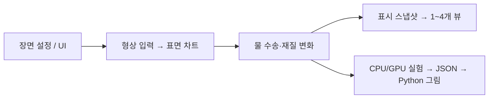

# Surface Simulation 코드 배치

`SceneAsset.cpp`는 공용 `ThinFilm` 프로파일을 읽고 재질, 층 순서와 상호작용 포트를 연결한다. CPU `AdvanceFilm`과 GPU `FilmStep.glsl`은 단일·다층에서 같은 계산 흐름을 사용한다. 각 층은 자기 물성과 아래층이 채운 위치의 유효 바닥으로 면 유량을 산출한다. GPU는 준비 뒤 면 후보, 출발 제한, 셀 반영을 기록한다. 마지막 수송 서브스텝의 셀 반영에서 영역 규칙과 셀 공유 규칙을 실행하고 수위를 복원한다. 표시용 피복은 다층에서 게시한다.

| 경로 | 책임 |
|---|---|
| [Application/Editor/SurfaceSimulation](../../../../Source/Application/Editor/SurfaceSimulation) | 장면 설정, 진행·시간·입력, ImGui 조작과 실험 실행 |
| [SurfaceState/Geometry/HeightfieldSources](../../../../Source/SurfaceState/Geometry/HeightfieldSources.cpp) | 씬이 직접 참조하는 PNG Height Map을 미터 단위 차트로 샘플링하고 높이 대역을 분리. OBJ, 노멀, signed displacement 변환은 형상 비교 실험에서 호출 |
| [SurfaceState/Simulation](../../../../Source/SurfaceState/Simulation) | 도메인과 수위 복원은 `SurfaceSimulationDomain`, 초기 상태는 `SurfaceSimulationState`, CPU 기준 스텝은 `SurfaceSimulationReference`, GPU 디스패치는 `SurfaceSimulationGpu`, 표시 버퍼 배치는 `SurfaceSimulationSnapshot`. `SurfaceLocalUpdates`는 온도와 물·기판의 국소 갱신을 담당 |
| [SurfaceAppearance.h](../../../../Source/Rendering/Surface/SurfaceAppearance.h) · [SurfaceSimulationAppearance.h](../../../../Source/Rendering/Surface/SurfaceSimulationAppearance.h) | 공용 바탕색과 텍스처 매핑, Surface Simulation의 표시 두께·얼음 바닥·가열 표시 설정 |
| [Simulation 에셋](../../../../Assets/Simulation) · [LiquidMaterialLoader](../../../../Source/AssetManager/Loaders/LiquidMaterialLoader.cpp) | 공유 물성·상호작용과 인라인 상태 정의가 있는 프로파일. 세 종류의 YAML은 [YamlAssetLoader](../../../../Source/AssetManager/Loaders/YamlAssetLoader.cpp)로 읽고, 액상과 고체의 밀도와 액상 점도를 CPU·GPU에 전달 |
| [SceneAsset.cpp](../../../../Source/Application/Editor/SurfaceSimulation/SceneAsset.cpp) | 기본 및 비교 `.Scene` 파일을 읽고 형상 카탈로그의 세트와 프로파일의 상태·규칙·필드 참조를 검증 |
| [Rendering/Surface/Simulation](../../../../Source/Rendering/Surface/Simulation) | 상태 스냅샷, 수면·표시용 지오메트리, albedo/roughness, PBR·등고선, 수증기·불, 비교 뷰포트, RGB PNG 캡처와 GPU 타이밍 |
| [Shaders/Simulation/Surface](../../../../Shaders/Simulation/Surface) · [Shaders/Rendering/Surface/Simulation](../../../../Shaders/Rendering/Surface/Simulation) | compute와 화면 출력 |
| [Tools/surface_simulation_plot.py](../../../../Tools/surface_simulation_plot.py) | JSON 기반 Python 2D 검증 그림 |
| [Tools/surface_simulation_geometry_fixture.py](../../../../Tools/surface_simulation_geometry_fixture.py) · [Tools/surface_simulation_cavity_plot.py](../../../../Tools/surface_simulation_cavity_plot.py) | 같은 포켓의 메시와 맵 생성, 네 실행의 형상·저장량·넘침 비교 |

장면 이름과 장면별 입력은 응용 계층의 `SurfaceSceneBuilder`에 둔다. 수송·GPU·렌더링은 같은 차트와 재질 상태 계약을 읽는다. GPU 읽기는 모든 층 상태와 대표 액체의 마지막 수송 서브스텝 진단값을 반환한다. [SurfaceGridLimits.h](../../../../Source/SurfaceState/Simulation/SurfaceGridLimits.h)이 CPU에서 구성하는 형상 표본과 계산 격자의 축당 상한을 정의한다. `SceneAsset`이 현재 `SurfaceProfile`을 검증하고 상태·물성·국소 규칙을 실행에 연결한다. 우측 `Scene Setup → Assets`의 선택 메뉴는 표면 프로파일, 물리 재질, 표면층 상태, 바탕 상태, 상호작용, 씬을 종류별로 보여준다. 선택한 에셋은 영문 제목과 파일명을 표시한다. 상태를 선택하면 소속 `.SurfaceProfile`과 `states.layer` 또는 `states.substrate` 위치를 표시한다. 영문 속성 이름과 편집값은 같은 행에 놓인다. 종류 이름, 에셋 제목, 속성 이름과 값에 마우스를 올리면 한국어 설명이 표시된다. 재질은 물성, 상태는 색상 범위, 국소 규칙은 계수, 프로파일은 연결과 외관 값, 씬은 필드값이나 절차적 규칙의 계수를 표시한다. `Load Scene Defaults`는 초안에 파일 값을 불러오고 공용 `Apply & Restart`가 편집값을 적용한다. `--capture-surface` 경로는 프레임 수를 지정한 오프라인 캡처에 사용한다. CPU·GPU 검증은 `--reference-surface`와 `--check-surface`로 실행한다.

에셋 속성은 실제 용도에 따라 `Physics`, `Appearance`, `Bindings`, `Inputs`로 표시한다. 수송·반응 계산에 쓰는 물성과 계수는 `Physics`, 광학 및 진단 표시값은 `Appearance`에 둔다. 눈의 겉보기 밀도는 표시 두께 환산에 쓰므로 `Appearance`에 속한다. 상태·재질·필드 참조는 `Bindings`, 씬이 제공하는 입력 필드 값은 `Inputs`에 표시한다.

`SceneAsset`이 `splitSubgridBasins`를 읽고, `SurfaceSceneBuilder`가 이를 `SubgridBasins` 또는 `SinglePerCell`로 전달한다. `SurfaceSimulationDomain`이 저장 영역과 접촉부를 구성한다. `SurfaceSimulationUI`는 초안이 바뀌면 `Apply & Restart`를 활성화하고, `SurfaceSimulation`은 비교 조건마다 적용된 값과 영역 수를 표시한다.

계단형 수로와 빙하 수로는 `SurfaceSceneBuilder`에서 바닥 높이를 입력한다. PBR과 등고선은 공통 셰이더 [SurfacePbr.glsl](../../../../Shaders/Rendering/Surface/Simulation/SurfacePbr.glsl)과 [SurfaceFragmentMain.glsl](../../../../Shaders/Rendering/Surface/Simulation/SurfaceFragmentMain.glsl)에서 읽는다.

빙하의 접촉 온도는 `SurfaceSceneBuilder`에서 지정한다. [LavaAppearance.glsl](../../../../Shaders/Rendering/Surface/Simulation/LavaAppearance.glsl)은 용암의 두께와 냉각 외관을 정의한다. `Surface.vert`는 얼음 면밀도를 표층 높이로 환산하고 용암 레이어에 침착 두께를 더한다. `SurfaceSimulationDisplay`는 얼음과 용암을 각각 불투명 패스에 그린다. `SurfaceSimulationMesh`는 기화·연소가 가능한 영역에 체적 프록시를 만들고, [SurfaceVolumeEffects.frag](../../../../Shaders/Rendering/Surface/Simulation/SurfaceVolumeEffects.frag)가 기화율이나 연소 활성도에 따라 응결 구름과 불꽃을 적분한다.

`Surface.vert`는 저장 수위와 바닥 사이의 부호 있는 깊이를 `Depth`로 전달한다. `SurfaceFragmentMain.glsl`은 이 값으로 물의 경계, 광학 경로 및 두께 뷰를 계산한다. 스무딩을 켠 바닥 패스는 [LiquidSurfaceReconstruction.glsl](../../../../Shaders/Rendering/Surface/Simulation/LiquidSurfaceReconstruction.glsl)의 4방향 연결 보간을 `ShoreAppearanceDepth`로 전달해, 젖어진 바닥의 색과 반사를 완화한다.

정적 형상 버퍼의 접촉 배열은 표본 모서리에서 접촉 슬롯을 찾는 표 다음에 슬롯의 원래 모서리 목록을 저장한다. 매끄러운 바닥의 투명 수면을 그리기 직전에 기존 물띠 파이프라인에서 접촉당 수직 면 하나를 처리한다. `LiquidSurfaceConnections.vert`의 연결 면 경로가 두 저장 영역의 질량, 수위, 턱을 읽어 실제로 젖은 공유 모서리를 고른다. 불을 내는 액체와 합성 얼음 표면은 기존 표시 경로를 따른다.

[SurfaceDiagnostics.glsl](../../../../Shaders/Rendering/Surface/Simulation/SurfaceDiagnostics.glsl)은 계산 셀·형상 격자와 상태 진단을 그린다. 두 비교 프리셋의 뷰는 좌상단, 우상단, 좌하단, 우하단 순서로 배치한다. `Layer & Substrate`의 캡처 뷰 키는 `pbr,substrate-states,layer-states,layer-thickness`, `Elevation & Grids`는 `pbr,elevation,simulation-grid,geometry-grid`다. 상태 히트맵은 위치별 상태값으로 표면을 채우고 에셋의 표시 이름과 상태색을 범례에 그린다. 슬롯·범위·색·그룹 크기는 렌더 필드에 패킹한다. 온도 진단이 열린 동안 `SurfaceSimulationDisplay.cpp`가 표시 슬롯에서 계산 셀 상태 구간을 현재 프레임의 CPU 읽기 버퍼로 복사한다. 프레임 슬롯을 재사용할 때 기존 fence로 완료가 확인된 값을 읽는다. 최저·최고값과 커서 셀 온도는 같은 읽기 결과를 사용한다.

`SurfaceSimulationDisplay.h`는 상태 채널별 두께·면밀도 선택 가능 여부를 에디터와 캡처가 함께 사용하도록 정의한다. `Render Options`의 `Source`는 활성 뷰의 슬롯을 선택한다. 캡처는 `--surface-view-modes layer-thickness:SurfaceWater,layer-thickness:SnowIce,areal-mass:AbsorbedWater`처럼 같은 상태 ID를 사용한다. 캡처의 기존 `depth` 키도 두께 뷰에서 읽을 수 있다. `SceneAsset.cpp`는 일반·다층 장면의 상태 등록 순서에 공통 보색 팔레트를 적용하며 UI 범례와 GPU 상태 뷰가 같은 표시색을 읽는다.

`SurfaceSceneBuilder`는 동결 트레이의 온도 오프셋, 나무의 예열 시간, 장면별 카메라 연출을 정의한다. CPU 기준 스텝과 GPU 솔버는 재질 파일에서 읽은 물성으로 유량을 계산하고 모든 씬의 바닥 온도를 갱신한다. `SurfaceLocalUpdates`는 그 상태를 읽어 물의 상변화 및 바닥 반응을 적용한다. 수면 셰이더는 얼음 질량 비율로 외관을 바꾼다. Python 대시보드는 상별 질량, 점유 부피, 높이와 바닥 온도를 표시한다.

빙하 수로, 표면의 얇은 얼음층, 동결 수면은 `SurfacePbr.glsl`의 얼음 투과·반사 함수를 공유한다. `SurfaceFragmentMain.glsl`은 굴절된 광선이 닿는 텍스처나 배경을 형상과 패스에서 가져온다. 캔버스와 수로의 얼음층은 초기 얼음량 또는 동결 규칙을 가진 표면에서 자동으로 준비한다.

`SceneAsset`은 절차 씬과 수송 바인딩이 있는 씬에서 같은 방법으로 `PhysicalMaterial`의 바닥 외관을 읽는다. Glacier Cut은 수로 본체에 공용 강철 BRDF를 적용하며 눈 표층은 남은 눈 질량을 공용 적설 패스로 그린다. 용암 침착과 수면 광로는 적설 패스와 같은 표시 높이를 읽는다.

[상태·형상·GPU 계약](../01_Contracts/08_Surface-Simulation.md) · [검증 실행](../../05_Experiments/04_Surface-Simulation-Validation.md)

## 기존 에디터 연결

[FEditorSession](../../../../Source/Application/Editor/SurfaceSimulation/SurfaceSimulation.cpp)은 [공통 에디터](00_CPP/07_Scene-Input-DebugUI.md)의 씬 선택, 렌더 옵션, 타임라인, 입력과 실험에 연결된다. [RendererCommands](../../../../Source/Rendering/Core/RendererCommands.cpp)는 기존 main render pass 전에 Surface Simulation의 스텝과 offscreen draw를 같은 command buffer에 기록한다. [SurfaceSimulationDisplay](../../../../Source/Rendering/Surface/Simulation/SurfaceSimulationDisplay.cpp)는 편집 경로에서 샘플링 가능한 color attachment를 만들고 기존 ImGui에 등록한다. 실험 PNG도 같은 backend에 텍스처로 등록해 실험 탭에서 읽는다. 에디터 캡처·실험 출력은 프로젝트의 `Captures/Surface/`에 저장한다.

`FEditorSession`은 실험이 시작될 때 적용값을 복사한다. 현재 상태 그림은 에디터 스레드에서 셀 상태를 한 번 읽고, 비교 계산과 파일 생성은 백그라운드에서 실행한다. CPU/GPU 비교는 별도 비표시 창에서 구성한 장치·큐·명령 풀을 사용한다. 이미지가 준비되면 에디터 스레드가 미리보기 텍스처를 교체한다. 씬을 전환하거나 다시 시작하면 이전 실험이 생성한 파일은 남고 화면의 결과는 지워진다.

씬 목록은 분류 드롭다운과 조건 선택을 제공한다. 목록과 `Open Scene…`은 모두 `SurfaceScene` 파일을 연다. `BundledSceneVariants`는 배포된 `원본_변형.Scene`을 찾아 파일명 순으로 원본과 같은 카테고리에 붙인다. 필터 없는 전체 검사도 같은 탐색 경로를 사용한다. 원본의 연출 판정은 원본 입력에 적용하고 모든 변형의 질량 수지와 CPU·GPU 결과를 확인한다. 차트 주입은 직전 프레임의 투영·자세와 표시용 바닥 삼각형으로 지정 영역을 찾는다. `FRun`은 주입 용량을 현재 물성의 밀도로 질량으로 환산하고 다음 실행 스텝에 전달한다. 월드 그리드와 축은 메쉬 에디터의 World Reference 셰이더를 공유하며 차트에서는 1 cm 간격을 사용한다.

`SceneAsset.cpp`는 비교 파일과 2–4개 조건을 검증하고, `DebugUIWorkspace.cpp`가 목록을 만든다. `SurfaceSimulation.cpp`의 에디터 세션은 조건당 독립 실행을 같은 고정 시간으로 갱신한다. `SurfaceSimulationViewRect`는 조건별 렌더 타깃에서 세 뷰의 픽셀 사각형을 계산한다. 렌더링, 선택, 오버레이, 캡처가 이 사각형을 공유한다. `SceneAsset.cpp`가 씬의 셀당 비율 또는 전체 형상 격자를 읽어 솔버에 넘길 절대 해상도로 계산한다. `SurfaceSimulationUI.cpp`의 공용 해상도 편집기는 단일 씬과 비교에서 같은 비율 선택, 전체 형상 크기 표시, 축별 한도를 적용한다. 비교 세션은 현재·편집 중·원본 해상도를 추적하고, 적용 시 전체 조건의 새 리소스를 준비한 뒤 함께 교체한다. [씬 조건과 비교 재생](../01_Contracts/08_Surface-Simulation.md#씬-조건과-비교-재생)

도킹은 `FDebugUI::SetupDockspace`에서 초기화한다. 씬을 고른 뒤 좌하단에서 저작 기본값을 보고, 우측에서 솔버 설정과 활성 뷰의 표시를 비교한다. 씬 트랙의 재생 제어는 현재 에디터 실행에 적용한다. CPU/GPU 비교 실험은 적용된 씬 기본값과 솔버 연산 설정으로 다시 시작한다. 타임라인에서 트랙을 임시로 중지한 설정은 현재 상태 캡처에 직접 반영된다.

`PrepareBedDisplay`는 선택한 바닥 메시를 처음 사용할 때만 만들고 표시 자원에 보관한다. 바닥 모드를 바꿔도 계산 형상과 스냅샷은 유지한다. 주입 위치와 출구 안내선은 실제 표시된 메시를 참조한다. 넘침 표시 설정은 수송 상태와 무관하게 그리기만 제어한다.

예약 급수는 `SceneAsset`에서 선택적 `scheduledInlet`을 읽고, `SurfaceSceneBuilder::MakeScene`에서 형상과 저장 영역을 만든 뒤 `Liquid::SetScheduledInlet`으로 면적 배분율을 계산한다. `StepReference`와 `SurfaceSimulationStep.comp`에서 같은 배분율을 사용한다. `InitialState`도 초기 액체가 있는 씬에서 배분율을 읽고, 출구·급수·기울기가 같아도 시작 상태가 다른 비교를 지원한다. [예약 급수 계약](../01_Contracts/08_Surface-Simulation.md#01-수송과-연산-순서)

`FabricVsSponge.Scene`은 재질별 흡수 차이를 비교하기 위해 평평한 스펀지와 강철 시편을 배치한다. 다른 비교 에셋에 `surfaceRelief`가 있으면 `SurfaceSceneBuilder::MakeScene`이 모든 시편에 같은 형상을 반복한다. `SurfaceSimulationMesh.cpp`는 시편마다 몸체를 만들고 `Surface.vert`는 차트 좌표에서 상태를 읽은 뒤 시편을 벌려 그린다. `SurfaceSimulationDisplay.cpp`는 선택 메시에도 같은 오프셋을 적용하며, 시편의 물리 재질 에셋에 연결된 텍스처로 표시용 아틀라스를 만든다. 시편의 밑면과 깊이별 흡수 외관은 `SurfaceSimulationMesh.cpp`와 `SurfaceFragmentMain.glsl`에서 처리한다. [시편의 형상과 표시 계약](../01_Contracts/08_Surface-Simulation.md#바닥-저장-용량과-재질-비교)

액체 영역의 추출과 접촉 목록은 `SurfaceSimulationDomain.cpp`가 만든다. `SurfaceSimulationGpu.cpp`는 홈별 연속 표본과 질량·수위의 두 슬롯을 실제 장면의 요소 수로 묶어 기록한다. `SurfaceSimulationMesh.cpp`가 부모 셀 ID와 액체 영역 ID를 표시 정점에 함께 준다. 세 가지 비교 형상과 4종 입력의 변환 규칙은 [형상 에셋](../../../../Assets/Geometry/README.md)에서 확인한다.

### 접촉 냉각과 발광

`SceneAsset`이 `substrateQuench`와 바닥 온도 상태를 바인딩한다. `SurfaceSceneBuilder`는 바닥 초기 온도를 만든다. `SurfaceLocalUpdates.cpp`와 계산 셰이더의 `SurfaceLocalUpdates.glsl`이 수송 후 같은 에너지 한도로 온도와 기화 질량을 갱신한다. `SurfaceFragmentMain.glsl`은 표시 슬롯의 온도를 발광색으로 바꾸고, `SurfaceVolumeEffects.frag`는 기화율로 응결 구름을 그린다. `Experiments.cpp`는 기화 질량과 금속 열손실의 수지 및 활성값에 대응하는 상태 선언을 검사한다. [상태·셰이더 계약](../01_Contracts/08_Surface-Simulation.md)

### 출렁임의 광학과 수면 높이

`SurfaceSimulationDisplay.cpp`의 `AdvanceSnapshot`이 표시 자세와 함께 감쇠 진동을 계산하고, 두 효과의 플래그와 진폭을 `FDrawPush::LiquidOptions`에 기록한다. `SurfaceSimulationMesh.cpp`는 부모 셀의 최고 바닥 높이를 표시 필드에 보관한다. `LiquidSlosh.glsl`과 `Surface.vert`는 완전히 젖은 단일 영역에서 정점 높이와 수면 법선을 바꾼다. `SurfaceFragmentMain.glsl`은 물의 반사와 굴절에서 기울기 변화로 생긴 광학 법선을 섞는다. UI는 `SurfaceSimulation.cpp`의 `Surface Display`에 있다. [표시 계약](../01_Contracts/08_Surface-Simulation.md#수면-출렁임-표시)

### 데모 재질 텍스처와 HDR 반사

`SceneAsset.cpp`이 반복 재질 PNG 두 개와 선택적 환경 HDR의 상대 경로를 읽고 `SurfaceSceneBuilder.cpp`이 표시 외관에 전달한다. `TextureLoader.cpp`은 Radiance HDR를 선형 RGBA16F로 변환한다. `SurfaceSimulationDisplay.cpp`이 텍스처 수명과 그래픽 binding 6을 소유한다. `SurfacePbr.glsl`이 반사 방향을 파노라마 좌표로 바꾸고 거친 표면의 각도 샘플을 추가한다. 기존 재질의 색·거칠기 텍스처에서 쓰는 sRGB RGB와 선형 알파의 조합을 그대로 사용한다. [파일과 라이선스](../../../../Assets/Textures/SurfaceSimulation/README.md) · [씬 속성과 ABI](../01_Contracts/08_Surface-Simulation.md#03-재질-표시와-캡처)

`SurfaceFragmentMain.glsl`의 눈층 분기는 바닥과 별개인 Snow 003 색·거칠기 및 접선 노멀을 읽는다. `SurfaceSimulationDisplay.cpp`는 기존 눈 메시를 그릴 때 해당 맵의 반복 횟수를 전달한다. 바닥과 눈은 접선 노멀을 조명 좌표로 바꾸는 함수를 공유한다.

## 접촉·퇴적 진단과 실행

CPU의 `SurfaceSimulationReference`와 GPU의 `FilmStep.glsl`은 형상 샘플의 접촉 면적, 혼합물 상태, 고정 스텝 내 수송을 갱신한다. 표시 스냅샷의 영역별 접촉 기록에는 반응 직전 수위, 접촉 면적, 반응 가능 여부와 물 존재 여부가 들어간다. 접촉 벡터의 네 번째 값은 수송에 사용한 아래층의 수위다. 다층 피복에는 RGB, 실제 피복 수위, 정규화한 피복 젖음과 수송용 아래층 수위가 들어간다. 렌더 셰이더는 각 위치에서 이 수위와 기준 바닥 중 높은 쪽을 사용한다. `SurfaceDiagnostics.glsl`은 접촉, 유효 바닥, 원시 수심, 월류 및 흡수 한도 대비 충전율을 그린다. `State Heatmap`과 `Areal Mass`는 성분 채널을 공용 선택자로 읽는다.

[비교 실험·캡처](../../05_Experiments/05_Surface-Physics-Comparison.md)
