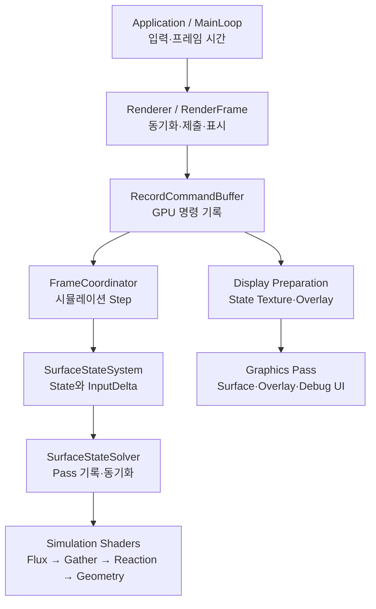
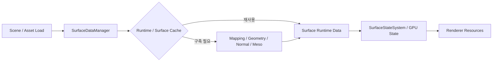

# System Map — MDSS Engine

처음 보는 개발자가 **시스템 소유권과 실행 흐름을 한눈에 파악하는 지도**다. 세부 계산이나 수치 계약은 [[02_Architecture/01_Contracts/00_Contract-Register|Contracts]], 구현 파일은 [[02_Architecture/02_Source/00_Source-Map|Source Map]]에서 확인한다.

## 프레임과 GPU 실행 흐름

위 그림은 주요 **조율·위임 관계**를 보여준다. 실제 Simulation Step 수, Reaction 실행 여부, 화면 준비 경로는 현재 설정과 Scene 상태에 따라 달라진다.

## 초기화 및 Surface 준비

- `FSurfaceDataManager::LoadSurfaceData`는 요청을 검증하고 재사용 가능한 Runtime Surface를 조회하거나 생성한다. Runtime key와 `.Surface` 캐시 조회는 서로 다른 재사용 단계다.
- Scene 리소스를 교체할 때 `FRenderer::ReloadSceneResources`가 GPU 자원의 준비·교체·관련 실행 상태 갱신을 조율한다.

## 주요 책임과 진입 함수

| 책임 | 먼저 볼 함수 | 상세 내용 |
|---|---|---|
| 앱 실행과 이벤트 | `FApplication::MainLoop` | [[02_Architecture/02_Source/00_CPP/01_Application-and-Frame|Application]] |
| 프레임 동기화·제출 | `FRenderer::RenderFrame` | [[02_Architecture/02_Source/00_CPP/06_Rendering|Renderer]] |
| GPU 명령 순서 | `FRenderer::RecordCommandBuffer` | [[02_Architecture/00_Flows/00_Main-Flow|Main Flow]] |
| Surface 초기화·캐시 | `FSurfaceDataManager::LoadSurfaceData` | [[02_Architecture/02_Source/00_CPP/00_SurfaceState/01_Runtime-and-Registry|Runtime]] |
| Simulation Step 구성 | `FFrameCoordinator::RecordSimulation` | [[02_Architecture/00_Flows/01_Frame/00_Frame-and-Step-Scheduling|Frame]] |
| Solver GPU 패스 | `FSurfaceStateSolver::RecordSteps` | [[02_Architecture/00_Flows/02_Simulation/00_Step-Overview|Simulation]] |
| 렌더용 파생 데이터 | `FRenderer::PrepareDisplayResources` | [[02_Architecture/00_Flows/03_Rendering/00_Render-Overview|Rendering]] |
| 사용자·디버그 설정 | `FDebugUI`의 관련 Panel 함수 | [[02_Architecture/02_Source/00_CPP/07_Scene-Input-DebugUI|Debug UI]] |

## 데이터 경계

| 데이터 | 생성·관리 | 소비 |
|---|---|---|
| 공유 Surface Geometry | Mapping/Geometry Builder, Surface Cache | Instance별 Surface Runtime 및 GPU Geometry |
| Instance State·Contact Input | `FSurfaceStateSystem`, Contact Application | `InputDelta`와 Solver |
| Current/Next State | Solver, Simulation GLSL | 다음 Step와 표시 준비 |
| Render State Texture·Overlay | Rendering 준비 단계 | Surface/Overlay/Debug Shaders |

**불변 조건:** Current/Next A/B Buffer, CPU–GPU Layout, GPU Barrier, 상태 소비 시점은 소스와 [[02_Architecture/01_Contracts/05_GPU-Layout|GPU Layout]]을 함께 확인한다. 표시용 필터링은 Simulation State를 직접 변경하지 않는다.

## 다음 단계

상위 함수만 따라 읽으려면 [[02_Architecture/04_Code-Reading-Guide|Code Reading Guide]], 원하는 기능의 코드 위치를 찾으려면 [[02_Architecture/02_Source/00_Source-Map|Source Map]]을 연다.
