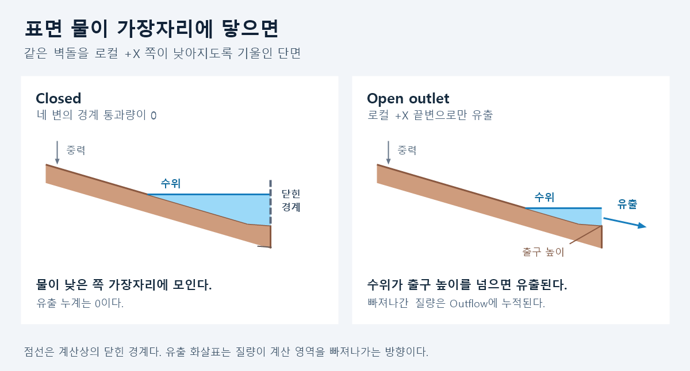

# ADR-0001 — 표면 물의 경계와 출구 표시

- 상태 `Accepted`
- 날짜 `2026-11-24`
- 구현 계약 [Surface Simulation](../../02_Architecture/01_Contracts/08_Surface-Simulation.md#표면-물의-외곽-경계)

## 맥락과 문제

홈의 저장과 내부 월류를 관찰하는 씬은 같은 급수량이 어디에 모이는지 비교할 수 있어야 한다. 벽돌과 배수로 씬은 물이 영역 밖으로 나가는 과정까지 보여 준다. `Open outlet`이라는 이름만으로는 어느 변이 열리는지, 기울인 뒤에도 같은 변이 열리는지 파악하기 어렵다.

## 고려한 선택지

| 선택지 | 장점 | 비용 |
|---|---|---|
| 모든 씬을 `Closed`로 통일 | 외곽 유출 없이 보유량과 내부 월류를 비교하기 쉽다. | 배수 장면에서도 물이 끝에 고인다. |
| 씬에서 필요할 때 로컬 +X 변을 연다 | 저장과 배수를 각각 시연하고, 유출량을 추적할 수 있다. | 출구의 방향과 활성 경계를 화면에서 알려야 한다. |
| 네 변을 개별 지정한다 | 자유롭게 회전하는 물체의 여러 출구를 표현할 수 있다. | 에셋·솔버·에디터에서 변별 조건과 질량 장부를 검증해야 한다. |

## 결정과 근거

새 씬은 `Closed`를 기본으로 한다. 배수가 필요한 씬은 `openOutlet: true`로 로컬 +X 변을 연다. 고정된 출구는 기울기나 카메라에 따라 다른 변으로 이동하지 않는다. 물이 홈에서 다음 홈으로 넘어가는 내부 수송은 두 설정 모두에서 계산한다.

에디터 이름은 `Open +X edge`로 정한다. `Scene default` 옆에 씬의 기본 경계를 표시하고, `Active boundary`에는 실행 중인 경계를 표시한다. `Apply & Restart`를 누르면 경계 설정을 적용한다. 활성 출구는 각 뷰포트에서 호박색 선으로 표시한다. 적용된 경계는 공통 타임라인에서 한 번 표시한다. `Show → Outlet Edge`는 선의 표시만 제어한다.

## 결과와 재검토 조건

배수 확인은 `Outflow` 누계로 수행한다. 출구 마커의 색은 열려 있는 변을 뜻한다. 낙하하는 물이나 여러 방향의 자유 배수가 장면의 요구사항이 되면 경계와 표시를 함께 재설계한다.
