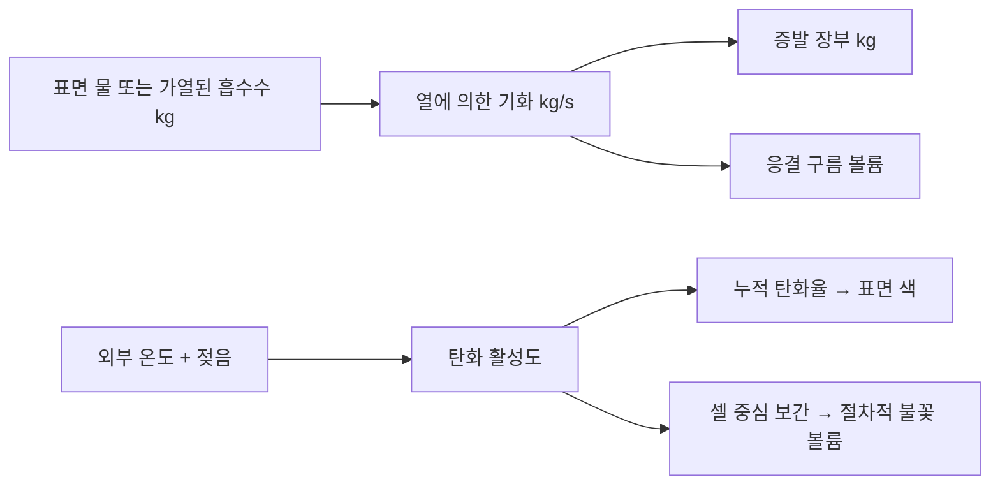

# 표면 반응에서 수증기와 불을 표시하는 방식

## 00. 결정

응결 구름은 현재 열에 의한 기화 질량률(kg/s), 불은 이번 스텝에서 구한 탄화 활성도(0–1)로 표시한다. 두 효과는 바닥 위 체적에서 밀도와 투과율을 광선을 따라 적분한다. 모든 Surface Simulation 불꽃은 Charring Wood에서 사용한 하나의 밀도 함수를 공유한다. 건조로 빠진 질량과 불이 지나간 뒤의 탄화율은 각자의 상태 및 장부에 남는다.

## 01. 이유와 검증

가용 물이 없으면 기화량은 0이다. 일반 건조 손실은 흡수수 장부에만 반영한다. 열로 흡수수가 기화하는 규칙을 켠 경우 그 질량을 별도로 가시 구름의 입력에 더한다. 탄화율은 한 번 증가하면 남으므로 이를 불의 세기로 쓰면 오래전에 반응한 곳이 계속 타게 된다. 현재 스텝의 활성도를 읽으면 젖은 곳과 이미 탄 곳에서 불이 약해진다.

이전 불꽃 카드는 활성화된 셀마다 같은 실루엣이 반복됐다. 볼륨에서 위치와 시간에 대한 노이즈를 읽으면 불꽃이 위로 이동하고 서로 갈라지면서 여러 셀에 걸친 실루엣을 만든다. 흡수와 발광은 룩을 위한 계수로 정하고, 불빛과 그을음도 연속적인 바닥 외관으로 표시한다. 수증기와 불의 합성 순서는 표면 데모용 표현이고, 광선이 가려지는 위치는 불꽃 셰이더가 바닥 높이로 제한한다. 온도·반응 수지와 히트맵은 동일한 계산 상태를 읽는다.

[상태 계약](../02_Architecture/01_Contracts/08_Surface-Simulation.md) · [실험](../05_Experiments/04_Surface-Simulation-Validation.md)
