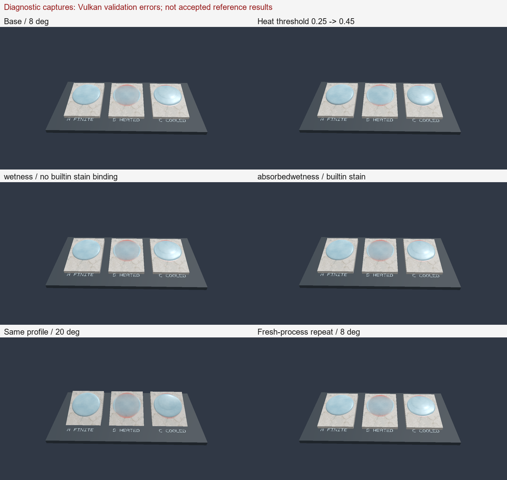
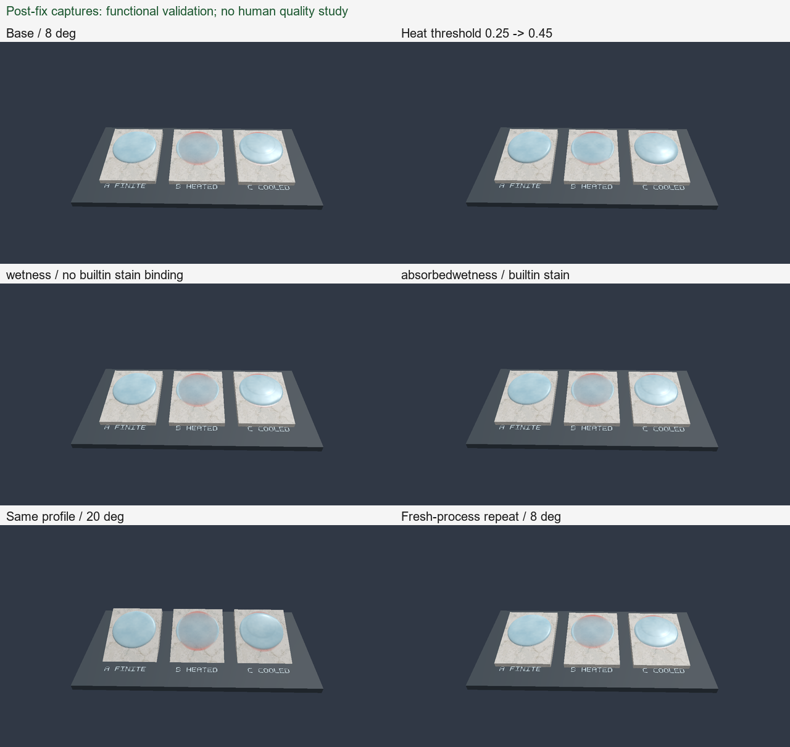

# 제작 과제 검증 — 준비 상태와 비교 조건

> **현재 판정:** Descriptor layout 수명 오류 수정과 실제 화면 6조건 검증은 완료했다(§8). 후속 단일 시스템 제작 과제의 목표·완료/실패 기준과 격리 입력을 준비했다(§9). 새 과제는 미실행이며 독립적인 품질 평가·인간 제작 비교·학술적 기여는 미입증이다.

- 마지막 확인: 2026-10-27, HEAD `880af1ebcffe601f0bac27413cad94055ce92812` + 미커밋 작업 트리. commit만으로 실행 버전을 재현할 수 없으며 아래 manifest의 소스·실행 파일 보관본을 함께 사용한다.
- 범위: **현행 기능 확인 및 제작 연구의 실행 가능성 평가**. 인간 생산성·새로운 시스템 기여·GPU 성능의 검증 결과가 아니다.
- [준비 명세](../../../Performance-Data/20261027-authoring-readiness/plan.json), [실제 검사 결과](../../../Performance-Data/20261027-authoring-readiness/readiness.json), [검사 manifest](../../../Performance-Data/20261027-authoring-readiness/manifest.json), [화면 검증 명세](../../../Performance-Data/20261027-authoring-readiness/render-validation/plan.json), [차단된 실행 기록](../../../Performance-Data/20261027-authoring-readiness/render-validation/manifest.json).

## 1. 검증하려는 주장과 비교를 중단하는 이유

후속 질문은 “공통 State·Reaction·State-Driven Geometry Coupling이 목표한 복합 효과를 만드는 부담을 줄이는가?”이다. 그러나 PERF-042의 M은 같은 Profile 선언·수치 provider·Reaction·Geometry를 사용하는 headless 조정자다. UI가 있는 U와 M의 작업 시간을 바로 비교하면 모델의 이점과 UI 제공 여부가 섞인다. 동일한 선언을 양쪽에 전달하는 과제는 제작자가 경험하는 차이 자체가 없을 수도 있다.

따라서 **U/M backend 선택만 바꾸는 인간 비교 실험은 No-Go**다. 이 판정은 MDSSP의 일반적인 비신규성을 증명하지 않는다. 현재 비교군으로는 제작 생산성 가설을 식별할 수 없다는 뜻이다. M에 불필요한 파일 변환·수동 복사·중복 구현을 강요해 차이를 만들지 않는다. 비교를 성립시키려는 목적만으로 새 UI나 새로운 불편한 Baseline을 구현하지 않는다.

단일 시스템 pilot은 파일 편집, 반복 조정, 저장·재로드, 외관 연결의 실패를 찾는 데 사용할 수 있다. **이 pilot만으로 MDSSP가 기존 범용 시스템보다 쉽다고 결론 내리지 않는다.** 기존 범용 모델과의 차별성은 [[06_Prior-Model-Differentiation|선행모델 검토]]와 별도의 근거가 필요하다.

## 2. 실제 코드와 실행에서 확인한 범위

| 항목 | 근거 및 결과 | 주장할 수 없는 것 |
|---|---|---|
| 선언된 scalar State 등록 | 실제 `TSRProfileLoader::Load` → `TSurfaceStateRegistry`로 기본, threshold, wetness, absorbedwetness, residue의 5개 fixture를 읽었다. 모두 로드·지정 State 조회 성공 | 임의 현상의 물리적 타당성·외관 자동 생성 |
| 젖은 외관 연결 | `Source/Rendering/Surface/DemoSurfaceEffects.h::ResolveDemoSurfaceStates`는 `absorbedwetness`라는 정확한 이름을 연결한다. 실제 probe에서 해당 fixture만 built-in absorbed-wetness binding=true. `wetness`, `residue`는 등록되지만 그 binding=false | `wetness`에 계산값이 있으면 자동으로 젖은 자국이 보인다는 주장 |
| 외관의 코드 경로 | `Shaders/Rendering/Surface/Lighting/SurfaceLit.glsl`이 추가 binding을 읽고 `Effects/AbsorbedWetness.glsl::ApplyAbsorbedWetness`로 albedo·roughness를 바꾼다 | 이 과제의 실제 rendered frame에서 자국의 가시성·품질을 확인했다는 주장 |
| Reaction 편집 | `Source/DebugUI/Panels/DebugUIContactProfile.cpp::DrawProfileTuningTab`의 Reaction 트리는 `.SRProfile` 편집·scene reload를 안내한다 | GUI에서 반응을 직접 편집·저장할 수 있다는 주장 |
| Profile 조정값 지속성 | 같은 함수의 “Runtime only … source files stay unchanged”와 `Apply Override` → `SetDebugProfileParameters` 호출. runtime override는 원본 파일 저장이 아니다 | GUI 조정 후 재시작하면 변경이 자동 복원된다는 주장 |
| 과제 경로 | 분리한 3개 Scene의 mesh·animation·map·profile 참조 파일 존재 검사 오류 0 | 실제 `TSceneLoader` 실행·GPU 기동 성공 |

검사 실행은 2026-10-27 **09:55:49–09:55:52 KST**, Release 연구 대상 `MDSS_AuthoringProbe`다. 실행 파일 SHA-256 `6a104c0aef56ad22ffc023546c24ab56b2865964def3661c4f882ea2b4fcc15b`. 검사 전 exe·fixture·해당 로더/registry/외관/UI 소스를 보관했다. 5건은 **정해진 양성 fixture에 대한 로드/연결 확인**이며 모든 Profile 유효성·부정 입력·GPU 동작을 검증한 테스트 묶음이 아니다.

PERF-042 T2는 `wetness`의 수치 등록·유입 전환을 검증했다. 그 결과는 유지되지만, **새 lit 외관을 코드 수정 없이 추가했다는 증거로 확대하면 안 된다.** 기존 `MidtermSoil`의 `absorbedwetness`와 해당 데모의 직접 입력도 이 과제의 Waterfilm→잔류량 전환을 화면으로 검증한 증거가 아니다.

## 3. 준비한 단일 시스템 과제 팩

**아래는 최초 팩의 준비 기록이다.** 후속 실제 앱 실행에서 절대 mesh/animation 경로가 로더 계약을 위반함을 확인했다. 현재 사용할 상대 경로 **v2 팩과 재실행·GPU 오류 판정은 §7**을 따른다. 최초 파일 존재 검사를 Scene 로드 성공으로 해석하지 않는다.

로컬 경로: `Performance-Data/20261027-authoring-readiness/raw/task-pack/`. `raw`는 Git 제외이며 [생성기](../../../Scripts/Research/authoring_study.py)의 `prepare`로 새 작업 공간에서 생성할 수 있다. 이미 존재하는 명세·시작 파일을 덮어쓰지 않는다. 이 팩은 **과제 실행 및 기능 점검용**이고, 독립 평가자가 승인한 외관 목표가 아직 없다.

| 과제 | 시작 파일과 요구사항 | 현재 reference와 완료 조건 | 한계 |
|---|---|---|---|
| P1 조정값 저장·재로드 | `P1/start/Task.Scene`, `Editable.SRProfile`. 융해 조건을 바꾸고 파일로 저장한 뒤 새 프로세스에서 복원 | 기능 microtask는 `ice_melting`의 heat threshold를 0.25→0.45로 바꾸는 제한된 편집. reference는 `reference/threshold.SRProfile`. 제출 파일과 실제 재로드 값을 확인 | 정확한 수치를 알려 주는 파일 편집 과제다. 원하는 외관을 탐색·제어하는 능력의 증거가 아님 |
| P2 흐른 물의 흔적 추가 | 같은 판 장면에서 positive Input/Incoming 중 0.1을 별도 잔류 State로 전환. 정지한 기존 보유량 전체를 반복 전환하지 않음 | 기본 외관을 쓰는 reference는 `absorbedwetness.SRProfile`. `inflowFraction`, Waterfilm 소비/잔류량 생성 각 1, 잔류 State는 비수송·비적층·decay=0. 파일 저장·재로드, 실제 잔류량·수지·화면을 확인해야 완료 | `wetness.SRProfile`과 `residue.SRProfile`는 등록/외관 경계 확인용 대조다. 제공된 외관 재사용이며 새 외관의 일반적 작성 기능이 아님 |
| P3 조합·변환 재사용 | `P3/start/Task.Scene`은 같은 판의 X 회전을 8°→20°로 바꾼 배치. P2에서 제출한 Profile을 재사용 | Profile·반응·Shader를 바꾸지 않고 적용되는지 확인. 원래 8° 장면도 다시 실행. 바꾼 설정과 예외를 빠짐없이 기록 | **새 Mesh·미사용 장면 일반화가 아니다.** 제작자와 과제 설계자가 이미 알고 있는 장면이다 |

각 `start` 폴더는 독립 Profile/map을 가리킨다. 원래 `Assets`는 수정하지 않는다. Mesh·animation은 기존 자산의 절대 경로를 사용하므로 다른 checkout으로 옮길 때 재생성이 필요하다. 각 과제의 시작 Profile은 모두 원래 기본값이다. P3 시작 폴더에 P2의 최종 제출물을 가져오는 행위도 기록한다. P1/P2/P3는 이어지는 workflow이며 세 개를 독립 참가자 표본처럼 세지 않는다.

작업 절차는 시작 폴더를 별도 제출 폴더로 복사 → `MDSS.exe --scene <제출 폴더/Task.Scene>` → 수정/저장 → 앱 종료·새 프로세스로 같은 Scene 열기 → 수정 파일·로그·영상/State 제출이다. **현재 Windows 차단 때문에 이 앱 실행 절차의 성공은 확인하지 못했다.** reference 정답 폴더는 정답을 제공하는 기능 microtask에서만 사용한다. 향후 창작·탐색 시간 과제에서는 참가자에게 reference를 노출하지 않는다.

P2 수지는 단순한 최종 Waterfilm+잔류량 합만으로 판정하지 않는다. 이 장면에는 초기 Ice, Ice→Waterfilm, Heat 소비·냉각과 외부 입력이 있다. 해당 채널의 입력/전환/감쇠/경계 장부를 포함해야 한다. `inflowFraction`의 단위 회귀와 이전 headless 수치 감사가 이 새 rendered 장면의 수지를 대신하지 않는다. Reaction 생성량을 새 input/incoming으로 오해하지 않는다.

## 4. 화면 실행 시도와 미완료 범위

Profile 검사 후 별도 명세를 동결했다. 6조건은 base, threshold, wetness, absorbedwetness, 같은 Profile의 20° 재사용, absorbedwetness 새 프로세스 반복이다. simulation/render mesh 128, 고정 dt 1/60, Coupling ON, Dense FP32, 원래 데모 입력·카메라, frame 359의 단일 이미지 예정이었다. State exporter는 마지막 drain 2 frame 뒤 값을 저장하므로 화면과 같은 Step이라고 부르지 않는다. 이 짧은 확인은 목표 외관의 완전한 진행·시간 수렴을 검증하는 실험이 아니다.

Release 본 앱 빌드는 성공했다. exe·production SPIR-V **137개**·제품 소스·관련 mesh/MTL/texture·animation·실제 설정·입력을 **실행 전에** 보관했다. 2026-10-27 **10:59:46–10:59:49 KST**, 첫 `base`에서 Windows Application Control이 exe를 차단했다(`WinError 4551`). 실행 파일 SHA-256 `bf3bf397a156caae18f370ae98c36fe53c645f0435b47cce7681386bfc97748f`.

- 앱 기동/평가 frame/이미지/State: **0**. 나머지 5조건은 미실행. GPU·화질·비용 결과 없음.
- 차단된 실행 파일을 교체·이름 변경·재패키징하거나 정책을 변경해 우회하지 않았다. 차단 hash를 기존 로컬 registry에 기록하고 해당 hash의 재실행을 막는다.
- Editor layout은 원래 내용으로 복원했다. 원래 source asset·engine startup 설정은 수정하지 않았다.
- 이 저장소에는 별도로 미해결 `MDSS_SharedSurfaceGeometry` invalid-texel render triangle 테스트 실패 1개가 있다. 이번 양성 probe 통과를 전체 제품 테스트 통과로 확대하지 않는다.

후속 2026-10-27 CPU 점검에서는 위 실패를 재현하고 소스상의 렌더 정점 ID/texel ID 혼동을 확인해 **테스트만** 수정했다. 네 삼각형/12 index 기대값을 유지했으며 제품 Geometry는 그대로다. 수정본 빌드는 성공했지만 그 테스트 exe도 오류 4551로 실행 전 차단돼 통과 여부는 미검증이다. 앱 차단이 해소되거나 rendered 검증이 완료된 것은 아니다. [변경 전후 요약](../../../Performance-Data/20261027-authoring-readiness/geometry-validation/summary.json), [[05_Experiments/01_Validation-and-Tests|원인·검증 기록]]을 따른다.

최초 `readiness.json`은 Profile probe 직후의 `rendered_scene_execution=not_run` 상태를 보존한다. 이후의 차단은 `render-validation/manifest.json`과 `readiness-followup.json`을 정본으로 한다. 기존 기록을 성공으로 덮어쓰지 않는다.

## 5. 공정한 비교 연구를 다시 열 조건

아래 조건을 **실제 참가자 데이터 수집 전에** 충족하고 별도 버전 명세를 확정한다.

1. **측정할 개입**: 표현력/구성 모델의 차이인지, UI 편집 도구의 차이인지 하나를 명시한다. UI 차이만 실험했다면 알고리즘/공통 모델의 이점으로 결론 내리지 않는다. 같은 모델을 같은 선언으로 조작하는 backend 선택만으로는 시작하지 않는다.
2. **비교군의 충분한 기능**: 양쪽에서 저장·재로드·입력·미리보기·기본 외관·공유 Geometry/Reaction 연결을 완료할 수 있어야 한다. 공통 로더·기본 UI·GPU 자원 공유를 허용한다. 전용 Solver를 억지로 중복 구현시키지 않는다. 그 결과 구조 차이가 없어지면 그 자체가 비교 중단 근거다.
3. **독립적인 목표와 품질 기준**: MDSSP의 결과를 본 뒤 유리한 목표를 택하지 않는다. 별도 평가자가 같은 camera/input 아래 시작/완료 구간, 잔류 흔적·원치 않는 부작용·재로드 재현을 판단할 기준을 양쪽에 적용해 통과 가능성을 확인한다. 현재 0.45/0.1 값은 기능 fixture이며 예술적 품질의 정답이 아니다.
4. **대상 제작자와 시행 설계**: 실제로 이 workflow를 수행할 사람의 경험을 기록한다. pilot으로 과제 길이·실패 유형을 확인한 뒤 표본 수와 분석 계획을 정한다. 임의의 소수 예시를 유의한 생산성 연구라고 부르지 않는다. P3처럼 의존하는 과제는 sequence 단위로 다루고, backend/과제 순서를 균형 배정하며 동일 정답의 학습 이월을 통제한다.
5. **동일 지원과 AI 정책**: 자료·훈련·기본 자산·도움 요청·허용 편집 범위·시간 제한을 맞춘다. AI를 허용한다면 모델·버전·제공 context·도구·도움 기록을 양쪽에서 같게 관리한다. AI가 작성한 시간은 AI 보조 workflow 결과이며 비보조 제작자의 시간으로 대체하지 않는다.
6. **제출과 실패를 함께 기록**: 실제 session-template를 복사해 participant ID, timestamps, 파일 버전, 재로드 증거, 오류, 개입, 품질 판정을 채운다. 완료하지 못한 과제는 time limit까지의 미완료/검열 자료로 남기고 성공자 평균만 비교하지 않는다.

주 결과는 **사전에 정한 같은 품질에 도달한 완료율과 시간**이다. active time과 wall time, 도구·빌드 대기, 도움, 실패/재시도, 수동 예외를 함께 보고한다. 파일/규칙 변경 수와 전용 코드는 보조 지표이며 추상화가 다른 시스템의 LOC를 곧 생산성으로 해석하지 않는다. 초기 framework 개발 비용과 신규 과제의 한계 작업량도 분리한다. GPU 비용은 같은 완료 품질·실제 시간 구간으로 별도 성능 규칙에 따라 측정한다.

## 6. Go / No-Go와 현재 권고

| 관찰 | 판단 |
|---|---|
| 양쪽 workflow와 품질 gate가 준비되지 않음 | 비교 연구 시작하지 않음. 결측을 생산성 우위로 해석하지 않음 |
| 단일 시스템에서 기능/저장/외관 문제 발견 | 기능 한계와 사용자 부담의 관측. MDSSP의 상대적 우위는 아님 |
| 대등한 비교군이 동일 선언·지원으로 같은 작업을 처리 | 현 과제에서 공통 모델의 제작 우위 가설은 지지되지 않음 |
| 차이가 UI·교육·기본 preset에만 기인 | 해당 도구/교육의 효과로 한정. State-Driven Geometry Coupling 설계의 기여로 확대하지 않음 |
| 품질을 맞춘 뒤에도 재사용·구성 부담의 우위가 반복되고, 구조적 차이와 연결됨 | 시스템 기여의 후보 증거. 가까운 범용 선행모델 대비 중요한 차이 검토는 여전히 별도 |

당시 준비 상태는 **양성 capability 검사 완료, pilot 파일 준비, 실제 rendered 실행 차단, 인간 session 0**이었다. 이후 차단 해제·검증 실패·수정 후 재검증은 §7–8에 시간순으로 보존한다. 현재의 다음 과제와 미완료 계측은 §9를 따른다. 자동으로 인간 결과를 만들거나 비교군을 유리하게 변형하지 않으며, 제작 생산성 비교 연구 착수와 Contribution 판정 상향의 근거는 아직 없다.

## 7. Smart App Control 해제 후 실제 재실행 — 2026-10-27

사용자가 Smart App Control을 해제했다고 알리고 재시도를 명시적으로 요청했다. 이전과 **같은 exe hash**의 Geometry 테스트와 본 앱을 실행했다. 에이전트가 Windows 정책을 변경한 것은 아니다. 이전 차단 기록·명세는 보존하고 [사용자 재시도 지시](../../../Performance-Data/20261027-authoring-readiness/policy-change-retry/retry-authorization.json), [Geometry 결과](../../../Performance-Data/20261027-authoring-readiness/policy-change-retry/geometry.json), [새 manifest](../../../Performance-Data/20261027-authoring-readiness/policy-change-retry/render-v2/manifest.json)를 따로 기록했다. Geometry 테스트는 통과했다. 제품 Geometry/Solver를 고치지 않고 테스트의 ID 해석만 바로잡은 결과다.

과제 팩에는 별도의 준비 오류가 있었다. 최초 절대 경로 Scene이 실제 `SceneLoader::ResolveScenePath`의 상대 경로 요구를 위반해 앱 기동 후 실패했다. 앞선 파일 존재 검사는 이 계약을 검사하지 못했다. 오류를 기존 시스템의 한계로 돌리지 않는다. **동일한 mesh/animation을 가리키는 상대 경로로 과제 파일만 수정**하고 새 v2 명세·폴더에서 재실행했다. 모든 조건에서 원래 의도한 자산과 같은지 검증했다. 입력 보관 중의 긴 경로 처리 실패도 별도 보존했다. 원래 실패를 지우거나 완전한 최초 사전등록이라고 부르지 않는다.

**앱 검증 판정은 실패다.** 아래 6조건은 화면·State 파일을 관측한 것이며 정상 GPU 검증을 통과한 reference가 아니다. 모든 조건의 로그에서 `VUID-vkCmdBindPipeline-pipeline-parameter` 오류가 발생했다. 첫 메시지는 pipeline layout이 이미 삭제된 descriptor set layout을 참조한다는 것이다. 중복 메시지 제한 때문에 로그의 오류 줄 수를 실제 오류 발생 총수로 해석하지 않는다. 비음수 State와 반복 일치는 이 GPU 자원 수명 위반을 상쇄하지 않는다. 아래 수치/화면은 **잠정 관측**으로만 보존하며 기여·외관 기능의 확정 검증 근거로 쓰지 않는다.

소스 대응은 `TSurfaceStateSystem::PrepareScratchStorage` → `TSurfaceGPUResourceManager::ConfigureScratchStorage`에서 descriptor를 교체·삭제하는 경로다. `TSurfaceStateDescriptorResources` 소멸자는 이전 layout을 삭제하지만, 기존 Solver의 pipeline layout은 처음 받은 layout을 계속 참조한다. 이번 설정은 기본 FP16 RawFlux에서 FP32로 바꿔 scratch 재구성을 유발한다. 이 연결은 코드와 로그에 근거한 원인 진단이며, 이번 재시도에서 GPU 제품 코드 수정이나 수정 후 검증을 수행한 것은 아니다.

실행 구간은 `2026-10-27T13:20:03.306376+09:00` ~ `2026-10-27T13:36:00.738862+09:00` (KST). 앱 exe SHA-256 `bf3bf397a156caae18f370ae98c36fe53c645f0435b47cce7681386bfc97748f`, Release / AMD Radeon RX 6700 XT / Vulkan validation ON. simulation·surface/overlay mesh 128, Coupling ON, Dense Solver·FP32 RawFlux/Weights, 원래 데모 입력·카메라, fixed dt 1/60이다. 실제 옵션은 각 `.settings.json`에 저장했다. 채택한 실행당 362 Solver Step이며 이미지는 frame 359, 최종 State는 drain 후 Step 362이므로 같은 시각이라고 부르지 않는다. 전체 14초 중 약 6초만 관측했다.

최초 v2 실행 중 `absorbedwetness` 조건은 종료 코드 0에도 필수 화면/프레임 산출물을 충족하지 못했다. swapchain 재구성과 실제 제출 프레임 부족을 [원래 gate 감사](../../../Performance-Data/20261027-authoring-readiness/policy-change-retry/initial-capture-gates.json)에 보존하고 해당 조건만 새 프로세스로 재실행했다. 수치 결과의 유불리가 아닌 기존 산출물/프레임 기준으로 [선택](../../../Performance-Data/20261027-authoring-readiness/policy-change-retry/capture-selection.json)했으며, 미완료 실행을 성공 수에 합산하지 않는다.

| 조건 | 최종 Ice 합 | 최종 Waterfilm 합 | 최종 잔류량 합 | Step |
|---|---:|---:|---:|---:|
| base | 877088.274414 | 941580.454148 | 0.000000 | 362 |
| threshold | 1022845.397214 | 795823.325367 | 0.000000 | 362 |
| wetness | 865551.497982 | 896127.669027 | 56989.574580 | 362 |
| absorbedwetness | 865551.497982 | 896127.669027 | 56989.574580 | 362 |
| reuse20 | 888831.580689 | 897325.770658 | 76945.892597 | 362 |
| absorbedwetness-repeat | 865551.497982 | 896127.669027 | 56989.574580 | 362 |

합은 세 판 전체의 texel 총량이며 면적을 다시 곱하지 않았다. C 판은 별도 물 입력을 받으므로 판끼리 또는 조건 사이의 최종 합만으로 보존성을 판단하지 않는다.

| 대조 | 이름 대응 후 최종 State 비트 일치 | 달라진 화면 pixel 수 | RGB 절대차 평균(0–255) |
|---|---|---:|---:|
| base / threshold | False | 33826 | 0.21197374 |
| wetness / absorbedwetness | True | 1356 | 0.00350911 |
| absorbedwetness / absorbedwetness-repeat | True | 175 | 0.00087167 |
| absorbedwetness / reuse20 | False | 98373 | 3.16482241 |

`wetness`와 `absorbedwetness` 비교는 두 잔류 채널을 이름 대응시켰다. 화면 pixel 차이는 외관/배치 차이의 서술적 지표이며 품질·사용성 점수가 아니다. 최종 State와 이미지의 시점도 다르다.

- **실제 실행:** Geometry 테스트 통과 1건, 화면·State 관측 6조건. 최종 저장 State의 음수/NaN/Inf와 exporter의 최종 Reaction budget/arithmetic flag는 0. GPU 로그 gate 실패 6조건, 그 외 원자료·설정·배열 합·자산 재경로·보관 hash 감사 오류 0. 중간 모든 Step의 Reaction flag/물질 장부를 수집한 검증은 아니다.
- **해석:** 이름 대응한 최종 wetness/absorbedwetness 배열 및 새 프로세스 반복의 State는 비트 일치했다. 화면의 젖은 외관 차이는 작고 반복 화면도 완전히 같지는 않았다. 잠정 관측이며 GPU 검증 오류가 해결되기 전 기능 정확성·사용성의 확정 증거로 쓰지 않는다. 독립 평가자·목표 외관 gate·인간 제작 시간도 없다.
- **계속 미측정:** 사람의 작업 완료/시간/실패율, 같은 품질에 도달하는 제작 부담의 상대적 우위, 새 Mesh 일반화, 전체 시간 수지, 상호작용 UI 조정/저장 과정, 정식 GPU 성능. 주어진 reference 파일의 새 프로세스 재실행을 사람의 저장 작업 검증으로 대체하지 않는다. 현재 U/M 인간 비교 No-Go 판단과 시스템 기여 미확보 판정은 유지한다.
- 수정된 [과제 팩 v2 색인](../../../Performance-Data/20261027-authoring-readiness/policy-change-retry/task-pack-v2.json), [잠정 수치·화면 분석과 오류](../../../Performance-Data/20261027-authoring-readiness/policy-change-retry/render-v2/analysis.json), [현재 상태](../../../Performance-Data/20261027-authoring-readiness/readiness-current.json). 원래 차단 상태 JSON은 당시 관측으로 보존한다.

## 8. Descriptor layout 수명 수정·실제 재검증 — 2026-10-27

사용자의 후속 진행 승인으로 GPU 자원 수명 오류를 수정했다. `TSurfaceStateDescriptorResources::RebindInstanceBuffers`는 기존 25-binding의 AB/BA descriptor set에 buffer handle/range만 다시 쓴다. `ConfigureScratchStorage`는 종전과 같이 device idle을 기다리고, layout/pool/set을 교체하지 않는다. Solver·Renderer의 기존 layout 참조를 유지하며 recorded command는 다음 frame에서 reset·record한다. 기존 buffer-write 본문은 소스상 동일하고 State·반응·수송·Geometry·셰이더 식을 바꾸지 않았다.

- **변경 전:** 새 `--scratch-layout-only` 회귀가 첫 저장 형식 전환에서 stable layout/set 조건에 실패했다(exit 1). 최초 빌드가 끝나기 전 캡처 호출 1회는 실행 전 실패로 명세에 기록했다. [변경 전 결과](../../../Performance-Data/20261027-authoring-readiness/layout-lifetime-fix/before.json).
- **변경 후:** 같은 검사에서 12회 정밀도/cache/compact 전환, 즉시 State 보존, layout/AB/BA handle 유지, 실제 compute/render 및 종료 시 Vulkan 오류 0을 확인했다. 기존 `MDSS_SurfaceGPUResourceTests` 전체 실행도 통과했다. 전체 저장소 CTest suite는 미실시다. [변경 후](../../../Performance-Data/20261027-authoring-readiness/layout-lifetime-fix/after.json), [GPU 회귀](../../../Performance-Data/20261027-authoring-readiness/layout-lifetime-fix/gpu.json).
- **실제 앱 재검증:** `2026-10-27T13:56:05.325002+09:00` ~ `2026-10-27T14:08:39.439462+09:00` (KST), Release exe SHA-256 `6ca38c479acf9fa24c30f0202dd1cc5fd8db17dffd1ec60869dfa80875f3c9ab`. 원래 6조건의 scene/profile/입력/카메라·128 해상도·FP32 Dense·fixed 1/60을 유지했다. **6조건·2,172 Step, Vulkan 오류 0, 최종 State/Reaction flag 및 frame/image/settings/자산 경로/보관 감사 오류 0**. Reaction flag는 최종 scratch 값이며 전 Step 장부를 수집한 것은 아니다. [실행 manifest](../../../Performance-Data/20261027-authoring-readiness/layout-lifetime-fix/render/manifest.json), [조건별 분석](../../../Performance-Data/20261027-authoring-readiness/layout-lifetime-fix/render/analysis.json).
- **수정 전후 관측 비교:** 저장 State 배열 **18개, 전부 비트 일치=True**. 이전 실행은 Vulkan 오류가 있었으므로 ground truth가 아니다. 이번 비교는 수명 수정으로 수치 경로가 달라졌는지 보는 일관성 검사다. GLSL/SPIR-V 변경 0, 제품 소스 변경은 descriptor h/cpp 및 resource manager cpp의 3개로 한정했다. [수치 대조](../../../Performance-Data/20261027-authoring-readiness/layout-lifetime-fix/before-after-state.json), [소스 변경 감사](../../../Performance-Data/20261027-authoring-readiness/layout-lifetime-fix/source-change-audit.json).
- **판정:** 해당 수명 오류는 해결됐고 제한된 6조건의 기능 검증을 통과했다. 상태 이름 대응과 새 프로세스 반복의 수치 일치, 임계값/회전의 분포 변화는 새 정상 실행으로 관측했다. 화면의 bit 일치 여부·차이는 실제 분석 표를 따르며 임의로 동일하다고 가정하지 않는다.
- **한계 유지:** 약 6초·같은 mesh이며 이미지 frame 359/최종 State Step 362의 시차가 있다. 독립 예술 품질 gate, 인간 제작 시간/성공률, 새 Mesh 일반화, 전 시간 물질 수지, GPU 성능 우위는 검증하지 않았다. 일반적인 GPU 자원 수명 수정은 새로운 연구 Contribution이 아니다. U/M 제작 비교 No-Go 및 현 시스템 기여 미확보 판정도 유지한다. 이전 오류·누락·차단 결과를 새 성공으로 덮어쓰지 않는다.

## 9. 대표 제작 과제의 목표·완료·실패 기준 — AUTH-GOAL-01 v1

상태: **명세·시작 파일 준비, 새 과제 앱 실행 0회** · 2026-10-27. 사용자가 승인한 다음 작업인 ‘대표 사례의 시각적 목표·완료 기준·실패 기준 확정’이다. 제품 코드·기본 Assets·기존 실행 원자료는 변경하지 않는다. [기계 판독 명세](../../../Performance-Data/20261027-authoring-readiness/goal-v1/plan.json), [정적 준비 검사](../../../Performance-Data/20261027-authoring-readiness/goal-v1/preparation.json), [팩 생성기](../../../Scripts/Research/prepare_authoring_goal.py).

### 9.1 이번에 답할 질문과 목표 선정의 한계

**기존 State·Reaction·외관만 조정해서, 얼음에서 생성된 물이 퍼져 나간 뒤 반사성 물막과 구분되는 젖은 흔적을 남기는 16초 장면을 만들 수 있는가?** 성공하면 어떤 조정·재실행·예외가 필요했는지 기록한다. 실패하면 저장/도구 문제, 외관 가시성, 수송·반응 제어, 공유 형상 결합 중 실제로 관측한 원인을 분리한다.

이 목표는 이전 6초 화면과 PERF-041–043을 알고 선정했다. 따라서 **독립적·맹검 목표 선정 또는 사전등록된 인간 실험이라고 부르지 않는다.** 아래 수치는 이 pilot의 제작 요구이며 물리 상수·선행연구의 표준·실측 합격선이 아니다. 새 목표의 실행 결과를 보기 전에 v1을 고정하며, 완화할 때는 실패와 변경 이유를 보존한 v2로 진행한다. 독립 제작자가 승인한 품질 기준은 여전히 없으므로 AI 자체 검토만으로 인간 품질 gate를 통과했다고 쓰지 않는다.

### 9.2 제작자에게 전달할 과제

가운데 가열 판 B의 얼음이 녹아 생긴 물이 초기 얼음 자리 밖으로 퍼지고, 물막이 줄어든 자리에는 젖은 자국이 남는 짧은 장면을 제작한다. 처음에는 얼음이 알아볼 수 있어야 하고, 마지막에는 남은 물과 젖은 표면을 일반 조명 화면에서 구분할 수 있어야 한다. 얼음이 즉시 사라지거나 판 전체가 균일한 어두운 색으로 덮이는 결과는 목표가 아니다. 왼쪽 A·오른쪽 C는 같은 화면의 문맥이며 주 평가 대상은 B다.

| 시간 | 요구하는 진행 | 확인 방법 |
|---|---|---|
| 초기 입력 직후 / 1초 | 초기 얼음 자리와 양을 기록하고 1초 화면에서 얼음을 알아볼 수 있음 | 첫 Solver 이전 초기 State, 1초 lit 화면 |
| 2–6초 | 융해가 진행하되 6초에 얼음이 전부 사라지지는 않음 | B의 초기 대비 얼음량, 같은 시점 화면 |
| 8초까지 | 생성된 물이 초기 얼음 자리 밖으로 퍼짐 | Waterfilm 분포와 초기 얼음 마스크 대조 |
| 12–16초 | 물막이 줄어든 동일 영역에서 젖은 자국이 적어도 4초 유지됨 | 12·14·16초의 State와 lit 화면, 정상 재생 영상 |

제출은 수정 Profile, 실제 설정, 변경·시도 기록, 같은 설정으로 새 프로세스에서 다시 실행한 자료다. 숫자가 알려진 0.45/0.1 reference를 복사하는 파일 편집 시험과 다르며, 그 수치를 정답으로 요구하거나 완성 reference 영상을 제공하지 않는다.

### 9.3 고정 입력·편집 범위

- 원래 `IceReactionLab.Scene`의 세 판·초기 Contacts·128 해상도·8° 기울기·재질·조명·카메라를 사용한다. **B에는 외부 Waterfilm 입력이 없다.** B의 Waterfilm은 기존 Ice→Waterfilm 반응에서 시작한다. A도 초기 Heat를 받으므로 ‘무가열 대조’라고 부르지 않는다. C는 별도 물 입력이 있어 판 사이의 최종 합으로 수지를 계산하지 않는다.
- 원래 Animation은 12초까지 Heat/Waterfilm을 반복 공급한다. 새 격리 Animation은 **4초 이하 사건만 남기고 16초까지 관찰**한다. B Heat 16회, C Heat 16회, C Waterfilm 15회다. 카메라 이동 track은 제거한다. 입력 종료가 융해 종료를 의미하지는 않는다. 남은 Heat와 Ice가 후속 반응을 계속할 수 있다.
- Coupling ON, fixed dt 1/60, Dense Solver/Height/Geometry, FP32 RawFlux/Weights, RawFlux cache ON, render mesh 128을 요청한다. 실제 실행 전 다른 렌더링 옵션까지 설정 파일로 고정·보관하고 실행 후 실설정을 확인한다. 이번 파일 준비만으로 앱 설정이 적용됐다고 주장하지 않는다.
- **허용:** `work/Editable.SRProfile`의 기존 State 계수, 기존 `ice_melting`·`water_cooling`의 rate/modifier 계수, `absorbedwetness` State와 기존 `inflowFraction` 전환 선언 추가. 두 기존 반응은 유지한다. Waterfilm decay를 조정했다면 이를 추가 손실로 기록하고, 물의 이동만으로 자국이 드러났다고 설명하지 않는다.
- **고정:** Solver/셰이더, mesh/texture/조명, Scene/카메라/입력·관찰 시간, 기존 외관 방식. 잔류 State를 직접 칠하거나 물을 시간표로 제거하거나 새 현상 전용 코드를 넣지 않는다. UI 조정만 남기지 않고 파일로 저장한다.

기본 젖은 외관은 `absorbedwetness` 이름에만 연결된다(`DemoSurfaceEffects.h::ResolveDemoSurfaceStates`). 현재 Shader의 `ApplyAbsorbedWetness`를 재사용하며 ‘새 외관 자동 생성’으로 평가하지 않는다. `inflowFraction`은 positive Input/Incoming에 적용되고 **Reaction 생성 Waterfilm 자체를 신규 유입으로 세지 않는다.** B에서 잔류량을 얻으려면 생성된 물이 후속 수송에서 유입되어야 한다. 이 계약을 우회하기 위해 보유량 전체를 매 Step 흡수하는 반응으로 바꾸지 않는다.

### 9.4 완료 판정

`c_s(i,t) = clamp(q_s(i,t) / (ProfileCapacity_s × WorldTexelArea_i × 256²), 0, 1)`을 표시용 coverage로 정의한다. `StateSampling.glsl::StateSaturationForProfile`과 같은 정규화이며 실제 State를 clamp하는 것이 아니다. 면적 비율은 **B의 기준 윗면 macro texel 면적**으로 가중한다. 윗면 ID는 mesh/Geometry에서 확인하고 surface 번호나 render 정점 ID를 가정하지 않는다. texel 개수·화면 pixel 수·동적으로 늘어난 표면적을 분모로 바꾸지 않는다.

| Gate | 사전에 정하는 통과 조건 | 현재 증거 |
|---|---|---|
| G0 실행 건전성 | 새 입력으로 정상 실행, Vulkan/런타임 오류 없음, 관측 State가 유한·비음수, 실제 설정·입력·버전 보관 | **미실행**. 이전 6조건의 통과를 재사용하지 않음 |
| G1 융해의 진행 | B의 `Ice(6초) / Ice(초기)`가 **0.05–0.80**, 1초 lit 화면에서 얼음을 식별 | **미측정**. 총량 감소만으로 외관 합격을 대체하지 않음 |
| G2 수송의 범위 | 초기 `c_ice ≥ 0.10` 자리 밖에서, 8초까지 어느 관측 시점의 `c_waterfilm ≥ 0.10` 영역이 B 윗면 면적의 **1% 이상** | **시점별 State/Geometry 필요** |
| G3 남은 흔적 | 초기 얼음 자리 밖의 **동일 texel 집합**이 12·14·16초에 모두 `c_waterfilm ≤ 0.05`, `c_ice ≤ 0.05`, `c_absorbedwetness ≥ 0.25`를 만족하고 면적이 **1% 이상**. 각 texel에서 이전 관측 시점의 `c_waterfilm ≥ 0.10`도 확인. 정상 크기 lit 화면에서 자국을 식별 | **시점별 State·실제 화면 평가 필요** |
| G4 저장·재실행 | 제출 파일만으로 새 프로세스 실행, 같은 규칙·설정을 확인하고 G0–G3 재통과 | **미실행**. 화면의 pixel 비트 동일성을 요구하지 않음 |

G3는 세 시점의 **교집합**이다. 매 시점 서로 다른 1%를 세어 흔적이 유지됐다고 하지 않는다. 1% 수치만 넘고 정상 화면에서 보이지 않으면 실패다. 반대로 화면만 어둡고 State 조건을 만족하지 않으면 완료로 세지 않는다. 평가자는 확대 차분/Heat map 없이 자국을 표시하고, 그 위치가 수치 마스크와 대응하는지 나중에 확인한다. 독립 평가자가 없으면 결과를 **AI 자체 평가에 의한 잠정 통과**로만 남긴다.

기록할 시점은 0·1·2·4·6·8·10·12·14·16초다. 초기 0은 initialContacts 적용 후 첫 Solver 이전이다. 같은 Step의 State·Geometry·화면과 실제 demo time/Step serial을 대응시켜야 한다. 현재 benchmark의 단일 화면과 drain 2 frame 후 State는 동시 자료가 아니므로 그대로 이 gate에 대입하지 않는다. checkpoint 방문 이력은 실제 방문 영역의 하한이며 전체 Step의 수송/반응 출처 증명은 아니다. 이 새 장면의 전 시간 물질 수지는 별도 미검증 항목으로 남긴다.

### 9.5 실패·중단과 해석

| 관찰 | 기록할 판정 |
|---|---|
| 목표 영상과 State를 같은 시점에 확보하지 못함 | 계측/실행 준비 미완료. 모델이 못 만든다는 결론도, 제작 성공이라는 결론도 내리지 않음 |
| 잔류량은 생기지만 물/얼음에 가려 자국이 보이지 않음 | 외관 또는 시간 진행 제어 실패. 이름 binding 성공과 구분 |
| 전체를 어둡게 하거나 물을 거의 즉시 전환해야만 흔적이 보임 | 목표한 물막·흔적 구분 실패. 목표를 사후 완화하지 않음 |
| 수송·반응 계수 변경이 다른 요구를 반복적으로 훼손함 | 실제 시도와 민감도를 기록한 제어 한계 후보. 새 알고리즘의 필요성을 곧바로 단정하지 않음 |
| 전용 Shader/반응 코드 또는 고정 입력 변경이 있어야 성공 | 현 기능만으로라는 v1 범위에서 미완료. 확장 제안과 구현 성공을 분리 |
| AI가 Profile을 조정해 gate를 만족함 | 이 과제의 AI 보조 실행 가능성. 인간 생산성/모듈식 대안 대비 우위/신규성의 증거가 아님 |

첫 pilot은 **Profile 후보 최대 6개와 성공 제출물의 새 프로세스 재실행 1개**로 제한한다. 첫 완전한 잠정 통과에서 멈추고 이전 후보를 모두 남긴다. 후보 6개에서 못 만들면 ‘이 예산 안에서 목표 미달’이며 ‘모델상 불가능’은 아니다. 실행 도구 오류를 고쳐 재시도한 경우 같은 후보의 실행 실패로 별도 보존한다. 계측용 build·자료 준비·AI 도구 대기·파라미터 변경을 구분하고 인간 작업 시간으로 환산하지 않는다.

State-Driven Geometry Coupling의 기전 확인은 기존 PERF-041 근거와 분리한다. 이 과제에서 Coupling ON 결과만으로 형상이 자국의 원인이라고 하지 않는다. 새 장면에서 이를 주장하려면 별도의 동시 State/flux 계측·고정 Geometry 대조를 먼저 명세해야 한다. **이 pilot의 합격에 새로 큰 Geometry 효과를 보일 의무를 억지로 넣지 않는다.** 성공하더라도 가까운 범용 시스템보다 중요한 제약을 해결했는지는 여전히 별도 질문이다.

### 9.6 준비 산출물과 바로 다음 작업

`goal-v1/raw/start/`는 변경하지 않는 초기본, `goal-v1/raw/work/`는 동일 깊이에서 참조 경로를 다시 계산한 작업본이다. 각각 Scene/Animation/ProfileMap/Profile 네 파일을 포함한다. mesh 참조는 실제 파일을 가리키는 상대 경로이며, 폴더를 임의의 다른 깊이로 복사하지 않는다. 초기 Profile에는 잔류 State와 전환 정답을 미리 넣지 않았다. 생성기는 기존 goal 폴더 덮어쓰기를 거부한다.

이번 확인은 JSON 파싱, 참조 경로의 상대성·존재, 4초 입력 종료·고정 카메라·B의 외부 물 입력 부재에 대한 **정적 검사**다. 실제 SceneLoader/GPU로 새 16초 장면을 실행한 것이 아니다. **다음 작업은 시점별 관측·윗면 면적 마스크를 준비하고, 이 명세로 첫 AI 보조 후보를 실제 실행하는 것**이다. 현재 계측으로 G2/G3를 채울 수 없으면 우선 미측정으로 남기고 필요한 최소 계측을 별도로 준비한다. U/M 인간 작업 시간 비교와 성능 최적화는 시작하지 않는다.

## 10. 시점 일치 계측과 첫 AI 보조 후보 — 실행 기록

2026-10-27 후속 진행 승인으로 §9의 첫 후보를 실행한다. 명세의 수치/품질 gate를 완화하지 않는다. 실제 실행 명세는 [계측 대조](../../../Performance-Data/20261027-authoring-readiness/goal-v1/pilot/compatibility-plan.json), [후보 01](../../../Performance-Data/20261027-authoring-readiness/goal-v1/pilot/candidate-01-plan.json), [입력 로드 실패 후 동일 후보 재시도](../../../Performance-Data/20261027-authoring-readiness/goal-v1/pilot/candidate-01-retry-plan.json)에 보존한다.

### 10.1 계측 계약과 먼저 확인한 일관성

`authoring_checkpoint_steps`와 `authoring_instance_id`는 benchmark 설정의 선택형 진단이다. 지정 Step에서 이미지 복사를 같은 command buffer에 기록하고, 제출·present 후 다음 frame 전에 device idle로 기다려 CurrentState·DynamicGeometry·AccumulationHeight를 저장한다. CPU/GPU 대기와 파일 쓰기가 포함되므로 성능 측정에 사용하지 않는다. `TRenderer::WriteAuthoringCheckpoint`가 실제 demo time, 누적 simulation clock, Solver Step serial을 함께 기록한다. 기존 최종 drain 후 exporter는 그대로 남는다.

초기 Contacts는 Scene 로드 때 State에 바로 반영되지 않고 첫 Solver의 입력으로 대기한다. 따라서 `TSurfaceStateSystem::RecordStep`의 `ApplyPendingContacts` 직후에 **한 번만 호출하는 읽기 observer**를 두었다. 이때 CurrentState=0과 이미 rasterize/면적·InputFactor 환산된 InputDelta를 별도로 보관한다. 초기량/초기 얼음 마스크는 그 합으로 정의하고, 이를 융해 이후 State로 대체하지 않는다. 이 observer는 입력이나 수식을 바꾸지 않는다. 초기 Step serial=0에서 clock/demo는 이미 첫 frame 예산 1/60초를 진행한 값일 수 있다. 이는 초기 State가 한 Step 진전했다는 뜻이 아니며 원자료의 실제 값을 보존한다. 초기 동적 Geometry와 초기 화면을 확보했다고도 쓰지 않는다.

같은 이전 정상 6초 absorbedwetness 장면을 362 Step 재실행한 [일관성 대조](../../../Performance-Data/20261027-authoring-readiness/goal-v1/pilot/compatibility-analysis.json)는 Vulkan/런타임 오류 0, 관측 State/Geometry 유한·비음수, 설정 확인을 통과했고 **최종 State 3개 배열이 이전 결과와 비트 일치**했다. 제품 변경은 Application/Renderer 연결과 readback, 초기 observer, buffer getter의 8개 파일이며 GLSL/SPIR-V 변경 0이다. 한 장면의 계측 일관성 검사이며 전체 저장소 테스트나 물리 정확도 검증이 아니다.

분석기 첫 호출에는 별도 오류가 있었다. 논리적 48-byte AoS 구조체와 실제 세 vec4 plane의 SoA buffer를 혼동했고, capacity 양수 assertion에서 중단됐다. `ProfileResources.cpp`의 실제 packing에 맞춰 reader를 수정하고 **같은 GPU 원자료를 재분석**했다. [분석 준비 실패](../../../Performance-Data/20261027-authoring-readiness/goal-v1/pilot/analysis-preparation-failure.json)를 보존하며 모델의 실패나 추가 GPU 실행으로 세지 않는다.

### 10.2 후보 01과 입력 파일 준비 오류

기존 Ice/Heat/융해·냉각 계수는 유지하고 Waterfilm의 spread **0.30**, gravity **0.05**, decay **0.10**, 잔류 전환 fraction **0.20**, absorbedwetness capacity **0.5**를 첫 후보로 정했다. 잔류 State는 수송·감쇠·형상 기여 0이다. 물을 빨리 퍼뜨리고 줄이면서 잔류량을 식별하려는 제작 시도이며, 이 값이 성공한다는 예측/결과는 아니다. 물막 감쇠를 도입했으므로 마지막에 물이 적어졌다면 수송과 감쇠를 구분해야 한다.

첫 실제 로드는 `Demo Animation tracks must be a non-empty array`로 **Solver 0 Step에서 실패**했다. §9 준비기가 카메라 이동 제거를 빈 track으로 표현한 오류다. 정적 경로 검사는 이 로더 계약을 검사하지 못했다. [실패 manifest](../../../Performance-Data/20261027-authoring-readiness/goal-v1/pilot/candidate-01-manifest.json)를 보존했다. 동일 후보의 재시도에서는 **0초/16초 모두 Scene 카메라와 같은 위치인 고정 track 하나**를 넣었다. Profile·카메라 값·사건 입력·관찰 시간·gate는 동일하다. 최초 `start/work`와 frozen 명세도 덮어쓰지 않았다. 이를 새 Profile 후보 또는 모델의 표현력 실패로 세지 않는다. 향후 같은 팩을 실행할 때는 이 입력 보정이 필요하다.

**사용자 요청으로 로컬 실행 중단:** 2026-10-27 18:35:06 KST, 사용자가 컴퓨터를 사용하기 위해 실행 중단을 요청해 해당 실험 프로세스 PID 29344만 종료했다. 초기 입력과 Step 60/120/240/360/480/600(마지막 약 10초)의 checkpoint가 남았다. 12/14/16초·최종 drain 자료는 없으며 G3·G4와 전체 과제 판정은 **미완료/미평가**다. 이를 모델의 목표 달성 실패로 세지 않는다. 원래 wrapper의 강제 종료 exit code와 실패 표기를 남기고 manifest에 `interrupted_by_user` 및 이유를 주석 기록했다. 이후 새 로컬 실행을 시작하지 않는다. 인간 session 0, 인간 생산성/상대 우위/신규성 결과 없음이라는 범위도 유지한다.
