# Surface Simulation 검증과 실험 결과

## Melt Geometry의 Layer Thickness

Fixed Initial Bed의 녹은 얼음 아래에서 표시 바닥과 수송용 유효 바닥이 달랐다. 기존 두께 뷰는 수송 깊이로 젖음을 판정한 뒤 표시 바닥을 빼는 바람에 둑에 밝은 점이 반복됐다. 수송용 깊이를 먼저 구하고 연결된 샘플끼리 보간한다. 표시 바닥은 화면에서 수면 아래인지 확인하는 상한으로 쓴다.

같은 Debug Vulkan 실행 파일과 시점에서 Evolving Bed와 Fixed Initial Bed를 각각 600·1200 고정 스텝으로 비교했다. 둑 가장자리의 밝은 점이 줄었고, PBR·Solver Depth·Effective Bed는 각 캡처에서 픽셀이 일치했다. Solver Depth에도 나타나는 계산 격자 띠는 남는다. Soil-Covered Stone Path를 함께 비교했고 Twin Pockets 대조는 네 뷰의 픽셀이 일치했다. 각 Ice Gate 조건의 CPU/Vulkan 질량·수위 검사와 표시 셰이더 네 모듈의 Vulkan 1.2 SPIR-V 검사를 통과했다. [전후 픽셀 비교](../../../Build/Melt-Geometry-Diagnostics/PixelComparison.json)

## 홈 자동 분할 ON/OFF

기준인 각진 바닥은 시뮬레이션 셀 1개와 14×10 형상 표본을 사용한다. 면적 200 mm²인 두 홈 사이에 3 mm 턱이 있고, 외곽 벽은 5 mm다. 왼쪽 홈에만 4초 동안 물 0.8 g을 균일한 속도로 붓는다. 씬 ID와 `splitSubgridBasins`를 제외한 두 조건의 에셋 값과 솔버 바닥 배열이 일치한다.

| 시점 | 자동 분할 ON | 자동 분할 OFF |
| --- | --- | --- |
| 2.00초, 누적 급수 0.4 g | 왼쪽 2.000 mm, 오른쪽 0 mm | 양쪽 1.000 mm, 턱은 마름 |
| 3.67초 GPU 수심 캡처 | 턱과 오른쪽 홈에 물이 나타남 | 턱은 마르고 두 홈은 같은 수심 |
| 8초 CPU 수심 | 왼쪽 3.107 mm, 오른쪽 0.787 mm | 양쪽 약 2.000 mm |

CPU·Vulkan 대조에서 ON은 저장 영역 2개, OFF는 1개였다. 두 조건의 물 수지 오차는 0.0083 mg 이하고 CPU·GPU 질량 차이는 최대 0.011 mg이다. 비교 씬으로 `--check-surface`를 실행하면 두 결과 JSON과 턱 넘침 계약 검증을 재현할 수 있다. 캡처는 `--surface-view-modes pbr,solver-depth`로 120과 220프레임에 저장했다. [수심 비교](../../../Build/BasinSplittingValidation/comparison.png) · [ON JSON](../../../Build/BasinSplittingValidation/check/BasinSplittingOn.json) · [OFF JSON](../../../Build/BasinSplittingValidation/check/BasinSplittingOff.json)

PBR 뷰의 앞면 단면은 1 mm 간격의 눈금과 가운데 턱을 함께 표시한다. 에디터는 비교를 0.5배속으로 재생한다. 각진 바닥의 2초 수심은 급수율 0.2 g/s를 유지해 0.4 g 주입에서 멈춘 CPU 기준 실행에서도 확인했다. [단면 비교 캡처](../../../Build/BasinSplittingValidation/Section/comparison.png) · [2초 급수 수치](../../../Build/BasinSplittingValidation/Section/check/)

### 각진 바닥과 매끄러운 바닥

`Compare All`에서 두 바닥 형상의 분할 ON/OFF를 함께 재생한다. 매끄러운 조건은 완만한 턱과 경사진 홈을 그린 높이장 `basin-splitting-smooth.height.png`를 솔버에 공급하고, 바닥 표시는 정점 사이를 보간한다. 두 형상은 같은 3 mm 턱, 격자, 차트 크기, 급수 위치·유량과 1 mm 단면 눈금을 사용한다.

수면이 턱에 닿을 때 왼쪽 홈의 부피는 형상 표본 기준으로 각진 바닥 0.600 mL, 매끄러운 바닥 0.438 mL다. 2.50초 GPU 캡처의 분할 ON에서 각진 바닥의 오른쪽 홈은 마르고, 매끄러운 바닥의 오른쪽 홈에는 물이 들어왔다. 네 조건이 CPU·Vulkan 대조를 통과했고, 각진 두 조건의 결과는 기존 결과와 일치했다. [같은 시점의 네 조건 단면·수심](../../../Build/BasinSplittingValidation/SmoothComparison/comparison.png) · [검증 JSON](../../../Build/BasinSplittingValidation/SmoothComparison/check/)

## 기울기와 출구 배수의 테라코타 재질

Tilt-Driven Drainage와 Outlet Drainage에 같은 홈 벽돌과 무유약 점토 프로파일을 적용했다. 전후에 급수량 1.2 g, 바닥 요철 5 mm, 계산 격자 12×5와 최대 기울기 25°를 맞췄다. 6초 GPU 캡처의 같은 구도에서 물이 지난 저점의 흡수 자국과 닫힌 출구에 남은 물막을 확인했다. [전후 캡처](../../../Build/TerracottaDrainage/drainage-comparison.png)

8초 CPU/Vulkan 대조에서 열린 출구는 0.858 g이 유출되고 0.278 g이 흡수됐다. 닫힌 출구의 유출은 0 g이고 흡수수는 0.334 g이다. 열린 출구에서 누적 유출 10 mg에 도달한 시각은 4.583초에서 4.733초로 바뀌었다. 변경 후 두 조건의 최대 물 수지 오차는 0.0018 mg 미만이다. [변경 전 JSON](../../../Build/TerracottaDrainage/BaselineMetrics/BrickRunoff.json) · [열린 출구 JSON](../../../Build/TerracottaDrainage/UpdatedMetrics/BrickRunoff.json) · [닫힌 출구 JSON](../../../Build/TerracottaDrainage/UpdatedMetrics/BrickRunoff_ClosedOutlet.json)

## 배수 수로의 계단형과 연속 표면 비교

`Drainage Geometry Comparison`은 같은 테라코타·흡수 프로파일, 급수 1.2 g, 기울기, 12×5 계산 격자, 36×20 형상 표본과 열린 출구를 사용한다. 왼쪽은 기존 계단형 수로다. 오른쪽은 같은 높이 범위에서 단차와 양쪽 벽을 곡선으로 연결한 새 높이장을 사용하며, 셰이딩에 쓰는 표면 정점도 이어진다. 오른쪽의 수송과 렌더 메시가 같은 높이장 입력을 사용한다. [같은 구도의 PBR·수심 캡처](../../../Build/DrainageGeometryComparison/matched-comparison.png)

두 조건을 CPU와 Vulkan에서 확인했다. 8초 유출량은 계단형 0.858 g, 연속 표면 0.898 g이다. 각 흡수량은 0.278 g과 0.267 g이다. [계단형 수치](../../../Build/DrainageGeometryComparison/Metrics/BrickRunoff.json) · [연속 표면 수치](../../../Build/DrainageGeometryComparison/Metrics/BrickRunoff_Smooth.json)

## 아래층이 채운 형상과 위층 수위

면적이 같은 네 형상 표본의 높이를 `[3, 0, 0, 3]` mm로 두고 하나의 저장 영역에서 계산한다. 밀도 1000 kg/m³인 아래층 0.4 g과 물 0.2 g을 넣는다. 수평에서는 아래층이 홈의 두 표본만 2 mm까지 채우고, 물이 읽는 바닥은 `[3, 2, 2, 3]` mm다. 이때 물 수위는 3 mm다. 예전 균일 두께 방식의 바닥은 `[4, 1, 1, 4]` mm였다.

CPU와 Vulkan GPU 모두 수평 및 0.025 rad에서 각 층의 질량과 복원 부피를 만족했다. 별도 5 mm 턱에서 급수 수심 4 mm의 수신 질량과 월류 기록은 0이고, 6 mm에서는 약 10.86 mg이 이동했다. `--reference-surface`와 `--check-surface`의 표면 계약 검사에서 재현할 수 있다. [돌길 4뷰 캡처](../../../Build/LayerFootprintVerification/SoilCoveredStonePath.png)

CPU 기준과 Vulkan 씬 회귀 35개를 각각 통과했다. 단일층 씬 결과 28개에서 최종 표면 질량, 흡수수, 얼음, 유출량이 변경 전 CPU 기준과 일치했다. 별도 CTest 8개 중 7개가 통과했고, 기존 UV seam 경고 기대값을 검사하는 SurfaceMapping은 실패했다. [CPU 로그](../../../Build/LayerFootprintVerification/reference.log) · [Vulkan 로그](../../../Build/LayerFootprintVerification/gpu.log)

## ThinFilm 실행 경로 통합

MSVC Debug 빌드에서 15개 씬의 CPU/Vulkan 대조와 시나리오 검사를 실행했다. 변경 전 로그가 있는 12개를 비교했다. Snow on Fabric의 최종 흡수수 1.005427 g, 건조량 1.038916 g, 표면 물 0.525251 g은 변경 전과 수치가 동일했다. Ice Gate, Soil-Covered Stone Path, Wax Melt and Set의 질량 장부와 CPU/GPU 오차도 동일했다. 주름진 천과 가열 수로에서 최종 표면 질량의 차이는 5×10⁻¹³ kg 미만이었다.

두 Storage Region을 포함한 Simulation Cell에서 정지한 아래층과 액체층을 함께 사용했다. 물 400 mg에서 셀의 흡수 상한 40 mg을 한 번 채우고 10 mg을 한 번 건조했다. 4개 수송 서브스텝 뒤 흡수수 30 mg과 표면 물 360 mg이 남았다. CPU와 Vulkan이 일치했다. 단일층 활성 Workgroup/전체 디스패치 대조, Vulkan 1.2 SPIR-V 검사, Python 기준 계산 6건도 통과했다.

편집기에서 Wetted Contact 비교 에셋을 열어 5프레임 실행했다. Snow on Fabric을 PBR·Layer·Substrate 세 뷰로 오프라인 캡처했다. 캡처에 기존 표시 레이아웃 경고가 기록됐다. [전후 수치](../../../Build/ThinFilm-Unification/Comparison.json) · [실행 로그](../../../Build/ThinFilm-Unification/After) · [캡처](../../../Build/ThinFilm-Unification/SnowOnFabric.png)

## 층별 이동성과 정지한 아래층의 턱

단일층과 한 층만 등록한 다층 경로에 같은 형상과 물성을 두고 한 스텝의 영역별 질량을 비교했다. 뉴턴 극한과 세 마찰·항복 설정에서 CPU 두 경로의 일치 허용치는 영역당 1 µg이었다. 단일층은 세 마찰·항복 설정에서 CPU와 Vulkan을 비교했고, 다층도 흐르는 마찰·항복 조건의 CPU와 Vulkan 결과를 비교했다.

두 층의 경우 움직이지 않는 아래층이 5 mm 턱을 만들도록 했다. 4개 수송 서브스텝에서 공급 수심 4 mm는 반대편에 0 mg, 6 mm는 10.8593 mg을 보냈다. CPU와 Vulkan에서 아래층 질량이 유지됐고 실제 월류와 표시 레코드가 일치했다.

`--check-surface --scene`으로 Snow on Fabric, Ice Gate, Soil-Covered Stone Path, Stepped Water Leveling을 통과했다. `python -B -m unittest discover -s Research/LayerTransport -v`의 기준 계산 6건과 `LiquidRunoff.comp.spv`의 Vulkan 1.2 검사도 통과했다. [실행 로그와 보고서](../../../Build/TransportLayerOrder)

## 단일 물층의 얕은 물가

Meadow Firebreak의 280 고정 스텝을 1200×780 PBR 뷰와 같은 카메라로 캡처했다. 형상 샘플은 56×48, 계산 셀은 28×24였다. 전후 모두 `Smooth liquid boundary`를 켰다. 위에서 읽은 표시 수심으로 저장 영역 경계의 인접 픽셀을 비교했다. 수심차 집계는 양쪽이 모두 젖은 픽셀 중 수정 전 얕은 쪽 수심이 0.5 mm 이하인 715쌍을 사용했다.

| 초원 물가 지표 | 수정 전 | 수정 후 |
|---|---:|---:|
| 저장 영역 경계에서 젖음과 마름이 바뀌는 픽셀 쌍 | 834 | 278 |
| 얕은 경계의 평균 수심차 | 0.1470 mm | 0.0282 mm |
| 수심을 적분한 표시용 물 부피 | 4.2178 mL | 4.1057 mL |

초원 하류와 옆 물가의 톱니가 줄었다. 계산 부피는 전후 4.4321 mL였고 원시 수심과 스무딩 OFF PBR은 픽셀 단위로 일치했다. 표시 부피는 약 2.7% 감소했다. 초원과 Twin Pockets 180스텝에서 질량이 0인 영역의 표시 수심은 모두 0이었다. 쌍둥이 홈의 반대편 중심에도 표시된 물이 없었다.

AMD Radeon RX 6700 XT와 Debug Vulkan 빌드에서 한 개의 1200×780 PBR 뷰를 시뮬레이션 280스텝 동안 그렸다. 전후 셰이더를 순서를 바꿔 10쌍 실행했다. 각 실행의 준비 구간 뒤 38프레임씩 GPU 타임스탬프를 읽었다. 뷰포트 그리기 배치의 380프레임 평균은 1.8668 → 1.8743 ms였고, 실행별 p90의 중앙값은 1.9350 → 1.9882 ms였다. 평균 차이 +0.0075 ms는 전후 반복 편차 안에 있었다. 이 범위에는 굴절 prepass와 주 색상 패스가 포함된다.

GLSL Region 검사, Debug 셰이더 빌드, Vulkan 1.2 SPIR-V 네 모듈, 초원·쌍둥이 홈 CPU/Vulkan 검사와 텍스처 캡처 회귀를 통과했다. 전후 캡처에는 기존 Vulkan 표시 레이아웃 경고가 있었다. [같은 화면 비교](../../../Build/ShorelineReconstruction-20261126/Meadow-Shoreline-Before-After.png) · [수치와 타이밍](../../../Build/ShorelineReconstruction-20261126/Results.json)

## 단일 물층의 수면 경계 연결

Meadow Firebreak 280스텝과 Twin Pockets 180스텝에서 같은 실행 파일과 카메라로 PBR 전후를 캡처했다. 계측용 복사본은 위에서 수면 삼각형의 표시 수심, 형상 표본 기준 원시 수심, 면밀도와 저장 영역 ID를 읽었다. 각 표시 경로에서 모두 젖은 이웃 영역 경계의 픽셀 쌍으로 수심 차이를 비교했다.

| 장면 | 평균 경계 수심차, OFF → ON | 표시 부피, OFF → ON |
|---|---:|---:|
| Meadow Firebreak | 0.3451 → 0.0454 mm, 2,461쌍 | 4.21865 → 4.21781 mL |
| Twin Pockets | 0.5720 → 0.0613 mm, 1,269쌍 | 1.61861 → 1.61859 mL |

초원의 물길 중앙 띠가 줄었고 얕은 가장자리의 일부 띠는 남았다. Twin Pockets의 반대쪽 홈 중심부에는 ON/OFF 모두 양수 수심 픽셀이 0개였다. 두 장면에서 새로 젖은 픽셀은 질량이 있는 저장 영역 안에 있었다. 원시 수심과 스무딩 OFF PBR 픽셀은 수정 전후에 각각 일치했다. 초원의 솔버 저장 부피는 4.43210 mL다. 표시 부피의 기존 차이는 부피 보존형 재구성 실험에서 다룬다. 이 보간에서 저장 영역별 표시 부피 최대 변화는 초원 0.00565 mL, 쌍둥이 홈 0.01932 mL였다.

Debug 셰이더 빌드와 Vulkan 1.2 SPIR-V 검증, 초원·쌍둥이 홈의 CPU/Vulkan 검사, 텍스처 캡처 스크립트가 통과했다. 이전에도 관찰한 Vulkan 표시 레이아웃 경고가 전후 캡처에 나타났다. [초원 전후 캡처](../../../Build/ConnectedWaterSurface-20261126/Meadow-Surface-Comparison.png) · [쌍둥이 홈](../../../Build/ConnectedWaterSurface-20261126/Twin-After-On.png) · [깊이·부피 결과](../../../Build/ConnectedWaterSurface-20261126/DepthMetrics.json) · [집계 코드](../../../Build/ConnectedWaterSurface-20261126/AnalyzeDepth.py)

## 기존 씬의 좌우 비교

`--reference-surface --scene Assets/Scenes/Comparisons/SnowOnFabric_FlatVsRuffled.Scene`은 원본 두 씬을 개별 입력으로 검사한다. `--check-surface`는 같은 경로로 CPU와 GPU 결과를 비교하고 `--surface-output`에 원본 씬별 JSON을 남긴다. 배포 비교 파일 13개로 두 검사를 각각 통과했다.

에디터에서 Snow on Fabric과 Grooved Brick의 좌우 비교를 열고 카메라 구도, 일시 정지, 한 스텝과 재시작을 확인했다. 천 비교에서 `Capture → All Views PNG`로 두 파일이 저장되는 것을 확인했다. 명령줄에서 `--capture-surface --scene <비교 파일> --frames 217 --surface-capture <이름>.png`를 실행하면 같은 고정 스텝의 `-A.png`, `-B.png`를 남긴다. 천 예시의 시각 비교, 격자 캡처와 수치 결과는 `Build/ViewportLayout-20261125/SceneComparisons`에 저장했다.

2026-11-26에는 Meadow Firebreak 비교의 원본 두 씬과, 양쪽 해상도만 바꾼 임시 씬을 `--check-surface`로 검사했다. 다음 결과는 명령줄 CPU/Vulkan 검사다.

| 형상 샘플 | 계산 셀 | 결과 |
|---|---|---|
| 56 × 48 | 28 × 24 | 원본 급수·건조 통과 |
| 32 × 32 | 16 × 16 | 급수·건조 통과 |
| 64 × 64 | 24 × 24 | 급수·건조 통과 |
| 64 × 64 | 32 × 32 | 급수에서 GPU 질량 수지 오차가 검사 한계 0.5 mg에 도달해 중단 |

[해상도별 설정과 실행 로그](../../../Build/ComparisonResolution)

## 스펀지와 강철의 흡수 용량 비교

현재 비교는 모든 시편을 마른 상태로 시작하고 2.0–2.25초에 20 g씩 공급한다. CPU/Vulkan 대조에서 주입 전 시편은 마른 상태였고 공급 누계는 각각 20 g이었다. 장면의 8초 시점에서 흡수수는 25 mm 스펀지 19.41 g, 5 mm 스펀지 5.00 g, 강철 0.00 g이었다.

이전 즉시 물 배치에서는 Substrate Absorption의 스펀지와 강철 및 Absorption Storage Depth의 두 스펀지에 같은 노멀 복원 높이장(최고–최저 0.324 mm)과 수송 서브스텝 2회를 적용했다. CPU/Vulkan 대조에서 8초 흡수수는 25 mm 스펀지 19.80 g, 5 mm 스펀지 5.00 g, 강철 0.00 g이었다. 해상도와 20 g 초기 물을 고정했다. 5 mm 요철 시편에서 서브스텝 1회의 GPU 질량 수지 검사가 실패했고, 같은 형상의 2회 설정은 통과했다.

이전 Substrate Absorption 에셋은 바닥 높이차가 0인 평평한 스펀지와 강철을 비교했다. 시편당 20 g을 배치하고, 양쪽 시편의 10 × 10 cm 면적과 25 mm 표시 두께, 시편별 격자와 흡수 규칙을 맞춘다. 8초 후 흡수량은 스펀지 19.84 g, 강철 0.00 g이다. 총 질량 수지 최대 오차는 3.30 × 10⁻⁸ kg, CPU/Vulkan 최대 셀 질량 차이는 1.17 × 10⁻¹⁰ kg이다. [평판 PBR 비교](../../../Build/SceneReview-20261126/AgreedSceneCatalog/03%20Material%20Response.png) · [검사 결과](../../../Build/SceneReview-20261126/AgreedSceneCatalog/Captures/SpongeAndSteel/Metrics/FabricVsSponge.json)

이전 Fabric, Sponge & Steel 검증은 같은 요철(높이차 2.77 mm), 10 × 10 cm 크기와 25 mm 표시 두께를 갖는 시편 세 개를 26 mm 간격으로 배치했다. 시편마다 형상 샘플 32 × 32, 계산 셀 8 × 8을 쓰며 물 20 g을 동일한 면밀도로 배치한다. 흡수 규칙은 같은 1차 속도 0.60 s⁻¹를 사용한다. 용량은 천 0.65 kg/m², 스펀지 2.50 kg/m², 강철 0 kg/m²다.

| 시편 | 8초 후 흡수 [g] | 8초 후 표면에 남은 물 [g] |
|---|---:|---:|
| 천 | 6.50 | 13.50 |
| 스펀지 | 18.74 | 1.26 |
| 강철 | 0.00 | 20.00 |

`--check-surface --surface-scene absorption-comparison`에서 시편 간 수송 차단, 대응 샘플 높이, 초기 질량, 개별 질량 수지와 용량별 흡수를 검사했다. 총 질량 수지 최대 오차는 5.18 × 10⁻⁸ kg, CPU/GPU 최대 질량 차이는 1.67 × 10⁻⁹ kg이었다. 시작·8초 후 PBR, 수심과 두 격자의 캡처 및 JSON은 `Build/ViewportLayout-20261125/AbsorptionMaterials`에 저장했다.

## 천과 스펀지의 흡수 용량 비교

Fabric vs Sponge는 10 × 10 cm 시편 두 곳에 물을 20 g씩 같은 면밀도로 배치한다. 두 시편의 형상은 같은 표면 요철을 사용하며, 형상 샘플에서 가장 높은 곳과 가장 낮은 곳의 차이는 2.77 mm다. 표시용 몸체 두께는 25 mm, 시편 간 표시 간격은 26 mm다. 시편의 격자, 온도, 액체 물성, 초기 상태와 1차 흡수 속도 0.60 s⁻¹는 같다. 건조와 상변화는 적용하지 않으며 양쪽은 독립적으로 닫혀 있다. 천은 0.65 kg/m², 스펀지는 2.50 kg/m²의 유효 용량을 쓴다. 용량값은 시각 비교를 위해 설정했다.

| 시편 | 초기 물 [g] | 저장 용량 [g] | 8초 후 흡수 [g] | 8초 후 표면에 남은 물 [g] |
|---|---:|---:|---:|---:|
| 천 | 20.00 | 6.50 | 6.50 | 13.50 |
| 스펀지 | 20.00 | 25.00 | 18.74 | 1.26 |

`--check-surface --surface-scene absorption-comparison`은 양쪽의 대응 높이 샘플이 일치하고, 두 영역 사이에 수송 면이 없으며, 초기 질량과 개별 수지가 일치하는지 검사한다. 최대 질량 수지 오차는 4.41 × 10⁻⁸ kg이고, CPU/GPU 최대 셀 질량 차이는 1.73 × 10⁻⁹ kg이다. 같은 조건에서 평평한 초기 형상으로 실행했을 때 스펀지의 8초 흡수량은 19.84 g이었다. 요철을 추가한 실행은 같은 시점에 스펀지의 홈에 물을 더 많이 남겼다.

시작과 8초 GPU 캡처, 계산·형상 격자 캡처와 수치 JSON은 `Build/ViewportLayout-20261125/AbsorptionSamplesRelief`에 저장했다. 기본 천 데모 회귀 검사(`--check-surface --surface-scene textile`)도 통과했다.

## 다층 박막과 두 갈림길

`--check-surface --scene Assets/Scenes/IceGate.Scene --surface-output <DIR>`과 같은 방식으로 돌길과 대조군을 실행한다. `Tools/surface_simulation_plot.py`에 JSON을 전달하면 유출량과 층 두께를 그린다. 2026-11-25 Debug Vulkan 빌드에서 두 기본 씬과 세 대조군의 CPU/GPU 상태를 비교했다. 최대 셀·층 질량 오차는 0.0243 mg, 최대 수위 오차는 0.483 µm였다. 다섯 실행의 질량 장부 잔차는 0.023 mg 이하였다. 벽돌 홈과 공통 솔버 계약도 통과했다.

| 씬 | 대조 | 관측 |
|---|---|---|
| 얼음 마개 갈림길 | 물이 읽는 바닥을 초기 얼음 형상으로 고정 | 약 8초 동안 지름길 물 유출 6.60 g → 20.90 g. 동적 실행에서 0.1 g에 처음 도달하는 시각은 우회로 2.03초, 지름길 3.15초였다. |
| 흙으로 덮인 돌길 | 두 번째 급수 시점부터 물의 유효 바닥에서 진흙만 제외 | 5.25초 체크포인트까지 두 실행 장부가 일치했다. 5.3초 이후 우회로 분율 38.41% → 40.48%. 우회로의 절대 유출은 5.14 g → 5.06 g, 지름길 유출은 8.25 g → 7.44 g였다. 최종 진흙의 최대 두께는 2.69 mm였다. |
| 흙으로 덮인 돌길 | 두 번째 급수부터 원래 피복 높이를 읽음 | 우회로 분율은 48.62%였다. 흙 씻김과 진흙 퇴적을 함께 바꾸면 퇴적 항만 비교한 실험과 효과 방향이 달라진다. |

다층 질량과 수위는 약 0.25초마다 Vulkan 버퍼에서 읽어 C++ 기준과 비교했다. 얼음의 용융 속도와 흙·진흙의 물성은 시연용 보정값이다. 렌더링은 공용 모서리의 바닥 두께를 이어 그리고, 부드러운 물 경계 옵션을 켜면 턱 위에서 연결된 물 표본의 수위를 보간한다. [실행 로그와 캡처](../../../Build/LayeredValidation/Final)

## 다층 박막 CPU 기준 계산

프로젝트 루트에서 `python -B -m unittest discover -s Research/LayerTransport -v`로 재현한다. 2026-11-25에 여섯 건을 통과했다. 물의 뉴턴 박막 해, 회전한 경사에서의 마찰 문턱, 마찰과 응집 항복의 결합, 비스듬한 경사의 실제 셀 이동량, 아래층 턱의 높이에 따른 정지·통과, 두 이동층의 질량 수지를 검사한다.

계산은 수평 면적과 셀당 한 높이를 사용하는 닫힌 정사각 격자에서 수행한다. 높은 턱과 낮은 턱의 초기 상태를 각각 주어 비교한다. 실제 엔진의 홈별 저장과 융해에 따른 동적 턱 갱신, Vulkan 실행, 실물 재료의 계수 보정은 후속 검증 범위다. [CPU 기준 소스](../../../Research/LayerTransport/thin_film.py)

**상태: 실행 완료.** Windows x64 / MSVC, Debug, Vulkan 1.2, AMD Radeon RX 6700 XT에서 실행했다. Vulkan core, synchronization, best-practices validation을 활성화했다.

## 도킹 배치와 솔버 연산 전환

- 2×1 열린 표면에서 내부 수송과 외부 교환의 네 조합을 CPU 기준과 Vulkan으로 확인했다. 내부 면과 출구의 유량 후보, 예약 주입, 액체·고체·온도 수동 입력, 복원한 수위를 각각 확인했다. 예약 구간이 1.5스텝일 때 지정 질량을 채우고, 외부 교환을 끄면 예약 주입이 장부에도 들어오지 않는지 검사했다. 눈 맞은 천에서 Local Update를 끄면 초기 눈이 유지된다.
- MSVC Debug 빌드, `MDSS_SurfaceSimulationReference`, `--check-surface --surface-scene runoff`, Vulkan 1.2의 계산 SPIR-V 검증, 텍스처 ON/OFF 캡처 회귀를 통과했다. 벽돌의 8초 실험에서 최대 CPU/GPU 질량 차이는 3.64×10⁻¹⁰ kg, 물량 수지 오차는 1.42×10⁻⁹ kg이다.
- 실제 에디터에서 좌하단 Scene Setup, 우측 Simulation·Render Options, 중앙 Timeline과 Scene Tracks를 확인했다. 9.821초에 정지한 채 바닥 표시 모드를 바꿨고 시각과 상태가 유지됐다. Source & Boundary를 끄고 Apply & Restart를 실행한 상태로 `Experiments → CPU Reference`에서 급수·출구 유출·물량 오차가 0인 그래프를 생성했다. 확인 화면은 `Build/EditorWorkspaceV3-20261125/Editor_Workspace.jpg`와 `Editor_Smooth_Paused.jpg`에 저장했다.

## 에디터 국소 주입 검증

두 셀에 각각 액체 0.1 g을 주입하고 오른쪽 셀에 고체 0.2 g을 더하는 고정 입력을 검사한다. 첫 스텝에 왼쪽 셀 온도를 315 K로, 다음 스텝에 오른쪽 셀을 265 K로 지정한다. CPU 기준과 실제 Vulkan 계산에서 액체·고체 질량이 한 번만 추가되고, 지역 온도가 다음 입력으로 교체된 뒤 입력이 없는 스텝에서 씬 온도로 복귀하는 것을 확인했다.

`MDSS_SurfaceSimulationReference`, `--check-surface --surface-scene textile`, 계산 셰이더의 Vulkan 1.2 SPIR-V 검증이 통과했다. 에디터를 실행해 새 도킹 배치와 파일명·도구줄·프로파일링 탭을 관찰했다. 실제 데스크톱의 Space 주입과 설정 적용 버튼은 별도로 조작 검증하지 않았다.

## Glacier Cut 용융과 응결 구름

기존 물 주입 장면을 접촉 열원에 반응하는 닫힌 빙하 수로로 바꿨다. 16×12 계산 격자와 64×48 형상 샘플에서 8초를 계산했다. 0.2초에 표면 물과 기화율은 0이었다. 표층의 초기 얼음 4.6302 g은 마지막에 잔류 얼음 0.0061 g, 융해수 2.6646 g, 기화 누계 1.9595 g으로 나뉘었다. 계산 수로의 하류 절반에 2.6445 g이 도달했다. 흡수수, 출구 유출, 외부 물 주입은 0이었다. 최대 기화율은 1.0878 g/s였다. 최대 물 수지 오차는 0.00672 mg, 비교 시점의 최대 CPU·GPU 질량 차이는 0.000175 mg이었다.

정점에서 남은 얼음 면밀도 [kg/m²]를 밀도 [kg/m³]로 나눠 표층의 두께 [m]를 얻는다. 계산에서는 아래 고정 얼음 지형으로 흐름을 계산한다. 응결 구름은 증발률을 표시하는 체적 렌더링이며, 용암은 지정 열원과 표시 경로로 구동한다.

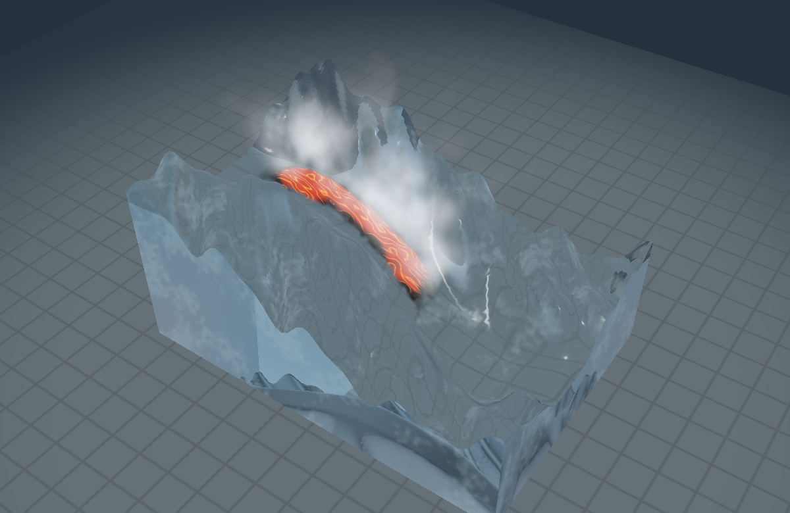

[접촉 중 PBR·계산 격자·형상 샘플·수심](Artifacts/SurfaceSimulation/Glacier_Lava_Grids.png) · [냉각 뒤 PBR·수심·얼음·온도](Artifacts/SurfaceSimulation/Glacier_Lava_Cooled.png) · [실행 데이터](Artifacts/SurfaceSimulation/glacier-lava.json)

### 굳은 용암 외관 비교

같은 카메라와 370프레임(약 6.17초)에서 용암을 식힌 뒤 비교했다. 기존 화면에서 한 줄의 검은 띠로 보이던 영역에 높이 편차와 밝은 빛을 받는 돌 표면이 드러난다. 18프레임에는 침착 형상이 나타나기 전 얼음이 보이고, 112프레임에는 같은 형상 위의 용암 발광과 응결 구름을 확인했다.

Debug 빌드, CPU·GPU 비교 17개 케이스, 텍스처 캡처 회귀 및 관련 SPIR-V 셰이더 3개 검증이 통과했다. Glacier Cut의 표면 물, 잔류 얼음, 기화 누계와 최대 기화율은 기존 결과와 일치했다.

[기존 캡처](Artifacts/SurfaceSimulation/Glacier_Lava_Deposit_Before.png) · [두께와 암석 음영 적용 후](Artifacts/SurfaceSimulation/Glacier_Lava_Deposit.png)

### 얼음 보충과 금속 받침

초기 표층 얼음을 4.6302 g에서 8.1029 g으로 늘리고, 접촉 열이 줄어드는 구간을 3.2초에서 4.4초로 늘렸다. Glacier Cut의 8초 표면 물이 2.6646 g에서 5.0368 g으로 증가했다. 새 조건에서 잔류 얼음은 0.0532 g, 기화는 3.0129 g이었다. 외부 물 주입, 흡수, 출구 유출은 0이었다. 표준 및 용융 포켓 조건의 CPU·Vulkan 대조를 통과했다. 최대 물 수지 오차는 표준 조건의 0.0060 mg이었다. PBR 캡처에서 직접 보이는 받침과 얼음 아래에 비치는 받침에 브러시드 스틸을 확인했다.

[8초 PBR·수심 비교](../../../Build/SceneReview-20261126/GlacierMetal/GlacierPBRAndDepth.png) · [CPU·Vulkan 결과](../../../Build/SceneReview-20261126/GlacierMetal/Vulkan/GlacierCut.json)

### 수로 본체를 강철로 교체

두 Glacier Cut 조건의 실제 바닥과 측면에 브러시드 스틸을 연결했다. 같은 형상과 접촉열에서 초기 표층 얼음 8.1029 g, 8초 표면 물 5.0368 g, 기화 3.0129 g, 흡수와 유출 0 g은 직전 실험의 수치와 같았다. CPU·Vulkan 대조에서 강철 음영 선택과 얼음 본체 굴절 미사용을 JSON으로 따로 확인했다. 초기 캡처에 국소 얼음층이 보이고, 8초 캡처에 강철 바닥과 하류 융해수가 함께 보인다.

[초기 PBR](../../../Build/SceneReview-20261126/GlacierSteelBed/GlacierSteelBed-Initial.png) · [8초 PBR·수심](../../../Build/SceneReview-20261126/GlacierSteelBed/GlacierSteelBed-Final.png) · [CPU·Vulkan 결과](../../../Build/SceneReview-20261126/GlacierSteelBed/Vulkan/GlacierCut.json)

### 강철 수로 위 Snow 003 적설

Glacier Cut 두 조건의 고체 물 상태를 `Snow`로 저작하고, 벌크 밀도 250 kg/m³와 Snow 003 재질을 공용 적설 패스에 연결했다. 첫 프레임, 접촉 1.6초와 8초의 PBR에서 적설 높이와 하류 물을 확인했다. CPU·Vulkan 대조에서 초기 눈 8.1029 g, 8초 표면 물 5.0368 g, 기화와 질량 수지는 앞선 강철 수로 결과와 일치했다. Snow on Fabric에서 같은 프레임의 이전 PBR 캡처와 픽셀이 일치했다.

[첫 프레임](../../../Build/SceneReview-20261126/GlacierSnow003/GlacierCut-Snow-Start.png) · [용암 접촉](../../../Build/SceneReview-20261126/GlacierSnow003/GlacierCut-Snow-Contact.png) · [8초 PBR·수심](../../../Build/SceneReview-20261126/GlacierSnow003/GlacierCut-Snow-Final.png)

## 데모 격자와 수면 경계

기본 프리셋 9개에서 PBR·계산 격자·형상 샘플·수심의 4뷰를 캡처했다. 계산 해상도는 장면에 따라 다음과 같이 조정했다.

| 장면 | 이전 → 현재 계산 격자 | 현재 형상 샘플 |
|---|---:|---:|
| Cavity fill & spill | 2×1 → 16×8 | 64×40 |
| Grooved brick | 3×1 → 12×5 | 36×20 |
| Snow on canvas, Charring, Terrace, Kiln | 10×7 → 14×10 | 56×40 |
| Cascade, Ice substrate | 12×8 → 16×12 | 64×48 |
| Freeze and thaw | 1×1 → 1×1 | 36×28 |

동결·해빙은 닫힌 트레이 한 곳에서 같은 질량의 상별 부피와 수위를 비교한다. 2×1 포켓은 정적 보유 용량과 월류 시점을 재는 기준으로 별도 검사했다. 16×8 포켓에서는 원본 OBJ·노멀·높이·변위 입력 모두 9 g 주입 뒤 8초에 출구로 4.34–4.77 g을 보냈고 물 수지 최대 잔차는 0.0060 mg, 비교 시점의 최대 CPU·GPU 질량 차이는 0.0303 mg이었다. 벽돌의 12×5 프리셋은 1.2 g 주입 뒤 8초에 하류 절반과 출구에 0.409 g이 도달했다.

아래 두 장은 원본 OBJ, 16×8, 150프레임(2.5초)으로 맞췄다. 보간을 켜면 PBR 물가의 직각 경계와 수심 뷰의 물줄기 단차가 줄어든다. 좁고 얕은 수로에는 형상 샘플 간격과 계산 상태에 따른 경계가 일부 남는다.


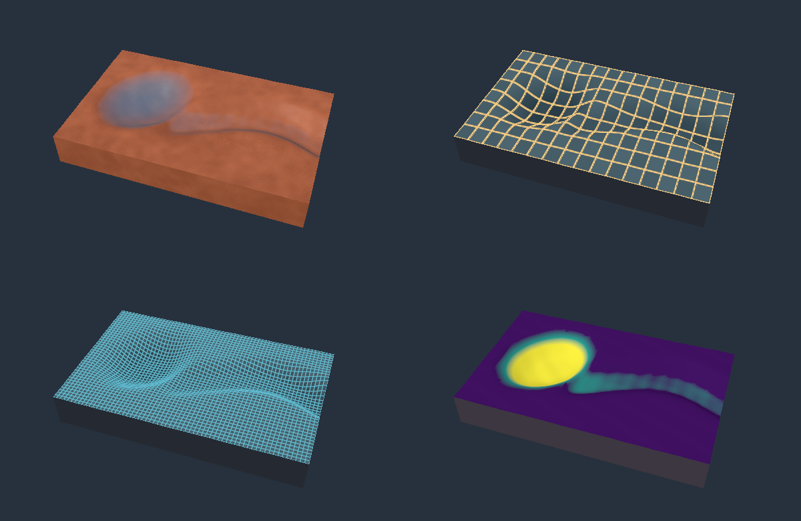

## 00. 검증 항목과 결과

| 검사 | 기대와 실제 결과 | 자료 |
|---|---|---|
| 벽돌 수위와 중력 | 첫 홈이 턱을 넘기 전의 용량은 수평에서 **1.830 mL**, 5°에서 **0.789 mL**다. 수평에 1.2 mL를 넣을 때 공유 면의 유량이 0이고, 8초 시점에 다음 두 저장소에 0.12 mL 이상 도달했다. | [기울이기 전](Artifacts/SurfaceSimulation/Runoff_BeforeTilt.png) · [후](Artifacts/SurfaceSimulation/Runoff_AfterTilt.png) · [데이터](Artifacts/SurfaceSimulation/runoff.json) |
| 네 방향 출발량 제한 | 가운데 셀의 가용량 1 g으로 이웃 네 곳이 각각 0.8 g을 요청하는 경우, 공통 배율 **0.3125**를 얻었다. | [CPU 검증 코드](../../../Source/Application/Editor/SurfaceSimulation/Experiments.cpp) |
| 눈과 흡수·건조 | 초기 눈 2.539 g이 녹았다. 최대 흡수수 **1.573 g**, 8초 잔류 **0.775 g**, 건조 장부 **1.764 g**이다. 별도의 건조 반감기 시험에서는 반감기 2초일 때 1 g이 **0.500 g**으로 감소했다. | [3D](Artifacts/SurfaceSimulation/Textile_Melt.png) · [2D](Artifacts/SurfaceSimulation/textile.png) · [데이터](Artifacts/SurfaceSimulation/textile.json) |
| 탄화와 불 | 최대 탄화율은 **96.8%**다. 불 활성도는 최대 **0.395**에서 8초 때 **0.045**로 감소했다. | [3D](Artifacts/SurfaceSimulation/Charring_Active.png) · [2D](Artifacts/SurfaceSimulation/charring.png) |
| 2D 집수면·격자 변형 | 시작한 행 밖으로 20% 이상 이동했다. 기본 40×28/10×7에서 형상만 64×48, 계산만 16×10으로 변경한 경우에도 9.000 g 물량 수지가 맞고 CPU/GPU가 일치했다. | [3D](Artifacts/SurfaceSimulation/Terrace_Transport.png) · [기본](Artifacts/SurfaceSimulation/terrace.png) · [형상만 증가](Artifacts/SurfaceSimulation/terrace-geometry-64x48.png) · [계산만 증가](Artifacts/SurfaceSimulation/terrace-solver-16x10.png) |
| 복합 수로 | 고체 물의 용융, 수송, 표면 증발과 탄화를 한 장면에서 검사했다. 최대 수증기 입력은 **0.911 g/s**, 최종 증발 장부는 **3.815 g**, 최대 탄화율은 **93.4%**다. | [장면](Artifacts/SurfaceSimulation/Kiln_Cinematic.png) · [4뷰](Artifacts/SurfaceSimulation/Kiln_Views.png) · [2D](Artifacts/SurfaceSimulation/kiln.png) |
| 형상 어댑터 | **17,549정점** OBJ를 52×36 격자로 투영했다. 상수 높이차 제거 후 OBJ 표본 대비 RMS는 높이 맵 **0.0074 mm**, displacement **0.0135 mm**, 노멀 맵 **0.0173 mm**다. base + meso + micro 합이 입력을 복원했다. 같은 수위에서 base-only와 base+meso의 셀 저장 용량이 최대 **0.00649 mL** 차이 났다. 동일 초기 상태로 두 입력을 CPU·GPU에서 실행했다. | [형상 분해](Artifacts/SurfaceSimulation/geometry.png) · [지표](Artifacts/SurfaceSimulation/geometry.json) · [base-only](Artifacts/SurfaceSimulation/mesh-base-only.png) · [base+meso](Artifacts/SurfaceSimulation/mesh-base-and-meso.png) |
| 수치 정합 | 5개 기본 장면과 4개 격자·형상 변형에서 1,920 스텝(8초), 48스텝마다 비교했다. 최대 CPU 물 장부 잔차 **0.0155 mg**, 최대 CPU/GPU 셀 질량 차이 **0.00233 mg**, 수위에서 복원한 총량 절대 오차 합은 최대 **0.00122 mg**이었다. 모든 비교는 CPU의 독립적인 구간별 역함수와 GPU 이분법을 사용했다. | 이 표의 JSON과 [검증 코드](../../../Source/Application/Editor/SurfaceSimulation/Experiments.cpp) |
| UI와 Vulkan | 장면 전환, 55×28 형상과 10×7 계산 격자, 4뷰, 직접 CPU/GPU 실행, PNG/SVG/JSON과 프레임 캡처를 실사용 흐름에서 확인했다. 새 경로에서 core/sync 오류는 관찰되지 않았다. 작은 메모리 전용 할당에 대한 best-practices 경고는 남아 있다. | [UI 캡처](Artifacts/SurfaceSimulation/SurfaceLab_UI.png) |

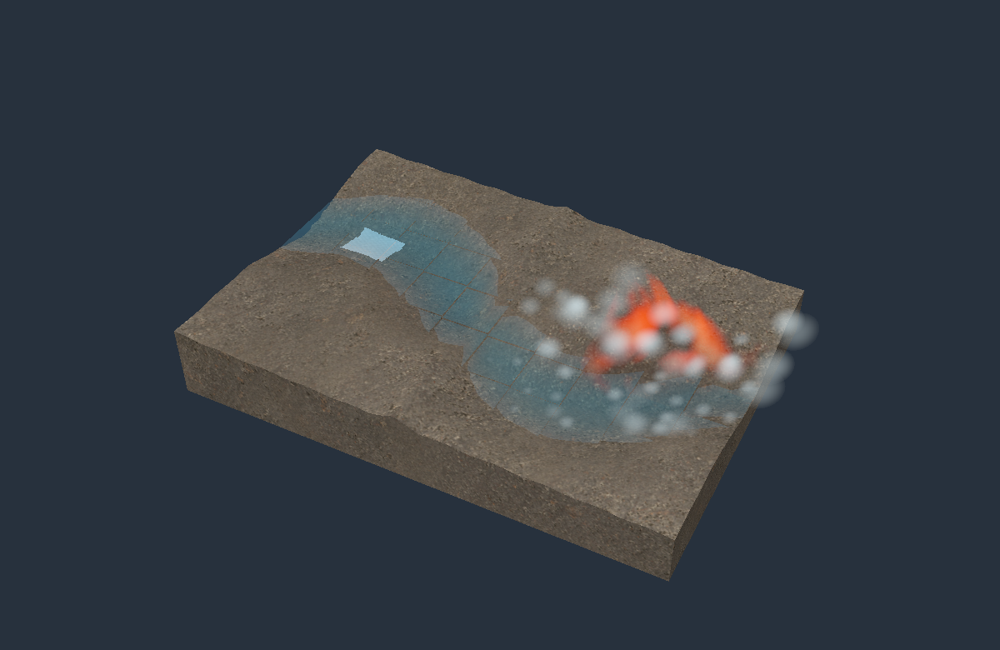

소스와 형상 해상도를 바꾸는 시험은 입력과 상태 계약을 검증한다. 일반화된 격자 수렴이나 실험 재료의 물성을 입증하는 시험에는 다른 기준 자료가 필요하다.

## 01. 렌더링 비용

텍스처 도입 이전 렌더러에서 GPU 타임스탬프로 **그리기 구간**을 측정했다. 동일한 Kiln spillway, 뷰 1개, 1200×780, 동일한 250프레임 시퀀스를 모드별로 5회 실행했다. 첫 30프레임 후 마지막 유효 120표본을 집계했다. 아래 값은 다섯 실행 평균의 중앙값이다.

| 모드 | GPU 그리기 시간 |
|---|---:|
| Translucent | 0.0404 ms |
| Fresnel | 0.0408 ms |
| Screen refraction | 0.0712 ms |

Screen refraction은 오프스크린 불투명 color/depth 패스를 추가한다. 이 결과는 같은 장비와 시퀀스의 비교다. compute, VSync, 파일 저장 비용은 타임스탬프 범위에서 제외했다. [원본 CSV](Artifacts/SurfaceSimulation/shading-timing.csv)

## 02. 재질 표시와 PNG 검증

이전 벽돌 캡처의 기울인 뒤 프레임은 59,346픽셀의 알파가 255보다 작았다. 복합 수로에서는 34,098픽셀이 해당했다. 물·수증기·불의 소스 알파가 최종 색에 합성된 뒤에도 저장 파일에 복사되었기 때문이다. 수정한 렌더러는 드로우에서 불투명한 대상 알파를 유지하고 캡처를 RGB로 인코딩한다.

다섯 장면의 3D 이미지 일곱 장과 UI 캡처를 다시 생성했다. UI에서 `Material textures`를 끄고 켜면서 Lit 뷰는 바뀌고 수심 히트맵의 표시가 유지되는 것을 확인했다. 같은 스텝으로 캡처한 복합 수로의 텍스처 ON/OFF 프레임은 223,683개의 RGB 픽셀이 달랐다. 발표 이미지 19장은 모두 RGB로 디코딩되고 투명도 청크가 없음을 확인했다. [텍스처 ON/OFF](Artifacts/SurfaceSimulation/Texture_On_Off.png) · [UI 캡처](Artifacts/SurfaceSimulation/SurfaceLab_UI.png)

GPU 캡처 회귀 검사는 `Tests/SurfaceSimulationCaptureTest.cmake`로 두 모드의 PNG 헤더와 캡처 차이를 검사한다. Vulkan 장면 검사를 켜면 `MDSS_SurfaceSimulationCapture`로 등록된다. 텍스처의 출처·라이선스·가공 내역은 [재질 소스](../../../Assets/Textures/SurfaceSimulation/README.md)에서 확인한다.

## 03. 불꽃 표현 재검증

같은 판자, 카메라, 시뮬레이션 스텝을 기준으로 기존 카드와 볼륨 표현을 비교했다. 점화 전·활성·8초 이후를 다시 캡처하고, 연속 프레임으로 불꽃의 높이와 갈라지는 위치가 변하는지 확인했다. 늦은 프레임에서 불꽃이 약해지고 그을음은 남는다. 복합 수로에서는 굴절을 켜고 최대 4뷰까지 렌더했다. 변경된 SPIR-V 5개, 기준·수송 CTest 3개, 복합 수로 CPU/GPU 비교, RGB·텍스처 캡처 회귀 검사를 통과했다. [전후 비교](Artifacts/SurfaceSimulation/Flame_Comparison.png) · [움직임](Artifacts/SurfaceSimulation/Charring_Motion.gif) · [약해진 뒤의 캡처](Artifacts/SurfaceSimulation/Charring_Late.png)

## 04. 높이 차가 있는 수로와 얼음 PBR

두 장면에서 64×48 형상 샘플과 12×8 계산 셀을 사용했다. 2초 동안 물 15.00 g을 공급하고 총 1,920 서브스텝(8초)을 실행했다. 하류 도달량은 하류 절반에 남은 물과 열린 경계를 통과한 물의 합이다.

| 장면 | 표면 최고점과 최저점 차이 | 하류 도달량 | CPU/GPU 최대 셀 질량 차이 | 자료 |
|---|---:|---:|---:|---|
| Canyon cascade | 71.05 mm | 14.56 g (97.1%) | 0.00698 mg | [비교](Artifacts/SurfaceSimulation/Cascade_Relief_Comparison.png) · [2D](Artifacts/SurfaceSimulation/cascade.png) · [데이터](Artifacts/SurfaceSimulation/cascade.json) |
| Glacier cut | 67.07 mm | 14.95 g (99.7%) | 0.000284 mg | [비교](Artifacts/SurfaceSimulation/Glacier_PBR_Comparison.png) · [2D](Artifacts/SurfaceSimulation/ice.png) · [데이터](Artifacts/SurfaceSimulation/ice.json) |

같은 스냅샷으로 계단형 수로의 PBR과 등고선을, 빙하 수로의 Fresnel과 PBR을 비교했다. 빙하의 초기 얼음 레이어 질량은 0이며 바닥이 고체 얼음이다. 물과 얼음의 화면용 광학 계수는 조정값이다. 4뷰 동시 실행과 PNG 형식, 기존 RGB·텍스처 캡처 회귀 검사, SPIR-V 5개, 일곱 기본 장면의 CPU/GPU 비교를 통과했다. 새 캡처와 CPU/GPU 실행에서 Vulkan core·synchronization 오류는 관찰되지 않았다. 전체 CTest는 9/10으로 SurfaceMapping의 기존 seam fixture 실패가 다시 발생했다.

### 맑은 얼음

동일한 96프레임 시퀀스에서 입사·출사 굴절을 적용한 PBR PNG를 이전 셰이더와 비교했다. 받침의 선이 투과 경로에서 휘어 보인다. Fresnel에서는 이전 RGB와 픽셀이 일치했다. 빙하의 8초 CPU/GPU 수치 JSON도 바이트 단위로 일치했다. Debug 빌드, SPIR-V 5개, CTest 3개와 4뷰·RGB 캡처 회귀를 확인했다.

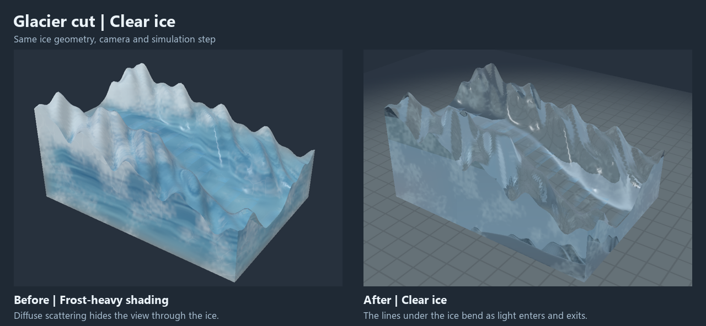

## 05. 메조형상 포켓과 네 가지 입력 비교

**상태 · 실행 완료.** 100×62 mm 시편의 동일한 포켓을 14,065정점 OBJ와 145×97 RGB8 맵 세 종류에서 재구성했다. 기준은 64×40 샘플로 투영한 원본 OBJ다. 네 실행은 2×1 계산 셀, 수평 자세, 4초 동안 물 9.00 mL 주입의 조건을 공유한다. 전체 높이 RMS를 계산할 때 입력별 상수 높이 오프셋을 제거했다.

| 입력 | 바닥 RMS | 턱까지 깊이 | 턱까지 저장 부피 | 넘침 시점 |
|---|---:|---:|---:|---:|
| 원본 OBJ | 기준 | 4.645 mm | 1.999 mL | 1.175 s |
| 노멀 맵 | 0.0236 mm | 4.606 mm | 1.964 mL (−1.76%) | 1.163 s |
| 높이 맵 | 0.0082 mm | 4.627 mm | 1.992 mL (−0.36%) | 1.171 s |
| signed displacement | 0.0109 mm | 4.612 mm | 1.984 mL (−0.74%) | 1.167 s |

넘침 시점은 하류 셀에 남은 물과 열린 경계로 빠진 물의 합이 처음 0.01 mL에 도달한 시뮬레이션 시간이다. CPU에서 1/240 s마다 감지하고, GPU의 물량·수위·면 후보는 48스텝마다 CPU와 대조했다. 두 솔버에서 네 입력으로 1,920스텝을 검증했다. 수위가 턱을 넘기 전에 하류 도달량이 임계치를 넘는 경우를 거부한다. 정량 결과는 이 형상, 해상도, 인코딩에 대한 비교다.

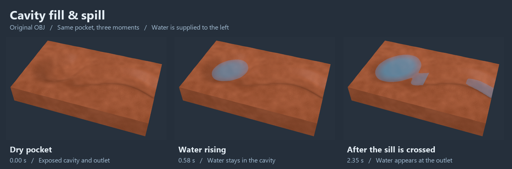
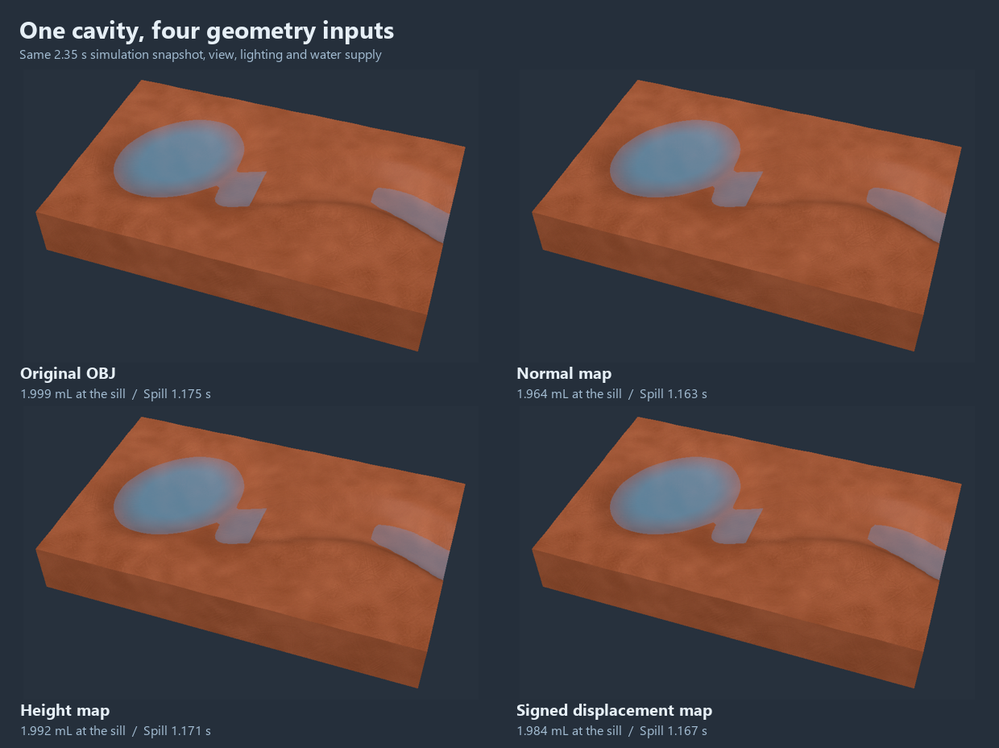

[형상 단면과 도달량 그래프](Artifacts/SurfaceSimulation/Cavity_Accuracy.png) · [비교 수치 JSON](Artifacts/SurfaceSimulation/Cavity_Accuracy.json) · [입력과 인코딩](../../../Assets/Geometry/README.md)

### 수면 경계 보간

같은 포켓과 2×1 계산 셀에서 142프레임째 Fresnel과 PBR을 각각 캡처했다. 옵션을 끈 Fresnel RGB가 이전 캡처와 픽셀 단위로 일치했다. 옵션을 켜면 턱 부근의 직선 경계가 약해졌다. 시작 프레임에서 두 모드의 RGB가 일치했고, 넘기 전 프레임에서 달라진 픽셀은 포켓 주변에만 있었다. 원본 OBJ의 8초 CPU/GPU 실험 JSON이 변경 전 결과와 바이트 단위로 일치했다.

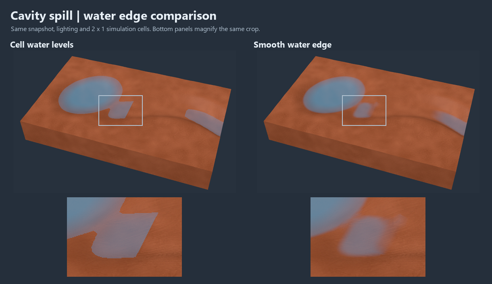

포켓 PBR·Fresnel, 집수면과 벽돌, 4뷰의 PBR·진단 뷰, 기존 PNG 회귀 검사와 SPIR-V 다섯 개, CTest 세 개를 확인했다. 해당 캡처에서는 Vulkan core·synchronization 오류가 관찰되지 않았다.

## 06. 격자와 상태 뷰

**상태 · 실행 완료.** 같은 카메라와 스냅샷에 계산·형상 격자를 4뷰로 그렸다. 포켓은 2×1 계산 셀과 64×40 형상 샘플, 빙하는 12×8 계산 셀과 64×48 형상 샘플이다. 벽돌의 폭이 서로 다른 3×1 계산 구획도 확인했다.

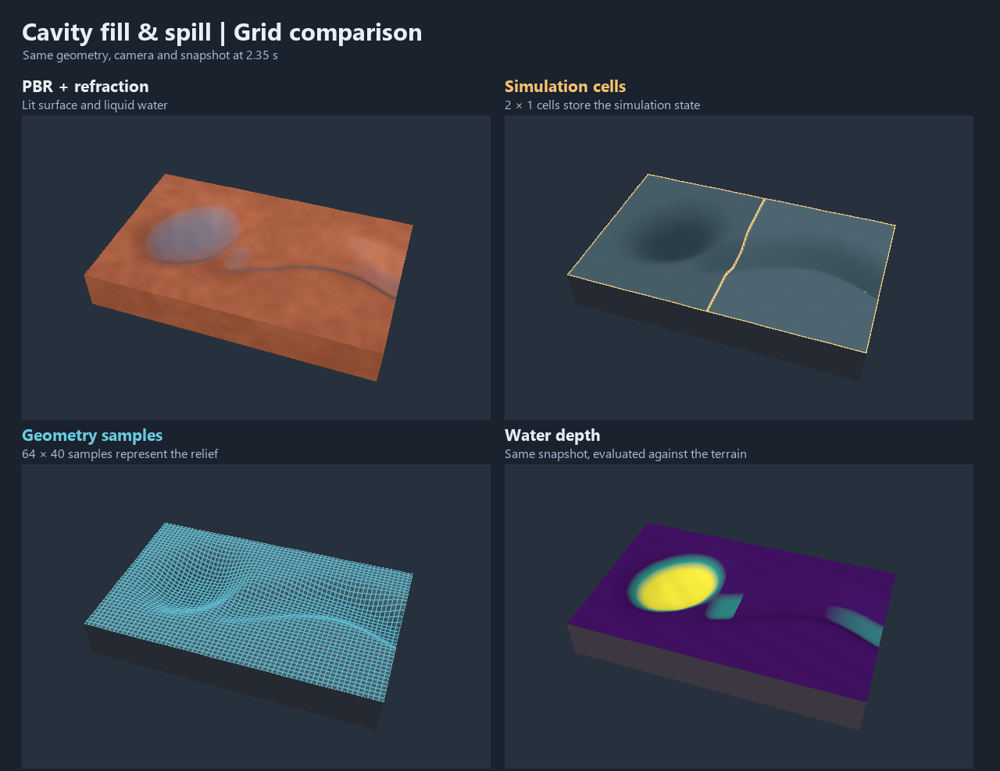

천의 시작 프레임에서는 상태 타일에서 눈·얼음만 검출됐다. 1.20초에는 눈·얼음, 표면 물, 흡수수가 검출됐다. 가열 수로에서는 표면 물과 탄화가 동시에 검출됐고 흡수수 색은 검출되지 않았다. 각 분류는 GPU PNG에서 색 범위를 확인했다. 값의 크기는 개별 히트맵과 표시 스냅샷을 기준으로 읽는다.

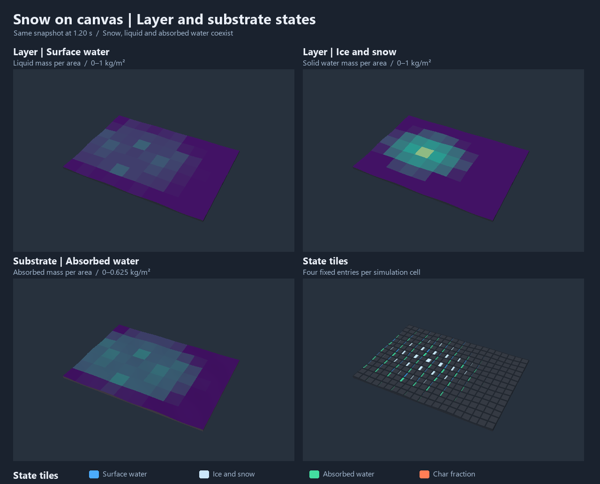

[빙하 4뷰](Artifacts/SurfaceSimulation/Glacier_Grid_Views.png) · [가열 수로 탄화 비교](Artifacts/SurfaceSimulation/Kiln_State_Views.png) · [벽돌의 비균일 구획](Artifacts/SurfaceSimulation/Runoff_Nonuniform_Grid.png)

## 07. 동결·용융과 장면 연출

**상태 · 실행 완료.** 36×28 형상 샘플과 계산 셀 하나의 닫힌 트레이에 물 12.00 g을 두고 8초 동안 실행했다. 카메라를 고정한 렌더에서 파란 눈금과 밝은 눈금을 비교했다. 양은 빈 트레이 바닥부터 계산한 높이다.

| 단계 | 점유 부피 | 표시 수면 높이 |
|---|---:|---:|
| 액체 | 12.000 mL | 5.357 mm |
| 완전 동결 | 13.086 mL | 5.842 mm |
| 용융 완료 | 12.000 mL | 5.357 mm |

전체 질량 편차 최대 **0.0400 mg**, CPU/GPU 최대 셀 질량 차이 **0.000931 mg**, 형상으로 복원한 부피의 최대 절대 오차 **0.00000121 mL**였다. 출구 유출과 증발·건조는 0이었다. 입력 온도는 278.15 K에서 265.15 K로 낮춘 뒤 289.15 K까지 올렸다. 상변화 속도는 지정 온도를 쓰는 축약 모델이다.

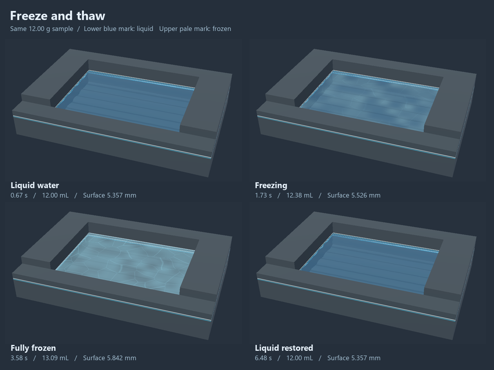

Debug 빌드, SPIR-V 6개와 1,920 스텝의 CPU/GPU 비교를 완료했다. 기존 8개 장면의 11개 입력 실행도 통과했다. 보관본과 공통인 수치 지표, 시간 계열과 형상 배열이 일치했다. 전체 CTest는 9/10이고 기존 SurfaceMapping 이음매 테스트가 실패했다. 동결 시퀀스의 31개 프레임, 동일한 시점의 4뷰, 계단 수로의 고정·연출 카메라를 캡처했고 RGB 캡처 회귀 검사를 통과했다.

[동결·용융 GIF](Artifacts/SurfaceSimulation/FreezeThaw_Animation.gif) · [4뷰](Artifacts/SurfaceSimulation/FreezeThaw_Grid.png) · [질량·부피·온도 곡선](Artifacts/SurfaceSimulation/FreezeThaw_Chart.png) · [수치 JSON](Artifacts/SurfaceSimulation/freeze-thaw.json) · [계단 수로 카메라](Artifacts/SurfaceSimulation/Cascade_Cinematic_Camera.png)

## 08. 나무 예열과 공통 얼음 광학

**상태 · 실행 완료.** Charring Wood의 최고 셀 온도는 시작 시 293.15 K, 1초 시점에 386.80 K였다. 1초까지 불 활성도와 탄화율은 0이었다. 첫 불 활성도는 1.433초에 기록됐고, 8초의 최고 셀 탄화율은 0.937이었다. 최고 온도와 탄화 활성도는 동일한 CPU·GPU 상태 비교에서 검증했다.

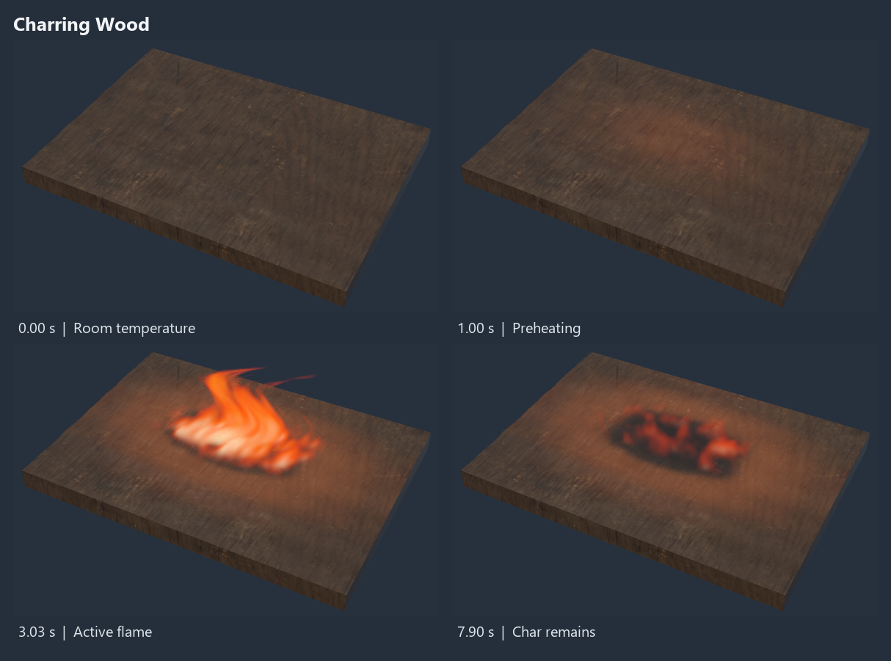

Snow on Canvas의 0.40초 PBR 프레임에서 기존 흰 피복 대신 얼음 아래의 직조 무늬와 가장자리의 약한 산란을 확인했다. 8초의 질량 시간 계열 40개 표본이 기존 기록과 일치했다. Glacier Cut의 고정 카메라 96프레임째 1,200×780 RGB 전체가 기존 캡처와 픽셀 단위로 일치했다. Freeze and Thaw의 동결 상태에도 같은 얼음 투과·반사 함수를 적용했다.

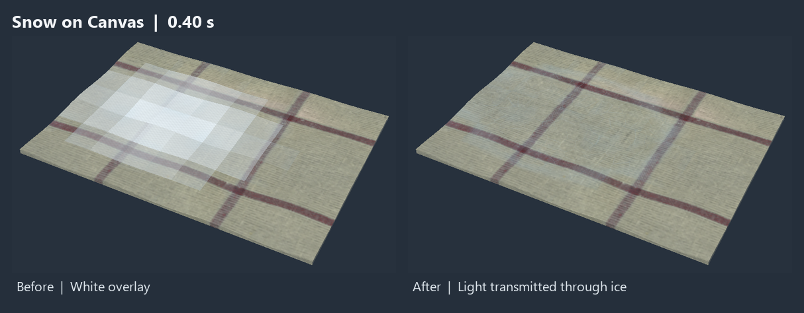

CPU·GPU 비교는 Charring Wood, Snow on Canvas, Glacier Cut, Kiln, Freeze and Thaw의 각 1,920스텝을 통과했다. SPIR-V 진입점 6개와 RGB 캡처를 확인했다. 전체 CTest는 기존 SurfaceMapping 이음매 검사를 제외한 9/10이 통과했다.

[나무 수치 기록](Artifacts/SurfaceSimulation/Charring_Warmup.json) · [나무 예열 4뷰](Artifacts/SurfaceSimulation/Charring_Preheat_Views.png) · [캔버스 4뷰](Artifacts/SurfaceSimulation/Textile_Ice_Views.png) · [빙하 RGB 대조](Artifacts/SurfaceSimulation/Glacier_Shared_Ice.png) · [동결 수면](Artifacts/SurfaceSimulation/FreezeThaw_Shared_Ice.png)

## 09. 재현 방법

```powershell
cmake --preset windows-msvc-x64
cmake --build Build --config Debug --target MDSS
python Tools/surface_simulation_geometry_fixture.py Build/lab-inputs
Build/bin/Debug/MDSS.exe --check-surface --surface-geometry-fixtures Build/lab-inputs --surface-output Build/lab-data
python Tools/surface_simulation_plot.py Build/lab-data/kiln.json
Build/bin/Debug/MDSS.exe --capture-surface --surface-scene kiln --surface-views 4 --surface-shading refraction --frames 220 --surface-capture Build/kiln.png
Build/bin/Debug/MDSS.exe --capture-surface --surface-scene cascade --surface-views 2
Build/bin/Debug/MDSS.exe --capture-surface --surface-scene ice --surface-shading pbr
Build/bin/Debug/MDSS.exe --capture-surface --scene Assets/Scenes/CavityFillAndSpill.Scene --surface-views 2
Build/bin/Debug/MDSS.exe --capture-surface --surface-scene cavity --surface-shading fresnel --surface-water-edges smooth --frames 142 --surface-capture Build/cavity-smooth.png
Build/bin/Debug/MDSS.exe --check-surface --surface-scene cavity --surface-output Build/lab-cavity
python Tools/surface_simulation_cavity_plot.py Build/lab-cavity
Build/bin/Debug/MDSS.exe --capture-surface --surface-scene cavity --frames 142 --surface-view-modes pbr,simulation-grid,geometry-grid,depth --surface-capture Build/cavity-grids.png
Build/bin/Debug/MDSS.exe --capture-surface --surface-scene textile --frames 73 --surface-view-modes layer-water,layer-ice,absorbed,state-tiles --surface-capture Build/textile-states.png
Build/bin/Debug/MDSS.exe --capture-surface --surface-scene freeze-thaw
Build/bin/Debug/MDSS.exe --check-surface --surface-scene freeze-thaw --surface-output Build/lab-freeze-data
python Tools/surface_simulation_plot.py Build/lab-freeze-data/freeze-thaw.json
Build/bin/Debug/MDSS.exe --capture-surface --surface-scene freeze-thaw --frames 216 --surface-view-modes pbr,simulation-grid,geometry-grid,layer-ice --surface-capture Build/freeze-grid.png
Build/bin/Debug/MDSS.exe --capture-surface --surface-scene cascade --surface-animate-camera
ctest --test-dir Build -C Debug --output-on-failure
```

`--capture-surface`을 시간 제한 없이 실행하면 조작 패널을 연다. UI는 `Captures/Surface/`에 파일을 저장한다. Python 3.10 이상에서 PNG와 SVG를 생성한다. Pillow가 있으면 PNG에도 제목·눈금을 그린다. SVG에는 항상 제목·눈금이 포함된다.

전체 CTest는 **9/10 통과**했다. 남은 항목은 SurfaceMapping의 seam fixture 경고다. 변경 전 main 커밋 `50638e4`의 별도 복사본에서 같은 seam fixture 실패를 재현했다. 엔진 기본 진입점은 `--frames 3`으로 초기화와 종료까지 확인했다. [기존 검증 이력](Records/Validation-History-Through-2026-11-10.md)

## 08. 기존 에디터 실행 검증

기본 실행 스크립트로 MDSS Engine을 열어 Kiln spillway가 나오는 것을 확인했다. 왼쪽 Scene에서 Cavity Fill & Spill을 선택하고, 중앙 툴바에서 Simulation and geometry grids를 열었다. 오른쪽 Views에서 4뷰 RGB PNG를 저장했다. 같은 창에서 기존 반응 씬으로 전환한 뒤 Demos로 돌아왔다. 명시한 기존 씬 실행, CPU 기준과 자동 캡처에 쓰이는 CLI는 계속 쓸 수 있다.

Experiments의 CPU/GPU 실행 결과는 9.000 g을 주입한 Cavity 8초 실험이다. CPU·GPU 셀 순간 질량 차이 최대값은 0.001397 mg, 전체 물량 장부 잔차는 0.09544 mg이다. Python 결과는 1080×690 RGB이며 Pillow가 없는 환경에서도 그래프 레이블과 단위를 그린다. 4뷰 캡처는 633×571 RGB다.

- [4뷰 캡처](Artifacts/SurfaceSimulation/Editor_Cavity_4Views.png)
- [CPU/GPU 그래프](Artifacts/SurfaceSimulation/Editor_Cavity_GPU.png) · [정량 결과](Artifacts/SurfaceSimulation/Editor_Cavity_GPU.json)

기존 단독 캡처 회귀 스크립트는 통과했다. CTest는 9개 통과, 기존 SurfaceMapping의 이음매 경고 기대값 1개 실패다. 확인한 에디터 조작 구간에서 Vulkan core·synchronization 검증 오류는 로그에 없었다.

## 계산 셀 내부의 넘침과 GPU 시간

형상에서 자동으로 찾은 두 홈을 부모 셀 한 개에 유지했다. 최저 고개가 3 mm인 표본에서 한쪽에 0.20 mL, 누적 0.59 mL를 공급한 뒤 양 방향 모두 수신 질량 0이었다. 누적 0.70 mL를 공급하고 1초 후 0.0233 mL와 0.0481 mL가 반대쪽에 도달했다. 별도의 6 mm 턱에서는 수평의 수신 질량이 0이고, 5° 기울인 뒤 1초의 수신량은 0.1026 mL였다. 이 검사에서 최대 CPU·GPU 질량 차이는 6.41×10⁻¹⁰ kg이다. [넘침 원자료](Artifacts/SurfaceSimulation/Subgrid_Basin_Overflow.json)

RX 6700 XT에서 32×32 형상과 8×8 기본 계산 격자를 사용했다. 측정 대상은 고정 자세에서 급수를 포함한 compute 스텝이다. 같은 셰이더에서 셀별 질량 하나를 쓰는 대조군과 자동 분할을 교차 실행했다. 32스텝을 묶은 타임스탬프 30개를 버리고, 유효한 80묶음을 조건당 네 번 수집했다.

| 조건 | 저장 영역 | GPU μs/스텝 중앙값 | p90 μs |
|---|---|---|---|
| 한 셀에 두 홈, 대조군 → 자동 | 64 → 65 | 155.15 → 93.25 | 162.60 → 97.08 |
| 모든 셀에 두 홈, 대조군 → 자동 | 64 → 128 | 160.00 → 72.01 | 165.04 → 76.35 |

입력 형상과 급수는 각 비교 쌍에서 동일하다. 홈별로 질량을 보존하면 젖는 표본의 크기와 평탄한 저장 영역의 비중이 바뀐다. 이 결과는 해당 형상에서의 시스템 비용을 보여 준다. 대규모 기울기, 전체 프레임, 저장 영역만 분할한 순수 오버헤드는 별도 측정 대상이다. [GPU 타임스탬프 원자료](Artifacts/SurfaceSimulation/Subgrid_Basin_GPU_Timing.json)

```powershell
MDSS --check-surface --surface-scene runoff --surface-profile-basins --surface-output Build/LabValidation
```

### 교체 가능한 세 가지 형상

이 기록은 당시 단일 포켓, 쌍둥이 홈, 계단형 수로와 네 가지 입력의 비교다. CPU와 Vulkan으로 실행한 12개 조합이 포켓 저장·하류 유출·CPU/GPU 허용 오차 검사를 통과했다. 현재 씬의 형상 입력은 [직접 Height Map으로 지정](../02_Architecture/01_Contracts/08_Surface-Simulation.md)한다. [원본 메시 기준 복원 오차와 수송 결과](Artifacts/SurfaceSimulation/Geometry_Set_Validation.json) · [PBR 비교 캡처](Artifacts/SurfaceSimulation/Geometry_Set_Comparison.png) · [분지 넘침 그림](Artifacts/SurfaceSimulation/Subgrid_Basin_Overflow.png)


## 씬 직접 Height Map 이관

이관 전 Height Map 옵션으로 실행한 기본 Cavity의 2×1 기준 격자와 16×8 데모 격자를, 같은 PNG·배율·격자에 대한 이관 후 실행과 비교했다. 두 CPU/Vulkan JSON 보고서가 일치한다. 2×1 기준에서 턱까지 보유 부피는 2.8490 mL, 첫 월류는 1.45417 s다. 단일 포켓, 쌍둥이 홈과 계단형 수로의 배포 씬도 CPU/Vulkan 검사를 통과했다.

BrickCube Lava의 기존 노멀 적분 바닥을 기본 형상 256×256에서 16비트 맵으로 베이크했다. 같은 격자에서 높이 최대 차이는 0.0000505 mm, 분리된 저장 영역 수는 8,454 → 8,448이다. 8초 후 하류 질량은 3.15244 → 3.15235 mg, CPU/Vulkan 최대 질량 차이는 0.000565 mg 이하다. 해당 숫자는 기본 격자의 이관 회귀에 해당한다. [실행 결과 폴더](../../../Build/HeightMapSceneInput) · [직접 참조 캡처](../../../Build/HeightMapSceneInput/Cavity-HeightMap.png)

### BrickCube Lava 동일 프레임 캡처

기존 노멀 적분 빌드와 Height Map 빌드에서 같은 씬 설정·고정 카메라로 PBR 및 용암 두께를 캡처했다. 솔버와 렌더의 SPIR-V 7개는 해시가 일치한다. 240프레임은 960스텝(4.0초), 480프레임은 1,920스텝(8.0초)이다. 두 시점에서 PBR의 주황색 용암 픽셀 위치가 일치했다. 원본 1200×780의 두 뷰 전체에서 RGB 채널 차이의 최댓값이 8단계를 넘는 픽셀은 4초에 0개, 8초에 6개였다. 두 시점의 현재 격자와 조명에 대한 표시 비교다. [전후 확대](../../../Build/HeightMapSceneInput/LavaVisualComparison/BrickCube-Lava-Before-After.png) · [픽셀 비교 방법과 수치](../../../Build/HeightMapSceneInput/LavaVisualComparison/VisualMetrics.json)

## 에셋 이관 검증

- 벽돌과 천을 `--scene`으로 직접 열고, Surface Simulation 별칭에서도 같은 에셋을 읽었다. PNG는 각각 1200×780 RGB다. [벽돌 캡처](Artifacts/AssetMigration/runoff.png) · [천 캡처](Artifacts/AssetMigration/textile.png)
- 기존 메시 씬 17개와 새 씬 2개를 각각 3프레임 실행했다. 기존 40개 오브젝트의 직접 할당이 이전 맵과 일치하고, 14개 응답 프로파일의 본문 바이트가 동일하다. 브릭의 여섯 표면 기본 할당, 프로파일 오버라이드, 렌더 전용 표면, 저장 후 다시 열기를 Vulkan 씬 테스트에서 확인했다.
- 구형 배포 파일 제거 후 Surface Simulation GPU 검사에서 13개 보고서를 다시 생성했다. 벽돌·천의 최대 CPU–GPU 셀 질량 오차는 각각 0.00758 mg과 0.000124 mg이다. [벽돌 수치](Artifacts/AssetMigration/runoff.json) · [천 수치](Artifacts/AssetMigration/textile.json)
- 벽돌과 산의 기존 성능 프리셋을 128 해상도에서 워밍업 2프레임·측정 3프레임으로 실행했다. 기존 연구 요청의 경로를 사용해 plate/mud 커플링을 각각 1초 실행하고 저작 과제 입력 생성도 확인했다.
- 기본 Debug CTest는 9/10 통과다. `MDSS_SurfaceMapping`의 UV seam 경고 기대 조건이 실패한다. 추가 Vulkan 씬 검사 4개 중 직접 프로파일, 애니메이션, 용암 재시작 3개가 통과했다. `MDSS_SceneResources`는 Raw State 렌더링에서 용량 초과 값 두 개를 구별하는 검사에서 실패한다.


## 천 위 적설

`Snow on canvas`의 PBR 뷰에서 30, 150, 320프레임을 같은 카메라로 캡처했다. 적설은 밝고 거친 표면을 가지며 두께가 줄어들수록 작은 패치로 나뉘고 젖은 천이 드러난다. [초기 적설](Artifacts/SurfaceSimulation/Textile_Snow_Early.png) · [녹는 중](Artifacts/SurfaceSimulation/Textile_Snow_Melting.png) · [젖은 천](Artifacts/SurfaceSimulation/Textile_Snow_Wet_Cloth.png)

### 용융수 가시성과 젖은 자국 비교

같은 카메라와 기본 14×10 계산 격자, 56×40 형상 표본에서 반복 요철 바닥과 중앙에 얕은 홈 하나를 둔 바닥을 비교했다. 후자는 흡수율을 0.60에서 0.24 s⁻¹로 낮추고 두 구역의 건조율을 0.18 s⁻¹로 맞췄다. 6초 시점 잔류 표면 물은 0.240 g에서 0.849 g으로 늘었다. 8초 시점 눈 중심 표본의 흡수수 면밀도는 최대값 대비 13.6%에서 100%가 됐다. 초기 눈 질량은 중심을 옮기면서 2.531 g에서 2.570 g으로 바뀌었다. 수정 후 최대 질량 수지 오차는 0.0116 mg이며 CPU–GPU 최대 셀 질량차는 0.0000109 mg이다. [전후 캡처](../../../Build/TextileWetnessVerification/before-after.png) · [수정 전 보고서](../../../Build/TextileWetnessVerification/Before/textile.json) · [수정 후 보고서](../../../Build/TextileWetnessVerification/After/textile.json)

### 평면과 요철 바닥 대조

두 최신 씬은 같은 프로파일, 초기 눈 2.569587 g, 온도·격자·건조 입력을 사용한다. 아이디와 `surfaceRelief`만 다르다. GPU 검사에서 바닥 높이차는 평면 0 mm, 요철 3.571 mm였다. 8초 총 흡수량은 각각 1.005426 g과 1.005429 g이었다. 중심 표본의 흡수 면밀도는 각 장면의 최대값 대비 100%와 2.74%여서 총량이 거의 같아도 자국의 분포가 달라졌다. [같은 구도의 GPU 비교](../../../Build/CanvasReliefVerification/flat-vs-ruffled.png) · [평면 데이터](../../../Build/CanvasReliefVerification/Data/SnowOnCanvas.json) · [요철 데이터](../../../Build/CanvasReliefVerification/Data/SnowOnCanvas_Ruffled.json)

### 기본 씬과 변형 8쌍

같은 카메라 설정과 시각에서 원본과 변형의 PBR·진단 뷰를 캡처했다. `--check-surface --surface-output Build/SceneVariantVerification/Data`에서 각 장면의 CPU–GPU 일치, 질량 수지, 수위 복원 오차를 검사했다. 표의 수치는 원본에서 변형으로 읽는다. [8쌍 비교 캡처](../../../Build/SceneVariantVerification/all-comparisons.png) · [비교 수치](../../../Build/SceneVariantVerification/comparison-metrics.json)

| 변형 | 바꾼 조건 | 확인한 결과 |
|---|---|---|
| `BrickRunoff_ClosedOutlet` | 유출 경계 닫기 | 8초 유출량 1.137 g → 0 g |
| `CharringWood_PreWetted` | 가열 전 0.1초 동안 가운데에 물 2.4 g 공급 | 3초 최고 탄화율 0.493 → 0.324 |
| `CavityFillAndSpill_TwinPockets` | 쌍둥이 홈 OBJ | 8초 두 번째 홈 중심 수심 0 → 6.13 mm |
| `FreezeAndThaw_WideTray` | 트레이 너비 84 → 126 mm | 동결 상승폭 0.485 → 0.323 mm, 최대 부피 약 13.086 mL로 일치 |
| `TerracedCatchment_WideInlet` | 같은 급수 중심에서 차트 V 방향으로 폭 40 mm에 걸쳐 급수 | 총 급수량 9 g 유지, 0.30초 물막이 급수 폭 방향으로 더 넓게 퍼짐 |
| `CanyonCascade_FastPour` | 15 g의 주입을 2.0초에서 0.5초로 압축 | 0.6초 시점 표면 물 4.5 → 15.0 g |
| `GlacierCut_ShortHeatPulse` | 접촉 열의 감소 구간 3.2 → 1.2초 | 8초 남은 표층 얼음 0.006 → 0.309 g |
| `KilnSpillway_LowTilt` | 최대 기울기 18° → 4.6° | 8초 표면에 남은 물 0.079 → 1.362 g |

기존 에셋 이관 검증과 새 실행의 천 JSON은 동일했다. 초기 고체 물 저장량은 2.539 g이고, 8초 후 남은 고체 물은 0 g, 천에 남은 흡수수는 0.777 g이다.


## 적설 높이와 용융수 지속 시간

적설은 프로파일의 기준 밀도를 사용한다. 초기 면밀도 설정 상한 0.85 kg/m²를 250 kg/m³로 나누면 두께 상한은 3.4 mm다. 천 씬에서 기본 카메라 고도를 23°로 낮춰 적설 높이 변화를 관찰했다. [초기 적설](Artifacts/SurfaceSimulation/Textile_Snow_Relief_Early.png) · [녹는 중](Artifacts/SurfaceSimulation/Textile_Snow_Relief_Melting.png) · [후반 천](Artifacts/SurfaceSimulation/Textile_Snow_Relief_Wet_Cloth.png) · [PBR·수심·표면 물·흡수수 비교](Artifacts/SurfaceSimulation/Textile_Snow_Relief_States.png)

표시만 적용한 대조 실행에서는 기존 결과 JSON 13개가 모두 일치했다. 이전 천의 8초 시점 흡수수는 전체 면적 평균 0.056 kg/m², 국소 최대 0.352 kg/m²였다. 기존 음영 식의 평균 바탕 밝기 입력 변화가 작았다. 확대율이 같은 320프레임 캡처의 젖은 부분을 비교했을 때 표시 RGB의 가중 평균은 136.1에서 99.6으로 내려갔다. 이 픽셀값은 시연용 외관 확인에 쓰며 실물 반사율을 뜻하지 않는다.

천의 흡수 계수를 1.80 s⁻¹에서 0.60 s⁻¹로 낮추고, 물 질량의 변화와 표시를 따로 확인했다. 용량 제한에 닿기 전, 공급·수송이 없는 조건의 표면 물 반감기는 0.39초에서 1.16초로 늘었다. 실제 씬에서는 4초 시점에 표면 물이 0.095 g에서 0.575 g으로, 최고치는 0.528 g에서 1.059 g으로 바뀌었다. CPU·GPU는 매 스텝 수송 뒤 용융·흡수를 수행한다. 같은 스텝에 생성된 용융수도 흡수될 수 있고, 남은 표면 물의 수송은 다음 스텝에서 계산한다. [실험 수치](Artifacts/SurfaceSimulation/Textile_Snow_Relief_Measurements.json)

## 최대 해상도에서의 수송과 표시

64×64 형상 표본에 64×64 계산 셀을 생성했다. 4,096개 셀과 열린 오른쪽 출구를 포함한 8,128개 연결을 채우고, 마지막 셀에서 급수한 뒤 네 스텝 동안 이웃 유입, 흡수, 출구 유출, 총질량을 확인했다. CPU와 Vulkan GPU의 최대 질량 차이는 3.41061×10⁻¹³ kg이었다.

같은 64×64 설정의 벽돌을 121프레임 동안 실행해 PBR, Water Depth, Simulation Cells, Geometry Samples를 RGB로 캡처했다. 두 격자 뷰가 최대 해상도로 표시됐다. 기존 급수점 부근의 수면이 높게 솟는 현상도 관찰했다. 이 캡처의 목적은 해상도와 그래픽 버퍼 접근 검증이다.

## 고정 면적 자동 급수

부분 표본을 가로지르는 사각형을 평평한 네 영역에 겹쳐 25%, 50%, 25%, 0%로 배분되는지 검사했다. 이 표는 초기 급수 위치인 5 mm 테두리에서 실행한 결과다. 벽돌에서는 형상 샘플 64×64, 급수 면적 17.58 mm², 총량 0.0012 kg, 1/240초 간격을 공통으로 쓰고 480스텝을 실행했다. 최대 수심은 급수 영역의 CPU 값이며, CPU와 GPU의 질량 차이는 급수 종료 시점에 비교했다.

| 계산 격자 | 주요 급수 영역 수 | CPU 및 GPU 물량 장부 | 최대 수심 | 최대 CPU·GPU 질량 차이 |
|---|---:|---:|---:|---:|
| 16×16 | 1 | 0.0012 kg | 0.526608 mm | 9.09×10⁻¹² kg |
| 64×64 | 16 | 0.0012 kg | 8.37962 mm | 1.82×10⁻¹² kg |

MSVC Debug 빌드와 RX 6700 XT에서 `MDSS_SurfaceSimulationReference`, `MDSS_SurfaceSimulationGpu`, `MDSS_SurfaceSimulationCapture`가 통과했다. 새 계산 SPIR-V도 검사했다. 기본 벽돌 해상도에서는 별도로 480스텝 뒤 PBR·수심·계산 격자·형상 격자를 캡처했다. 캡처 로그에서 앞선 빌드와 같은 Vulkan 표시 레이아웃 경고가 한 번 기록됐다.

## 벽돌 테두리의 줄무늬

같은 면적과 급수량으로 급수 사각형의 중심을 높이 5 mm의 테두리에서 높이 1 mm의 홈 입구로 11.25 mm 옮겼다. 기본 격자 12×5와 형상 샘플 36×20에서 8초 후 5 mm 테두리 표본 336개 중 양의 수심을 가진 표본은 108개에서 0개로 줄었다. 중앙 단차 너머에 약 0.421 mL가 남았다. 같은 카메라의 6초 시점에서 `Smooth water edge`를 끈 PBR과 수심을 비교해 외곽 줄무늬가 사라졌는지 확인했다. 수송식과 수면 표시 규칙은 기존과 같다.

### 홈의 벽면 곁에서 밝아진 수심

기본 벽돌에서 8초의 원시 수심을 폭 방향으로 대조했다. 형상 샘플 X 인덱스 26에서 양쪽 벽과 중앙은 각각 0.813 mm였다. 기존 보간은 5 mm 턱과 낮은 홈을 평균한 높이를 수면의 경계 기준으로 써서 홈에 밝은 띠를 만들었다. 현재 바닥 정점 높이를 사용한 뒤 6초의 Smooth 캡처에서 밝은 띠가 사라졌다. 원시 수심 캡처의 전체 PNG 해시는 전후가 동일했다. Debug 셰이더 빌드, 수면 정점 SPIR-V 검증, `MDSS_SurfaceSimulationCapture`가 통과했다.

### 기울어진 표본에서 잠긴 부피 적분

한 표본과 두 표본으로 이루어진 닫힌 영역에서 양과 음의 25° 기울기 모두 삼각형 해와 CPU·GPU 수위를 대조했다. 같은 부피식으로 수송 상한도 계산한다. 분리된 홈 사이의 넘침 검사를 포함한 CPU·GPU·캡처 CTest 3개와 계산 SPIR-V 검증이 통과했다.

형상을 36×20으로 유지하고 240 Hz 벽돌을 8초까지 진행했다. 계산 12×5에서 동일 바닥의 최대 수심 점프는 0.531에서 0.224 mm로, 계산 36×20에서는 0.553에서 0.227 mm로 줄었다. 후자의 원시 수심을 투영 면적으로 적분한 부피와 저장 부피의 차이는 약 0.23150 mL에서 0.00000023 mL로 줄었다. 이 적분은 표본별 수평 수면 높이와 실제 기울어진 직사각형의 교차로 계산했다.

같은 렌더러에서 이전·현재 계산 셰이더만 교체해 PBR·수심을 캡처했다. 두 프레임의 계산 격자·형상 격자 픽셀은 동일했다. 높은 수심의 연속 줄무늬는 옅어졌고 낮은 수심의 셀 경계는 일부 보인다. 이전·현재 캡처에서 기존 Vulkan 표시 레이아웃 경고가 재현됐다.

## 눈에 가려진 얇은 융해수 표시

`Snow on Canvas`의 기준 계산에서 2.4초에 표면 물 1.575 g과 고체 눈 0.372 g이 남았다. PBR은 보간한 수면의 색과 반사를 수심 0.85 mm에 걸쳐 서서히 합성했기 때문에 얇은 물막이 천과 비슷하게 보였다. 기준 깊이를 0.16 mm로 맞추고 광학 경로 배율과 반사 조명을 조정했다. 기존 직조 텍스처의 밝기 패턴을 적갈색 알베도로 변환했다. 256×256 텍스처의 거칠기 채널을 원본과 픽셀별로 비교했을 때 차이는 0이었다.

1.5초, 2.5초, 4.0초에 같은 카메라와 고정 스텝으로 PBR과 수심을 비교했다. 세 수심 뷰의 전후 RGB가 각각 일치했고, 8초 CPU·GPU 검증 보고서도 전후 바이트 단위로 일치했다. 최종 캡처에서 평평한 천의 연속 물막과 주름진 천의 분리된 웅덩이를 확인했다. [전후 비교](Artifacts/SurfaceSimulation/Textile_Meltwater_Appearance.png) · [주름진 천의 PBR·수심](Artifacts/SurfaceSimulation/Textile_Ruffled_Meltwater.png)

## 체크무늬 천, 가열 수로와 계열별 재생

배포된 9개 원본과 9개 변형의 카메라 분류, 자동 기울기 최대각, 급수량·급수 시간, 접촉 열 감소 시간을 대조했다. 각 계열의 시간 입력이 일치했다. 넓은 급수, 융해수 포켓, 닫힌 출구는 공간 조건을 바꾸는 변형으로 사용한다. `CharringWood_PreWetted`의 첫 캡처에는 이미 물막이 있고, 0.2초 기록에서 표면 물 2.400 g을 확인했다. [이전 타이밍 입력](../../../Scripts/Research/Fixtures/SceneTiming/README.md)은 기존 비교를 재현할 때 사용할 수 있다.

Heated Water Channel의 열린 변형과 닫힌 변형 모두 흡수수 0 g이었다. 같은 18° 기울기에서 8초 누적 유출량은 열린 씬 9.337 g, 닫힌 씬 0 g이었다. 연료 패드 밖의 탄화율 최댓값은 0이었다. 같은 빌드의 PBR 캡처에서 두 천의 아이보리·머스터드 체크, 은회색 수로 반사, 연료 패드의 불꽃과 수증기를 확인했다. [최종 비교 캡처](Artifacts/SurfaceSimulation/CheckCanvas_HeatedWaterChannel.png)

## 공용 스트립 조명 비교

벽돌은 151 프레임과 481 프레임, 눈 맞은 천은 241 프레임, Glacier Cut은 169 프레임에서 PBR과 물 두께 뷰를 함께 캡처했다. 각 쌍은 `--surface-no-studio-strip`만 바꿨다. 네 쌍에서 PBR 픽셀이 달라졌고, 두께 뷰의 RGB는 모든 픽셀이 동일했다. 벽돌은 물의 거칠기만 0.12에서 0.65로 바꿨을 때도 PBR 픽셀이 달라졌고 두께 뷰는 동일했다. 거칠기 1.4 입력은 로더가 거부했다.

기울어진 벽돌에는 밝은 반사 띠가 드러나며 천과 빙하의 같은 프레임에서는 변화가 더 작게 보인다. 별도 Debug 빌드의 에디터에서 `Render Options → Studio strip light`를 끄면 벽돌의 반사 띠가 사라지는 것을 확인했다. Surface Simulation CPU·GPU 보고서 25개, 그중 시나리오 판정 16개, SPIR-V 6개와 텍스처 캡처 회귀를 확인했다. [PBR 켜기·끄기 비교](Artifacts/SurfaceSimulation/StudioStripComparison.png)

## 재질 노멀 맵과 바닥 광택 비교

Grooved Brick 151 프레임과 Snow on Canvas 241 프레임에서 고정 카메라로 PBR을 캡처했다. 기존 PBR과 넓은 소프트박스·재질 노멀을 적용한 화면을 비교한 뒤 새 조명에서 재질 노멀 토글만 바꿨다. 잔요철이 조명에 반응하는 부분은 벽돌에서, 넓은 윤기와 표면 결은 천에서 확인할 수 있다. 주름 변형도 같은 프레임에서 재질 노멀을 켜고 끈 비교에 포함했다.

기존 조명, 새 조명에서 노멀 OFF, 새 조명에서 노멀 ON의 물 두께 뷰는 두 기본 씬에서 픽셀 단위로 일치했다. PBR 뷰의 RGB 해시는 세 조건에서 달랐다. 원본은 `Build/Validation/MaterialNormals`에 보관했다. [기존 PBR과 광택 비교](Artifacts/SurfaceSimulation/MaterialGlossComparison.png) · [새 조명에서 노멀 ON/OFF](Artifacts/SurfaceSimulation/MaterialNormalComparison.png)

## 거칠기와 정반사 배율 비교

Grooved Brick의 151번째 프레임과 Snow on Canvas 및 주름 변형의 241번째 프레임을 고정 카메라에서 각각 세 번 캡처했다. 기준에서 마른 거칠기(dryRoughness)는 벽돌 0.80, 천 0.86이며 정반사 배율(specularScale)은 1.0이다. 첫 비교에서는 마른 거칠기만 0.38로 낮추고, 두 번째 비교에서는 정반사 배율만 2.5로 높였다.

각 장면에서 세 PBR 이미지의 RGB 해시가 모두 달랐고, 표면 물 두께의 RGB는 모든 픽셀이 일치했다. 거칠기를 낮췄을 때 벽돌의 반사와 천 주름의 윤기가 더 좁게 표현됐다. 정반사 배율을 높였을 때 기존 반사의 밝기가 커졌고, 평평한 천에서 변화가 가장 잔잔했다.

벽돌의 specularScale 키를 생략한 재질은 1.0을 명시한 재질과 같은 PBR 이미지를 냈다. 상한 4.0을 넘긴 4.1은 로더가 거부했다. RGB 해시와 원본은 Build/Validation/SpecularScale에 보관했다. [세 조건 비교 캡처](Artifacts/SurfaceSimulation/SpecularScaleComparison.png)


## 고정 가열 수로와 초원의 젖은 띠

가열 수로와 초원 모두 자동 기울기를 0°로 두었다. 강철 수로에 19 g을 공급한 실행은 8초 동안 출구로 13.24 g을 내보냈다. 최대 증발률은 0.984 g/s이고 흡수수, 탄화율, 불꽃 활성도는 모두 0이었다. 4뷰 캡처에서 급수 쪽과 하류에서 물길의 가로 위치가 바뀌는 것을 확인했다. [가열 수로 4뷰](Artifacts/SurfaceSimulation/HeatedWaterChannel_Fixed_Views.png)

초원 비교의 지형, 점화 위치와 시간, 28×24 계산 그리드, 56×48 형상은 동일하다. 점화 입력은 4.45초에 끝난다. 급수한 경우 30 g 중 흡수수의 최댓값은 27.01 g이었다. 건조 조건에서 맞은편 관측 띠(차트 V > 0.72)의 첫 불꽃 활성도 0.1 초과는 4.417초였다. 급수 조건은 8초 동안 해당 띠에서 0.1을 넘지 않았다. 두 조건 모두 외부 점화가 끝난 뒤 점화 범위 밖에서 활성도 0.1을 넘겼다. CPU·GPU 간 최대 온도 차이는 급수 0.0095 K, 건조 0.0007 K였다. 급수 조건의 최대 질량 장부 오차는 0.45 mg이었다. [같은 시각 비교](Artifacts/SurfaceSimulation/MeadowFirebreak_Comparison.png) · [급수 중 4뷰](Artifacts/SurfaceSimulation/MeadowFirebreak_Water_Fixed_Views.png) · [점화 후 급수 4뷰](Artifacts/SurfaceSimulation/MeadowFirebreak_Fixed_Views.png) · [점화 후 건조 4뷰](Artifacts/SurfaceSimulation/MeadowFirebreak_Dry_Fixed_Views.png)

## BrickCube 노멀로 복원한 상면의 용암 수송

`BrickCube Lava`의 64×64 형상 표본과 32×32 계산 셀에서 용암 21 g을 주입했다. 비교군은 같은 씬의 기울기 배율을 0.55에서 0.000001로 낮춰 거의 평평하게 만들었다. 알베도, 재질, 카메라, 주입과 자세 스케줄은 같은 입력을 사용했다.

8초에서 복원된 바닥의 높이 범위는 2.663 mm다. 하류 절반에 남은 용암은 복원한 경우 4.730 g, 평평한 경우 5.190 g이었다. 4,096개 형상 표본 중 907개에서 용암 두께가 0.25 mm보다 크게 달랐다. 최대 두께 차이는 1.371 mm였다. 두 경우 모두 닫힌 상면에 약 21.000 g을 유지했다. 노멀을 사용한 경우 질량 수지의 최대 오차는 0.009 mg, CPU·GPU 최대 질량 차이는 약 0.0004 mg이었다.

480 프레임의 PBR, 두께, 계산 셀 및 형상 표본 뷰를 캡처했다. Debug 빌드, 관련 SPIR-V 검사와 텍스처 토글 캡처 회귀를 통과했다. 캡처 실행에서 기존 표시 레이아웃 경고가 기록됐다. 원본 및 JSON은 `Build/Validation/BrickCubeLava`에 보관했다. [PBR](Artifacts/SurfaceSimulation/BrickCubeLava.png) · [동일 프레임 비교](Artifacts/SurfaceSimulation/BrickCubeLavaComparison.png)

### 줄눈을 따라 흐르는 용암과 PBR 노멀

급수를 4 g으로 낮추고 폭 1.8 mm의 급수 영역을 복원된 줄눈에 맞췄다. 노멀의 기울기 배율은 1이며 복원 높이차는 4.842 mm다. 같은 급수와 기울기를 쓰는 평탄 대조군과 8초 상태를 비교하면 최대 깊이는 1.970 mm에서 2.989 mm로 올라갔다. 64×64 알베도의 청회색 표본(`R − B < 22`로 얻은 줄눈 근사) 위의 깊이 합 비율은 평탄 대조군 41.2%, 복원 형상 51.0%였다. 14초 캡처는 복원된 홈이 두께 분포를 좁은 줄로 나누는 것을 보여 준다. [형상·조명 대조 캡처](../../../Build/BrickCubeGrooveVerification/NormalAndGrooves.png) · [복원 형상 수치](../../../Build/BrickCubeGrooveVerification/Data/BrickRunoff_BrickCubeLava.json) · [평판 수치](../../../Build/BrickCubeGrooveVerification/Data/BrickCubeLava_FlatControl.json)

복원 형상을 유지하고 `Material normal map`만 끈 14초 캡처와 비교했다. 같은 구도의 2픽셀 간격 표본에서 PBR 픽셀 13,262개가 달라졌고 두께 뷰에서 달라진 표본은 0개였다. 기존 캡처 배리어와 소형 메모리 할당에 대한 Vulkan 경고가 남아 있다.

기울기 배율을 1.0에서 1.5로 높인 후 같은 급수와 경계로 다시 실행했다. 상면의 최대·최소 높이 차이는 4.842 mm에서 7.263 mm로 바뀌었다. 최종 상면 용암은 4.000 g, 질량 수지 오차는 0.80 µg, CPU·GPU 최대 질량 차이는 0.16 µg였다. 14초 전후 비교에서 액상 표면 전체의 주황색과 밝은 흐름 무늬를 확인했다. 3초 빙하 캡처에서 냉각된 가장자리의 크러스트가 보인다. [전후 비교](../../../Build/BrickCubeLavaAppearanceVerification/BeforeAndAfter.png) · [PBR과 두께 뷰](../../../Build/BrickCubeLavaAppearanceVerification/Updated-14s.png) · [CPU·GPU 수치](../../../Build/BrickCubeLavaAppearanceVerification/Data/BrickRunoff_BrickCubeLava.json)

### 독립 적분·형상·수송 해상도

같은 512×512 노멀맵을 원본 크기로 적분해 256×256 형상 표본을 만들었다. SciPy의 독립 코사인 변환 기준과 엔진의 높이 RMS 차이는 약 0.000002 mm였다. 250×190으로 직접 지정한 적분 해상도도 GPU 렌더링까지 실행했다.

닫힌 BrickCube 상면에 4 g을 주입하고 8초의 상태를 비교했다. 줄눈 추정 마스크는 색상 텍스처에서 R−B < 22인 샘플로 정의했다. 도달 거리는 이 마스크에서 용암 두께가 0.1 mm 이상인 가장 먼 +X 표본과 급수 중심의 거리다.

| 수송 셀 | 줄눈 도달 거리 | 최대 두께 | 계산 SSBO | GPU 수송 평균 |
|---|---:|---:|---:|---:|
| 64×64 | 30.27 mm | 3.98 mm | 5.13 MiB | 1.75 ms/frame |
| 128×128 | 28.71 mm | 3.90 mm | 9.02 MiB | 1.67 ms/frame |

GPU 시간은 RX 6700 XT에서 재생 480프레임 중 최근 120프레임에 대한 단일 실행 평균이다. 프레임마다 고정 스텝 4개를 수행했다. 두 조건 모두 4.000 g을 유지했고, 최대 질량 수지 오차는 2.67 µg, CPU·GPU 최대 질량 차이는 0.55 µg였다. 128×128에서 저장 상태가 3.89 MiB 더 필요했고 화면에서 물길이 길어지지 않아, 기본 수송 해상도는 64×64로 정했다.

128×128 경계 셀의 유출·흡수, 면적 급수, 수동 국소 입력, 경사 쐐기, 월류와 Cavity 입력 회귀를 통과했다. [GPU 비교](../../../Build/HighResolutionVerification/Solver-Comparison.png) · [정량 비교](../../../Build/HighResolutionVerification/Comparison-Metrics.json)

같은 64×64 수송 상태에서 `--surface-water-edges cell`과 `smooth`를 비교했다. 8초의 확대 캡처에서 셀별 수위 표시가 벽돌 높이장의 얕은 경계와 맞물려 용암에 가는 줄을 만들었다. 연결된 영역의 표시 수위를 보간하면 줄이 대부분 사라졌다. 이 옵션은 수송 질량과 저장 수위를 바꾸지 않는다. [수면 경계 확대 비교](../../../Build/HighResolutionVerification/Liquid-Boundary-Comparison.png)

#### PBR에서 얕은 발광막의 두께 표현

씬 입력을 고정하고 12초와 32초의 GPU 캡처를 비교했다. 32초에는 줄눈이 두께 뷰에 이어져 있고, 얇은 막도 불투명하게 그린 비교군의 PBR에서는 넓게 덮인 것처럼 보였다. 발광 막을 프래그먼트의 차트 위치에서 두께에 따라 바닥에 합성하면 벽돌 윗면과 진한 줄눈을 읽을 수 있다. 12초 용암 두께, 32초 용암 두께와 레이어 상태 뷰 각각의 전후 차이는 0픽셀이었다. `Surface.frag`와 `Refraction.frag`의 SPIR-V 검사를 통과했다. [32초 확대 비교](../../../Build/BrickCubeMortarFlow/Mortar-Rendering-Comparison.png) · [픽셀 검사](../../../Build/BrickCubeMortarFlow/Rendering-Checks.json)

## Heated Water Channel의 접촉 냉각

이전 배포 씬 두 개는 `SnowIce` 상태를 명시하고 상류에 고체 물을 초기 배치했다. 범례는 씬 상태에서 이름을 읽어 `Snow`를 표시했다. 과거 증발률은 하류에 지정한 온도를 읽었고, 물과 접촉해도 강철 온도가 갱신되지 않았다.

현재 씬은 `SurfaceWater`와 `SubstrateTemperature`를 선언한다. 새 에디터의 Layer & Substrate 레이아웃에서 각각 해당 상태가 표시되는 것을 확인했다. PBR과 온도 뷰는 동일한 위치와 카메라에서 1, 55, 300 프레임을 비교했다. 물이 닿기 전에 금속만 발광하고, 접촉하면서 응결 구름이 생기며, 물길의 발광이 약해졌다. [PBR과 온도 비교](Artifacts/SurfaceSimulation/HeatedWaterQuench.png)

19 g을 넣은 뒤 8초에서 열린 수로는 3.703 g이 기화했고 14.137 g이 유출됐다. 접촉한 셀 하나에서 최대 1086.81 K가 내려갔다. 금속 표층 열손실 9594.493 J와 물의 기화에 쓰인 9594.510 J의 차이는 0.017 J다. 닫힌 수로는 4.042 g이 기화하고 유출량은 0 g이었다. 1460 K이지만 물을 붓지 않은 대조군과 293.15 K에서 물을 부은 대조군은 모두 기화량과 온도 하락이 0이다. 열린·닫힌 수로의 CPU/GPU 최대 온도 차이는 각각 0.0021 K 미만과 0.0087 K 미만이다. 보고서 및 대조군 씬은 `Build/Validation/HeatedWaterQuench`에 보관했다.

## 배포 씬 전수 점검

`Assets/Scenes`의 본편·변형 21개에서 씬과 프로파일의 상태 선언, 초기 질량·예약 주입·국소 반응, 경계 조건과 4뷰 캡처를 대조했다. CPU/GPU 수지·분포 비교는 포켓의 네 가지 입력과 기준 격자를 포함해 28개 보고서를 생성했다. 배포 21개는 아래 표에 모두 포함된다. [21개 PBR 캡처](Artifacts/SurfaceSimulation/SceneAudit.png)

| 계열 | 포함한 씬 | 확인한 동작 |
|---|---|---|
| 벽돌 물길 | BrickRunoff, BrickRunoff_ClosedOutlet | 물만 활성화된다. 1.2 g 주입 후 열린 경계는 1.137 g 유출되고 닫힌 경계의 유출은 0이다. |
| BrickCube 용암 | BrickRunoff_BrickCubeLava | 원본 노멀에서 복원한 상면에 용암 21 g을 공급한다. 8초 뒤 용암 질량이 약 21 g이다. |
| 협곡 | CanyonCascade, CanyonCascade_WideInlet | 물만 활성화된다. 배치한 입구에 따라 초기 분포가 달라지며, 8초에는 양쪽에서 약 12.3 g이 유출됐다. 후반 PBR만으로는 입구 변형을 구별하기 어렵다. |
| 홈 채움 | CavityFillAndSpill, CavityFillAndSpill_TwinPockets | 물만 활성화된다. 두 홈의 장면에서 두 저장부의 물과 하류 흐름이 보인다. 네 가지 형상 입력도 계산 검사에 포함했다. |
| 나무 | CharringWood, CharringWood_PreWetted | 마른 씬의 자동 물 공급은 0이고 젖은 씬의 초기 물은 2.4 g이다. 젖은 변형의 최고 불꽃 활성도는 0.275로 마른 씬의 0.407보다 낮았다. |
| 동결·해빙 | FreezeAndThaw, FreezeAndThaw_WideTray | 12 g이 물에서 얼음으로 갔다가 물로 돌아왔다. 기본 트레이에서 최대 점유 부피는 13.086 mL였다. |
| 빙하 | GlacierCut, GlacierCut_MeltPocket | 약 4.63 g의 표층 얼음이 지정된 열에 녹고 일부는 기화한다. 유출과 흡수는 0이다. 용암의 경로와 외관은 지정된 접촉 열원의 연출이다. 두 씬의 4분할에서 본체 하단이 보이도록 기본 카메라 거리를 조정했다. |
| 가열 수로 | HeatedWaterChannel, HeatedWaterChannel_ClosedOutlet | 두 씬의 눈·얼음은 0이다. 물 접촉에서만 바닥이 식고 기화한다. |
| 초원 | MeadowFirebreak, MeadowFirebreak_Dry | 젖은 씬은 물 30 g을 공급하며 흡수수가 최고 27.01 g이다. 마른 변형의 물과 흡수수는 0이다. 두 씬에서 계산 중 변하는 바닥 온도 상태를 선언했다. |
| 눈 맞은 천 | SnowOnCanvas, SnowOnCanvas_Ruffled | 눈 약 2.57 g이 녹아 물막과 흡수수로 이동한다. 최고 흡수수는 약 1.06 g이며 주름 변형에서는 물막이 분리된 홈에 고였다. |
| 계단식 집수 | TerracedCatchment, TerracedCatchment_WideInlet | 물 9 g이 닫힌 집수판에 남는다. 입구 폭의 차이는 공급 중에 비교하기 쉽고 두 씬의 후반 외관은 비슷하다. |

선언이 있는 씬에서는 활성 액체·얼음·흡수수·탄화 및 시간이 지나며 갱신되는 바닥 온도가 대응 상태에 연결됐는지 검사한다. 초원 변형에서 온도 선언을 제거한 대조군은 이 검사에서 거부됐다. 원본 4뷰와 보고서는 `Build/Validation/SceneAudit`에 보관했다. 관련 SPIR-V 검사와 텍스처 캡처 회귀가 통과했다. 캡처 실행의 기존 Vulkan 프레젠테이션 레이아웃 경고는 재현됐다.

## Firebreak의 공통 불꽃·기화·탄화 외관

짧은 불꽃 전용 분기를 걷어내 Charring Wood의 불꽃 밀도·요동·광학 적분을 공유한다. 초원의 바닥 온도가 높아진 셀에서 표면 물과 흡수수가 기화한다. 일반 건조 손실과 열 기화량을 구분하고, 열 기화량을 빙하와 같은 응결 구름에 전달한다. 탄화율이 높을수록 초원의 알베도와 정면 반사율을 낮추고 거칠기를 높여 검고 무광인 흔적을 표시한다.

30 g을 넣은 젖은 씬에서 첫 기화는 3.783초이고 8초까지 열로 기화한 물은 1.942 g이다. 샘플된 최대 기화율은 1.050 g/s다. 젖은 씬에서는 8초 동안 반대편의 불꽃 활성도가 0.1을 넘지 않았다. 마른 변형에서는 4.417초에 그 기준에 도달했고 기화량은 0 g이다.

두 초원 씬은 최종 Debug 실행 파일에서 CPU·GPU 비교를 통과했다. 젖은 씬의 최대 온도·활성도·탄화율 차이는 각각 0.665 K 미만, 0.00165 미만, 0.000194 미만이었다. 결합 전파의 장시간 비교는 온도·활성도·탄화율 한도를 각각 2 K·0.015·0.003으로 두고 실제 차이를 보고한다. 질량 수지·수위·기화율 비교 한도는 기존 값을 사용한다. 최종 수분 계수로 나머지 26개 CPU·GPU 보고서도 통과했다. SPIR-V 네 개와 텍스처 캡처 회귀를 확인했다.

4.33초의 기존·수정·마른 비교에서 수정한 젖은 띠에 응결 구름이 보인다. 6초에는 탄화된 전경과 남은 구름이 구별된다. 원본 4뷰와 보고서는 `Build/Validation/Firebreak`에 보관했다. [불꽃·수증기·탄화 비교](Artifacts/SurfaceSimulation/MeadowFirebreakSteamAndChar.png)

## 연결된 수면의 표시 보간

전후 모두 `--surface-view-modes pbr,layer-thickness --surface-water-edges smooth`로 캡처했다. 같은 카메라와 고정 스텝 수의 전후 비교는 벽돌 용암 1,920, 기본 Cavity 568, 두 포켓 180·720스텝이다. 보간을 끈 두께 뷰에서 마른 색이었던 위치 중 녹색 채널이 27 이상인 픽셀 수는 각각 22·151·50·171개에서 모두 0개로 줄었다. 기본 Cavity에 녹색 채널이 마른 색과 1단계 차이 나는 픽셀 하나가 남았다. 두 포켓 초기 프레임의 반대편 홈과 턱은 마르게 보였다. 새 점무늬는 확인되지 않았지만 기본 Cavity의 얇은 수로 두께 윤곽에는 셀 단차가 일부 보인다. [벽돌 확대](../../../Build/ConnectedSurfaceDisplay-20261125/BrickLava-Detail.png) · [Cavity](../../../Build/ConnectedSurfaceDisplay-20261125/Cavity-Comparison.png) · [두 포켓 초기](../../../Build/ConnectedSurfaceDisplay-20261125/TwinPocketsEarly-Comparison.png) · [픽셀 수 JSON](../../../Build/ConnectedSurfaceDisplay-20261125/Thickness-Coverage-Metrics.json)

Debug 셰이더와 SPIR-V 네 개를 확인했다. BrickCube Lava의 CPU·GPU 질량 최대 차이는 약 $5.48\times10^{-10}$ kg였다. Cavity의 네 형상 입력은 기존 CPU·GPU 검사에서 통과했다. `MDSS_SurfaceSimulationReference`와 텍스처 캡처 회귀도 통과했다. 물·용암 비교 캡처의 기존 프레젠테이션 레이아웃 경고는 전후 모두 발생했다.

## 마른 턱과 수로 물가의 표시 분리

원시 수심으로 물가를 잘랐던 위 구현과, 보간한 수위가 바닥과 만나는 선을 그리는 수정안을 비교했다. 기본 Cavity의 568스텝에서 두께 뷰의 수로 상단을 199개 픽셀 열로 샘플링했다. 세 열 사이 높이의 2차 차분 절댓값이 2픽셀을 넘는 곳이 5개에서 2개로 줄었다. 이 지표는 한 프레임의 화면상 윤곽을 비교한다. 같은 프레임의 원시 두께에는 해당 위치가 18개였다.

두 포켓이 분리되어 있는 180스텝에서 턱 440픽셀과 뒤에 채워지는 홈의 중심부 1,732픽셀은 모두 마른 색을 유지했다. 일반 Cavity 전체에서는 원시 두께가 마른 색인 위치 88픽셀에 얕은 경계가 표시됐다. PBR에서의 차이는 두께 뷰보다 작았다. GLSL 서식, Debug 셰이더 빌드, SPIR-V 네 개, 텍스처 캡처 회귀를 통과했다. 기존 프레젠테이션 레이아웃 경고가 캡처에서 발생했다. [전체 전후](../../../Build/CavityShoreline-20261125/Cavity-Comparison.png) · [수로 확대](../../../Build/CavityShoreline-20261125/Cavity-Channel-Detail.png) · [마른 턱 검사](../../../Build/CavityShoreline-20261125/TwinPocketsEarly-Comparison.png) · [원시 집계](../../../Build/CavityShoreline-20261125/Shoreline-Metrics.json)

## 물가 스무딩과 표시 수심 분리

Brick Runoff 스냅샷 세 장과 Twin Pockets 스냅샷 두 장을 같은 Vulkan 표시 슬롯에서 비교했다. ON과 OFF의 수심을 위에서 내려다보는 차트에 기록해 수평 투영 면적으로 적분했다. 수정 후 다섯 스냅샷 모두에서 ON/OFF의 수심과 젖은 영역이 픽셀 단위로 일치했다. 솔버의 질량과 수심, OFF 수심은 수정 전의 측정값과 같았다.

| 스냅샷 | 솔버 부피 | 이전 ON | 수정 후 ON과 OFF |
|---|---:|---:|---:|
| Brick Runoff, 8.00초 | 0.06307 mL | 0.04272 mL | 0.06304 mL |
| Twin Pockets, 0.73초 | 1.65000 mL | 1.61631 mL | 1.61744 mL |

두 스냅샷은 더 촘촘한 투영에서도 비교했다. Twin Pockets는 솔버의 표본별 높이와 매끄러운 렌더 바닥이 다르다. 0.73초에서는 두 스무딩 설정 모두 부피가 솔버보다 약 1.97% 작고 젖은 영역은 약 5.17% 다르다. 이 값은 두 영역의 합집합에 대한 불일치 면적이다. Brick Runoff, Twin Pockets, BrickCube Lava에서 실제 두께 뷰 PNG는 ON/OFF가 같았고 PBR PNG는 달랐다. PBR에서 Twin Pockets의 좁은 수면 틈은 원래 수심 경계에 남는다.

Debug 셰이더 빌드와 수정된 네 SPIR-V 스테이지 검증을 마쳤다. 현재 씬 형식을 지원하는 실행 파일에서 전체 CPU 기준, 두 물 씬의 GPU 검사, 텍스처 캡처 회귀가 통과했다. 재현용 셰이더·스크립트와 수치·PBR 캡처는 `Documents/MDSSP-Previews/SmoothWaterEdge-Fix-2026-11-25`에 있다.

## 비스듬한 시점의 수면 내부 틈

Twin Pockets의 0.73초 시점에서 같은 카메라로 PBR과 물 레이어만 흰색으로 그린 마스크를 캡처했다. 굴절을 끄고 바닥에 의한 가림을 해제한 대조에서도 빈 영역이 남았다. 저장 영역마다 다른 높이의 수면 조각이 비스듬한 시점에서 벌어지는 것을 확인했다.

공유 턱이 잠긴 접촉에 수직 면을 넣자 수면 외곽 안쪽의 빈 픽셀이 449개에서 8개로 줄었다. 새로 채워진 441픽셀은 모두 기존 외곽 안에 있었다. 옆의 마른 홈과 전체 외곽은 같은 마스크를 유지했다. 0.73초와 2.23초의 위에서 본 GPU 읽기 결과는 이전과 바이트 단위로 같았다. 수심과 젖은 영역, 솔버 질량 데이터는 모두 같았다. 계단형 Brick Runoff의 실제 PBR 캡처도 동일했다.

Debug 셰이더와 별도 MSVC 검증 실행 파일을 빌드했다. SPIR-V 검증, Twin Pockets CPU/GPU 검사, 텍스처 캡처 회귀를 통과했다. 검증 자료는 `Documents/MDSSP-Previews/TwinPockets-Surface-Continuity-2026-11-25`에 있다.


## 수면 출렁임 표시 검증

Brick Runoff의 189·207프레임에서 576×380 GPU 수심 읽기로 같은 솔버 스냅샷의 렌더 높이 ON/OFF를 비교했다. 수심 1 µm 기준에서 두 렌더 모드와 솔버의 젖은 영역은 43,776픽셀로 같았다. 표시 부피에서 ON과 OFF의 최대 차이는 2×10⁻⁸ mL 미만이고, 솔버의 질량 환산값과 렌더 부피의 최대 차이는 2.40×10⁻⁶ mL였다. 최대 표시 변위는 189프레임의 ±0.297 mm였다. 이전 기울기 변화가 없는 89프레임에서는 두 옵션을 모두 켠 캡처와 끈 캡처가 바이트 단위로 같았다.

RX 6700 XT, Vulkan Debug, 1200×780 PBR 한 뷰에서 189프레임 후 스냅샷을 고정했다. 효과마다 OFF–ON–ON–OFF를 3회 반복했고 각 구간의 최근 120 GPU 타임스탬프 평균을 비교했다.

| 설정 | 전체 Draw 중앙값 | 인접 OFF 대비 중앙값 |
|---|---:|---:|
| 둘 다 끔 | 155.26 µs | 기준 |
| 반사·굴절 | 154.92 µs | +2.81 µs |
| 수면 높이 | 153.80 µs | −0.69 µs |
| 둘 다 켬 | 152.20 µs | −0.04 µs |

시간 차이는 실행 간 변동 범위 안에 있다. 높이 옵션은 확대하면 셀별로 반복되는 모양이 보인다. Shader Debug 빌드, SPIR-V 검사 네 개, MSVC Debug 빌드, 전체 CPU 기준, Brick Runoff CPU/GPU 비교, 텍스처 캡처 회귀를 통과했다. 비교 캡처, 수심 차이 그림, 타임스탬프와 재현 스크립트는 `Documents/MDSSP-Previews/WaterSlosh-2026-11-25`에 보관했다.

## Snow 003 적설 외관

Snow on Fabric의 평평한 천과 주름진 천에 동일한 Snow 003 PBR 맵을 적용했다. 평평한 천의 동일한 30번째 프레임에서 전후 픽셀 차이는 눈이 그려진 영역에만 있었다. 텍스처 및 재질 노멀 전환에 따라 적설 내부의 픽셀이 바뀌는 것을 확인했다. 두 조건의 CPU·Vulkan 대조를 통과했고 초기 적설 질량, 최종 표면수와 흡수수, 기화, 잔존 적설 및 질량 수지는 변경 전과 일치했다. 별도 확인한 Glacier Cut의 PBR·수심 합성 캡처도 이번 눈 재질 변경 전후 픽셀이 일치했다.

[이전 PBR](../../../Build/SceneReview-20261126/Snow003/Before.png) · [Snow 003 기본](../../../Build/SceneReview-20261126/Snow003/After.png) · [Snow 003 주름 조건](../../../Build/SceneReview-20261126/Snow003/Ruffled.png) · [재질 노멀 끔](../../../Build/SceneReview-20261126/Snow003/NormalsOff.png)

## ambientCG 데모 재질과 HDR 환경 반사

1200×780 Vulkan 캡처에서 사용 재질만 교체한 세 쌍과 HDR 반사만 변경한 네 쌍을 비교했다. Charring Wood는 36프레임, Heated Water Channel은 110프레임, Terraced Catchment는 210프레임, Brick Runoff는 169프레임, Glacier Cut은 159프레임을 사용했다. 진단 뷰에서는 Brick Runoff의 HDRI OFF/ON과 Terraced Catchment의 기존 재질/새 재질+HDRI를 각각 비교했다. 같은 장면에서 두께 뷰의 RGB는 두 비교 모두 0픽셀 차이였다. Heated Water Channel은 파노라마 각도별 후보 캡처를 비교해 천창 반사가 보이는 −120° 방향과 5.0의 선형 노출을 사용한다.

별도 MSVC Debug 실행 파일, 표시 셰이더 여섯 개의 SPIR-V, Brick Runoff CPU/GPU 비교와 텍스처 캡처 회귀를 확인했다. 에디터 체크박스의 동작 검증은 캡처 옵션을 이용한 렌더 비교까지 수행했다. 이미지, 원자료와 재현 스크립트는 `Documents/MDSSP-Previews/AmbientCG-2026-11-25`에 둔다.

## 접촉 면적, 재습윤 및 열용량

[장면별 비교, 수송 격자 측정 및 같은 시각의 캡처](05_Surface-Physics-Comparison.md)를 참조한다.
