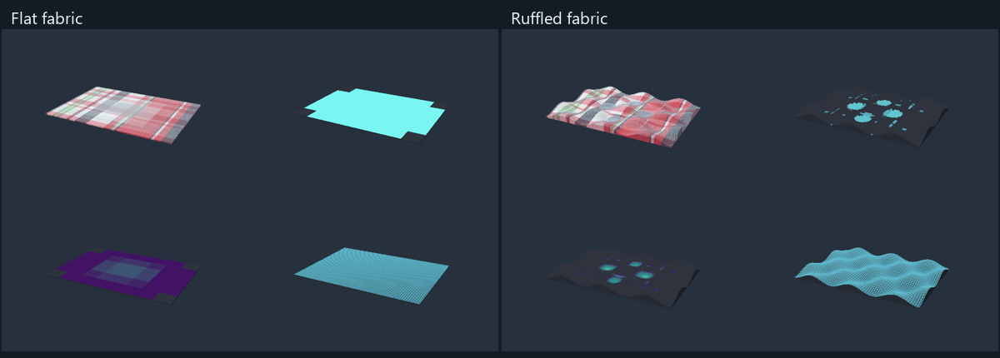
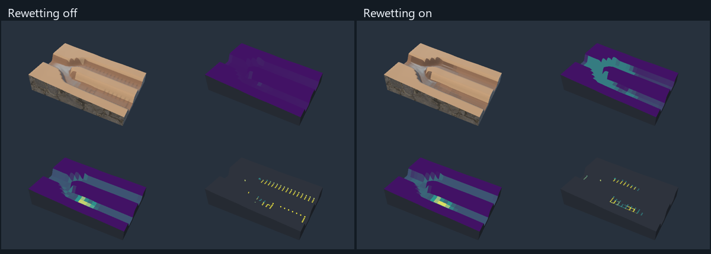
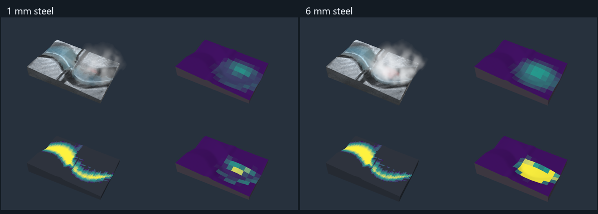
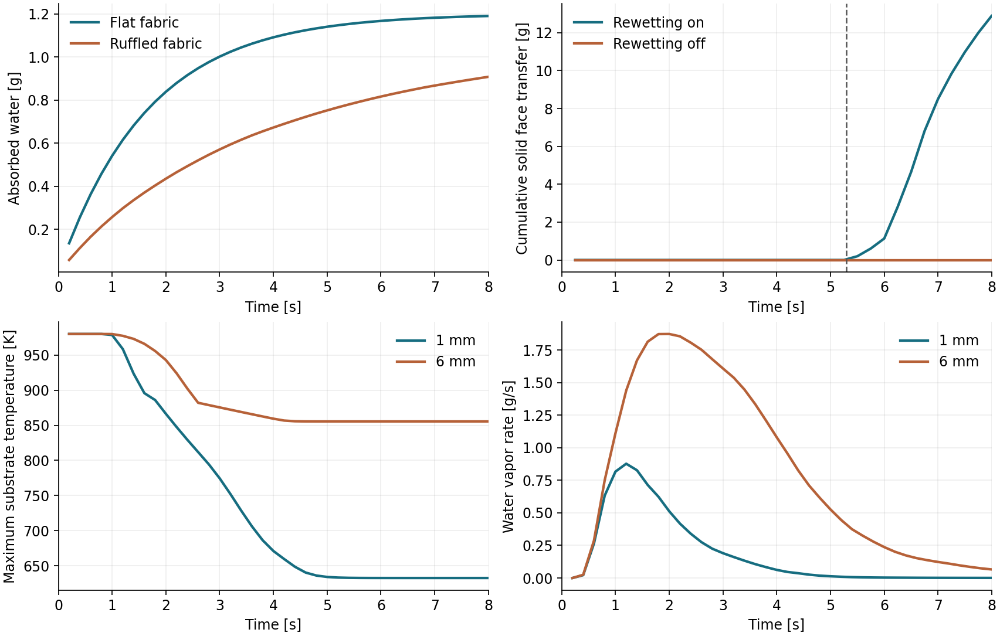
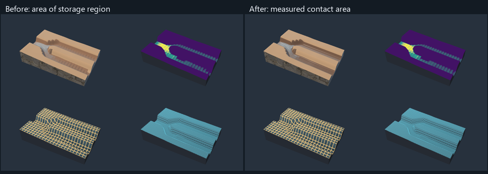
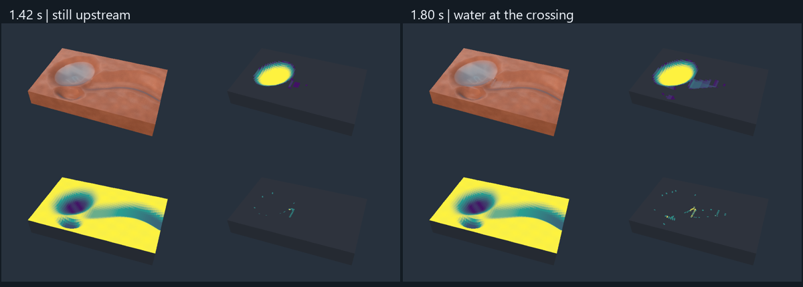
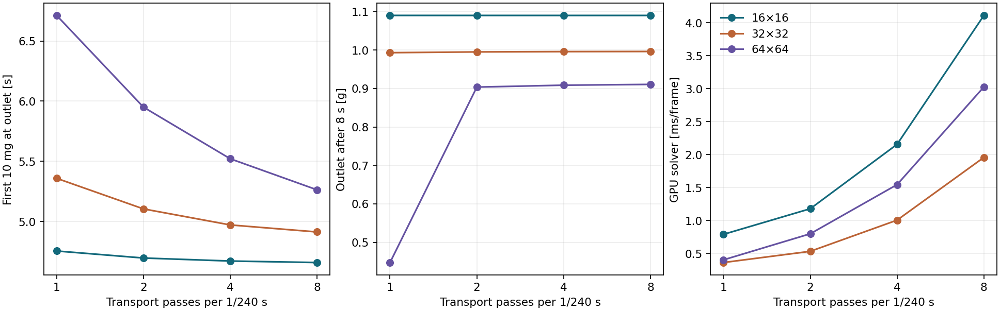

# 표면 접촉·퇴적·수송 비교 실험

2026-11-25 · AMD Radeon RX 6700 XT · MSVC Debug · Vulkan 1.2. 장면 기본 시간 간격은 1/240초다. 아래 시연은 엔진 모델의 일관성과 표현 차이를 검증한다.

## 변인 통제와 캡처

| 비교 | 동일하게 둔 입력 | 변경한 입력 | 확인한 결과 |
|---|---|---|---|
| Surface Relief & Wetting (이전 설정) | 직조 천, 물 1.2 g, 초기 배분 영역, 계산 셀 8×6, 형상 샘플 64×48 | 주름의 유무 | 첫 반응 직전 접촉 면적 9333.3 → 1649.7 mm², 첫 스텝 흡수 2.996 → 1.288 mg, 8초 흡수수 1.190 → 0.908 g. |
| Rewetting Delta | 돌 수로, 두 번의 26 g 급수, 초기 흙 배치, 5.3초 전까지의 시간 진행 | 5.3초 이후 기존 진흙의 재습윤 켬·끔 | 5.3초 전의 계측 시계열이 일치했다. 재습윤을 켜면 자유수 15.788 g이 진흙으로 들어갔다. 두 번째 급수 뒤 내부 공유 면을 지난 진흙 고형분의 누계는 12.885 g이고, 끈 쪽은 0이었다. |
| Thin vs Thick Steel | 같은 강철, 상면 형상, 시작 최고 980 K, 급수 및 접촉 계수 | 유효 두께 1 → 6 mm | 면적당 열용량 3846.5 → 23079 J/(m²·K), 8초 최고 온도 632.6 → 855.5 K, 누적 기화 1.487 → 6.522 g. |
| Fabric vs Sponge | 동일 형상, 액체, 20 g씩의 초기 물 | 재질별 저장 한도 | 8초 흡수수는 천 6.500 g, 스펀지 17.876 g, 강철 0 g. |
| 5 mm 퇴적 턱 | 동일 영역, 아래층과 4회 수송 | 유입 쪽 초기 물 깊이 4 → 6 mm | 4 mm에서 수신 질량과 GPU 월류 기록 모두 0. 6 mm에서 첫 1/240초 수신 질량 10.859 mg, GPU 월류도 기록됐다. |

현재 **Flat & Ruffled Fabric**은 두 천 중앙의 60×60 mm 정사각형에 물 1.44 g씩을 배분하고 0초에 정지한다. CPU/Vulkan 대조에서 8초 흡수량은 평면 1.43 g, 주름 1.08 g이었다.

이전 105×66.7 mm 직사각형 배치(2.8 g씩)에서 8초 흡수량은 평면 2.78 g, 주름 2.08 g이었다.

이전 전체 면적 배치(5.6 g씩)의 첫 스텝 접촉 면적은 평면 14,000 mm², 주름 6,517 mm²였고 8초 흡수량은 각각 5.55 g과 3.49 g이었다.

접촉 비교는 수송 뒤의 면적을 읽었다. 수평 형상 샘플을 덮는 극박막도 양의 수심이면 그 면적에 포함된다. 한 표본이 25%만 잠기는 경사 시험의 해석값도 별도 검증했다. 같은 시험에서 수송 횟수를 1회에서 4회로 바꿔도 한 스텝의 흡수량이 유지됐다.

재습윤을 켠 쪽의 두 번째 급수 이후 자유수 유출은 두 갈래에서 7.363 g과 2.036 g이고, 끈 쪽은 15.418 g과 7.432 g이다. 전체 자유수 유출과 갈래별 분배가 모두 바뀌었다. 고형분 통과량은 각 내부 면을 이동한 고형분을 합산한다. 같은 질량이 여러 면을 건너면 여러 번 집계한다. 물길 차이에는 퇴적으로 바뀐 턱과 혼합수로 전환된 자유수가 함께 작용한다.









## 면적당 열용량과 동결·해빙

2026-11-26 Debug Vulkan 검사에서 같은 강철, 상면, 접촉 계수, 980 K 최고 초기 온도와 19 g 급수량을 유지하고 유효 두께를 0.5 mm와 12 mm로 벌렸다. 표시용 몸체 두께도 같은 값으로 맞췄다. 면적당 열용량은 약 1,923 및 46,158 J/(m²·K)다. 8초까지 기화한 질량은 각각 0.776 g과 9.281 g, 8초의 최대 바닥 온도는 628.7 K와 876.2 K였다. 같은 426프레임 PBR 캡처에서 두꺼운 쪽에 응결 구름이 선명하게 남는다. 위 표의 1 mm와 6 mm는 변경 전 비교다.

밀폐 동결·해빙 트레이 한 개를 고정 카메라로 캡처했다. 액상, 완전 동결, 해빙 후 부피는 12.000 → 13.086 → 12.000 mL, 바닥 기준 높이는 5.357 → 5.842 → 5.357 mm였다. 질량 12 g에 대한 최대 수지 오차는 약 0.040 mg이다. PBR 시퀀스는 세 시점에 같은 구도를 사용하고, 트레이 면적에 따른 상승폭 비교는 별도 씬으로 제공한다.

[열용량 PBR 비교](../../../Build/SceneReview-20261126/ThermalComparison/Areal%20Heat%20Capacity.png) · [동결·해빙 GPU 측정](../../../Build/SceneReview-20261126/ThermalComparison/Metrics/FreezeAndThaw.json)

## 평평한 강판 시편 비교

이전 물 접촉 비교 시편은 공통 `flat.height.png`를 읽었다. 100×80 mm 상면 높이 범위는 0 mm다. 40×32 형상 표본, 10×8 계산 셀, 닫힌 경계에서 두 시편의 같은 중앙 영역에 물 19 g을 3초 동안 공급했다. 물성, 가열 영역과 초기 온도, 접촉 계수는 같다. 열 계산의 유효 두께와 외형에 보이는 몸체 두께는 각각 0.5 mm 및 12 mm다.

두 Vulkan 대조 검사는 통과했다. 8초까지 기화한 양은 0.715 g 및 14.944 g이고, 8초의 최고 바닥 온도는 373.15 K 및 448.10 K다. 426프레임의 동일 구도에서 12 mm 시편에 응결 구름이 남는 것을 확인했다.

[직육면체 시편 PBR](../../../Build/SceneReview-20261126/FlatThermalSpecimens/Areal%20Heat%20Capacity%20-%20Flat%20Specimens.png) · [0.5 mm 데이터](../../../Build/SceneReview-20261126/FlatThermalSpecimens/Metrics/HeatedWaterChannel_ThermalSteelThin.json) · [12 mm 데이터](../../../Build/SceneReview-20261126/FlatThermalSpecimens/Metrics/HeatedWaterChannel_ThermalSteelThick.json)

## 기능 단위 시연과 복합 시연

Feature마다 화면에서 답할 질문을 하나 정한다. 비교 조건은 같은 형상과 입력을 공유하고, 범례에는 실제 계산이나 외관에서 쓰는 상태만 둔다. 입력이 목표 현상을 구동할 때는 포함한다. 여러 변화를 묶는 경우에는 관찰할 인과관계를 이름에 드러낸다.

- **Areal Heat Capacity**는 평평한 두 강판에 2초 동안 같은 2.00 MJ/m²를 가하는 건식 비교다. 두께 0.5 mm 및 1 mm의 상승폭은 각각 약 1040 K 및 520 K다. 물과 수증기 상태는 없다. 위의 물 접촉 결과는 이전 구성의 계측이며, 가열 수로는 냉각과 기화를 같이 보여주는 Showcase다.
- **Wax Melt & Set**은 닫힌 경사로에서 고체 왁스의 경로를 확인한다. 초기 2.439 g에서 액체 질량이 최대 2.267 g까지 늘어났고, 8초에 경사로 하류에서 1.700 g이 고체로 집계됐다. 물과 얼음의 폐쇄형 질량·부피 검증 씬은 실험 실행에서 사용할 수 있다. 왁스는 지정 온도장과 시연용 상변화 계수를 사용한다.
- **Moisture Suppression of Ignition**은 마른 나무의 발화 시연과 다른 질문을 맡는다. 기존 건조·급수 비교 에셋에 이 이름을 표시한다. 첫 가열, 눈의 용융에서 건조로 이어지는 변화, 축적 높이가 뒤이어 흐름을 바꾸는 장면은 해당 Feature가 관찰하는 인과 단계다.

[건식 열용량 PBR](../../../Build/SceneReview-20261126/IsolatedFeatures/Areal%20Heat%20Capacity%20-%20Dry.png) · [왁스 PBR](../../../Build/SceneReview-20261126/IsolatedFeatures/Wax%20Melt%20and%20Set.png) · [왁스 CPU·Vulkan 측정](../../../Build/SceneReview-20261126/IsolatedFeatures/Metrics/WaxMeltAndSet.json)

## 가열·냉각의 시각적 단서

강판과 가열 수로는 `Steel.PhysicalMaterial`의 `appearance.thermalEmission`을 사용하고, 등록된 바닥 온도를 공용 PBR 발광 함수에 입력한다. 시뮬레이션의 에너지 펄스 또는 접촉 열교환을 발광 여부의 직접 조건으로 사용하지 않는다. 기존 가열 수로의 31프레임 PBR 이미지는 변경 전후 픽셀 단위로 같았다.

건식 열용량 시연은 두 시편에 동일한 2.00 MJ/m²를 2초 동안 공급한다. 0.5 mm 시편은 1333.06 K, 1 mm 시편은 813.10 K에 도달했다. 이전 12 mm 시편(336.48 K)에서는 발광이 보이지 않았다. 공용 곡선을 적용한 PBR에서 얇은 판의 주황색과 두꺼운 판의 옅은 적색을 확인했다. 두 시편이 CPU·Vulkan 대조를 통과했다. 고온 보간의 CPU와 Vulkan 반올림 차이는 목표 온도의 두 ULP 이내에서 판정했다.

Wax Melt & Set은 공용 `chartAlbedo` 슬롯으로 경사로 측면 레일에 가열부와 냉각부의 위치를 표시한다. 이 표식은 온도장의 경계 위치를 안내하며 실시간 온도값은 상태 뷰에서 읽는다. 텍스처 적용 전후 왁스 상별 질량 시계열과 검증 요약은 일치했다.

[강판 PBR 비교](../../../Build/SceneReview-20261126/ThermalAppearance/Shared%20Steel%20Thermal%20Emission.png) · [왁스 경사로 PBR](../../../Build/SceneReview-20261126/ThermalAppearance/Wax%20Thermal%20Ramp.png)

## 같은 질량의 왁스 상별 부피

Wax Phase Volume은 질량 12 g을 닫힌 40×30 mm 홈에 두고 균일한 지정 온도로 녹인다. 녹는 동안 급수·배수·기울임은 없다. 차트의 주변 벽 높이는 가장 높은 액면보다 높다. 기존 박막 보존·상변화와 PBR 경로를 사용하고, 층별 보고서의 `layer_volume_mL`은 매 표본 시각의 질량을 에셋의 상별 밀도로 나눈 값이다.

고체 880 kg/m³에서는 **13.636 mL / 11.364 mm**, 액체 780 kg/m³에서는 **15.385 mL / 12.821 mm**다. 양 끝 단계의 질량은 약 12.000 g으로 같고 CPU의 최대 질량 수지 오차는 0.020 mg이다. GPU와 CPU의 수위 최대 차이는 약 0.0000075 mm다. 에디터 씬 목록의 대표 왁스 시연을 Wax Phase Volume으로 바꿨다. 경사로를 사용하는 Wax Melt & Set 에셋은 파일로 열 수 있다.

[같은 구도의 PBR과 공통 눈금](../../../Build/SceneReview-20261126/WaxPhaseVolume/Wax%20Phase%20Volume%20-%20PBR.png) · [CPU/Vulkan 실험 데이터](../../../Build/SceneReview-20261126/WaxPhaseVolume/Metrics/WaxPhaseVolume.json)

Wax Phase Volume은 0.5 mm 간격의 눈금이 있는 전면 관측창을 표시한다. 아래 두 PBR 캡처는 같은 카메라로 비교했다. 12.000 g의 왁스가 완전히 녹은 뒤 수면은 1.457 mm, 부피는 12.82% 증가했다. 전면과 옆벽에 투명 유리 용기를 적용한 뒤에도 상별 CPU·Vulkan 보고서는 이전과 일치한다. [유리 용기의 고체·액체 PBR 비교](../../../Build/SceneReview-20261126/GlassVessel/Wax%20Glass%20Vessel%20-%20PBR.png)

## 바닥 높이가 다른 두 구역의 수면 평형

**Stepped Water Leveling**의 좌우 바닥 높이는 0 / 12 mm이며 투영 면적은 같다. 184.320 g을 두 구역에 균등하게 배치한다. 초기 수심은 16 / 16 mm, 초기 수면은 16 / 28 mm다. 닫힌 계에서 8초 후 수면은 21.999990 / 22.000010 mm, 수심은 21.999990 / 10.000010 mm였다. 유출과 CPU 질량수지 오차는 0이며 CPU와 Vulkan의 수위 최대 차이는 0.000055 mm 미만이다. 낮은 카메라와 2 mm 눈금으로 수면과 바닥 단차를 함께 본다. 이 결과는 최종 수평 평형과 질량 보존을 검증한다. 유동의 과도 시간은 수조 실측과 비교하지 않았다.

오른쪽 물 밑의 기존 12 mm 단차를 돌 받침으로 표시한다. [돌 받침을 표시한 초기·평형 PBR 비교](../../../Build/SceneReview-20261126/GlassVessel/Stepped%20Water%20-%20Stone%20Support%20-%20PBR.png) · [CPU/Vulkan 실험 데이터](../../../Build/SceneReview-20261126/LevelGauges/Metrics/SteppedWaterLeveling.json)

## 기존 빌드와 같은 장면 비교

기존 `SoilCoveredStonePath`를 양쪽 빌드에서 같은 에셋으로 실행하고 120프레임에 캡처했다. 변경 전에는 저장 영역 전체 면적으로 혼합했고 변경 후에는 젖은 면적과 성분 질량을 사용한다. 기본 돌길에서는 건조와 재습윤을 두 실행 모두 끈다. 전체 자유수 유출은 24.425 → 24.377 g이고, 두 번째 급수 이후 각 갈래의 유출은 7.439 → 7.429 g, 5.060 → 5.044 g이다. 기존 장면의 유출은 비슷했고 새 재습윤 시연에서 큰 차이가 나타났다.



같은 돌길 4뷰의 GPU 프레임 시간은 솔버 1.250 → 1.486 ms, 디스플레이 0.245 → 0.249 ms였다. 변경 전은 측정 1회 평균, 변경 후는 3회 평균의 중앙값이다. 각 실행은 88개 유효 타임스탬프를 썼다. 새 퇴적 씬의 PBR·원시 수심·유효 바닥·월류 4뷰에서는 디스플레이 0.263 ms였다. 퇴적 씬의 값은 별도 형상·수송 횟수에서 잰 값이다. [렌더링 시간 원자료](Artifacts/SurfacePhysicsComparison/RenderingTimings.json)

## 턱과 화면의 일치

쌍둥이 홈에서는 같은 카메라로 PBR, 솔버 수심, 유효 바닥, 실제 월류 위치를 기록했다. 원시 수심 뷰에는 저장 영역 경계와 계단이 나타난다. 월류 오버레이는 솔버가 이동량을 확정한 접촉에 그린다. 3 mm 고정 턱 시험에서 턱 아래는 수신량과 표시 기록이 모두 0이었고, 턱을 넘은 첫 수송에서 함께 양수가 됐다.



[1.53초의 경계 통과 캡처](Artifacts/SurfacePhysicsComparison/TwinPockets-92.png) · [2초의 하류 도달 캡처](Artifacts/SurfacePhysicsComparison/TwinPockets-120.png)

## 수송 횟수와 GPU 시간

같은 급수와 형상 해상도를 유지한 격자별 10 mg 첫 유출 시각, 8초 누적 유출과 GPU 솔버 시간이다.

형상 64×64, 같은 급수 영역과 1.2 g 급수 및 기울기 곡선을 사용했다. 유량은 CPU에서 8초 동안 측정했다. GPU 시간은 캡처 프레임당 고정 스텝 4회를 수행하는 조건에서, 150프레임 실행 3회의 솔버 구간 평균을 낸 뒤 중앙값을 택했다. GPU 시간은 월류 기록과 수위 갱신을 포함한다.

| 계산 격자 | 수송 횟수 | 첫 유출 10 mg [s] | 8초 유출 [g] | GPU 솔버 [ms/프레임] |
|---|---:|---:|---:|---:|
| 16×16 | 1 | 4.754 | 1.0900 | 0.790 |
| 16×16 | 2 | 4.696 | 1.0899 | 1.178 |
| 16×16 | 4 | 4.671 | 1.0899 | 2.155 |
| 16×16 | 8 | 4.658 | 1.0899 | 4.111 |
| 32×32 | 1 | 5.358 | 0.9931 | 0.362 |
| 32×32 | 2 | 5.104 | 0.9951 | 0.532 |
| 32×32 | 4 | 4.971 | 0.9959 | 1.005 |
| 32×32 | 8 | 4.913 | 0.9962 | 1.957 |
| 64×64 | 1 | 6.713 | 0.4476 | 0.402 |
| 64×64 | 2 | 5.950 | 0.9036 | 0.798 |
| 64×64 | 4 | 5.521 | 0.9086 | 1.544 |
| 64×64 | 8 | 5.263 | 0.9106 | 3.026 |

64×64에서 1 → 2회는 누적 유출을 0.448 → 0.904 g으로 바꾼다. 2 → 8회에서는 누적량이 약 0.9 g으로 유지되지만, 10 mg 유출 시각은 0.687초 빨라진다. 8회에도 16×16과 64×64의 유출량·도달 시간에 차이가 남는다. 씬 기본값은 1회로 유지했고 재습윤 시연만 2회를 사용한다. 횟수는 Solver에서 변경할 수 있다.

16×16의 GPU 시간이 32×32보다 길었다. 형상 격자는 동일하지만 셀당 형상 샘플 수와 수위 복원 경로가 다르다. 단일 액체의 1회 실행은 활성 영역 스케줄링을 사용할 수 있고 2회 이상은 전체 영역을 디스패치한다. 이 표는 두 조건의 실제 총비용을 보여준다. 특정 패스나 복원 경로의 기여도는 분리 측정하지 않았다.



[수송 원자료 JSON](Artifacts/SurfacePhysicsComparison/TransportMatrix.json) · [CSV](Artifacts/SurfacePhysicsComparison/TransportMatrix.csv)

## 회귀와 수치 허용 오차

최종 Debug 빌드의 `--check-surface`는 CPU와 Vulkan으로 배포 장면 40건 및 접촉·층별 턱·월류 계약을 모두 통과했다. 원본 가열 수로의 CPU–GPU 최대 온도 차이는 0.0019 K였다. 접촉 면적 전체를 즉시 열교환에 쓰면 극박막에서 표본 하나의 접촉 여부가 바뀔 때 온도 오차가 커졌다. 국소 수심 0.25 mm까지 열교환 면적을 연속적으로 늘리는 근사로 수정했다. 동일 높이 표본의 반응 접촉 뷰는 가중치를 적용하기 전 면적을 읽는다.

물질 수지는 남은 자유수·흡수수와 혼합수, 누적 유출 및 건조로 빠진 질량을 포함한다. 재습윤 씬의 물만 따로 셌을 때 최대 장부 잔차는 9.12×10⁻⁹ kg이었다. 최종 SPIR-V 7개 모듈이 Vulkan 1.2 검사를 통과했다. 별도 64×64 수송 입력에서도 1회·8회의 CPU/Vulkan 검사를 통과했다. 세 비교 씬을 좌우 비교 CLI 경로로 각각 열어 두 PNG가 모두 저장되는지 확인했다.

## 추가 4뷰 캡처

- [주름진 천 · PBR, 계산 셀, 형상 샘플, 반응 접촉](Artifacts/SurfacePhysicsComparison/Contact-Grid.png)
- [진흙 수로 · PBR, 계산 셀, 형상 샘플, 유효 바닥](Artifacts/SurfacePhysicsComparison/Delta-Grid.png)
- [두꺼운 강판 · PBR, 계산 셀, 형상 샘플, 온도](Artifacts/SurfacePhysicsComparison/Steel-Grid.png)

[측정 원자료](Artifacts/SurfacePhysicsComparison/MeasuredSeries.json) · [물리 계약](../02_Architecture/01_Contracts/08_Surface-Simulation.md) · [결정 근거](../03_Decisions/00_Records/ADR-0002-Surface-Contact-and-Coupling.md)

```powershell
python Tools/surface_physics_comparison.py <MDSS.exe> Build/SurfacePhysicsComparison-After/Verified --repetitions 3
```
