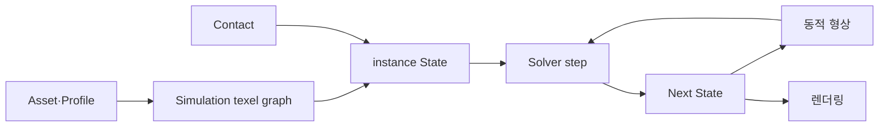

# Surface State 아키텍처

> 현재 구현의 실행 흐름과 계약을 찾는 입구다. 코드·테스트와 충돌하면 실제 동작을 확인해 문서를 갱신한다.

## 무엇을 어디서 읽는가

| 목적 | 문서 |
|---|---|
| 전체 실행 흐름과 세부 페이지 | [[02_Architecture/01_Flows/00_Index|Flows 단계별 지도]] |
| Scene 초기화부터 GPU 구성 | [[02_Architecture/01_Flows/01_Initialization/00_Scene-Load|Scene Load]], [[02_Architecture/01_Flows/01_Initialization/01_Surface-Build-and-GPU-Setup|Surface Build]] |
| State에서 화면 표시까지 | [[02_Architecture/01_Flows/04_Rendering/00_Render-Overview|Rendering Pipeline]] |
| State·Profile·입력 | [[02_Architecture/02_Contracts/00_State-and-Profile|State and Profile]], [[02_Architecture/02_Contracts/01_Assets-and-Profiles|Assets]] |
| 전이·상호작용과 Profile v5 | [[02_Architecture/02_Contracts/05_Reactions|Local Reactions]] |
| 형상·Solver 수식 | [[02_Architecture/02_Contracts/02_Geometry|Geometry]], [[02_Architecture/02_Contracts/03_Solver|Solver]] |
| GPU 저장·공유·ABI | [[02_Architecture/02_Contracts/04_GPU-Layout|GPU Layout]] |
| CPU↔GPU 변경 영향 | [[02_Architecture/03_Source/00_Index|Source 연결표]] |
| C++ 소유 모듈·클래스 | [[02_Architecture/03_Source/Src_Cpp/00_Index|C++ Source Index]] |
| 셰이더 단계 | [[02_Architecture/03_Source/Src_Shaders/00_Index|Shader Source Index]] |

Flows는 **순서와 데이터 이동**, Contracts는 **현재 의미·수식·지원 경계**, Source는 **실제 C++·셰이더 파일을 찾는 지도**다. 진행 중인 구현은 [[03_Development/00_Overview|Development]], 검증과 성능 결과는 [[04_Experiments/00_Overview|Experiments]]에서 찾는다.
