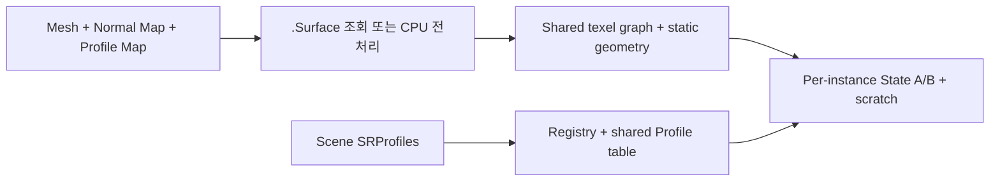

# Surface Build와 GPU Setup

이 단계는 **초기화 및 재사용** 경로다. 프레임마다 실행하는 Solver 연산과 구별한다. Static geometry는 같은 Runtime Surface 사이에서 재사용하지만 instance 상태·world area·weights·scratch는 독립적이다.

**연결 문서**
- [[02_Architecture/01_Flows/01_Initialization/00_Scene-Load|Scene Load]]
- [[02_Architecture/03_Source/Src_Cpp/03_SurfaceState/02_Mapping-and-Geometry|Geometry Source]]
- [[02_Architecture/03_Source/Src_Cpp/04_GPU/03_Resources-and-Descriptors|GPU Resource Source]]

## 정적 준비와 동적 State

정적 texel graph는 Mesh·Map·해상도별로 공유한다. State, world area, TransferWeight와 동적 형상은 instance마다 독립적이다. [[02_Architecture/02_Contracts/01_Assets-and-Profiles|Asset]], [[02_Architecture/02_Contracts/02_Geometry|Geometry]], [[02_Architecture/02_Contracts/04_GPU-Layout|GPU]]

## Mapping, Geometry, GPU 생성

2. [`TSurfaceMappingBuilder`](../../../../../Source/SurfaceState/Mapping/SurfaceMappingBuilder.cpp)는 triangle을 simulation UV texel에 대응시키고 원본 topology를 따라 UV seam의 이웃을 연결한다. [`ValidateSurfaceMapping`](../../../../../Source/SurfaceState/Mapping/SurfaceMappingValidation.cpp)이 유효 texel·neighbor 관계를 검사한다.

3. [`TSurfaceGeometryBuilder`](../../../../../Source/SurfaceState/Geometry/SurfaceGeometryBuilder.cpp)는 texel 위치·법선·면적·이웃 기하량을 구성한다. [`BuildMesoGeometry`](../../../../../Source/SurfaceState/Geometry/MesoGeometryBuilder.cpp)와 [`NormalMapTransferNormalBuilder`](../../../../../Source/SurfaceState/Mapping/NormalMapTransferNormalBuilder.cpp)가 추가 기하량을 준비한다.

4. [`TSurfaceStateRegistry`](../../../../../Source/SurfaceState/Types/SurfaceStateRegistry.cpp)가 State ID와 profile index를 정한다. [`TSurfaceGPUResourceManager`](../../../../../Source/SurfaceState/GPU/Resources/SurfaceGPUResourceManager.cpp)는 정적 geometry를 동일 runtime surface 사이에 공유하고, State A/B·InputDelta·동적 geometry·scratch·world texel area를 instance마다 구성한다. Runtime data는 CPU 전처리 결과이며 GPU resource는 실제 shader가 읽고 쓰는 자료다.

## Surface cache hit / miss

`TSurfaceDataManager::LoadSurfaceData`는 `TSurfaceCache::Describe` → `GetPath` → `Load`를 시도한다. 캐시 미존재·손상·버전 mismatch에서는 Mapping/Geometry/NormalMap/Meso build로 fallback하고 저장 실패는 경고로 남긴다. **Response Profile의 이동·감쇠 계수 수정만으로 GPU Solver 계산을 위해 CPU `.Surface` geometry 전처리를 반드시 다시 수행한다고 가정하지 않는다.** 자세한 fingerprint 포함·제외 값은 [[02_Architecture/03_Source/Src_Cpp/03_SurfaceState/04_Cache-and-Lifecycle|캐시 문서]]를 참조한다.
