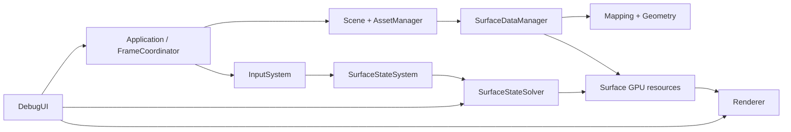

# C++ 소스 지도

이 문서는 **파일과 코드 책임을 찾는 색인**이다. 데이터 의미와 불변 조건은 [[02_Architecture/02_Contracts/00_State-and-Profile|Contracts]], 함수 실행 순서는 [[02_Architecture/01_Flows/00_Index|Flows]]가 기준이다. 아래 하위 시스템 문서는 각 소스 파일의 주요 선언·진입 함수·데이터 이동을 설명한다.

## 시스템 소유 경계

| 문서 | 담당 위치 | 파일에서 찾을 것 |
|---|---|---|
| [[02_Architecture/03_Source/Src_Cpp/01_Application-and-Frame|Application and Frame]] | `Source/main.cpp`, `Source/Application/` | 프로세스 시작, CLI, 설정, 창·프레임·step 조정 |
| [[02_Architecture/03_Source/Src_Cpp/02_Asset-Pipeline|Asset Pipeline]] | `Source/AssetManager/` | Asset 수명, 파일 형식 파서, CPU/GPU asset 구성 |
| [[02_Architecture/03_Source/Src_Cpp/03_SurfaceState/00_Index|Surface State]] | `Source/SurfaceState/`의 Types, Runtime, Mapping, Geometry, State, Contact, Debug | Scene 표면 입력에서 runtime mapping·geometry·contact까지 |
| [[02_Architecture/03_Source/Src_Cpp/04_GPU/00_Index|GPU Resources]] | `Source/GPU/`, `Source/SurfaceState/GPU/` | Vulkan 객체, ABI, packing, descriptor·buffer 수명 |
| [[02_Architecture/03_Source/Src_Cpp/05_Solver|Solver]] | `Source/SurfaceState/Solver/` | simulation clock, timestep, solver dispatch와 step 기록 |
| [[02_Architecture/03_Source/Src_Cpp/06_Rendering|Rendering]] | `Source/Rendering/` | render pass 기록, 표면·overlay·debug·benchmark |
| [[02_Architecture/03_Source/Src_Cpp/07_Scene-Input-DebugUI|Scene, Input and Debug UI]] | `Source/Scene/`, `InputSystem/`, `DebugUI/`, `Logger/` | scene 파일, 카메라, raycast contact, 조작·계측 UI |

## 따라 읽기

1. 한 프레임의 순서는 [[02_Architecture/01_Flows/00_Index|Flows 실행 지도]]에서 본다.
2. 클래스 헤더에서 소유 객체와 public API를 확인한다.
3. 대응하는 `.cpp`에서 알고리즘·GPU 명령·리소스 교체 지점을 확인한다.
4. 셰이더와 연결할 때는 [[02_Architecture/03_Source/Src_Shaders/00_Index|Shader Source Index]]를 먼저 보고, 실제 빌드 저장소의 `CMake/ShaderManifest.cmake`는 별도로 확인한다(이번 ZIP 미포함).
5. 테스트 경로로 `Tests/`가 언급되지만 이번 소스 ZIP에는 해당 디렉터리가 없어 test 파일과 실행 결과는 대조하지 못했다.

이 지도는 파일을 옮기거나 핵심 함수를 바꿀 때 갱신한다. 새 파일은 담당 하위 시스템 표에 추가한다.

## 데이터 하나를 따라 읽는 경로

| 출발 데이터 | 생성·변환 | 마지막 소비자 |
|---|---|---|
| Scene의 mesh/profile/resolution | `TSceneLoader` → `TAssetManager` → `TSurfaceDataManager` → mapping/geometry builder | 공유 GPU geometry와 instance의 profile lookup |
| 사용자/Scene Contact | `TInputSystem` 또는 Scene event → `TSurfaceStateSystem::SubmitContact` → `ApplyPendingContacts` | `InputDelta`를 읽는 Solver Pass 2 |
| 프레임 시간 | `TApplication::MainLoop` → `TFrameCoordinator` → `TSimulationClock` | `TSurfaceStateSystem::RecordStep`의 `DeltaTime` |
| Current State A/B | `TSurfaceStateSolver::RecordSteps` → Next State·높이·동적 geometry | 다음 substep과 `TRenderer::RecordCommandBuffer` |
| 현재 State의 화면 표시 | `TRenderStateTexture`·`TTexelGeometryPreview`·`TAccumulationOverlaySides` | fragment shader·top/side indirect draw·Inspector |

문제에서 역추적할 때는 버퍼를 실제로 **쓰는** 코드와 그 버퍼를 **읽는** 코드를 함께 연다. 예를 들어 State 값이 예상과 다르면 `SurfaceContactApplication.cpp`의 입력 생성, `SurfaceStepRecording.cpp`의 현재 A/B 선택, Pass 1/2와 `SurfaceStateSolver.cpp`의 barrier, `RendererCommands.cpp`의 표시 descriptor 선택을 순서대로 확인한다. 각 페이지의 표는 파일 검색용이며 아래 설명에서 호출 순서와 상태 변화 지점을 다룬다.

## 재구성된 상세 소스

- [[02_Architecture/03_Source/Src_Cpp/03_SurfaceState/00_Index|Surface State: Runtime / Mapping / Contact]]
- [[02_Architecture/03_Source/Src_Cpp/04_GPU/00_Index|GPU: Vulkan / ABI / Resource Lifetime]]
- [[02_Architecture/03_Source/00_Index|Source 최상위 CPU↔Shader 연결표]]

## 파일 커버리지 및 Cache

- `SurfaceCache.h/.cpp`는 기존 03_Source에서 유일하게 빠져 있던 C++ 소스 파일 2개이며, [[02_Architecture/03_Source/Src_Cpp/03_SurfaceState/04_Cache-and-Lifecycle|CPU Cache]] 문서에 등록했다.
- `Source/` 180개 파일과 `Shaders/` 65개 파일명을 전체 Source 문서군에서 찾을 수 있도록 보완했다. 문서의 파일 경로가 유효하다는 것과 코드가 실제 컴파일·실행에 성공한다는 것은 다른 검증 수준이다.
