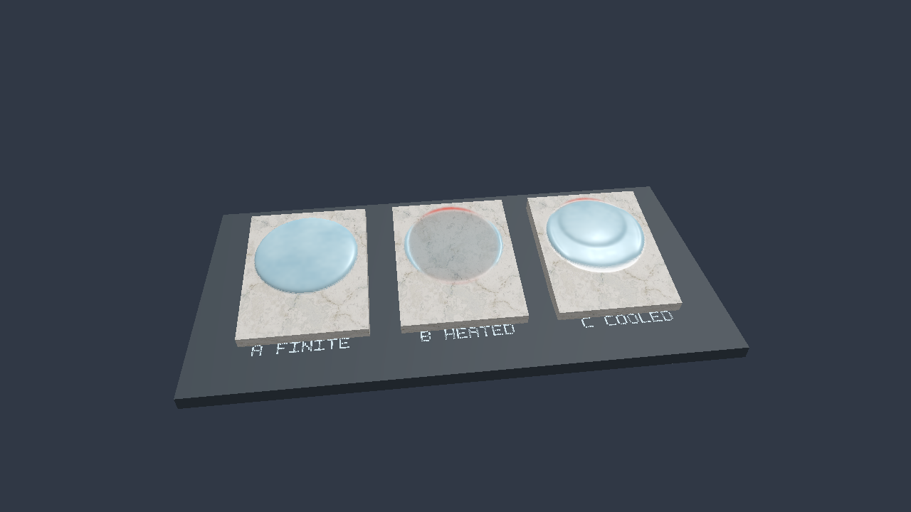

# 검증과 테스트

이 문서는 Solver의 **검증 질문·실행 결과·미실시 범위**와 Surface System의 회귀 테스트를 함께 둔다. 테스트 통과, State 일치, 물리적 타당성, 성능 이득은 서로 다른 주장이다.

현재 계산 계약은 [[02_Architecture/00_Overview|Architecture]]에서 확인한다. 성능 비교는 [[04_Experiments/02_Performance-Measurements|측정 규칙과 실험 기록]]을 따른다.

---
## Solver Validation

> **한 줄 요약:** 해상도, timestep, texel 면적과 Geometry rate가 Solver 결과에 미치는 영향을 한 문서에서 검증한다.

### 실험 초안 — 해상도와 시간 간격에 따른 Transport

- 상태: **전체 분포·성능 실험 계획 / 미실시**
- 마지막 소스 확인: 2026-09-29
- 범위: 현재 총량 모델의 해상도·시간 오차, alpha와 GPU 비용
- 구현 계약: 면적·총량, Geometry mobility, 누적 시간

#### 현재 구현과 구분할 사항

| 항목 | 현재 구현 | 실험으로 확인할 것 |
|---|---|---|
| State | texel별 총량, 보존 장부 `ΣState` | 입력·감쇠 장부를 뺀 총량 오차 |
| 면적 | Macro UV Jacobian footprint를 instance scale로 변환 | UV 왜곡·chart 경계 중심 sample 오차 |
| Capacity·입력·Decay | 고정 `ReferenceArea=1/256²`에 대한 값을 실제 면적 비율로 환산 | 같은 면적·밀도의 전체 Capacity·입력량 일치 |
| Geometry 전달 | 기존 높이차×방향×source Saturation, 기준 Rate 6000, 포화도 상한 없음 | 같은 밀도에서 월드 이동 거리의 해상도 의존 |
| Saturation 전달 | 이웃 포화도 차이, 기존 상대 DistanceWeight | 퍼짐과 이류를 분리한 공간 수렴 |
| 시간 | 실제 시간×배속 누적. 기본 Fixed ON·Auto OFF는 1/60초, Auto ON에서만 보수적 Transport 간격으로 세분화 | 옵션별 분포 차이, dt-halving, backlog 증가 여부 |
| GPU 반복 | frame당 최대 8회, 새 State·RawFlux 사용, 입력 한 번 | frame 합산 GPU 비용과 처리량 |

현재 모델은 외부 속도장을 정의하는 일정 속도 이류 모델이 아니다. Geometry coefficient를 월드 속도로 직접 사용하지 않는다. 아래 비교는 현재 모델의 동작 검증이며 물리 정확성 또는 해상도 독립성의 증명은 아니다.

#### 1. 같은 출발 조건 만들기

128·256·512에서 동일한 월드 영역에 동일한 **면적당 분포**를 준비하고 `State_i=density(WorldPosition_i)×Area_i`로 초기화한다. 총량 합이 초기 허용 오차 안에 드는지 먼저 확인한다. 같은 텍셀 수나 같은 클릭 횟수를 조건으로 사용하지 않는다.

- Macro analytic 경사 평면, 하나의 Registry channel, 같은 Profile부터 시작한다.
- 첫 실험은 Normal Map·Decay·입력 OFF, Curvature OFF, Profile 경계 없는 닫힌 영역이다.
- Shape·world transform·Profile Factor·ReferenceArea는 해상도별로 동일하게 둔다.
- 해상도 변경은 State·clock을 초기화하므로 매 run에 초기 분포를 다시 만든다.
- shader binary/hash, commit/diff, GPU·driver·build·validation 상태를 기록한다.

#### 2. 비교 단계

| 단계 | 조건 | 목적 |
|---|---|---|
| A | Geometry만 ON, 공통 작은 dt, 세 해상도 | downhill 중심 이동 거리·분포·총량 |
| B | Saturation만 ON, 공통 작은 dt, 세 해상도 | 포화도 차의 퍼짐·분포·총량 |
| C | 둘 다 ON, 같은 조건 | 두 경로의 합성 결과 |
| D | 한 해상도에서 dt, dt/2, dt/4, 같은 총 시간 | 시간 간격 오차와 alpha 제한 |
| E | 15·30·60·120 FPS cadence, 같은 실제 경과 시간, Fixed·Auto 네 조합 | 누적 시간·진행 시간·잔여 시간·Solver step 수 |
| F | 동일 월드 반경의 사건 입력, falloff 0/1 | 입력 총량의 해상도 의존과 부분 texel 오차 |
| G | 비균일 면적·UV 왜곡·seam·Profile 경계·비균일 scale | 단순 평면에서 벗어난 조건 |
| H | Cube Wetness Scene, 세 해상도·과거 cache ON/OFF | 실제 분포와 GPU·메모리 비용 (Decision 0025 이전 기록) |

각 비교의 **실제 실행한 Solver 시간 합**을 맞춘다. 큰 dt 한 번과 작은 dt 여러 번을 같다고 가정하지 않는다. 반복 한도로 backlog가 남으면 같은 시뮬레이션 시간까지 추가로 소비한 비용도 기록한다.

현재 기본 Fixed ON·Auto OFF와 Auto ON을 별도 조건으로 비교한다 (Decision 0013). Fixed ON·Auto ON에서는 1/60초 단위로 시작한 구간의 내부 substep을 기록한다. Auto OFF·Fixed OFF는 경과 시간을 한 번에 계산하므로 cadence에 따른 분포 차이도 측정한다.

#### 3. 왜 세 해상도를 비교하는가

같은 밀도에서 간격을 절반으로 하면 면적·State·Capacity는 약 1/4, 포화도는 같고 Geometry 높이차는 약 1/2이다. 상대 DistanceWeight도 유지된다. 따라서 Geometry 원시 전달/보유량 비율은 약 두 배가 되고 이동 간격은 절반이다. 이를 통해 월드 이동 거리 차이가 줄어드는지 확인한다.

이 설명은 균일 평면과 alpha가 제한하지 않는 조건이다. 여러 방향 유출, UV 왜곡, Normal Map 재생성, 경계가 있으면 결과가 달라질 수 있다. HeightDrive를 거리로 나누거나 Weight를 추가 1/d로 변경하는 후보는 이번 구현에 포함하지 않는다.

#### 4. 측정 지표와 판정

| 지표 | 기록 |
|---|---|
| 보존 장부 | `ΣState`, 입력 합, Decay 합, 경계 출입량; State에 면적을 다시 곱하지 않음 |
| 월드 분포 | State 총량으로 가중한 중심·폭·downhill 이동 거리 |
| 공통 영역 비교 | `density=State/Area`를 같은 월드 평가 영역에 환산한 L1/L2 차이 |
| 시간 | 실제 시간, 실행한 dt 합, backlog, frame별 step 수 |
| 제한 | alpha 최소·평균·alpha<1 비율, min State, NaN/Inf |
| 비용 | frame의 Pass 1·2 합, step당 비용, CPU 상한 계산, 면적 buffer와 cache 크기 |

잠정 기준은 닫힌 영역의 상대 총량 오차 `1e-4` 이내, 이동 거리 차이 5% 이내, 비음수·finite 유지다. 성능·분포의 최종 허용 기준은 미확정이다. 차이가 크면 alpha와 dt-halving 결과부터 확인하며 이유 없이 허용 오차를 완화하지 않는다.

#### 결과와 구현 검증의 구분

**전체 월드 분포·GPU 성능 비교는 미실시다.** CPU clock·면적 및 작은 GPU fixture의 회귀 테스트는 [[04_Experiments/01_Validation-and-Tests#검증 — 면적 환산과 누적 시간|면적·시간 회귀 검증]]에 별도로 기록한다. 단위 테스트 통과를 실제 Cube Scene의 세 해상도 결과가 같다는 근거로 사용하지 않는다.

| Fixture | 해상도 | dt / step 수 | 진행 시간 | 이동 거리 | 총량 오차 | alpha<1 | frame GPU ms |
|---|---:|---|---:|---:|---:|---:|---:|
| 측정 대기 | — | — | — | — | — | — | — |

#### 관련 문서

- State Update
- UI와 backlog
- Semi-Lagrangian 후보
- 보존형 이류 배경

### 검증 — 면적 환산과 누적 시간

- 상태: **구현 회귀 통과 / 전체 Scene 해상도·성능 비교 미실시**
- 날짜: 2026-09-29
- 브랜치: `feat/area-aware-transport-and-timestep`
- 계약: 면적·총량, Geometry mobility, 누적 시간

#### 확인 대상

State는 texel 총량이다. Capacity·입력·Decay는 `AreaScale=WorldArea/(1/256²)`로 환산한다. Geometry는 출발 `State/Capacity`에 비례하고 1에서 자르지 않는다. 실제 경과 시간×배속을 누적해 갱신된 State로 여러 step을 실행한다.

#### 테스트와 결과

| 범위 | 조건 | 확인 결과 |
|---|---|---|
| CPU 시간 | 15·30·60·120 FPS cadence, 배속 1, step 1/60초 | 모두 1초에 60 step, 진행 시간 1초 |
| 반복 한도 | 1초 누적 후 한 frame 소비 | 최대 8회 실행, 약 0.867초 미처리 시간 유지 |
| Pause·Step | Pause 시간 추가, 수동 step | Pause 시간 누적 없음, 수동 1회, 기존 backlog 유지 |
| 배속·부분 step | 배속 2, Auto ON의 작은 안전 간격, Fixed ON/OFF | 배속은 시간 budget에 적용, Fixed는 전체 구간이 모일 때 시작, OFF는 마지막 부분 소비 |
| Fixed·Auto 분리 | 네 옵션 조합, 기본 Fixed ON·Auto OFF, 가상의 작은 Transport 상한 | 기본 dt=1/60초는 상한을 무시. variable·Auto OFF는 누적 시간 한 번, ON은 상한으로 분할 |
| 고정 구간 세분화 | 1/60초 미만 누적, 비정수 분할, 구간당 16 substep | 전체 구간이 모일 때 시작, 마지막 짧은 step으로 완료, 8회 한도 이후 다음 frame 재개 |
| 옵션 전환·Reset | 진행 중 고정 구간에서 Auto OFF, 미완료 구간 Reset | 잔여 시간 한 번 완료 후 새 고정 구간 사용, Reset은 미완료 구간도 제거 |
| CPU 면적 | 기울어진 UV 평면, 128·256·512, 비균일 scale | 월드 면적 합과 전체 Capacity 일치, 반사에서도 양의 면적 |
| Cache | `.Surface` format 4 round-trip | AreaVector 포함 모든 texel 필드 정확히 복원 |
| GPU Geometry | source 면적 2×기준, Capacity=2, State 4→8 | 포화도 2→4, 전달량 0.2→0.4; SaturationDrive OFF에서도 작동 |
| GPU 면적·Saturation | 면적 비율 2:4, State 2:4 | 같은 포화도라 Saturation 전달 0 |
| GPU Decay | 같은 포화도, 면적 2:4, 기준 rate 1, dt 0.1 | 총량 감소 0.2:0.4 |
| GPU 연속 반복 | 한 command buffer에 두 step, 입력 0.3 | 입력 한 번, 두 번째 step에서 갱신된 State의 0.015 전달, 합 0.3 |
| GPU 국소 해상도 | 단일 수직 이웃, 간격 1/R, 면적 1/R², R=128·256·512 | 한 step의 총량 보존과 질량 중심 월드 이동량 일치 |
| GPU 면적 0 | 기존 State 3,7 유지 | 전달·감쇠 없이 총량 유지 |
| 실제 접촉 경로 | Scene fixture의 균일 falloff 입력 | 지원 texel의 양이 InputFactor×AreaScale과 일치, 미지원 channel 제외 |

기존 GPU 검사는 RawFlux cache ON/OFF 양쪽에서 같은 기대값을 확인했다. Decision 0025 이후 GPU suite는 단일 재계산 경로를 대상으로 한다. 국소 해상도 검사는 2-texel fixture에서 공간 계수의 스케일을 확인하는 검사이며 전체 초기 분포의 이동·퍼짐 검증은 아니다.

Geometry 기준값 6000 재보정 후에도 위 검사의 목표 실제 Rate는 유지한다. 새 기본 Factor 0.5와 8-neighbor 국소 이동률 검사는 [[04_Experiments/01_Validation-and-Tests#검증 — Geometry 전달 기준값 재보정|Geometry 재보정 검증]]에 별도로 기록한다.

Fixed·Auto 분리의 실행 정책은 Decision 0013를 따른다. Auto ON·Fixed ON의 substep들은 1/60초 구간을 완성하며, 기본 Auto OFF는 CPU Transport 상한으로 dt를 변경하지 않는다.

`MDSS_SceneResources`는 실제 Debug UI 기본값 Fixed ON·Auto OFF와 Renderer의 15 FPS 경과 시간 입력을 검사했다. 한 frame에서 네 번의 고정 Solver 실행으로 약 1/15초가 진행됐다. CPU clock는 Auto·Fixed를 모두 끄고 다시 고정 모드로 돌아왔을 때 이전 미완료 구간이 다시 나타나지 않는지도 확인한다.

#### 실행 검증

전체 C++·shader 빌드와 CTest 8개를 실행했다. 기본 Scene의 8-frame smoke 실행이 정상 종료했고 Vulkan validation 오류는 없었다. 기존 소규모 allocation 및 depth attachment의 best-practices 경고는 남아 있다.

관련 코드: `Tests/SimulationTransportTests.cpp`, `Tests/SurfaceGPUResourceTests.cpp`, `Tests/SceneResourceTests.cpp`, `Tests/SurfaceCacheTests.cpp`.

#### 한계와 다음 실험

- CPU cadence 테스트는 GPU가 해당 step 수를 처리할 수 있다는 성능 증명이 아니다. 지속 과부하에서는 backlog가 증가한다.
- Macro footprint·chart 중심 sampling의 근사는 남아 있다. Meso 면적과 부분 texel clipping은 포함하지 않는다.
- 단일 이웃의 월드 이동량 일치는 일반 8-neighbor graph·seam·Profile 경계·Cube 전체의 해상도 독립성을 증명하지 않는다.
- dt-halving, 동일 월드 초기분포와 입력의 128·256·512 비교, alpha와 frame GPU 비용은 [[04_Experiments/01_Validation-and-Tests#실험 초안 — 해상도와 시간 간격에 따른 Transport|전체 비교 실험 초안]]을 따른다.

### 검증 — Geometry 전달 기준값 재보정

- 상태: **재보정 구현·회귀 통과 / 전체 Cube 이동·성능 비교 미실시**
- 날짜: 2026-09-29
- 브랜치: `feat/area-aware-transport-and-timestep`
- 계약: Decision 0012, 면적·총량, Geometry mobility, 누적 시간

#### 재보정 대상

초기 Geometry 기준값 100과 Factor 0.5는 Rate 50이다. 기준 면적 1/256², Capacity 1, 균일한 수직면과 기존 TransferWeight를 사용한 CPU 계산에서 국소 질량 중심 이동률은 약 0.001684 world-length/s였다. Medium에서는 약 0.431 texel/s로, SaturationDrive를 꺼도 중력 방향 이동이 작다.

기준값을 100→6000으로 바꾸고 Factor는 유지했다. 기본 Factor 0.5의 Rate는 3000이다. 이 Rate는 월드 이동 속도 자체가 아니라 Flux를 만드는 전달량 계수다. State·면적·포화도·기존 GeometryDrive와 TransportWeight 식은 유지한다. C++와 GLSL은 `SurfaceSolverRates.h`의 같은 상수를 사용한다.

#### GPU 검사 조건

`TestCalibratedGeometrySpeed`는 5×5 texel fixture를 사용한다. 중앙 source와 그 이웃 8개는 각자 8개 이웃을 모두 가지므로 바깥 경계의 영향 없이 첫 step의 이동량을 검사한다.

- 월드 위치: 수직 평면 `x=0`, 간격 `h=1/R`, normal `(1,0,0)`, identity transform.
- texel 면적: `h²`. 기존 CPU builder로 TransferWeight와 월드 면적을 만든다.
- Capacity: 기준 면적당 1. Geometry Factor: 0.5. Saturation Factor와 Decay: 0. 외부 입력: 0.
- 초기 State: 중앙만 `2 × AreaScale`, 나머지 0. 출발 포화도 2를 사용해 1 이상의 mobility도 검사한다.
- 중력: `(0,0,-1)`. `dt=0.001초`. GPU Solver를 한 step 실행한다.
- 이동률: `하향 질량 중심 이동 거리 / dt`. 총량 오차는 초기 총량 대비 10⁻⁶ 미만, 모든 값은 유한하고 0 이상이어야 한다.

#### 측정 결과

| 해상도 R | cache ON 이동률 (world-length/s) | cache OFF 이동률 (world-length/s) | 총량·비음수 검사 |
|---|---:|---:|---|
| 128 | 0.101033 | 0.101033 | 통과 |
| 256 | 0.101033 | 0.101033 | 통과 |
| 512 | 0.101033 | 0.101033 | 통과 |

기대값 0.101033333과의 절대 오차 10⁻⁵ 미만을 검사한다. 같은 fixture의 초기 계수 CPU 계산값보다 약 60배 크다. 이전 계수의 GPU 측정을 새로 수행한 A/B 성능 실험은 아니다.

#### 안전 시간 간격과 기존 회귀

`MDSS_SceneResources`의 수직 Medium triangle fixture에서 Geometry Factor 0.5의 안전 간격은 0.012~0.016초 사이였고, Factor를 1로 올리면 간격이 절반이 됐다. GeometryDrive를 끄면 1/60초 상한으로 돌아왔다. Shader 기준값만 올리고 CPU 상한을 그대로 두는 오류를 검출한다.

기존 GPU 검사의 목표 실제 Rate 1·2·8은 `Factor=목표 Rate/현재 기준값`으로 구성한다. 따라서 기존 mobility·alpha·Geometry 방향성 검증 조건은 유지되며, 별도 이동률 검사가 새 기본 Factor의 보정을 검증한다.

전체 C++·shader 빌드와 CTest 8개가 통과했다. 기본 Cube Wetness Scene의 8-frame 실행은 정상 종료했고 Vulkan validation 오류는 없었다. 실행 검증은 FPS 또는 장시간 backlog 측정이 아니다.

#### 한계와 다음 실험

- 결과는 한 step의 국소 질량 중심 이동률이다. 1초 이상 이동한 전체 분포의 속도를 측정한 값이 아니다.
- 전체 Cube의 Meso 요철·UV 왜곡·seam·Profile 경계·alpha·Decay·GPU backlog에 따라 실제 이동과 퍼짐은 달라진다.
- Geometry 기준값은 공용이므로 Geometry Factor가 양수인 모든 Registry channel에 적용된다. 기존 자산의 Factor를 재환산하지 않는다.
- Auto substepping ON에서는 더 큰 Rate가 안전 간격을 줄여 필요한 Solver 반복 수를 늘릴 수 있다. 현재 기본 Fixed ON·Auto OFF에서는 dt=1/60초가 유지된다. frame당 8회 한도와 미처리 시간 이월은 유지된다 (Decision 0013).
- 같은 월드 초기분포의 128·256·512 이동 거리·분포·총량, dt-halving 및 GPU 비용 비교는 [[04_Experiments/01_Validation-and-Tests#실험 초안 — 해상도와 시간 간격에 따른 Transport|해상도·시간 비교 실험 초안]]을 따른다.

관련 코드: `Source/SurfaceState/Types/SurfaceSolverRates.h`, `Tests/SurfaceGPUResourceTests.cpp`, `Tests/SceneResourceTests.cpp`.

---

## Surface System Tests

> **한 줄 요약:** Surface 데이터 계약, Mapping, Normal Map 전달과 Scene resource 회귀 테스트를 한 곳에서 관리한다.

### 테스트 구성 가이드

이 문서는 테스트 코드와 입력 fixture를 구분하는 공통 원칙을 간략히 정리한다. 개별 구현의 구체적인 테스트 사례는 별도 문서에 둔다.

#### 테스트 코드와 fixture의 역할

| 구성 요소 | 담당 역할 |
|---|---|
| 테스트 코드 | 조건을 구성하고 동작과 결과를 검증 |
| Fixture | parser/loader 등 실제 입력 파일 경로를 검증 |
| 테스트 runner | 테스트 실행 및 결과 보고 |

JSON parser의 파일 처리 자체를 확인하는 사례에는 fixture를 쓴다. 값 범위나 자료구조 불변조건은 테스트 코드에서 객체를 직접 구성하면 fixture가 불필요하게 늘어나는 것을 막을 수 있다.

#### 테스트 사례 문서화

사례 문서에는 검증 대상, 입력·조건, 기대 결과와 테스트 방식을 기록한다. 반복 적용할 기준만 여기에 남기고, 구현별 함수명·fixture명·개별 결과는 주제별 문서에서 관리한다.

#### Fixture 관리

- fixture는 `Tests/Fixtures/`에 두고 검증 의도가 드러나는 이름을 사용한다. 예: `Valid.SRProfile`, `UnknownState.SRProfile`.
- 정상 입력과 실패 입력을 각각 최소 단위로 구성한다. 하나의 fixture에 여러 오류를 섞지 않는다.
- 테스트가 실행 당시 작업 디렉터리에 의존하지 않도록 CMake가 fixture 경로를 전달하게 한다.
- fixture는 실제 parser/loader를 통해 읽고, 객체 직접 검증을 대신하는 용도로 쓰지 않는다.

#### GPU 및 통합 테스트 경계

| 검증 대상 | 적절한 단계 |
|---|---|
| CPU 로직과 파일 parsing | CPU 단위 테스트 |
| GPU 배치와 동기화 | layout 단위 테스트 또는 Vulkan 통합 테스트 |

GPU resource가 아직 존재하지 않는 단계에서 GPU 배치 검증을 완료로 표시하지 않는다.

세부 사례는 같은 디렉터리의 번호별 테스트 문서에서 관리한다.

### Surface Data Contract 테스트 사례

CPU 자료형, `.SRProfile` loader, State Registry, Surface geometry/Profile map 및 Runtime preprocessing 계약의 테스트 사례를 관리한다. 공통 원칙은 이 문서의 `테스트 구성 가이드`를 따른다.

#### 테스트 함수 구성

| 테스트 함수 | 입력 방식 | 검증 범위 |
|---|---|---|
| `TestProfileAndRegistry` | Profile 객체와 JSON fixture | 임의 State 이름, 정규화, Registry ID, Transition 참조 및 재현성 |
| `TestTransferFactorValidation` | C++ Profile 객체 | 두 Factor의 `[0,1]` 경계값 허용 및 음수·상한 초과·NaN/Inf 거부 |
| `TestGeometryAndInstanceData` | C++ 객체 직접 구성 | Surface 범위, sentinel, texel Profile map, 동적 State 채널 |
| `TestContactInputType` | `TSurfaceContactInput` 직접 구성 | Registry `TStateId`와 입력 기본값 |
| `TestSurfacePreprocessing` | Mapping/Profile Distribution 입력 | Profile map 구성, deterministic build 및 같은 입력의 결과 공유 |

#### 검증 사례

| 대상 | 입력·조건 | 기대 결과 | 방식 |
|---|---|---|---|
| 정규화 전달 계수 | version 2의 두 TransferFactor | Factor를 그대로 로드하고 Solver 기준 속도는 적용하지 않음 | `Valid.SRProfile` |
| 이전 schema | version 1의 실제 Rate 필드 | version 2 요구 오류 | `LegacyRates.SRProfile` |
| 범위 밖 전달 계수 | version 2에서 GeometryTransferFactor=50 | 필드 경로와 `[0,1]` 오류 | `InvalidTransferFactor.SRProfile` |
| Factor 범위 | 각 Factor의 0, 0.5, 1 및 음수·1 초과·NaN/Inf | 정상 범위 허용, 나머지 거부 | C++ 직접 검증 |
| 부분 State 정의 | Profile에 임의 State key 하나만 선언 | 고정된 채널 집합 없이 로드 | 정상 JSON fixture |
| 이름 정규화 | 대소문자와 앞뒤 ASCII whitespace 차이 | 같은 canonical name; 구두점과 내부 공백은 보존 | 직접 검증 및 fixture |
| Registry 구성 | 둘 이상의 Profile에 서로 다른 State 선언 | 전체 State union에 deterministic ID 배정 | C++ 직접 검증 |
| ID 재현성 | 동일 Profile 집합을 다른 순서로 제공 | bytewise 이름 정렬에 따라 같은 ID | C++ 직접 검증 |
| 미지원 State slot | 한 Profile에만 있는 State를 다른 Profile에서 조회 | `optional` empty로 미지원 표시 | C++ 직접 검증 |
| Transition endpoint | 등록 State를 가리키는 source/target | runtime `TStateId`로 변환 | C++ 직접 검증 |
| 알 수 없는 Transition endpoint | 전체 Profile 집합에 없는 State 참조 | Registry 생성 오류 | `UnknownState.SRProfile` |
| 잘못된 JSON 자료형 | 숫자 필드에 문자열 입력 | JSON 경로를 포함한 오류 | `WrongFieldType.SRProfile` |
| 필수 parameter 누락 | State parameter 하나 생략 | 누락된 필드 경로를 표시 | `MissingParameter.SRProfile` |
| parameter 범위 | 음수 Rate, Capacity 0, Factor 범위 초과 | 검증 오류 | C++ 직접 검증 |
| Factor 경계 | Factor에 `0`과 `1` 입력 | 허용 | C++ 직접 검증 |
| 자기 전이 | 정규화 후 source와 target이 같음 | 거부 | C++ 직접 검증 |
| Geometry sentinel | 예약 Surface ID를 실제 ID로 입력 | 거부 | C++ 직접 검증 |
| 빈 Surface 목록 | 빈 정의 목록 전달 | 거부 | 생성자 검증 |
| Texel Profile map | valid/invalid texel에 정상 index/sentinel 설정 | count·sentinel·ProfileCount 검사 통과 | C++ 직접 검증 |
| 잘못된 Profile index | index가 `ProfileCount` 이상 | Runtime Surface build 거부 | C++ 직접 검증 |
| Runtime build 재현성 | 같은 입력으로 전처리 반복 | geometry 및 Profile map 동일 | CPU builder |
| Runtime 공유 | 동일 Mesh/Profile Distribution을 쓰는 복수 instance | 동일한 전처리 결과 참조 | Runtime Asset/Scene 연결 |
| 전처리 입력 변경 | Mesh UV 또는 Profile Distribution 변경 | 새 입력으로 Runtime 결과 재생성 | C++ 직접 검증 |

#### Fixture 목록

| 파일 | 목적 |
|---|---|
| `LegacyRates.SRProfile` | version 1의 Rate schema를 거부 |
| `InvalidTransferFactor.SRProfile` | version 2의 정규화 계수 범위 위반을 거부 |
| `Valid.SRProfile` | 정규화할 이름과 Transition을 포함하는 다중 State Profile |
| `MissingState.SRProfile` | 임의의 단일 State만 지원하는 부분 Profile |
| `UnknownState.SRProfile` | 존재하지 않는 Transition endpoint를 Registry에서 거부 |
| `WrongFieldType.SRProfile` | 숫자 필드가 잘못된 JSON 자료형인 경우 |
| `MissingParameter.SRProfile` | 필수 parameter가 누락된 경우 |

#### 실행 및 완료 확인

| 항목 | 기준 |
|---|---|
| 실행 명령 | `ctest --test-dir <build-dir> --output-on-failure` |
| 실행 조건 | CPU contract test는 Vulkan 초기화 없이 실행 |
| 완료 기준 | 모든 contract test가 성공 |

GPU memory packing, descriptor와 barrier 검증은 GPU Resource 단계에서 별도로 다룬다.

#### 면적·시간 계약 확장

`MDSS_SimulationTransport`는 15·30·60·120 FPS clock, 반복 한도·backlog·pause·배속 및 128·256·512의 비균일 scale 면적 합을 검사한다. `MDSS_SurfaceGPUResource`는 면적 환산 Capacity·Decay, 상한 없는 Geometry mobility, SaturationDrive OFF, 한 command buffer의 반복·입력 한 번 소비와 단일 이웃의 공간 스케일을 검사한다. cache ON/OFF 검사는 이전 구현 당시의 기록이다. `MDSS_SceneResources`는 실제 접촉 입력의 면적 환산을 확인한다. 전체 결과와 아직 실시하지 않은 비교 범위는 [[04_Experiments/01_Validation-and-Tests#검증 — 면적 환산과 누적 시간|면적·시간 회귀 검증]]을 따른다.

Geometry 기준값 6000은 `MDSS_SurfaceGPUResource`에서 기본 Factor 0.5의 128·256·512 국소 이동률을 검사한다. 과거 cache ON/OFF 비교 결과는 [[04_Experiments/01_Validation-and-Tests#검증 — Geometry 전달 기준값 재보정|Geometry 재보정 검증]]의 역사 기록으로 남는다. `MDSS_SceneResources`에서는 Factor 변경 및 Geometry OFF에 따른 안전 시간 간격 변경을 검사한다.

`MDSS_SimulationTransport`는 Fixed·Auto 네 조합과 기본값 ON·OFF를 검사한다. 작은 Transport 상한에서도 Auto OFF의 고정 dt=1/60초가 유지되는지, Auto ON이 전체 고정 구간 대기·마지막 짧은 substep·반복 한도 이후 재개·전환·Reset에서 시간을 보존하는지 확인한다. 현재 정책은 Decision 0013다.

### Surface Mapping 테스트 사례

OBJ 원본 topology 보존, UV rasterization, chart-local 이웃과 seam 연결 결과를 검증한다. 공통 원칙은 이 문서의 `테스트 구성 가이드`를 따른다.

#### 테스트 함수 구성

| 테스트 함수 | 입력 방식 | 검증 범위 |
|---|---|---|
| `TestOBJTopologyPreservation` | UV seam OBJ fixture | render vertex 분리 이후에도 원본 position·UV index와 Surface ID 보존 |
| `TestSingleTriangleRasterization` | 단일 triangle fixture | Valid texel 생성과 barycentric 범위 |
| `TestRegularChartNeighbors` | seam 없는 quad fixture | 공유 UV edge와 chart-local neighbor |
| `TestSeamNeighbors` | UV seam quad fixture | 서로 다른 chart 사이의 양방향 seam neighbor |
| `TestDisconnectedTopology` | 분리된 두 quad fixture | UV와 공간상 가까운 별도 topology의 연결 방지 |
| `TestDeterministicResult` | 동일 fixture를 두 번 변환 | Triangle, Chart, barycentric과 neighbor 결과 일치 |
| `TestMultipleSurfaceRanges` | C++ 입력 직접 구성 | 서로 다른 해상도의 연속 Surface texel range |
| `TestInvalidFixtures` | 오류 OBJ fixture | UV·overlap·non-manifold 입력 거부 |
| `TestInvariantValidation` | 정상 결과를 의도적으로 훼손 | 단방향 neighbor 탐지 |

#### 정상 fixture

| 파일 | 목적 | 기대 결과 |
|---|---|---|
| `SingleTriangle.obj` | 기본 rasterization | 한 개 이상의 Valid texel과 정상 barycentric 생성 |
| `QuadNoSeam.obj` | 같은 chart의 triangle 두 개 | 공유 edge를 가로지르는 regular neighbor 생성 |
| `QuadSeam.obj` | 같은 원본 edge, 서로 다른 UV edge | 원본 position topology를 이용한 seam neighbor 생성 |
| `DisconnectedQuads.obj` | 공간상 가깝지만 원본 position이 다른 두 quad | 서로 다른 chart 사이 neighbor 없음 |

#### 오류 fixture

| 파일 | 오류 조건 | 기대 결과 |
|---|---|---|
| `DegenerateUV.obj` | UV triangle 면적 0 | mapping 생성 거부 |
| `Overlap.obj` | 서로 다른 triangle이 같은 UV 영역 점유 | 소유 Surface·Triangle·texel을 포함한 overlap 오류 |
| `NonManifold.obj` | 하나의 원본 edge에 triangle 세 개 연결 | non-manifold 오류 |
| `MissingUV.obj` | OBJ face에 `vt` index 없음 | Simulation UV 누락 오류 |

#### 실행 및 완료 확인

| 항목 | 기준 |
|---|---|
| 테스트 target | `MDSS_SurfaceMappingTests` |
| CTest 이름 | `MDSS_SurfaceMapping` |
| 실행 명령 | `ctest --test-dir <build-dir> --output-on-failure` |
| GPU 의존성 | Vulkan device나 GPU resource 초기화 없음 |
| 완료 기준 | 정상·오류 fixture와 mapping 불변조건 검증이 모두 통과 |

GPU buffer upload, descriptor와 Solver 연결은 후속 브랜치에서 다룬다.

### Normal Map Transfer 테스트 사례

Simulation texel mapping으로 지정된 triangle/barycentric 좌표에서 Material UV를 얻고, Normal Map tangent-space normal을 mesh-local transfer normal로 바꾸는 CPU 전처리를 검증한다. GPU fixture는 이 결과가 instance별 TransferWeight cache와 Solver flux까지 이어지는지 확인한다.

#### CPU fixture

| 사례 | 검증 범위 |
|---|---|
| Flat / tilted normal | 평탄 Map이 geometric normal을 보존하고 tangent-space 기울기가 mesh tangent로 변환됨 |
| Barycentric UV | 삼각형의 barycentric 좌표로 보간한 Material UV에서 sample함 |
| UV chart 경계 | 서로 다른 triangle UV가 각 texel의 Map sample 좌표를 독립적으로 결정함 |
| Repeat 주소 지정 | UV가 `[0, 1]` 바깥에 있어도 repeat sampler와 같은 좌표 wrapping을 적용함 |
| Tangent handedness | mirrored tangent frame에서 bitangent 방향을 반전함 |
| 잘못된 입력 fallback 신호 | 퇴화 tangent, 누락/잘못된 texture, triangle 또는 Surface 불일치는 geometric normal fallback을 요청함 |

테스트 코드는 `Tests/NormalMapTransferTests.cpp`, CPU 변환은 `Source/SurfaceState/Mapping/NormalMapTransferNormalBuilder.cpp`에 있다. 전처리 fixture는 Vulkan device 없이 실행한다.

#### GPU cache 및 Solver fixture

`Tests/SurfaceGPUResourceTests.cpp`의 `TestTransferWeightSolver`는 precomputed transfer normal을 shared geometry에 설정해 다음을 확인한다.

- texel의 transfer normal 내적이 cached `NormalWeight`와 Solver flux를 조절한다.
- non-uniform instance scale에서도 normal inverse-transpose 결과를 쓴다.
- Map normal이 없는 texel은 geometric normal로 fallback한다.
- NormalWeight debug contribution을 끄면 중립값 `1.0`을 쓴다.

#### 실행 및 결과

| 항목 | 값 |
|---|---|
| CPU target / CTest | `MDSS_NormalMapTransferTests` / `MDSS_NormalMapTransfer` |
| GPU target / CTest | `MDSS_SurfaceGPUResourceTests` / `MDSS_SurfaceGPUResource` |
| 전체 실행 | `ctest --test-dir <build-dir> --output-on-failure` |
| 로컬 검증 | 2026-09-27: 전체 CTest 5/5 통과, Apple M1에서 데모 1 frame 실행 및 Vulkan validation 오류 없음 |
| 제한 | live Normal Map/UV/tangent hot reload는 구현되어 있지 않다. 재생성은 asset load 수명에 한정된다. |

### Scene Resource 통합 테스트

관련 결정: Decision 0007

작은 Native GLFW window와 실제 Vulkan context에서 SceneLoader·AssetManager·Renderer·SurfaceStateSystem의 자원 수명을 검증한다. 테스트는 임시 디렉터리에 최소 OBJ·`.SRProfile`·`.SurfaceProfileMap`·`.Scene`을 생성해 실제 loader로 읽고 종료 시 입력 파일을 제거한다. `.Surface` 캐시는 빌드 디렉터리의 `SceneTestCache`에 둔다.

| 조건 | 기대 결과 |
|---|---|
| 외부 Profile을 먼저 캐시한 뒤 Wetness Scene 시작 | 현재 Scene의 Wetness 채널만 Registry에 포함 |
| 다음 Scene의 프로파일 로드 | 활성 Registry의 ID 유지 |
| Wetness → Mud Scene 전환 | Registry를 Mud 채널 하나로 교체 |
| 서로 다른 Mesh·Map 및 역순 로컬 Profile 테이블을 사용하는 mixed Scene | 고유 Profile 두 개를 한 GPU 테이블에 저장하고 모든 descriptor가 같은 Parameters·Supported buffer에 연결 |
| 동일 Profile의 Runtime 튜닝 | 단일 공유 record 갱신 |
| 새 Scene으로 전환 | 이전 숫자 State ID 기반 override 제거 |
| Wetness 지원 Mesh 두 개와 Mud Mesh에 Wetness 주입 | 로컬 Profile 순서와 무관하게 Wetness Mesh에만 입력 반영, instance State 독립 유지 |
| 동일 Scene 해상도 변경 | Registry ID와 Profile 튜닝 유지 |
| storage-buffer range를 초과하는 Scene 로드 | 이전 Registry·GPU handle·튜닝 값 복원 |
| 빈 Scene 및 이전 Scene으로 재전환 | 빈 Registry 처리 및 실패한 로드의 캐시 State 제외 |
| 생성·Compute·파괴 | Vulkan validation error 없음 |

`Tests/SurfaceDebugRenderingTests.cpp`는 같은 Vulkan context에서 실제 `SurfaceDebug.vert`·`SurfaceDebug.frag`를 float32 RGBA offscreen attachment에 렌더링하고 GPU 출력 픽셀을 읽는다. 삼각형 비율 계산을 CPU에서 반복하는 대신 알려진 단위 정사각형의 표시 결과를 검증한다.

| 렌더 조건 | 기대 결과 |
|---|---|
| 단위 정사각형, 기준 `1 / 256²`, 해상도 128·256·512 | 각각 빨강·초록·파랑 |
| 동일 화면 크기를 유지한 월드 2배 확대 | 텍셀당 면적 4배로 빨강 |
| 비균일 scale `(2, 0.5, 3)`의 XY 표면 | 표면 면적은 같으므로 초록 |
| 원근 투영 및 비스듬한 Camera | 기준 면적 색 유지 |
| UV의 두 축을 1/2로 축소 | 텍셀당 면적 4배로 빨강 |
| 반전 UV / 퇴화 UV | 정상 면적 / 계산 불가 분홍색 |
| 격자 8×8 → 16×16 변경 | 개별 텍셀 경계 위치를 유지하고 묶음 경계 변경 |
| 화면에서 구분 불가능한 격자 | 평균 중립색으로 축소 패턴 숨김 |
| invalid simulation texel | 두 기하 진단 뷰는 원본 mesh를 계속 표시 |
| 실제 Renderer·ImGui frame에서 Grid·Area·Transfer Weight·Meso Displacement 표시 | pipeline·UI context 정상 동작, Vulkan validation error 없음 |
| 해상도 128 → 256 → 128 | Grid 묶음 크기와 Area 색 기준 유지 |

Scene 전환은 Loader와 Renderer API로 실행한다. UI 파일 다이얼로그의 클릭 동작은 이 CTest의 검증 범위에 포함하지 않는다. Native window 또는 Vulkan context를 만들 수 없는 환경에서는 return code 77로 skip한다.

```sh
cmake --build Build --parallel 4
ctest --test-dir Build --output-on-failure
```

2026-09-29 로컬 실행에서 Scene Resource 통합 테스트를 포함한 CTest 7개가 통과했다.

---

## Dev Demo

> **한 줄 요약:** BrickCube, Bunny, Mountain Scene에서 Surface State 입력과 적층 Overlay 렌더링을 확인한다.

상태: **3개 Scene의 Profile·Map·애니메이션 연결 완료** / 2026-10-02

### 목적과 현재 구성

초기안은 BrickCube와 MarbleCube의 Wetness·Mud 쌍, 그리고 Bunny·Mountain별 Wetness/Mud 쌍을 비교하는 12개 효과별 Scene 구성이었다. 현재 데모 방향은 Heat·Mud·WaterFilm·Lava이며, 상태별 Scene 조합은 구현하지 않았다. Heat saturation은 Lit albedo를 빨간색으로 점진적으로 바꾸며, Heat의 gravity flow는 모든 demo Profile에서 0이다. 현재 세 Scene의 초기 접촉 입력은 Lava를 사용한다.

| Scene | 구성 | 초기 접촉 입력 | Animation |
|---|---|---|---|
| `BrickCube.Scene` | BrickCube 1개 | `lava` | `BrickCube.DemoAnim` |
| `Bunny.Scene` | Stanford Bunny 1개 | `lava` | `Bunny_Scene.DemoAnim` |
| `Mountain.Scene` | Mountain 3개 배치 | 각 오브젝트에 `lava` | `Mountain_CenterRock.DemoAnim` |

각 Scene은 `.SurfaceProfileMap`으로 형상별 `.SRProfile`을 참조한다. Profile의 상태 집합은 해당 `.SRProfile`의 `states` key에서 정해진다. Heat는 Profile 기반으로 전파·감쇠하며 renderer에서는 red tint로 표시한다.

### 자산 위치

| 위치 | 현재 자산 |
|---|---|
| `Assets/Scenes/` | `BrickCube.Scene`, `Bunny.Scene`, `Mountain.Scene` |
| `Assets/Animations/` | 세 Scene이 참조하는 애니메이션 및 상태별 추가 애니메이션 클립 |
| `Assets/SurfaceProfiles/` | 형상별 Profile과 `DemoHeat`, `DemoWaterFilm`, `DemoMud`, `DemoLava` Profile |
| `Assets/SurfaceProfileMaps/` | `BrickCube.SurfaceProfileMap`, `Bunny.SurfaceProfileMap`, `Mountain.SurfaceProfileMap` |

`SurfaceProfiles`는 `.SRProfile`을, `SurfaceProfileMaps`는 `.SurfaceProfileMap`을 보관한다. Scene의 메시, Profile Map, animation 경로는 Scene 파일 위치 기준 상대 경로다.

### 확인 항목

- 각 Scene을 열어 Profile Map과 Mesh가 로드되는지 확인한다.
- `Restart Scene`이 초기 Camera·Transform·애니메이션 상태를 복원하고 Solver State를 초기화하는지 확인한다. 초기 접촉 입력은 다음 Solver step에 적용된다.
- Heat, WaterFilm, Mud, Lava의 선택 State 미리보기와 Overlay를 확인한다. Heat는 Lit 표면의 red tint로 확인하며, 적층 상태는 Accumulation Height와 렌더 형상에서 확인한다.
- Scene 저장 후 다시 시작하면 저장 당시 Camera와 Transform이 기준으로 사용되는지 확인한다.

현재 시작 Scene은 `Config/Engine.ini`의 `[Application] StartupScene`이 지정한다. 기본값은 `Mountain.Scene`이다.

### 관련

- [[02_Architecture/02_Contracts/01_Assets-and-Profiles|Assets와 Profiles]]
- [[02_Architecture/03_Source/Src_Cpp/07_Scene-Input-DebugUI#Debug UI와 profiling|UI Interface]]
- Decision 0020 — Scene 참조형 데모 애니메이션
- 로드맵(별도 문서 미작성)

## 검증 — Local Reactions와 Ice Reaction Lab (2026-10-26)

상태: **기능 구현 및 실제 Lit 전체 재생 확인 · 최종 단위 테스트 일부 OS 실행 차단**. 성능 비교 실험이 아니다.

- 코드: `92225fc` 이후 작업 트리. Profile v5·Reaction·Ice Lit 변경을 포함한 Debug 전체 C++/SPIR-V 빌드 성공. 실행 파일과 소스 SHA-256은 `Build/ReactionValidation/summary.json`에 기록했다.
- 실행 환경: AMD Radeon RX 6700 XT, Debug, Vulkan core/synchronization/best-practices validation ON.
- Scene: `Assets/Scenes/IceReactionLab.Scene`, simulation/render mesh 128, 3 simulation instances, channels `heat`, `ice`, `waterfilm`. `SparseSolver`, global/WG channel mask ON. 정확한 렌더·수송 옵션은 각 `.settings.json`에 저장했다.
- `Scripts/Validation/verify_reactions.ps1`로 182 및 842 Solver step 실행 성공. Scene animation replay 및 presentation Lit 모드로 약 3초·14초를 캡처했다.
- 두 실행 모두 모든 instance에서 음수·NaN/Inf·Reaction 적분 예산 초과·산술 오류 **0**. 런타임/Vulkan validation 오류 **0**. 초기/최종 화면은 `Build/ReactionValidation/early.png`, `final.png`, 원본 PPM과 로그·State f32·validation JSON도 같은 폴더에 보존했다.
- 최종 화면에서 A의 잔류 얼음, B의 용융된 물과 낮아진 적층, C의 냉각에 따른 더 많은 잔류 얼음·물 합성을 확인했다. 아래 값은 자동 출력한 최종 texel 총량 합이며 면적을 다시 곱하지 않았다. C에는 별도 물 공급이 있으므로 세 판의 WaterFilm 양을 직접 보존량 비교로 쓰지 않는다.

| 판 | Ice | WaterFilm | Heat |
|---|---:|---:|---:|
| A — finite heat | 391926.661 | 77339.137 | 340.574 |
| B — sustained heat | 150912.535 | 318322.047 | 10610.955 |
| C — water cooling | 294980.874 | 663953.862 | 3734.328 |



### 회귀 결과와 실행 제한

- 작업 중 Surface State 계약 테스트와 Reaction 전용/전체 Surface GPU 테스트가 통과했다. 면적별 동일 밀도, 질량 보존, 여러 source/경쟁 규칙, Rule 순서, 상한 없는 생성, mass-action·억제, 유입 1회 전환, legacy Transition, Sparse 경계 수송, 32개 초과 채널 및 최종 Height를 확인했다.
- 진단 경계 테스트를 추가한 최종 빌드에서는 Windows Application Control이 `MDSS_SurfaceGPUResourceTests.exe`와 `MDSS_SceneResourceTests.exe`를 차단했다. 직접 실행에서도 “An Application Control policy has blocked this file”을 확인했다. 최종 14개 CTest 결과는 **4 통과 / 기존 CPU assertion 실패 2 / 실행 차단 8**이며 차단 항목을 통과로 기록하지 않는다. 실제 앱 `MDSS.exe`의 최신 Lit 검증은 위와 같이 정상 완료했다.
- 변경 전 HEAD를 `Build/ReactionValidation/Baseline/`에 별도로 구성하고, 기존 작업 폴더의 미추적 지원 파일인 `Source/SurfaceState/Cache` 및 `MidtermDustpan/Dustpan.obj`를 동일하게 준비했다. 선택한 9개 기존 회귀 중 2 통과/7 실패를 재현했다. 변경 버전도 OS 차단 전 전체 13개 실행에서 동일한 7개 실패를 보였다.
- 재현한 기존 실패: SceneResources/DemoAnimation의 dustpan 이벤트 시점, CavityFillDisplayBound의 이전 형상 기대값, LavaScene의 없는 `Mountain_Lava.Scene`, OverlaySideCompaction의 미지원 render 해상도, SurfaceMapping의 seam 경고 기대값, SharedSurfaceGeometry의 invalid-texel triangulation 기대값. 이번 기능에서 이 fixture/기대값을 수정하지 않았다.
- 원자료: `Build/reaction-build.log`, `Build/reaction-ctest.log`, `Build/reaction-gpu-tests.log`, `Build/ReactionValidation/baseline-build.log`, `baseline-ctest.log`, `summary.json`. 과거 통과 시점의 별도 소스 snapshot/hash는 보존하지 않았으므로 최종 차단된 테스트 바이너리의 통과를 주장하지 않는다.
