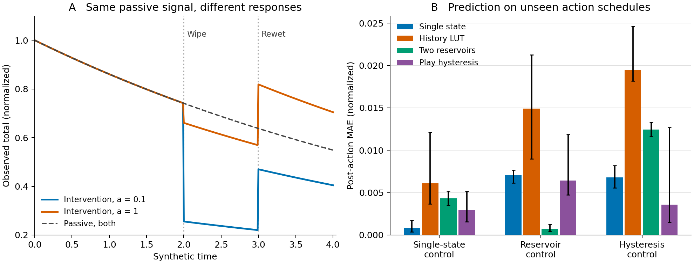

# MDSSP B1 — 개입을 통한 재질 상태 식별

2026-11-23 · 원문 및 공개 데이터 조사, 수학 분석, 합성 실행, 실제 촬영 계획

**판정은 최소 촬영 Go, 실제 상태 식별 Hold, 신규 알고리즘 개발 No-Go다.** 합성 조건에서는 기존 단일 상태, 두 저장량, 이력 구성식이 각각 해당 조건을 가장 잘 예측했다. 실제 재질에서도 기존 모델로 충분한지는 미관측 행동을 촬영한 뒤 판정한다. H의 Temporal 신규 알고리즘 No-Go를 유지한다. 이번 작업에서 시편 촬영과 실물 모델 적합은 수행하지 않았다. [H 연구 보고서](../H_Research_Direction/Report_KO.md) · [촬영·판정 프로토콜](Capture_Protocol_KO.md)

## 1. Identifiability Analysis

재질 상태 \(x\), 동역학 파라미터 \(\theta\), 기록된 입력 \(u\), 광학 조건 \(c\)에서 \(x_{i+1}=F_\theta(x_i,u_i)\), \(y_i=h_c(x_i)+\epsilon_i\)라 두고, 관측 벡터를 \(\mathcal Y_U(x_0,\theta,c)\)로 쓴다. 두 후보가 같은 관측 분포를 만들면 해당 입력 집합에서 구별할 수 없다. 구조적 식별성은 무잡음 모형, 실용적 식별성은 실제 입력·측정 정밀도에서 판단한다. 국소적인 민감도 행렬의 열계수는 국소 구분의 지표이며 전역 유일성과 다른 개념이다. 광학 조건을 모르면 캘리브레이션 제약을 포함한 nuisance 열공간 밖의 민감도가 필요하다. 행을 반복하면 측정 정밀도가 좋아질 수 있고, 독립 방향이 추가될 때 열계수가 증가한다. 실용 비교에는 반복으로 추정한 공분산으로 행을 표준화하고 단위가 다른 상태·파라미터는 사전에 범위로 스케일링한다. [알려진 입력과 미지 입력의 관측 가능성](https://www.mdpi.com/2227-7390/8/11/1876) · [Data Informativity](https://arxiv.org/abs/1908.00468)

- **단일 상태.** 알려진 단조 \(h\)라면 무잡음 단일 프레임에서 스칼라 \(x\)를 역산할 수 있다. 포화·클리핑, 비단조 \(h\), 미지 이득 및 건조 속도–시간 척도 혼동이 있으면 스칼라도 식별이 제한된다. 예를 들어 \(y=g x_0e^{-kt}\)에서 \(g x_0\)만 관측되며, 건조 중 작동하지 않는 wipe 파라미터는 건조 영상만으로 추정할 수 없다.
- **두 상태.** 표면막 \(f\), 내부수 \(p\)에 대해 \(\dot f=-(k+a)f,\ \dot p=af-kp,\ y=f+p\)이면 \(y(t)=e^{-kt}(f_0+p_0)\)다. 고정된 \(a\)에서도 같은 합의 서로 다른 \(f_0,p_0\)는 완전히 겹친다. \(h_c\)가 합에만 의존하면 영상 전체도 각 위치에서 같은 합을 가진 경우 같을 수 있다. 반대로 알려진 \(k_f\ne k_p\)이면 \(y(0)=f_0+p_0,\ \dot y(0)=-k_f f_0-k_p p_0\) 두 행의 행렬식이 \(k_f-k_p\)다. 차이가 작으면 수치적으로 구분하기 어렵다. 이 결론은 주어진 광학 모델과 알려진 속도에 조건부다.
- **닦기와 재젖음.** \(f^+=(1-\eta)f,\ p^+=p\)이면 \(y^- - y^+=\eta f\)다. \(\eta\ne0\)이고 알려져 있으면 한 번의 닦기로 두 저장량을 푼다. 미지 \(\eta\)에서 한 번의 닦기는 곱을 보여 준다. 독립 reset 두 번에서 같은 \(\eta\), \(p_0=0\), 알려진 \(k,f_0\)라면 \(L(t)=\eta f_0e^{-(k+a)t}\)의 비로 \(a\)를 추정한다. 입력 강도·패드 상태에 따라 \(\eta\)가 변하면 같은 풀이를 적용할 수 없다. \(f^+=f+d\)인 가산 재젖음은 이 합 모델에서 \(y^+=y+d\)이므로 새로운 방향이 없다. 포화에 따른 흡수, 표면 피복, 확산 등으로 \(F_{\rm rewet}\) 또는 \(h_c\)가 상태별로 달라지면 추가 정보를 제공할 수 있다.
- **광학과 실제 변화.** 선형 RAW에서도 \(y=g[h_c(x)]+b\)이며 자동 노출, specular angle, 초점·정렬과 ROI 이동이 상태 변화처럼 보일 수 있다. 회색 패치로 공통 이득 및 변동을 추적하고 건조 고정 패치, sham 닦기, 무입력 시편, 두 번째 조명 테스트로 원인을 좁힌다. 두 광학 채널이 \(q\)와 \(\alpha f+\beta p\)라면 \(\alpha\ne\beta\)일 때만 상태를 구별한다. 교차 편광과 grazing 조명은 후보 측정이며 실제로 독립 민감도를 갖는지 확인한다. 질량과 영상이 서로 독립된 장비라도 둘 다 \(q\)만 읽으면 계수가 증가하지 않는다. 영상이 표면에 민감하거나 토널 포화가 있으면 질량이 유용할 수 있다. [젖은 재질의 표면 반사와 내부 산란](https://graphics.cs.yale.edu/publications/rendering-wet-materials) · [편광 기반 반사 분리](https://diglib.eg.org/items/da04b92c-39fe-41d1-a658-a8535521521c)

현재 관측이 같은 두 후보에 대해 미래 목표 차이가 \(\Delta\)이면, 같은 정보로 만드는 공통 점예측의 최악 절대 오차는 적어도 \(\Delta/2\)다. 입력 이력까지 받은 LUT가 두 후보를 이미 구별할 수 있으면 이 하한은 그 LUT에 적용되지 않는다. 반대로 두 후보의 상태 이름이 유일하지 않아도, 필요한 행동에서 미래 관측이 같다면 작업에 필요한 예측은 가능하다. **영상 예측 개선, 잠재 상태의 기능적 구별, 표면막과 내부수를 물리량으로 개별 식별하는 주장은 각각 다른 증거를 요구한다.**

건조 적합 후보가 홀드아웃에서 갈리는 경우 먼저 훈련 조건의 다중 초기화, 파라미터 프로파일과 예측 범위를 확인한다. 설계된 입력으로 범위가 줄어들면 관측·파라미터 제약 문제다. 충분한 입력과 적절한 광학 모델을 줬는데도 같은 행동·이력에서 편향이 반복되면 표현력 부족이나 누락된 물리 입력을 의심한다. 단일 모델의 공통 \(w\)에서 행동 전이식을 유연하게 해도 같은 유효 상태와 같은 입력에 서로 다른 출력이 필요하면, 그 스칼라 표현에는 이력이 부족하다. 그 경우 기존 다중 상태나 이력 구성식으로 넘어갈 근거가 생긴다.

## 2. Strong Baseline Audit

| 비교군 | 이번 합성 구현 | 실물 보정과 비교할 범위 |
|---|---|---|
| Single-State Drying / Wetness | 지수 건조, 현재량에 따른 닦기 제거율, 재젖음 이득, 1상태·4계수 | 포화 가능한 dry/wet 관측 LUT, 상태 의존 건조·닦기·재젖음. 상수 제거율만 허용하면 약한 대조군이 된다. |
| Action-Conditioned History LUT | 건조 감쇠와 닦기·재젖음 전이 표. 최근 wet 이후 시간, 누적 추가량, 닦기 횟수, 직전 예측량과 입력 강도로 보간한 뒤 합성 | 이전 행동 종류, 마스크, 깊이·이력 proxy까지 포함하는 사전 고정된 특징의 표·보간. 이산 예시 재생과 실제 미관측 입력 전이의 오차를 각각 기록한다. |
| Two-Reservoir Surface/Absorbed Water | 막→내부 흡수, 서로 다른 증발률, 선택적 wipe, 재젖음 입력 이득, 2상태·5계수 | 서로 다른 증발률과 흡수 포화 포함. 공통 광학 모델에서 막·내부수 민감도를 다르게 허용하고 질량 제약을 적용한다. |
| 기존 이력 의존 Constitutive | 스칼라 play 연산자의 이력 \(r^+=\mathrm{clip}(r,q^+-\rho,q^++\rho)\)와 \(q-r\)에 따른 닦기 접근률, 2상태·6계수. 수분–wipe 결합은 이번 합성 설정이다. | 장기 이력·반전점을 허용하는 다중 play 또는 습윤/배수 scanning curve 기준을 공유 광학 모델에 연결한다. Kool–Parker/Parker–Lenhard는 흡인압–포화 constitutive 근거다. 흡인압 데이터가 없으면 물리 계수 복원을 주장할 수 없으므로, 관측 가능한 이력에 맞춘 gray-box 예측과 분리한다. [Play의 이산 정의](https://mbpapers.math.cas.cz/full/141/2/mb141_2_9.pdf) · [Kool–Parker](https://doi.org/10.1029/WR023i001p00105) · [Parker–Lenhard](https://doi.org/10.1029/WR023i012p02187) |
| Neural ODE / NCA | 문헌·입력 적합성 감사. 학습 및 실행 보류 | 동일 채널과 dose·wipe 마스크·시각이 입력인 조건부 모델. Neural ODE는 ROI 상태 기준, NCA는 공간 패턴 목표가 있을 때 격자 기준. 물리적 평가에 쓸 독립 행동 궤적이 충분해진 경우에만 동등한 split으로 학습한다. [NDE](https://arxiv.org/html/2410.07128v2) · [신호 반응형 NCA](https://doi.org/10.1038/s41598-025-23997-7) |

실물 비교에서 같은 재질·split·마스크·dose·시간·센서 자격·보정 작업 시간을 주고, 보조 관측은 모든 모델에 같은 시점에 허용한다. 질량의 공유 관측량 또는 LUT 특징으로의 매핑은 훈련에서만 보정한다. 먼저 공통 ROI 영상 예측을 비교하고 채널별 검증 가능한 결과만 확장한다. 학습의 총 획득 분, 시퀀스·독립 시편 수, CPU/GPU 적합 시간, 수작업 조정 분, 상태와 모델 바이트, 해상도·장비별 추론 p50/p95를 기록한다. 같은 비교군 안에서는 정규화·복잡도 선택을 보정 시편 단위로 진행한다. 전체 예측군이 실패하는 경우 재질별 파라미터 범위, 플레이 반전 이력, 실제 wipe 제거량, 광학 및 공간 분포 영향을 먼저 확인한다.

## 3. Synthetic Counterexample Validation

### 개입 정보량

H 원본을 재실행해 수동 차이 \(1.11\times10^{-16}\), 닦기→재젖음 뒤 \(t=4\) 차이 **0.300044**, 공통 예측 최소 최악 오차 **0.150022**를 확인했다. 이 반례는 서로 다른 흡수율 \(a=0.1,1.0\)을 비교한다. 같은 재질 파라미터를 사용하는 별도 실험에서는 총량 1을 \(t=1\)에 모두 주입한 경우와 \(t=0,2\)에 0.53743, 0.46257을 나눠 넣은 경우를 비교했다. \(t=2\) 이후 수동 차이는 \(1.11\times10^{-16}\)이며 \(t=4\)의 동일 닦기 뒤 차이는 **0.019664**였다. 두 수치는 모두 무차원 합성 결과다. 앞선 주입 로그가 있으면 기록된 이력으로 구별할 수 있다. [H 재현 코드](../H_Research_Direction/Evidence/check_counterexamples.py) · [B1 원자료](Results.json)

H의 두 후보를 동일 사전확률로 두고 \(t=2\)에 스칼라 관측 하나를 추가했다. 각 후보에서 독립 가우시안 잡음 표본 20,000개를 쓰고, 알려진 두 후보 분포로 분류하고 닦기→재젖음의 \(t=4\) 출력을 예측했다. 아래는 \(\sigma=0.15\) 조건이다. 실제 추가 관측 비용과 잡음은 채널마다 달라 별도 계측이 필요하다.

| 추가 관측 한 개 | 두 후보 관측 차이 | 오분류율 | \(t=4\) 예측 MAE |
|---|---:|---:|---:|
| 수동 영상 한 점, 총질량 한 점, 가산 재젖음 직후 각각 | 0 | 50.0% | 0.1500 |
| 내부수에 따라 ROI에 남는 투입량이 달라지는 재젖음 직후 | 0.19056 | 26.7% | 0.1059 |
| 표면막에만 민감한 가상 채널 | 0.50627 | 4.6% | 0.0207 |
| 제거율이 알려진 닦기 직후 | 0.40502 | 8.9% | 0.0387 |

재젖음의 조건부 대조에서는 \(\min(d,\max(0,0.70-p))\)만 관측 ROI에 남고 초과량은 빠져나가는 가상 규칙을 썼다. 이는 분리된 보정 시험의 추가 관측이다. 예측 목표는 원래의 H 닦기→가산 재젖음 경로로 고정했다. \(\sigma=0.05\)일 때 이 재젖음 관측의 오분류율은 2.8%였다. 실물에서는 유출량·공간 분포와 광학 민감도를 확인한 후 재젖음 신호의 원인을 해석한다.

초기 두 상태에 대해 \(k_f-k_p=0.001\)일 때, 수동 5점의 최소 특잇값은 0.000746, 알려진 닦기 직후 한 점을 추가하면 0.13077이었다. 미지 \((a,\eta)\)에 대해서는 한 시각의 동일 닦기 반복은 계수 1, 독립 시편에서 서로 다른 두 시각의 닦기 또는 same-time 표면막+닦기는 계수 2였다. 수치는 정규화되지 않은 모형 단위의 민감도다. 실물에서 저울이나 grazing 조명이 위 가상 채널과 같은 민감도를 갖는지는 Hold다.

### 적합과 홀드아웃 비교

단일 상태, 두 저장량, play로 각각 합성 참조를 만들었다. 모든 모델은 각 참조마다 똑같은 스칼라 관측과 행동 로그를 사용했다. 보정은 10개 스케줄 × 독립 잡음 실현 3회 × 스케줄당 25점이다. 무개입, 초기·후기 닦기와 재젖음, 재젖음→닦기가 보정에 들어간다. 평가는 그와 다른 시각의 건조→재젖음, 닦기→재젖음, 닦기→재젖음→닦기 세 스케줄이며 중간 정답 공급 없이 예측했다. \(t=0\)의 초기 dose와 초기화 조건은 공통으로 알려져 있다. 학습 잡음은 \(\sigma=0,0.01,0.03\), 평가 대상은 잡음 없는 합성 참조다.

| 합성 참조 | Single-State | History LUT | Two-Reservoir | Play |
|---|---:|---:|---:|---:|
| 단일 상태 | **0.00080** | 0.00609 | 0.00432 | 0.00298 |
| 두 저장량 | 0.00703 | 0.01491 | **0.00073** | 0.00645 |
| Play 이력 | 0.00679 | 0.01945 | 0.01243 | **0.00358** |

값은 \(\sigma=0.01\)의 8개 시드 중앙값이다. 각 스케줄에서 최초 행동부터 마지막 프레임까지의 MAE를 평균했다. 닦기→재젖음만 보면 두 저장량 참조에서 단일 상태 0.01052, 두 저장량 0.00076이었다. Play 참조의 마지막 닦기 이후에는 LUT 0.09876, 두 저장량 0.04949, play 0.00945였다. 반복 닦기 뒤에는 LUT의 이력 조합이 보정 범위를 벗어난다. 이 한 구현에서의 외삽 결과로 LUT 계열 전반을 배제할 수 없다. \(\sigma=0.03\)에서는 play 참조의 평균 MAE가 play 0.00668, 단일 상태 0.00733까지 가까워졌다. 적은 잡음에서의 순위 차이를 실험 해상도보다 큰 차이로 해석할 수 없다.

**보정 오차와 예측 오차는 다르다.** 잡음 없는 play 참조에 동일 계열을 적합했을 때 보정 최대 오차는 \(2.22\times10^{-16}\)이었지만 홀드아웃 MAE는 0.00052였다. 참조 반경 0.320과 적합 반경 0.348이 모두 보정 궤적을 설명했고, 마지막 닦기에서 차이가 생겼다. 정답 생성 계열도 관측이 드문 반전 경로에 모호함이 남을 수 있다. 네 비교군의 순위는 세 구현을 생성기로도 사용한 통제 실험의 특성을 반영한다. 재질, 공간 패턴, 광학 보정, 미관측 입력 물리의 실제 검증은 촬영 이후 대상이다.

그림 오른쪽 막대는 시드 중앙값, 오차막대는 8개 시드의 최소–최대다.

### 실행 비용과 재현

두 저장량 참조, \(\sigma=0.01\), 8개 시드 중앙값이다. 추론 시간은 25점 궤적 3개 배치의 시간을 궤적당 환산했다. 모델·상태 바이트는 수치 배열만 세었으며 런타임 객체, 고정 상수, 입력 버퍼는 포함하지 않았다.

| 모델 | 보정 수치 개수 / 실행 상태 개수 | 수치 저장 B | 보정 ms | 추론 p50 / p95 µs |
|---|---:|---:|---:|---:|
| Single-State | 4 / 1 | 40 | 48 | 80 / 90 |
| History LUT | 61 / 4 | 520 | 0.15 | 73 / 84 |
| Two-Reservoir | 5 / 2 | 56 | 38 | 62 / 66 |
| Play | 6 / 2 | 64 | 93 | 134 / 171 |

Windows, Python 3.12.15, NumPy 2.2.6, SciPy 1.15.3, 단일 OpenBLAS 스레드의 합성 CPU 측정이다. 물리 촬영·보정 비용, 공간 재질 제작·GPU 프레임 시간과 직접 비교할 수 없다. [코드](run_synthetic.py) · [시드별 결과·환경·피팅 값](Results.json) · [그림 생성 코드](plot_synthetic.py)

~~~powershell
Set-Location Research/B1_Material_State_Identifiability
python -m pip install -r requirements.txt
$env:OPENBLAS_NUM_THREADS = '1'
python run_synthetic.py
python plot_synthetic.py
~~~

## 4. 후속 연구와 공개 데이터

H의 Lu·Gu, NDE, MeshNCA 계통을 재검토하고 wetting/drying, wiping/rewetting, gravimetry/SWIR, hysteretic scanning curve로 범위를 넓혔다. 아래 판정은 원문, 저자 프로젝트와 데이터 저장소의 공개 메타데이터·파일 목록 범위다. 원자료 전체를 다운로드해 학습하지 않았다.

| 자료 | 실제로 재사용할 수 있는 것 | B1 적용 한계 |
|---|---|---|
| Lu 등 건조 외관 → Gu 등 STAF → Sun 등 시간별 BRDF | Lu의 픽셀별 건조 전이 기준, STAF 공개 파일의 brick 32프레임·rock 11프레임, CAVE TVBRDF의 직물·시멘트·석고 BRDF 측정과 적합값 | 수동·재조명 기준. 공개 목록에서 정량 wipe와 rewet 순서, 동일 프로토콜 반복·질량을 함께 확인하지 못했다. STAF 배포 페이지는 연구·학술 용도로 제한한다. [Lu](https://diglib.eg.org/items/42f2dcf0-4748-4c65-b8fb-f27f6f784010) · [Gu 원문](https://cave.cs.columbia.edu/old/publications/pdfs/Gu_TOG06.pdf) · [STAF 파일과 조건](https://www.cs.columbia.edu/CAVE/databases/staf/download.php) · [TVBRDF](https://www1.cs.columbia.edu/CAVE/databases/tvbrdf/about.php) |
| Liu–Ritschel NDE와 후속·인접 연구 | NDE의 RGB 동적 텍스처 22개, flash-lit 재질 영상 21개와 재조명 모델. 같은 저자의 Video Bi-flow는 영상 생성, DynaMesh는 참조 영상별 적응을 통한 시간별 3D PBR, From Cells to Pixels는 NCA 렌더링을 제공한다. | 확인한 결과는 B1과 동일한 개입·측정 조건에서의 홀드아웃 비교를 제공하지 않는다. 재조명 및 외관 표현력 대조에 해당한다. [NDE 원문](https://arxiv.org/html/2410.07128v2) · [저자 코드](https://github.com/ryushinn/ode-appearance) · [Video Bi-flow](https://arxiv.org/abs/2503.06364) · [DynaMesh](https://arxiv.org/html/2610.05529) · [From Cells to Pixels](https://cells2pixels.github.io/) |
| Chaghdo 등 다공성 건축재 SWIR | 석재 5종과 벽돌 1종의 수분 단계별 초분광 반사율과 수분 맵. 논문에서 시편 평균을 중량법과 비교했다. | 두 번째 센서의 후보 근거. SWIR 수분 추정과 일반 RGB 카메라의 독립성을 동일하게 가정할 수 없고, 행동 순서 벤치마크와 별개다. [논문](https://doi.org/10.1038/s41597-025-06416-4) · [Zenodo 파일](https://zenodo.org/records/17398900) |
| Trosseille 등 나노다공층 물방울 | 상대습도별 halo 확장, 흡수·증발 시간 척도, 증발률과 불확실성. | 공개 TSV는 요약 측정량이다. 재질·척도가 다르고 원시 wipe 영상으로 사용할 수 없다. [논문과 데이터](https://zenodo.org/records/18019169) |
| DaRUS 6481 다공성 매질 증발 | 저장소에 타임랩스 RGB·질량 손실과 통제 변수가 기재돼 있어 동기화와 노이즈 처리의 참고가 된다. | 염분·결정화라는 별도 변화가 있으며 B1의 맹검 행동 순서를 포함하지 않는다. [데이터 기록](https://darus.uni-stuttgart.de/dataset.xhtml?persistentId=doi:10.18419/DARUS-6481) |
| Lenhard 등 이력 구성식 검증 및 후속 장기 계측 | 습윤·배수 경로에서 이력 구성식과 수분 상태를 비교한 기존 반론. | 토양과 다공성 시편의 작동 조건, 관측량과 척도가 다르다. [2상 유동 실험 비교](https://doi.org/10.1029/91WR01272) · [장기 lysimeter 비교](https://doi.org/10.1002/2015WR018319) |

현재 확인 범위에서 B1의 **동일 시편 계열·정량 주입과 닦기·두 재젖음 경로·동기 조명 및 반복 오차**를 동시에 제공하는 공개 데이터는 확인하지 못했다. 따라서 공개 자료는 수동 외관, 수분 계측, 이력 구성식의 자료로 재사용한다. 개입 일반화와 새로운 관측의 가치는 아래 직접 캡처로 검증한다.

## 5. 촬영 전과 후의 판정 범위

| 촬영 이전에 확인한 것 | 촬영 후에 판정할 것 |
|---|---|
| 수동 동치와 개입 선택의 조건, 기존 모델의 합성 재현, 학습/평가 순서 분리, 공개 파일의 범위 | 같은 재질 내 두 실제 이력의 수동 동치, 닦기·재젖음 차이가 반복 오차보다 큰지 여부 |
| 모형 하에서 질량 중복, 알려진 닦기 및 독립 광학 채널의 정보 가치, 제거율이 미지일 때의 계수 손실 | 실제 채널과 제거율의 안정성, 별도 시편 예측에서 관측 추가의 검증 이득, 물리 상태 분해의 타당성 |
| 재현 가능한 촬영·매니페스트·판정 절차와 계획용 비용 | 강한 기존 모델들의 허용 오차 통과 여부, 실제 촬영·학습·아티스트 작업 시간, 재질 일반화 및 공간 제작 비용 |

[최소 촬영 절차, 데이터 요건, Go/Hold/No-Go와 비용](Capture_Protocol_KO.md)

**최종 답변.** 지금 새 알고리즘을 개발할 근거는 없다. 기존 모델에 적절한 상태 변수와 구별력 있는 관측을 주면 합성 반례는 설명된다. 실물에서 사전에 고정한 미관측 행동까지 기존 모델 하나가 예측하면 신규 개발을 종료한다. 측정 가능한 반응이 반복되고, 추가 관측이 홀드아웃 예측을 개선하며, 충분히 보정한 기존 비교군이 여전히 오차 기준을 넘을 때 새 후보를 검토한다.
